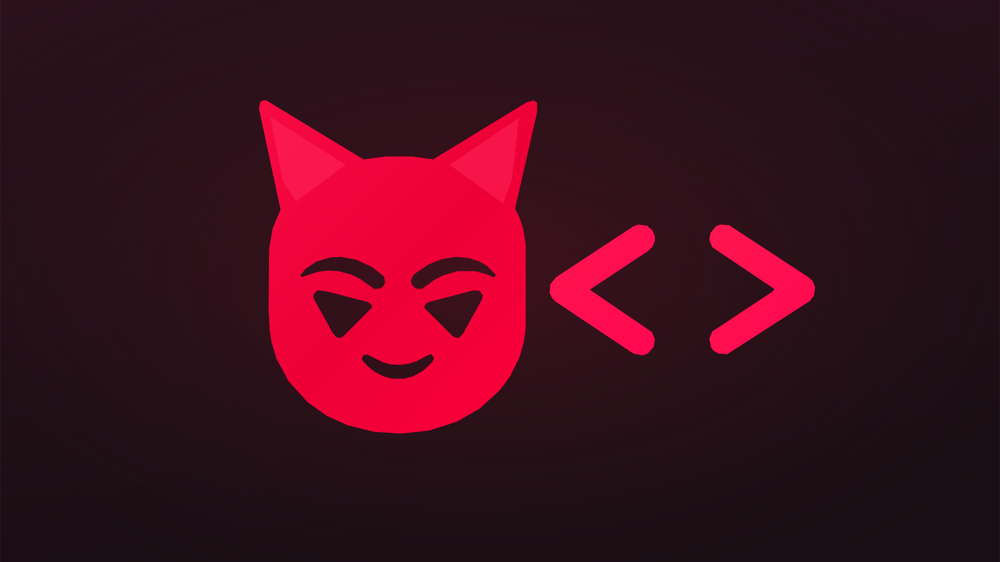

# BadDev V1.2 — Etapa H · Código completo

Este archivo reúne los fuentes principales de la Etapa H para consultar y copiar en Sublime Text. El ZIP incluye además pruebas, imágenes, ejemplos y guías.

## `.github/workflows/deploy.yml`

`````yaml
name: Publicar BadDev en GitHub Pages
on:
  push:
    branches: [main]
  workflow_dispatch:
permissions:
  contents: read
  pages: write
  id-token: write
concurrency:
  group: pages
  cancel-in-progress: true
jobs:
  deploy:
    runs-on: ubuntu-latest
    environment:
      name: github-pages
      url: ${{ steps.deployment.outputs.page_url }}
    steps:
      - name: Obtener repositorio
        uses: actions/checkout@v4
      - name: Instalar Node.js
        uses: actions/setup-node@v4
        with:
          node-version: '22'
      - name: Instalar dependencias
        run: npm install
      - name: Compilar
        run: npm run build
      - name: Preparar GitHub Pages
        uses: actions/configure-pages@v5
      - name: Subir sitio
        uses: actions/upload-pages-artifact@v3
        with:
          path: dist
      - name: Publicar
        id: deployment
        uses: actions/deploy-pages@v4

`````

## `AUDITORIA-ETAPA-A.md`

`````markdown
# Auditoría técnica — BadDev 1.0.2 → Etapa A de 1.2

## Fuente de verdad

Se revisó el archivo **BadDev.zip** cargado por el usuario, bajo la ruta interna `BadDev/BadDevvv/`. El archivo original incluye `node_modules`, dependencias de Windows, `package-lock.json` y archivos fuente de la versión **1.0.2**. Esta entrega parte de esa copia real y no de versiones antiguas generadas en otras conversaciones.

## Arquitectura inspeccionada

| Componente | Archivos existentes | Estado actual |
| --- | --- | --- |
| Punto de entrada y menús | `index.html`, `src/main.js`, `src/styles.css` | Se conservan |
| Editor CodeMirror 6 | `src/editor.js`, `src/completions.js` | Se amplía con `src/language-support.js` |
| Archivos sueltos | `src/files.js` | Se amplía a 12 tecnologías |
| Carpetas y guardado | `src/project.js`, `src/zip.js` | Se amplía selección de extensiones; flujo existente conservado |
| Vista previa aislada | `src/preview.js`, iframe HTML aislado | Sin cambios; sigue siendo para web HTML/CSS/JS |
| Preferencias y sesiones | `src/settings.js`, `src/session.js`, `src/lifecycle.js` | Sin cambios de estructura |
| Escuela de programación | `learn.html`, `lessons.html`, `manual.html`, `sandbox.html`, `src/learn-*`, `src/manual-*` | Se conservan; ampliar en etapas D y E |
| Herramientas de formato | `src/formatter.js` (Prettier) | Sin cambios; ampliar en Etapa B |
| Publicación | `vite.config.js`, `netlify.toml`, `.github/workflows/deploy.yml` | Sin cambios |

## Decisiones para proteger el proyecto

- Se creó un **catálogo único** (`src/languages.js`) para extensiones, nombres, etiquetas, distintivos y plantillas; evita listas contradictorias entre menú, carpetas y archivos.
- El soporte de sintaxis se encapsuló en `src/language-support.js`. TypeScript usa el paquete existente `@codemirror/lang-javascript`. Para los otros ocho lenguajes se añadieron paquetes oficiales CodeMirror 6; se importan **bajo demanda** para no cargar todos los analizadores al abrir BadDev.
- No se reemplazó el motor de edición: continúa usando `Compartment`, historial, pestañas y búsqueda existentes.
- Python utiliza 4 espacios de indentación recomendada. Los demás lenguajes respetan la preferencia de 2 o 4 espacios.
- El selector y el guardado de Windows aceptan las nuevas extensiones; el límite original de **250 archivos** y **5 MB por archivo** permanece.
- Se conserva la compatibilidad con archivos `.txt` como texto simple.
- No se añadieron motores simulados de ejecución ni se modificó el sandbox de la vista previa.
- Las dependencias Windows incluidas en el ZIP original no se distribuyen: se debe realizar `npm install` en la computadora destino para generar `node_modules` y un bloqueo actualizado.

## Riesgos conocidos y tareas futuras

1. **Instalación npm:** estos ocho paquetes no están disponibles en el entorno de pruebas sin acceso al registro. El usuario debe ejecutar `npm install` en Windows y revisar `npm run build`.
2. **Etapa B:** validadores/formateadores, comentarios y herramientas por lenguaje. Prettier actual solo admite HTML, CSS y JS.
3. **Etapa C:** vistas previas Markdown/JSON y posible transpilación TypeScript. Python/PHP/SQL/SCSS no se ejecutan.
4. **Etapas D/E:** nuevo selector flotante de manuales por lenguaje y contenido modular educativo.
5. **Etapa F:** accesibilidad, pruebas reales en Chrome, rendimiento y despliegue final.

## Pruebas verificadas aquí

- **64 pruebas automatizadas Node** superadas; 0 errores.
- Todos los módulos `.js` superaron `node --check`.
- Se añadieron pruebas de reconocimiento de lenguajes, tipos de archivo, importación de carpetas, escritura en carpeta, conexión del editor y selector HTML.
- **Compilación completa de Vite: NO verificada** (`vite: not found`, no fue posible instalar dependencias desde npm por falta de red en este entorno).
- **Prueba visual en Chrome de los 12 resaltados: NO verificada**; debe hacerse con las dependencias instaladas.

`````

## `NOVEDADES-ETAPA-E.md`

`````markdown
# BadDev V1.2 — Resumen de la Etapa E

La Etapa E entrega la **ampliación completa de contenido educativo** de Learn Without Mercy. Se mantiene la Etapa D, con dos tarjetas centrales (Lecciones / Leer Manual) y selección de doce lenguajes.

| Área | Etapa D | Etapa E |
|---|---|---|
| Lecciones HTML/CSS/JS | 13 lecciones originales compartidas | Se conservan y se suman 12 lecciones nuevas entre los tres lenguajes |
| Lecciones de los nueve lenguajes nuevos | Introducción breve | Cuatro lecciones por lenguaje, con ejercicios, pistas, soluciones y resumen |
| Manuales | Introducciones + manual base | 82 secciones de teoría en 12 rutas |
| Progreso | Local en los cursos originales | Local en los doce cursos |
| Sandbox | HTML/CSS/JS | Preservado y enlazado desde los nuevos ejercicios web |

**No se implementan todavía:** ejecutar Python/PHP/SQL, cambiar el diseño general ni avanzar a las Etapas F o G.

`````

## `PRUEBAS-ETAPA-B.md`

`````markdown
# Comprobación manual — BadDev V 1.2, Etapa B

Estas pruebas deben hacerse en Google Chrome después de `npm install` y `npm run dev`.

## JSON

1. Abre `ejemplos-multilenguaje/datos.json`.
2. Selecciona **Editar → Comprobar JSON / XML / YAML**. Debe indicar que es válido.
3. Abre `errores-etapa-b/invalido.json` y vuelve a comprobar. Debe señalar el error.
4. Pulsa el diagnóstico para ir a la línea del editor.
5. Corrige la coma final, comprueba otra vez y usa **Editar → Ordenar código**.
6. Guarda el archivo en Windows, no solo en el respaldo del navegador.

## XML

1. Abre `datos.xml`: debe ser válido.
2. Abre `errores-etapa-b/invalido.xml`: debe señalar etiquetas mal cerradas.
3. Corrige la etiqueta, vuelve a comprobar. El botón no ejecuta XML.

## YAML

1. Abre `config.yaml` o `config-alternativo.yml`: ambos deben comprobarse.
2. Abre `errores-etapa-b/invalido.yaml`: debe señalar claves duplicadas.
3. Elimina la clave duplicada y comprueba de nuevo.
4. Puedes ordenar YAML con Prettier si el documento es válido.

## Comentarios y edición

1. Abre `main.py`, selecciona una línea y pulsa **Editar → Comentar / descomentar**, o Ctrl+/.
2. Repite el mismo comando y comprueba que recupera el contenido original.
3. Prueba `consulta.sql`, `script.js`, `style.scss`, `datos.xml` e `index.html`.
4. En `datos.json`, el comando debe explicar que JSON estándar no admite comentarios.
5. Dentro de un bloque de código, prueba **Editar → Contraer bloque** y **Expandir bloque**.
6. En un archivo Python, escribe `def` y usa **Ctrl+Espacio** para las plantillas. Prueba también SQL y YAML.

## Formateo

Prueba HTML, CSS, JavaScript, TypeScript, JSON, Markdown, SCSS y YAML. El código solo debe actualizarse cuando Prettier termine correctamente; `Ctrl+Z` debe permitir deshacer el cambio.

## Regresiones

Crea un proyecto con HTML, CSS y JavaScript. Comprueba la vista previa, la consola de JavaScript, guardado, pestañas, búsqueda, temas, pantalla de carga, Learn, Manual, Sandbox y regreso al menú.

**No uses el botón de vista previa para PHP, Python, SQL o SCSS:** no se ejecutan en el navegador.

`````

## `PRUEBAS-ETAPA-C.md`

`````markdown
# Pruebas sugeridas — Etapa C

## Vista previa

### 1. Markdown
- Crea `README.md` con títulos, listas y código.
- Abre la vista previa y verifica el render.

### 2. JSON
- Crea `datos.json` con un objeto.
- Abre la vista previa y comprueba el coloreado y la estructura.

### 3. TypeScript
- Crea `demo.ts` con un `console.log()` y cambios sobre `#app`.
- Abre la vista previa y verifica que se ejecute.

### 4. HTML con TS
- Crea `index.html` y referencia `app.ts` con `<script src="app.ts"></script>`.
- Abre la vista previa y comprueba que BadDev lo transpila en memoria.

## Modal de salida

1. Edita un archivo.
2. Intenta cerrar el proyecto o salir.
3. Verifica que el modal ya no se corte ni tenga desplazamiento horizontal.

`````

## `PRUEBAS-ETAPA-D.md`

`````markdown
# Checklist de pruebas — BadDev Etapa D

## A. Portada Learn

1. En BadDev, pulsa **¿Nuevo en esto?**.
2. Verifica que se vean las tarjetas **Lecciones** y **Leer Manual** como antes.
3. Confirma que la animación del splash carga y puede saltarse.

## B. Selector del Manual (12 lenguajes)

1. Pulsa **Leer Manual**.
2. Se mostrarán doce tarjetas: **Leer HTML, Leer CSS, Leer JavaScript, Leer TypeScript, Leer Python, Leer PHP, Leer JSON, Leer Markdown, Leer SQL, Leer SCSS, Leer XML y Leer YAML**.
3. Pulsa **Leer Python**: debería mostrar una introducción y un ejemplo con `def saludar` y `print(...)`.
4. Pulsa **Copiar código** e intenta pegarlo en un `.py` dentro de BadDev.
5. Pulsa **← Elegir lenguaje** y prueba **Leer HTML**. Comprueba que contiene teoría y ejemplos, sin ejercicios.

## C. Lecciones existentes

1. Desde el menú Learn, pulsa **Lecciones** y elige **JavaScript**.
2. Abre la lección de DOM y pulsa **Abrir Sandbox**.
3. Desde Sandbox, pulsa **Regresar a lección**. Debes volver a la misma lección, no al inicio de toda la academia.
4. Resuelve un ejercicio y comprueba el progreso.
5. Vuelve a **Elegir lenguaje** y abre **HTML** o **CSS**. Comprueba que sus lecciones funcionan.

## D. Lecciones nuevas

1. Pulsa **Aprender Python** o **Aprender TypeScript**.
2. Comprueba que aparece una introducción con ejemplo y el aviso de que las lecciones completas llegarán en la Etapa E.
3. No debe aparecer un botón de ejecución falsa para Python.

## E. Interfaz y compatibilidad

1. Prueba el selector en pantalla estrecha o en vista móvil de Chrome.
2. Cambia entre los cinco temas de BadDev; el selector debe mantener legibilidad.
3. Verifica que el editor, guardado, pestañas y vista previa (HTML/Markdown/JSON/TS) funcionan como en la Etapa C.
4. Prueba **Cerrar proyecto** con cambios pendientes: el modal de guardado debe continuar funcionando.

## F. Comandos de prueba

```bat
npm test
npm run build
```

## Limitaciones esperadas

- No se ejecuta Python ni PHP dentro de BadDev.
- Los nuevos idiomas tienen introducciones de navegación, no cursos extensos todavía.
- El manual es solo teoría y ejemplos.

`````

## `PRUEBAS-ETAPA-E.md`

`````markdown
# Comprobaciones de BadDev V1.2 — Etapa E

## Lecciones

- [ ] Abrir los 12 lenguajes desde Lecciones.
- [ ] Ver cuatro lecciones nuevas por lenguaje y conservar las lecciones antiguas de HTML/CSS/JS.
- [ ] Elegir una opción incorrecta y verificar que BadDev no da la respuesta por válida.
- [ ] Resolver el ejercicio Python con `if edad >= 18:` y `print("Mayor")` indentado.
- [ ] Revelar solución, ocultarla y volver a mostrarla.
- [ ] Revisar el resumen del tema.
- [ ] Volver al selector sin perder el progreso de otros cursos.
- [ ] Abrir Sandbox desde una lección nueva HTML/CSS/JS y regresar a la lección correcta.
- [ ] Comprobar que Python y PHP muestran Copiar ejemplo, **no** ejecución simulada.

## Manuales

- [ ] Abrir Leer Manual y elegir cualquiera de los doce lenguajes.
- [ ] Navegar entre introducción, sintaxis, estructuras, aplicación, buenas prácticas y errores/glosario.
- [ ] Ver código y definiciones de glosario para cada lenguaje.
- [ ] Confirmar que los manuales no contienen áreas para entregar ejercicios.

## Regresiones

- [ ] Crear y guardar un archivo HTML.
- [ ] Abrir la mini vista previa y cambiar entre HTML, Markdown, JSON y TypeScript.
- [ ] Abrir el modal al cerrar un archivo modificado; comprobar que no se corta.
- [ ] Elegir cualquiera de los cinco temas sin perder navegación.
- [ ] Revisar el progreso en una recarga del mismo origen `127.0.0.1:5173`.

`````

## `PRUEBAS-ETAPA-F.md`

`````markdown
# Lista de comprobación — BadDev V 1.2 Etapa F

## A. Logo y versión

- [ ] `public/baddev-logo-v12.svg` se ve completo y proporcionado.
- [ ] La cabecera y pantalla de carga usan el nuevo SVG.
- [ ] Learn, Lecciones, Manual y Sandbox usan el SVG.
- [ ] El favicon de Chrome sigue siendo el original.
- [ ] Menú principal y barra inferior: `V 1.2` (sin «Etapa B»).

## B. Consejos del explorador

- [ ] Al iniciar se muestra «Tu espacio creativo».
- [ ] Aproximadamente a los 7,5 s cambia a «Domina cada línea».
- [ ] Aproximadamente a los 15 s cambia a «Construye sin miedo».
- [ ] Aproximadamente a los 22,5 s vuelve al primero.
- [ ] El cambio tiene fade y no corta el texto.
- [ ] Al pasar el cursor sobre la tarjeta, la rotación se pausa.
- [ ] Con «Reducir movimiento» activado, los cambios no animan.

## C. Angelical Water

- [ ] El menú, el explorador y las pestañas usan celestes y azules, sin fondos negros heredados.
- [ ] Los paneles casi blancos tienen matiz marfil/amarillo muy tenue.
- [ ] El texto y el cursor siguen siendo legibles sobre los fondos claros.
- [ ] Los diálogos, menús y buscadores tienen suficiente contraste.
- [ ] Learn y Sandbox aplican la misma paleta al elegir Angelical Water.
- [ ] Las páginas del usuario en el iframe no sufren cambios de tema.
- [ ] Demon Red, Inferno Purple, Toxic Green y Dev Slayer siguen disponibles.

## D. Regresiones

- [ ] Crear, abrir y guardar archivos.
- [ ] Edición multilenguaje y pestañas.
- [ ] Vista previa HTML/CSS/JS y Markdown/JSON/TypeScript.
- [ ] Modal «¿Guardar antes de salir?».
- [ ] Entrar y salir de Learn, Manual, Lecciones y Sandbox.
- [ ] Progreso de lecciones y preferencias persistentes.

## E. Comandos

```bat
npm install
npm test
npm run build
npm run dev
```

No avanzar a la Etapa G hasta confirmar el funcionamiento de F en Windows.

`````

## `PRUEBAS-ETAPA-G.md`

`````markdown
# Lista de pruebas — BadDev Etapa G

1. Inicia BadDev con `npm install` y `npm run dev`. Comprueba que el menú y los cinco temas funcionan.
2. Crea `main.py`. Debe aparecer el botón `▶ Python`.
3. Pulsa el botón, selecciona **Navegador · Pyodide**, escribe `print("Hola desde Python")`, pulsa Ejecutar. Debe aparecer la salida.
4. Ejecuta un ejemplo de `input()` con datos en el cuadro Entrada y verifica las respuestas.
5. Ejecuta Python erróneo (`if True print(3)`) y comprueba el error.
6. Prueba un bucle largo y detén con `■ Detener`. Debe liberar la interfaz.
7. Abre un segundo CMD, verifica `py -3 --version`, inicia `npm run python:bridge` y selecciona **Windows · Python local**.
8. Repite `print`, `input()` y el error de sintaxis. Prueba cerrar el complemento con Ctrl+C y vuelve a ejecutar: debe indicar que no está disponible.
9. Vuelve a seleccionar `index.html` en Vista previa. HTML/CSS/JS deben seguir funcionando; repite con Markdown, JSON y TypeScript.
10. Guarda o exporta un proyecto, cierra y vuelve a abrirlo. Python no debe ejecutarse automáticamente.
11. Visita Learn, Lecciones y Manual: los 12 lenguajes y Sandbox deben mantenerse.
12. Cambia a Angelical Water: consola Python debe mostrar un fondo azul claro legible.
13. Ejecuta `npm test` y `npm run build`.

**Nota:** el complemento local NO aísla Python del equipo; ejecuta solo código confiable.

`````

## `PRUEBAS-ETAPA-H.md`

`````markdown
# Checklist — BadDev V 1.2, Etapa H

- [ ] La X aparece solo al abrir o crear un proyecto.
- [ ] La X tiene descripción «Cerrar proyecto completo».
- [ ] Cerrar con modificaciones muestra el modal y no borra nada por sí solo.
- [ ] Cancelar conserva archivos y pestañas.
- [ ] Guardar en carpeta o ZIP conserva el código y permite volver al menú.
- [ ] No guardar solo actúa después de elegirlo expresamente.
- [ ] Abrir un proyecto nuevamente carga sus archivos.
- [ ] Demon Red tiene rojo profundo en los paneles y el editor.
- [ ] Inferno Purple colorea pestañas, paneles, botones, cursor y Learn.
- [ ] Toxic Green colorea pestañas, paneles, botones, cursor y Learn.
- [ ] Dev Slayer usa naranja/cobre en pestañas, paneles y Learn.
- [ ] Angelical Water sigue legible en celeste y marfil pálido.
- [ ] La vista previa HTML mantiene los colores de tu proyecto.
- [ ] El motor Python en navegador y el puente local siguen disponibles.

Comandos de diagnóstico en CMD: `npm install`, `npm run dev`, `npm test`, `npm run build`.

`````

## `README.md`

`````markdown
# BadDev V 1.2 — Etapa H

**CODE WITHOUT MERCY.**

Esta es una actualización visual completa construida a partir de la Etapa G, con Python en el navegador y puente local, 12 lenguajes, Learn Without Mercy, Sandbox y proyectos.

## Novedades

### X para cerrar todo el proyecto

- Abre o crea un proyecto con **Nuevo proyecto** / **Abrir proyecto**.
- Dentro del explorador, al lado del nombre bajo **PROYECTO ACTUAL**, aparece una **X**.
- Al pulsarla, BadDev usa el mismo sistema de cierre que **Cerrar proyecto**: si hay cambios, solicita **Guardar en…**, **Guardar como…** o **No guardar**.
- Si todo está guardado, BadDev te confirma el cierre y regresa al menú. Nunca es necesario cerrar pestañas una por una.
- La X no aparece al trabajar con archivos sueltos; el botón superior **Cerrar proyecto** sigue disponible para cerrar ese espacio de trabajo.

### Temas con personalidad

- **Demon Red:** negro profundo y rojo demoníaco más presente.
- **Inferno Purple:** superficies violetas, selección morada, contornos y hover.
- **Toxic Green:** verdes oscuros, acentos verdes y explorador temático.
- **Dev Slayer:** negro cálido, cobre y naranja intenso.
- **Angelical Water:** se conserva tal como estaba (celeste y marfil pálido).

Los nuevos tonos se ven en el editor, pestañas, explorador, vistas de Python, búsqueda, menús, ventanas, Learn y Sandbox. Los colores de las páginas que programas dentro de la vista previa NO se alteran.

## Instalar en Windows (Sublime Text)

1. Guarda o exporta tus archivos personales antes de cambiar de versión.
2. Extrae **BadDev-V1.2-Etapa-H.zip** en una carpeta nueva.
3. Abre la carpeta **BadDev-V1.2-Etapa-H** con **File → Open Folder** en Sublime Text.
4. Abre CMD en esa carpeta y ejecuta:

```bat
npm install
npm run dev
```

5. Abre en Chrome la dirección indicada por Vite (habitualmente http://127.0.0.1:5173/).

## Pruebas recomendadas

1. Crea un proyecto y escribe en `index.html` sin guardar.
2. Pulsa la nueva **X** junto a su nombre y comprueba el modal de protección. Usa **Cancelar**: debes conservar tu proyecto y el código.
3. Vuelve a pulsar la X, elige guardar una copia o descartar explícitamente y confirma el regreso al menú.
4. Abre un proyecto guardado para comprobar que la X vuelve a aparecer y que su nombre es correcto.
5. Abre **Configuración** y cambia a cada uno de los cinco temas. Revisa pestañas, panel de Python, vista previa, Learn y Sandbox.
6. Revisa que la función de Python de la Etapa G sigue disponible y que HTML/CSS/JS se visualizan.

## Comandos útiles

```bat
npm test
npm run build
```

## Seguridad del trabajo

Al cerrar el proyecto, **No guardar** descarta los cambios pendientes. La restauración automática de sesiones sigue desactivada, como pediste en la Etapa G. El complemento Python local es opcional y debe iniciarse por separado con `npm run python:bridge` cuando desees usar Python instalado en Windows.

## Límites de verificación

Se ejecutaron pruebas automatizadas Node y se inspeccionaron los estilos en Chromium con HTML/CSS cargados de forma independiente. La compilación completa de Vite y la interacción funcional integral requieren npm instalado y deben comprobarse en Windows.

`````

## `ejemplos-python/errores_ejemplo.py`

`````python
# Ejemplo para probar los mensajes de errores.
# Corrige el error antes de usarlo en un proyecto.
if True print('Este código necesita dos puntos')

`````

## `ejemplos-python/hola_baddev.py`

`````python
# BadDev — prueba básica de Python
nombre = input('¿Cómo te llamas? ')
print(f'¡Hola, {nombre}!')
for numero in range(1, 4):
    print('Contador:', numero)

`````

## `index.html`

`````html
<!doctype html>
<html lang="es">
  <head>
    <meta charset="UTF-8" />
    <meta name="viewport" content="width=device-width, initial-scale=1.0" />
    <meta name="theme-color" content="#090909" />
    <meta name="description" content="BadDev — Code without mercy. Editor local con centro de aprendizaje LEARN WITHOUT MERCY." />
    <link rel="icon" type="image/svg+xml" href="%BASE_URL%favicon.svg" />
    <title>BadDev — Code without mercy.</title>
    <style id="boot-critical">
      html,body{margin:0;min-height:100%;background:#090909;color:#f5f5f5;font-family:system-ui,Arial,sans-serif}
      img{max-width:100%;height:auto}
      #startup-splash,#learn-splash{position:fixed;inset:0;z-index:9999;background:#090909;display:grid;place-items:center;overflow:hidden;opacity:1;visibility:visible}
      #startup-splash[hidden],#learn-splash[hidden]{display:none!important}
      #startup-splash .splash-content,#learn-splash .learn-splash-inner{box-sizing:border-box;width:min(92vw,620px);max-height:94vh;display:flex;flex-direction:column;align-items:center;justify-content:center;text-align:center;padding:24px}
      #startup-splash .splash-logo-frame{width:min(74vw,390px);height:min(30vh,215px);display:flex;align-items:center;justify-content:center}
      #startup-splash .splash-logo-frame img{display:block;width:100%;height:100%;object-fit:contain;border-radius:15px}
      #learn-splash .learn-splash-inner>img{display:block;width:min(68vw,350px);max-height:27vh;object-fit:contain;border-radius:16px}
      #startup-splash h2,#learn-splash h1{font:800 clamp(27px,5vw,45px)/1.12 system-ui,Arial,sans-serif;margin:12px 0;letter-spacing:-.025em}
      #startup-splash h2 span,#learn-splash h1 span{color:#ff1744}
      #startup-splash p,#learn-splash p{font:600 12px/1.5 system-ui,sans-serif;letter-spacing:.12em;color:#ac8791}
      #startup-splash button,#learn-splash button{font:600 12px system-ui,sans-serif;padding:11px 17px;color:#f5f5f5;border:1px solid #632031;border-radius:9px;background:#211015;cursor:pointer}
      #startup-splash .splash-line,#learn-splash .splash-progress{width:min(66vw,280px);height:4px;background:#401721;overflow:hidden;margin:22px auto 17px;border-radius:99px;flex-shrink:0}
      #startup-splash .splash-line>span,#learn-splash .splash-progress>span{display:block!important;width:100%!important;height:100%!important;background:#ff1744;box-shadow:0 0 15px #ff174477;transform:scaleX(0);transform-origin:left center;animation:baddevBootFill 3.35s linear both!important}
      @keyframes baddevBootFill{0%{transform:scaleX(0)}100%{transform:scaleX(1)}}
      #startup-splash.is-leaving,#learn-splash.is-leaving{opacity:0;visibility:hidden;pointer-events:none;transition:opacity .38s ease,visibility .38s}
      @media(prefers-reduced-motion:reduce){#startup-splash .splash-line>span,#learn-splash .splash-progress>span{animation:none!important;transform:scaleX(1)}#startup-splash.is-leaving,#learn-splash.is-leaving{transition:none}}
    </style>
    <link rel="preload" as="image" href="%BASE_URL%baddev-logo-v12.svg" />
  </head>
  <body>
    <a href="#editor-stage" class="skip-link">Saltar al espacio de edición</a>
    <div id="startup-splash" class="startup-splash" role="status" aria-label="Iniciando BadDev">
      <div class="splash-content">
        <div class="splash-glow" aria-hidden="true"></div>
        <div class="splash-logo-frame"></div>
        <h2>BAD<span>DEV</span></h2>
        <p>CODE WITHOUT MERCY.</p>
        <div class="splash-line" aria-hidden="true"><span></span></div>
        <button class="splash-skip" id="skip-splash" type="button">Entrar ahora →</button>
      </div>
    </div>
    <div id="app" class="app-shell">
      <header class="topbar">
        <div class="topbar-left">
          <button class="brand brand-home" type="button" data-action="home" title="Volver al inicio de BadDev" aria-label="Ir al menú principal de BadDev">
            
            <div class="brand-copy">
              <strong>Bad<span>Dev</span></strong>
              <small>CODE WITHOUT MERCY.</small>
            </div>
          </button>
          <nav class="menubar" aria-label="Menú principal">
            <div class="menu-wrap">
              <button class="menu-trigger" data-menu="file" aria-expanded="false" aria-haspopup="true">Archivo <span class="menu-chevron">⌄</span></button>
              <div class="dropdown" data-dropdown="file" hidden>
                <button data-action="new">Nuevo archivo <kbd>Ctrl+N</kbd></button>
                <button data-action="new-project">Nuevo proyecto</button>
                <button data-action="open-folder">Abrir carpeta / proyecto</button>
                <button data-action="import-folder">Importar carpeta (alternativa)</button>
                <button data-action="open">Abrir archivos <kbd>Ctrl+O</kbd></button>
                <span class="menu-rule"></span>
                <button data-action="save">Guardar <kbd>Ctrl+S</kbd></button>
                <button data-action="save-as">Guardar como...</button>
                <button data-action="save-project">Guardar proyecto en carpeta</button>
                <button data-action="export-zip">Descargar proyecto ZIP</button>
                <span class="menu-rule"></span>
                <button data-action="close-project">Cerrar proyecto y volver al menú</button>
                <button data-action="recover-backup">Recuperar respaldo local (emergencia)</button>
                <span class="menu-rule"></span>
                <button data-action="close">Cerrar pestaña <kbd>Ctrl+W</kbd></button>
              </div>
            </div>
            <div class="menu-wrap">
              <button class="menu-trigger" data-menu="edit" aria-expanded="false" aria-haspopup="true">Editar <span class="menu-chevron">⌄</span></button>
              <div class="dropdown" data-dropdown="edit" hidden>
                <button data-action="undo">Deshacer <kbd>Ctrl+Z</kbd></button>
                <button data-action="redo">Rehacer <kbd>Ctrl+Y</kbd></button>
                <span class="menu-rule"></span>
                <button data-action="find">Buscar <kbd>Ctrl+F</kbd></button>
                <button data-action="replace">Buscar y reemplazar <kbd>Ctrl+H</kbd></button>
                <button data-action="format">Ordenar código (Prettier)</button>
                <button data-action="check-syntax">Comprobar JSON / XML / YAML</button>
                <span class="menu-rule"></span>
                <button data-action="comment">Comentar / descomentar <kbd>Ctrl+/</kbd></button>
                <button data-action="fold-block">Contraer bloque</button>
                <button data-action="unfold-block">Expandir bloque</button>
              </div>
            </div>
            <div class="menu-wrap">
              <button class="menu-trigger" data-menu="view" aria-expanded="false" aria-haspopup="true">Ver <span class="menu-chevron">⌄</span></button>
              <div class="dropdown" data-dropdown="view" hidden>
                <button data-action="toggle-sidebar" id="sidebar-menu-item">Ocultar explorador</button>
                <button data-action="format">Ordenar código</button>
                <button data-action="check-syntax">Comprobar sintaxis</button>
                <button data-action="toggle-preview" id="preview-menu-item">Mostrar vista previa</button>
                <button data-action="settings">Configuración del editor</button>
              </div>
            </div>
            <div class="menu-wrap">
              <button class="menu-trigger" data-menu="help" aria-expanded="false" aria-haspopup="true">Ayuda <span class="menu-chevron">⌄</span></button>
              <div class="dropdown" data-dropdown="help" hidden>
                <button data-action="learn">¿Nuevo en esto? — Learn</button>
                <button data-action="shortcuts">Atajos disponibles</button>
                <button data-action="about">Acerca de BadDev</button>
              </div>
            </div>
          </nav>
        </div>
        <div class="topbar-actions">
          <span class="phase-chip" id="version-chip">V 1.2 <span class="online-dot"></span></span>
          <button class="btn btn-quiet top-open" data-action="open-folder" title="Abrir carpeta de proyecto">Carpeta</button>
          <button class="btn btn-outline top-close-project" data-action="close-project" title="Cerrar proyecto guardado y volver al menú">Cerrar proyecto</button>
          <button class="btn btn-outline top-preview" data-action="toggle-preview" aria-pressed="false" title="Mostrar u ocultar la vista previa">▶ Vista previa</button>
          <button class="icon-button top-settings" data-action="settings" title="Configuración del editor" aria-label="Configuración del editor">⚙</button>
          <button class="btn btn-primary" data-action="save" title="Guardar el archivo actual (Ctrl+S)">
            <svg viewBox="0 0 24 24" fill="none" aria-hidden="true"><path d="M4 4h13l3 3v13H4zM7 4v6h9V4M8 20v-7h8v7" stroke="currentColor" stroke-width="1.7" stroke-linejoin="round"/></svg>
            Guardar
          </button>
        </div>
      </header>

      <div class="workspace" id="workspace">
        <aside class="sidebar" id="sidebar" aria-label="Explorador de archivos">
          <div class="sidebar-title"><span class="sidebar-heading">EXPLORADOR</span><span class="sidebar-count" id="file-count">0</span></div>
          <div class="project-banner">
            <div class="project-banner-info"><span class="project-label">PROYECTO ACTUAL</span><strong id="project-name">Archivos sueltos</strong></div>
            <button type="button" id="project-close-button" class="icon-button project-close-button" data-action="close-project" title="Cerrar proyecto completo y volver al menú" aria-label="Cerrar proyecto completo" hidden>
              <svg viewBox="0 0 24 24" fill="none" aria-hidden="true"><path d="M6 6l12 12M18 6 6 18" stroke="currentColor" stroke-width="2" stroke-linecap="round"/></svg>
            </button>
            <button class="icon-button" data-action="new-project" title="Nuevo proyecto HTML, CSS y JS" aria-label="Nuevo proyecto">+</button>
            <button class="icon-button" data-action="open-folder" title="Abrir carpeta de proyecto" aria-label="Abrir carpeta">▣</button>
          </div>
          <div class="side-section">
            <div class="side-section-heading">ARCHIVOS ABIERTOS
              <div class="side-section-actions">
                <button class="icon-button" data-action="new" title="Nuevo archivo (Ctrl+N)" aria-label="Nuevo archivo">+
                </button>
                <button class="icon-button" data-action="open" title="Abrir archivos (Ctrl+O)" aria-label="Abrir archivos">
                  <svg viewBox="0 0 24 24" fill="none" aria-hidden="true"><path d="M3 7V5h7l2 2h9v12H3zM7 13h10M12 9v8" stroke="currentColor" stroke-width="1.8" stroke-linecap="round" stroke-linejoin="round"/></svg>
                </button>
              </div>
            </div>
            <div class="file-tools">
              <label class="file-filter-label" for="file-filter">Filtrar archivos abiertos</label>
              <input id="file-filter" class="file-filter" type="search" placeholder="⌕ Buscar archivo..." aria-label="Filtrar archivos abiertos" autocomplete="off" />
              <button class="icon-button sort-button" id="sort-button" data-action="sort-files" title="Ordenar archivos por nombre" aria-label="Ordenar archivos por nombre">⇅</button>
            </div>
            <div id="file-list" class="file-list" role="list" aria-label="Archivos abiertos"></div>
            <p id="filter-empty" class="empty-sidebar" hidden>Ningún archivo coincide con la búsqueda.</p>
            <p id="empty-sidebar" class="empty-sidebar">Todavía no hay archivos abiertos.</p>
          </div>
          <div class="sidebar-bottom" id="sidebar-tip" aria-label="Consejos de BadDev">
            <div class="sidebar-tip-icon" aria-hidden="true">✦</div>
            <p class="sidebar-tip-content" id="sidebar-tip-content"><strong id="sidebar-tip-title">Tu espacio creativo.</strong><span id="sidebar-tip-description">Trabaja con carpetas y archivos relacionados. Puedes exportar tu proyecto en ZIP.</span></p>
            <div class="sidebar-tip-pips" id="sidebar-tip-pips" aria-hidden="true"><span class="is-active"></span><span></span><span></span></div>
          </div>
        </aside>

        <main class="main-panel">
          <div class="tabs-bar" id="tabs-bar" aria-label="Pestañas de archivos">
            <div id="tabs" class="tabs" role="tablist" aria-label="Pestañas abiertas"></div>
            <button id="python-quick-run" class="btn python-quick-run" data-action="run-python" hidden title="Ejecutar Python en BadDev">▶ Python</button>
            <button id="tab-add" class="tabs-add" data-action="new" title="Crear una pestaña nueva" aria-label="Crear archivo nuevo">+</button>
            <div class="tabs-spacer"></div>
            <button class="icon-button tabs-tool" data-action="find" title="Buscar en el archivo (Ctrl+F)" aria-label="Buscar texto">⌕</button>
            <button class="icon-button tabs-tool" data-action="format" title="Ordenar código" aria-label="Ordenar código">{ }</button>
            <button class="icon-button tabs-tool" data-action="replace" title="Buscar y reemplazar (Ctrl+H)" aria-label="Buscar y reemplazar">⇄</button>
            <button class="icon-button tabs-tool" data-action="toggle-preview" title="Vista previa del proyecto" aria-label="Vista previa">◧</button>
            <span class="workspace-label">BADDEV / WORKSPACE</span>
          </div>

          <section class="editor-stage" id="editor-stage">
            <div id="welcome" class="welcome">
              <div class="code-rain" id="code-rain" aria-hidden="true"></div>
              <div class="welcome-halo" aria-hidden="true"></div>
              <div class="welcome-content">
                <div class="welcome-mark"></div>
                <div class="welcome-eyebrow"><span class="tiny-red-line"></span> THE CODE STARTS HERE <span class="hero-caret" aria-hidden="true"></span></div>
                <h1>Make something <em>dangerous.</em></h1>
                <p>Un espacio sin distracciones para escribir en 12 lenguajes y tecnologías. Todo empieza con una línea de código.</p>
                <div class="welcome-actions">
                  <button class="btn btn-primary btn-large" data-action="new-project">+ Nuevo proyecto</button>
                  <button class="btn btn-outline btn-large" data-action="open-folder">Abrir proyecto</button>
                  <button class="btn btn-quiet btn-large" data-action="new">Archivo suelto</button>
                  <button class="btn btn-outline btn-large welcome-learn" data-action="learn" title="Abrir la guía BadDev Learn">¿Nuevo en esto? ↗</button>
                </div>
                <p class="welcome-workflow">Para continuar otro día, guarda tu proyecto en una carpeta o descarga el ZIP. Al volver a BadDev, usa <strong>Abrir proyecto</strong>.</p>
                <div class="welcome-hint"><span class="keycap">Ctrl</span><span class="plus-sign">+</span><span class="keycap">N</span> para comenzar desde cero</div>
              </div>
              <div class="welcome-decor" aria-hidden="true"><span>V 1.2</span><span>12 LENGUAJES / LEARN</span></div>
            </div>
            <div id="editor-host" class="editor-host" hidden aria-label="Editor de código"></div>
            <aside id="preview-panel" class="preview-panel" hidden aria-label="Vista previa aislada">
              <div class="preview-toolbar">
                <div class="preview-heading"><span class="preview-live-dot"></span><strong>VISTA PREVIA</strong></div>
                <select id="preview-size" aria-label="Tamaño de vista previa" title="Dispositivo"><option value="desktop">Escritorio</option><option value="tablet">Tablet</option><option value="mobile">Móvil</option></select>
                <label class="auto-preview-label"><input id="preview-auto" type="checkbox" /> Auto</label>
                <select id="preview-entry" title="Archivo compatible a visualizar" aria-label="Archivo compatible a visualizar"></select>
                <button class="icon-button" data-action="refresh-preview" title="Actualizar vista previa" aria-label="Actualizar vista previa">↻</button>
                <button class="icon-button" data-action="detach-preview" title="Abrir vista previa en nueva pestaña" aria-label="Abrir en nueva pestaña">↗</button>
                <button class="icon-button" data-action="toggle-preview" title="Cerrar vista previa" aria-label="Cerrar vista previa">×</button>
              </div>
              <section id="python-panel" class="python-panel" hidden aria-label="Consola Python">
                <div class="python-title-row"><span class="python-dot"></span><strong>PYTHON / BADDEV</strong><span id="python-status" role="status" aria-live="polite">Elige un motor y pulsa Ejecutar.</span></div>
                <div class="python-engines"><label for="python-engine">Ejecutar con</label>
                  <select id="python-engine" aria-label="Motor Python"><option value="browser">Navegador · Pyodide</option><option value="local">Windows · Python local</option></select>
                  <button id="python-run" type="button" class="btn btn-primary" title="Ejecutar el archivo Python seleccionado">▶ Ejecutar</button>
                  <button id="python-stop" type="button" class="btn btn-outline" title="Detener ejecución Python" disabled>■ Detener</button>
                </div>
                <p id="python-engine-help" class="python-engine-help">Pyodide ejecuta Python en el navegador. Primera carga: Internet necesario. No tiene acceso directo a tus archivos de Windows.</p>
                <label for="python-input" class="python-input-label">Entrada para input() (opcional, una respuesta por línea)</label>
                <textarea id="python-input" rows="2" placeholder="Escribe aquí las respuestas para input()…" spellcheck="false"></textarea>
                <pre id="python-output" class="python-output" role="log" aria-live="polite">La salida de print() aparecerá aquí. Python no se ejecuta automáticamente.</pre>
                <p class="python-security">Python local se habilita únicamente cuando inicias <code>npm run python:bridge</code>. Ejecuta solo código que comprendas o provenga de fuentes confiables.</p>
              </section>
              <iframe id="preview-frame" title="Visualizar archivos compatibles en entorno aislado" sandbox="allow-scripts" referrerpolicy="no-referrer"></iframe>
              <div class="preview-console"><div class="preview-console-title">CONSOLA / DIAGNÓSTICOS / AVISOS <span id="preview-error-count">0</span> <button id="clear-errors" type="button" data-action="clear-errors">Limpiar</button></div>
                <div id="preview-errors" class="preview-errors" role="log" aria-live="polite"><p>Sin errores detectados.</p></div>
              </div>
            </aside>
          </section>

          <footer class="statusbar" aria-label="Estado del editor">
            <div class="status-left"><span class="status-brand-dot"></span><span id="status-save" aria-live="polite">Listo para crear</span><span class="status-separator"></span><span id="status-file">Sin archivo</span></div>
            <div class="status-right"><span id="backup-status" class="backup-status" title="Respaldo de emergencia. No equivale a guardar en Windows y no se restaura automáticamente." aria-live="polite">Guarda o exporta tu proyecto</span><span class="status-separator"></span><span id="status-pos">Ln —, Col —</span><span class="status-separator"></span><span id="status-lang">—</span><span class="status-separator"></span><span id="status-indent">Espacios: 2</span><span class="status-separator"></span><span class="status-version" id="status-version">BadDev V 1.2</span></div>
          </footer>
        </main>
      </div>
    </div>

    <dialog id="new-project-dialog" class="app-dialog" aria-labelledby="new-project-title">
      <form id="new-project-form" class="dialog-inner">
        <div class="dialog-head"><span class="dialog-tag">NEW PROJECT</span><button type="button" class="modal-close" data-action="cancel-project" aria-label="Cerrar">×</button></div>
        <h2 id="new-project-title">Nuevo proyecto web</h2>
        <p>Se crearán index.html, style.css y script.js listos para usar.</p>
        <label for="new-project-name">Nombre del proyecto</label>
        <input id="new-project-name" maxlength="70" value="Mi proyecto BadDev" required />
        <p id="new-project-hint" class="field-hint">Luego podrás guardarlo en una carpeta o descargar su ZIP.</p>
        <div class="dialog-actions"><button type="button" class="btn btn-quiet" data-action="cancel-project">Cancelar</button><button type="submit" class="btn btn-primary">Crear proyecto</button></div>
      </form>
    </dialog>
    <dialog id="new-file-dialog" class="app-dialog" aria-labelledby="new-file-title">
      <form id="new-file-form" class="dialog-inner">
        <div class="dialog-head"><span class="dialog-tag">NEW FILE</span><button type="button" class="modal-close" data-action="cancel-new" aria-label="Cerrar">×</button></div>
        <h2 id="new-file-title">Crear un archivo</h2>
        <p>Elige el lenguaje y crea tu archivo. La vista previa de esta etapa funciona con HTML, Markdown, JSON y TypeScript.</p>
        <label for="new-file-type">Lenguaje</label>
        <select id="new-file-type" name="type"><option value="html">HTML</option><option value="css">CSS</option><option value="js">JavaScript</option><option value="ts">TypeScript</option><option value="py">Python</option><option value="php">PHP</option><option value="json">JSON</option><option value="md">Markdown</option><option value="sql">SQL</option><option value="scss">SCSS</option><option value="xml">XML</option><option value="yaml">YAML</option><option value="txt">Texto</option></select>
        <label for="new-file-name">Nombre del archivo</label>
        <input id="new-file-name" name="filename" maxlength="100" value="index.html" spellcheck="false" required />
        <p class="field-hint" id="new-file-hint">Los archivos sin guardar aparecen con un punto rojo.</p>
        <div class="dialog-actions"><button type="button" class="btn btn-quiet" data-action="cancel-new">Cancelar</button><button type="submit" class="btn btn-primary">Crear archivo</button></div>
      </form>
    </dialog>

    <dialog id="rename-dialog" class="app-dialog" aria-labelledby="rename-title">
      <form id="rename-form" class="dialog-inner">
        <div class="dialog-head"><span class="dialog-tag">RENAME FILE</span><button type="button" class="modal-close" data-action="cancel-rename" aria-label="Cerrar">×</button></div>
        <h2 id="rename-title">Renombrar archivo</h2>
        <p>El nuevo nombre cambia la pestaña de BadDev. Si tenía un archivo guardado en el equipo, guardarás una copia con el nuevo nombre.</p>
        <label for="rename-name">Nombre nuevo</label>
        <input id="rename-name" maxlength="100" spellcheck="false" required />
        <p class="field-hint" id="rename-hint">Elige una extensión compatible con BadDev.</p>
        <div class="dialog-actions"><button type="button" class="btn btn-quiet" data-action="cancel-rename">Cancelar</button><button type="submit" class="btn btn-primary">Renombrar</button></div>
      </form>
    </dialog>

    <dialog id="settings-dialog" class="app-dialog" aria-labelledby="settings-title">
      <div class="dialog-inner">
        <div class="dialog-head"><span class="dialog-tag">EDITOR SETTINGS</span><button type="button" class="modal-close" data-action="close-settings" aria-label="Cerrar">×</button></div>
        <h2 id="settings-title">Personalizar editor</h2>
        <p>Los cambios se aplican al instante y se recuerdan en este navegador. Las pestañas abiertas se respaldan automáticamente aquí, sin modificar archivos de Windows.</p>
        <label for="theme-select">Tema de BadDev</label>
        <select id="theme-select"><option value="demon">Demon Red</option><option value="purple">Inferno Purple</option><option value="green">Toxic Green</option><option value="angel">Angelical Water</option><option value="slayer">Dev Slayer</option></select>
        <label for="font-size">Tamaño de letra: <output id="font-value" for="font-size">14 px</output></label>
        <input id="font-size" type="range" min="12" max="22" step="1" value="14" />
        <label for="tab-size">Espacios para la indentación</label>
        <select id="tab-size"><option value="2">2 espacios</option><option value="4">4 espacios</option></select>
        <label class="settings-check" for="word-wrap"><input id="word-wrap" type="checkbox" /> Ajustar las líneas largas al ancho de la ventana</label>
        <div class="dialog-actions"><button type="button" class="btn btn-quiet" data-action="reset-settings">Restablecer</button><button type="button" class="btn btn-primary" data-action="close-settings">Listo</button></div>
      </div>
    </dialog>

    <dialog id="info-dialog" class="app-dialog" aria-labelledby="info-title">
      <div class="dialog-inner">
        <div class="dialog-head"><span class="dialog-tag">BADDEV / INFO</span><button type="button" class="modal-close" data-action="close-info" aria-label="Cerrar">×</button></div>
        <h2 id="info-title">BadDev</h2>
        <div id="info-content" class="info-content"></div>
        <div class="dialog-actions"><button type="button" class="btn btn-primary" data-action="close-info">Entendido</button></div>
      </div>
    </dialog>


    <dialog id="diagnostics-dialog" class="app-dialog diagnostics-dialog" aria-labelledby="diagnostics-title">
      <div class="dialog-inner">
        <div class="dialog-head"><span class="dialog-tag">BADDEV / SINTAXIS</span><button type="button" class="modal-close" data-action="close-diagnostics" aria-label="Cerrar diagnósticos">×</button></div>
        <h2 id="diagnostics-title">Comprobación de sintaxis</h2>
        <p id="diagnostics-name" class="field-hint">Selecciona JSON, XML o YAML.</p>
        <div id="diagnostics-list" class="diagnostics-list" role="list" aria-live="polite"></div>
        <p class="field-hint">Pulsa un error para ir a la línea. No se ejecuta el contenido del archivo.</p>
        <div class="dialog-actions"><button type="button" class="btn btn-primary" data-action="close-diagnostics">Cerrar</button></div>
      </div>
    </dialog>

    <dialog id="unsaved-dialog" class="app-dialog unsaved-dialog" aria-labelledby="unsaved-title" aria-describedby="unsaved-description">
      <div class="dialog-inner">
        <div class="dialog-head"><span class="dialog-tag">BADDEV / PROTEGER TU TRABAJO</span><button type="button" id="unsaved-cancel" class="modal-close" aria-label="Cancelar cierre">×</button></div>
        <h2 id="unsaved-title">¿Guardar antes de salir?</h2>
        <p id="unsaved-description">Tienes cambios sin guardar. Guarda tu archivo en un proyecto o elige descartarlo.</p>
        <p id="unsaved-error" class="field-hint" role="status" aria-live="polite"></p>
        <div class="unsaved-options">
          <button type="button" id="unsaved-save-folder" class="btn btn-primary">Guardar en…</button>
          <button type="button" id="unsaved-save-as" class="btn btn-outline">Guardar como…</button>
          <button type="button" id="unsaved-discard" class="btn unsaved-discard">
            <svg viewBox="0 0 24 24" width="19" height="19" fill="none" aria-hidden="true"><path d="M12 20.5 4.1 12.7C-1 7.8 5.1 0.9 10.3 5.7l1.7 1.6 1.7-1.6C18.9 0.9 25 7.8 19.9 12.7L12 20.5Z" stroke="currentColor" stroke-width="1.6" stroke-linejoin="round"/><path d="m13.5 3.4-3.2 6.1 3.5 1.4-3.1 5.9" stroke="currentColor" stroke-width="1.6" stroke-linecap="round"/></svg>
            No guardar
          </button>
        </div>
        <button type="button" class="unsaved-back" id="unsaved-back">Cancelar, seguir editando</button>
      </div>
    </dialog>
    <input type="file" id="native-folder-input" webkitdirectory directory multiple hidden />
    <input type="file" id="native-file-input" accept=".html,.htm,.css,.js,.mjs,.ts,.py,.php,.json,.md,.sql,.scss,.xml,.yaml,.yml,.txt" multiple hidden />
    <div id="toast" class="toast" role="status" aria-live="polite"></div>
    <script type="module" src="/src/main.js"></script>
  </body>
</html>

`````

## `learn.html`

`````html
<!doctype html>
<html lang="es">
  <head>
    <meta charset="UTF-8" />
    <meta name="viewport" content="width=device-width, initial-scale=1.0" />
    <meta name="theme-color" content="#090909" />
    <meta name="description" content="BadDev Learn Without Mercy: menú principal para lecciones y manual teórico." />
    <link rel="icon" type="image/svg+xml" href="%BASE_URL%favicon.svg" />
    <title>BadDev — LEARN WITHOUT MERCY</title>
    <style id="boot-critical">
      html,body{margin:0;min-height:100%;background:#090909;color:#f5f5f5;font-family:system-ui,Arial,sans-serif}
      img{max-width:100%;height:auto}
      #startup-splash,#learn-splash{position:fixed;inset:0;z-index:9999;background:#090909;display:grid;place-items:center;overflow:hidden;opacity:1;visibility:visible}
      #startup-splash[hidden],#learn-splash[hidden]{display:none!important}
      #startup-splash .splash-content,#learn-splash .learn-splash-inner{box-sizing:border-box;width:min(92vw,620px);max-height:94vh;display:flex;flex-direction:column;align-items:center;justify-content:center;text-align:center;padding:24px}
      #startup-splash .splash-logo-frame{width:min(74vw,390px);height:min(30vh,215px);display:flex;align-items:center;justify-content:center}
      #startup-splash .splash-logo-frame img{display:block;width:100%;height:100%;object-fit:contain;border-radius:15px}
      #learn-splash .learn-splash-inner>img{display:block;width:min(68vw,350px);max-height:27vh;object-fit:contain;border-radius:16px}
      #startup-splash h2,#learn-splash h1{font:800 clamp(27px,5vw,45px)/1.12 system-ui,Arial,sans-serif;margin:12px 0;letter-spacing:-.025em}
      #startup-splash h2 span,#learn-splash h1 span{color:#ff1744}
      #startup-splash p,#learn-splash p{font:600 12px/1.5 system-ui,sans-serif;letter-spacing:.12em;color:#ac8791}
      #startup-splash button,#learn-splash button{font:600 12px system-ui,sans-serif;padding:11px 17px;color:#f5f5f5;border:1px solid #632031;border-radius:9px;background:#211015;cursor:pointer}
      #startup-splash .splash-line,#learn-splash .splash-progress{width:min(66vw,280px);height:4px;background:#401721;overflow:hidden;margin:22px auto 17px;border-radius:99px;flex-shrink:0}
      #startup-splash .splash-line>span,#learn-splash .splash-progress>span{display:block!important;width:100%!important;height:100%!important;background:#ff1744;box-shadow:0 0 15px #ff174477;transform:scaleX(0);transform-origin:left center;animation:baddevBootFill 3.35s linear both!important}
      @keyframes baddevBootFill{0%{transform:scaleX(0)}100%{transform:scaleX(1)}}
      #startup-splash.is-leaving,#learn-splash.is-leaving{opacity:0;visibility:hidden;pointer-events:none;transition:opacity .38s ease,visibility .38s}
      @media(prefers-reduced-motion:reduce){#startup-splash .splash-line>span,#learn-splash .splash-progress>span{animation:none!important;transform:scaleX(1)}#startup-splash.is-leaving,#learn-splash.is-leaving{transition:none}}
    </style>
    <link rel="stylesheet" href="/src/learn.css" />
    <link rel="preload" as="image" href="%BASE_URL%baddev-logo-v12.svg" />
  </head>
  <body>
    <div class="learn-splash" id="learn-splash" role="status" aria-label="Iniciando Learn Without Mercy">
      <div class="learn-splash-inner">
        
        <p class="small-tag">BADDEV ACADEMY</p>
        <h1>LEARN <span>WITHOUT MERCY.</span></h1>
        <p class="splash-subtitle">Aprende sin prisa. Practica con intención.</p>
        <div class="splash-progress" aria-hidden="true"><span></span></div>
        <button id="skip-learn-splash" class="subtle-button" type="button">Entrar ahora →</button>
      </div>
    </div>

    <main class="learn-home learn-home-v2" id="learn-home">
      <div class="learn-code-rain" id="learn-code-rain" aria-hidden="true"></div>
      <div class="learn-orbit" aria-hidden="true"></div>
      <div class="learn-home-inner">
        <div class="learn-home-topline">
          <a class="learn-back-link" href="./index.html" aria-label="Volver a BadDev">← Regresar a BadDev</a>
          <span id="learn-version" class="version-badge">V 1.0.2</span>
        </div>
        <header class="learn-hero">
          <div class="learn-hero-art">
            
          </div>
          <div class="learn-hero-title">
            <p class="small-tag">BADDEV / ACADEMY</p>
            <h1>LEARN <span>WITHOUT MERCY.</span></h1>
            <p>Dos formas de aprender. Elige tu camino.</p>
          </div>
        </header>
        <nav class="learn-choice-grid" aria-label="Elige cómo aprender">
          <a class="learn-choice-card learn-choice-lessons" href="./lessons.html">
            <span class="learn-choice-icon" aria-hidden="true">
              <svg viewBox="0 0 48 48" fill="none" stroke="currentColor" stroke-width="2.2" stroke-linecap="round" stroke-linejoin="round"><path d="M24 11v28M24 14c-5-3-12-5-19-3v26c8-2 14 0 19 3m0-26c5-3 12-5 19-3v26c-8-2-14 0-19 3"/><path d="M11 20h6m14 0h6M11 26h6m14 0h6"/></svg>
            </span>
            <span class="learn-choice-meta">01 / PRÁCTICA</span>
            <strong>Lecciones</strong>
            <span class="learn-choice-description">Aprende paso a paso y resuelve retos en Sandbox.</span>
            <span class="learn-choice-arrow" aria-hidden="true">Explorar lecciones ↗</span>
          </a>
          <a class="learn-choice-card learn-choice-manual" href="./manual.html">
            <span class="learn-choice-icon" aria-hidden="true">
              <svg viewBox="0 0 48 48" fill="none" stroke="currentColor" stroke-width="2.2" stroke-linecap="round" stroke-linejoin="round"><path d="M13 5h17l7 7v30H13z"/><path d="M30 5v9h8M20 22h11m-11 6h11m-11 6h8"/><path d="M6 13v26"/></svg>
            </span>
            <span class="learn-choice-meta">02 / LECTURA</span>
            <strong>Leer Manual</strong>
            <span class="learn-choice-description">Lee teoría clara con ejemplos, sin ejercicios.</span>
            <span class="learn-choice-arrow" aria-hidden="true">Abrir manual ↗</span>
          </a>
        </nav>
      </div>
    </main>
    <script type="module" src="/src/learn-home.js"></script>
  </body>
</html>

`````

## `lessons.html`

`````html
<!doctype html>
<html lang="es">
  <head>
    <meta charset="UTF-8" />
    <meta name="viewport" content="width=device-width, initial-scale=1.0" />
    <meta name="theme-color" content="#090909" />
    <meta name="description" content="BadDev Learn Without Mercy: lecciones simples y prácticas para aprender a programar." />
    <link rel="icon" type="image/svg+xml" href="%BASE_URL%favicon.svg" />
    <title>BadDev — Lecciones</title>
    <style id="boot-critical">
      html,body{margin:0;min-height:100%;background:#090909;color:#f5f5f5;font-family:system-ui,Arial,sans-serif}
      img{max-width:100%;height:auto}
      #startup-splash,#learn-splash{position:fixed;inset:0;z-index:9999;background:#090909;display:grid;place-items:center;overflow:hidden;opacity:1;visibility:visible}
      #startup-splash[hidden],#learn-splash[hidden]{display:none!important}
      #startup-splash .splash-content,#learn-splash .learn-splash-inner{box-sizing:border-box;width:min(92vw,620px);max-height:94vh;display:flex;flex-direction:column;align-items:center;justify-content:center;text-align:center;padding:24px}
      #startup-splash .splash-logo-frame{width:min(74vw,390px);height:min(30vh,215px);display:flex;align-items:center;justify-content:center}
      #startup-splash .splash-logo-frame img{display:block;width:100%;height:100%;object-fit:contain;border-radius:15px}
      #learn-splash .learn-splash-inner>img{display:block;width:min(68vw,350px);max-height:27vh;object-fit:contain;border-radius:16px}
      #startup-splash h2,#learn-splash h1{font:800 clamp(27px,5vw,45px)/1.12 system-ui,Arial,sans-serif;margin:12px 0;letter-spacing:-.025em}
      #startup-splash h2 span,#learn-splash h1 span{color:#ff1744}
      #startup-splash p,#learn-splash p{font:600 12px/1.5 system-ui,sans-serif;letter-spacing:.12em;color:#ac8791}
      #startup-splash button,#learn-splash button{font:600 12px system-ui,sans-serif;padding:11px 17px;color:#f5f5f5;border:1px solid #632031;border-radius:9px;background:#211015;cursor:pointer}
      #startup-splash .splash-line,#learn-splash .splash-progress{width:min(66vw,280px);height:4px;background:#401721;overflow:hidden;margin:22px auto 17px;border-radius:99px;flex-shrink:0}
      #startup-splash .splash-line>span,#learn-splash .splash-progress>span{display:block!important;width:100%!important;height:100%!important;background:#ff1744;box-shadow:0 0 15px #ff174477;transform:scaleX(0);transform-origin:left center;animation:baddevBootFill 3.35s linear both!important}
      @keyframes baddevBootFill{0%{transform:scaleX(0)}100%{transform:scaleX(1)}}
      #startup-splash.is-leaving,#learn-splash.is-leaving{opacity:0;visibility:hidden;pointer-events:none;transition:opacity .38s ease,visibility .38s}
      @media(prefers-reduced-motion:reduce){#startup-splash .splash-line>span,#learn-splash .splash-progress>span{animation:none!important;transform:scaleX(1)}#startup-splash.is-leaving,#learn-splash.is-leaving{transition:none}}
    </style>
    <link rel="stylesheet" href="/src/learn.css" />
    <link rel="preload" as="image" href="%BASE_URL%baddev-logo-v12.svg" />
  </head>
  <body>
    <a class="skip-link" href="#lesson-content">Ir a la lección</a>
    <div class="learn-splash" id="learn-splash" role="status" aria-label="Cargando lecciones">
      <div class="learn-splash-inner">
        
        <p class="small-tag">BADDEV / LEARN WITHOUT MERCY</p>
        <h1>LECCIONES<span>.</span></h1>
        <p class="splash-subtitle">Aprende paso a paso.</p>
        <div class="splash-progress" aria-hidden="true"><span></span></div>
        <button id="skip-learn-splash" class="subtle-button" type="button">Entrar ahora →</button>
      </div>
    </div>
    <div class="learn-app learn-page-lessons">
      <header class="learn-top">
        <div class="learn-brand" aria-label="BadDev Learn">
          
          <div><strong>Bad<span>Dev</span></strong><small>LECCIONES · LEARN WITHOUT MERCY.</small></div>
        </div>
        <div class="learn-top-actions">
          <span id="learn-version" class="version-badge">V 1.2</span>
          <a class="button button-secondary" href="./learn.html">← Menú Learn</a>
      <a id="language-back" class="button button-secondary language-back-control" href="./lessons.html" hidden>← Elegir lenguaje</a>
        </div>
      </header>
      <section id="language-chooser" class="learn-language-chooser" aria-label="Seleccionar lenguaje"></section>
      <section id="language-intro" class="language-intro-page" hidden aria-label="Introducción del lenguaje"></section>
      <div class="learn-layout simple-layout" id="course-layout" hidden>
        <aside class="learn-sidebar" aria-label="Ruta de aprendizaje">
          <div class="route-heading"><span class="small-tag">LECCIONES</span><h2>Ruta simple</h2><p>Ve paso a paso. Menos texto, más claridad.</p></div>
          <div class="progress-card">
            <div class="progress-meta"><strong>Tu progreso</strong><output id="progress-count">0/13</output></div>
            <div class="progress-track" role="progressbar" aria-label="Progreso de lecciones" aria-valuemin="0" aria-valuemax="13" aria-valuenow="0" id="progress-track"><span id="progress-fill"></span></div>
            <p>Guardado local en este navegador.</p>
          </div>
          <nav id="learn-navigation" aria-label="Lecciones" class="learn-nav"></nav>
          <button type="button" id="reset-progress" class="subtle-button reset-button">Reiniciar progreso</button>
        </aside>
        <main class="learn-main" id="lesson-content" tabindex="-1">
          <div class="learn-intro-strip"><span class="signal-dot"></span><span>BADDEV / LECCIONES</span><span id="section-tag">COMIENZA AQUÍ</span></div>
          <article id="lesson-article" class="lesson-article" aria-live="polite"></article>
          <div class="bottom-nav">
            <button class="button button-secondary" id="previous-lesson" type="button">← Anterior</button>
            <button class="button button-primary" id="next-lesson" type="button">Siguiente →</button>
          </div>
          <footer class="learn-footer">BADDEV · LECCIONES · <span id="footer-version">V 1.0.2</span></footer>
        </main>
      </div>
    </div>
    <div class="toast" id="learn-toast" role="status" aria-live="polite"></div>
    <script type="module" src="/src/learn-main.js"></script>
  </body>
</html>

`````

## `manual.html`

`````html
<!doctype html>
<html lang="es">
  <head>
    <meta charset="UTF-8" />
    <meta name="viewport" content="width=device-width, initial-scale=1.0" />
    <meta name="theme-color" content="#090909" />
    <meta name="description" content="BadDev Learn Without Mercy: manual teórico con ejemplos sencillos y sin ejercicios." />
    <link rel="icon" type="image/svg+xml" href="%BASE_URL%favicon.svg" />
    <title>BadDev — Manual</title>
    <style id="boot-critical">
      html,body{margin:0;min-height:100%;background:#090909;color:#f5f5f5;font-family:system-ui,Arial,sans-serif}
      img{max-width:100%;height:auto}
      #startup-splash,#learn-splash{position:fixed;inset:0;z-index:9999;background:#090909;display:grid;place-items:center;overflow:hidden;opacity:1;visibility:visible}
      #startup-splash[hidden],#learn-splash[hidden]{display:none!important}
      #startup-splash .splash-content,#learn-splash .learn-splash-inner{box-sizing:border-box;width:min(92vw,620px);max-height:94vh;display:flex;flex-direction:column;align-items:center;justify-content:center;text-align:center;padding:24px}
      #startup-splash .splash-logo-frame{width:min(74vw,390px);height:min(30vh,215px);display:flex;align-items:center;justify-content:center}
      #startup-splash .splash-logo-frame img{display:block;width:100%;height:100%;object-fit:contain;border-radius:15px}
      #learn-splash .learn-splash-inner>img{display:block;width:min(68vw,350px);max-height:27vh;object-fit:contain;border-radius:16px}
      #startup-splash h2,#learn-splash h1{font:800 clamp(27px,5vw,45px)/1.12 system-ui,Arial,sans-serif;margin:12px 0;letter-spacing:-.025em}
      #startup-splash h2 span,#learn-splash h1 span{color:#ff1744}
      #startup-splash p,#learn-splash p{font:600 12px/1.5 system-ui,sans-serif;letter-spacing:.12em;color:#ac8791}
      #startup-splash button,#learn-splash button{font:600 12px system-ui,sans-serif;padding:11px 17px;color:#f5f5f5;border:1px solid #632031;border-radius:9px;background:#211015;cursor:pointer}
      #startup-splash .splash-line,#learn-splash .splash-progress{width:min(66vw,280px);height:4px;background:#401721;overflow:hidden;margin:22px auto 17px;border-radius:99px;flex-shrink:0}
      #startup-splash .splash-line>span,#learn-splash .splash-progress>span{display:block!important;width:100%!important;height:100%!important;background:#ff1744;box-shadow:0 0 15px #ff174477;transform:scaleX(0);transform-origin:left center;animation:baddevBootFill 3.35s linear both!important}
      @keyframes baddevBootFill{0%{transform:scaleX(0)}100%{transform:scaleX(1)}}
      #startup-splash.is-leaving,#learn-splash.is-leaving{opacity:0;visibility:hidden;pointer-events:none;transition:opacity .38s ease,visibility .38s}
      @media(prefers-reduced-motion:reduce){#startup-splash .splash-line>span,#learn-splash .splash-progress>span{animation:none!important;transform:scaleX(1)}#startup-splash.is-leaving,#learn-splash.is-leaving{transition:none}}
    </style>
    <link rel="stylesheet" href="/src/learn.css" />
    <link rel="preload" as="image" href="%BASE_URL%baddev-logo-v12.svg" />
  </head>
  <body>
    <a class="skip-link" href="#manual-content">Ir al manual</a>
    <div class="learn-splash" id="learn-splash" role="status" aria-label="Cargando manual">
      <div class="learn-splash-inner">
        
        <p class="small-tag">BADDEV / LEARN WITHOUT MERCY</p>
        <h1>MANUAL<span>.</span></h1>
        <p class="splash-subtitle">Teoría clara, sin ejercicios.</p>
        <div class="splash-progress" aria-hidden="true"><span></span></div>
        <button id="skip-learn-splash" class="subtle-button" type="button">Entrar ahora →</button>
      </div>
    </div>
    <div class="learn-app manual-page">
      <header class="learn-top">
        <div class="learn-brand" aria-label="BadDev Manual">
          
          <div><strong>Bad<span>Dev</span></strong><small>MANUAL · LEARN WITHOUT MERCY.</small></div>
        </div>
        <div class="learn-top-actions">
          <span id="manual-version" class="version-badge">V 1.2</span>
          <a class="button button-secondary" href="./learn.html">← Menú Learn</a>
      <a id="language-back" class="button button-secondary language-back-control" href="./manual.html" hidden>← Elegir lenguaje</a>
        </div>
      </header>
      <section id="language-chooser" class="learn-language-chooser" aria-label="Seleccionar lenguaje"></section>
      <section id="language-intro" class="language-intro-page" hidden aria-label="Introducción del lenguaje"></section>
      <div class="learn-layout simple-layout" id="course-layout" hidden>
        <aside class="learn-sidebar" aria-label="Secciones del manual">
          <div class="route-heading"><span class="small-tag">MANUAL</span><h2>Guía teórica</h2><p>Lee solo lo importante, con ejemplos cortos.</p></div>
          <nav id="manual-navigation" class="learn-nav" aria-label="Secciones del manual"></nav>
        </aside>
        <main class="learn-main" id="manual-content" tabindex="-1">
          <div class="learn-intro-strip"><span class="signal-dot"></span><span>BADDEV / MANUAL</span><span id="manual-section-tag">TEORÍA CLARA</span></div>
          <article id="manual-article" class="lesson-article" aria-live="polite"></article>
          <div class="bottom-nav">
            <button class="button button-secondary" id="previous-manual" type="button">← Anterior</button>
            <button class="button button-primary" id="next-manual" type="button">Siguiente →</button>
          </div>
          <footer class="learn-footer">BADDEV · MANUAL · <span id="manual-footer-version">V 1.0.2</span></footer>
        </main>
      </div>
    </div>
    <script type="module" src="/src/manual-main.js"></script>
  </body>
</html>

`````

## `netlify.toml`

`````toml
[build]
  command = "npm run build"
  publish = "dist"

`````

## `package.json`

`````json
{
  "name": "baddev",
  "private": true,
  "version": "1.2.0-alpha.5",
  "type": "module",
  "scripts": {
    "dev": "vite --host 127.0.0.1",
    "build": "vite build",
    "preview": "vite preview --host 127.0.0.1",
    "test": "node --test",
    "python:bridge": "node bridge/python-bridge.cjs"
  },
  "dependencies": {
    "@codemirror/lang-css": "^6.3.1",
    "@codemirror/lang-html": "^6.4.9",
    "@codemirror/lang-javascript": "^6.2.4",
    "@codemirror/state": "^6.5.2",
    "@codemirror/view": "^6.38.6",
    "@codemirror/commands": "^6.8.1",
    "@codemirror/search": "^6.5.11",
    "@codemirror/autocomplete": "^6.20.0",
    "codemirror": "^6.0.2",
    "@codemirror/theme-one-dark": "^6.1.3",
    "@codemirror/language": "^6.11.2",
    "prettier": "^3.6.2",
    "@codemirror/lang-python": "^6.1.3",
    "@codemirror/lang-php": "^6.0.1",
    "@codemirror/lang-json": "^6.0.0",
    "@codemirror/lang-markdown": "^6.2.2",
    "@codemirror/lang-sql": "^6.0.0",
    "@codemirror/lang-sass": "^6.0.2",
    "@codemirror/lang-xml": "^6.0.2",
    "@codemirror/lang-yaml": "^6.0.0",
    "yaml": "^2.8.1",
    "typescript": "^5.9.3"
  },
  "devDependencies": {
    "vite": "^8.0.0"
  }
}

`````

## `public/baddev-logo-v12.svg`

`````xml
<svg xmlns="http://www.w3.org/2000/svg" xmlns:xlink="http://www.w3.org/1999/xlink" width="3840" height="2161" viewBox="0 0 1672 941" role="img" aria-label="Logotipo rojo de diablito sonriente con símbolos de código sobre fondo granate oscuro">
<title>Logo diablito y código — vector escalable</title>
<defs>
  <linearGradient id="bg" x1="0" y1="0" x2="0.3" y2="1"><stop stop-color="#2c111b"/><stop offset="1" stop-color="#180e13"/></linearGradient>
  <radialGradient id="halo" cx="48%" cy="48%" r="64%"><stop stop-color="#52131f" stop-opacity=".62"/><stop offset=".65" stop-color="#35121c" stop-opacity=".27"/><stop offset="1" stop-color="#180e13" stop-opacity="0"/></radialGradient>
  <linearGradient id="head" x1="0.03" y1="0" x2=".88" y2="1"><stop stop-color="#f70a42"/><stop offset=".54" stop-color="#ed0036"/><stop offset="1" stop-color="#fa003b"/></linearGradient>
  <linearGradient id="code" x1="0" y1="0" x2="1" y2="1"><stop stop-color="#ff1650"/><stop offset="1" stop-color="#ff0750"/></linearGradient>
  <clipPath id="face-clip"><path d="M435,171 L433,182 L469,351 L456,382 L450,416 L449,518 L451,554 L454,573 L462,600 L483,639 L515,674 L546,696 L581,712 L625,723 L670,726 L717,721 L764,706 L802,684 L836,653 L853,630 L869,597 L876,572 L879,550 L879,410 L875,384 L869,365 L862,351 L862,346 L898,188 L898,172 L892,168 L881,171 L724,267 L689,262 L645,262 L608,267 L445,168 L440,168Z"/></clipPath>
</defs>
<rect x="0" y="0" width="1672" height="941" fill="url(#bg)"/>
<rect x="0" y="0" width="1672" height="941" fill="url(#halo)"/>
<!-- Solid red head with the eyes, eyebrows and smile as true vector cutouts. -->
<path d="M435,171 L433,182 L469,351 L456,382 L450,416 L449,518 L451,554 L454,573 L462,600 L483,639 L515,674 L546,696 L581,712 L625,723 L670,726 L717,721 L764,706 L802,684 L836,653 L853,630 L869,597 L876,572 L879,550 L879,410 L875,384 L869,365 L862,351 L862,346 L898,188 L898,172 L892,168 L881,171 L724,267 L689,262 L645,262 L608,267 L445,168 L440,168Z M726,599 L723,606 L707,621 L691,630 L676,634 L655,634 L641,630 L627,623 L618,616 L608,606 L605,601 L606,597 L609,594 L615,594 L641,607 L653,610 L669,611 L683,609 L696,605 L719,593 L722,594Z M807,494 L806,501 L774,559 L768,565 L764,566 L757,563 L710,516 L710,511 L716,506 L792,486 L802,487Z M524,493 L531,486 L547,488 L616,506 L621,510 L622,515 L573,564 L567,566 L562,564 L556,557 L524,499Z M829,460 L827,464 L824,464 L816,460 L794,454 L765,454 L741,461 L729,467 L705,484 L695,483 L689,477 L687,470 L690,462 L694,458 L716,443 L738,434 L763,430 L784,432 L802,438 L814,445Z M502,461 L511,450 L529,438 L552,431 L570,430 L596,435 L622,447 L642,463 L644,473 L641,479 L636,483 L626,484 L602,467 L588,460 L566,454 L549,453 L532,455 L504,464Z" fill="url(#head)" fill-rule="evenodd"/>
<!-- Inner facets of the horns, clipped to the silhouette. -->
<g clip-path="url(#face-clip)" opacity=".55" fill="#ff2458">
 <path d="M452 196L578 276L495 337L473 304Z"/>
 <path d="M868 197L752 276L841 341L856 300Z"/>
</g>
<path d="M1204,376 L1197,379 L1188,390 L1186,402 L1191,414 L1295,484 L1292,488 L1191,555 L1186,567 L1189,582 L1193,587 L1201,592 L1216,593 L1354,504 L1361,495 L1363,481 L1359,471 L1353,465 L1219,377Z" fill="url(#code)"/>
<path d="M1067,376 L1059,379 L930,464 L920,476 L919,490 L923,499 L929,505 L1059,592 L1074,595 L1083,592 L1093,581 L1095,568 L1090,556 L986,485 L1084,420 L1091,413 L1095,403 L1095,396 L1091,386 L1082,378Z" fill="url(#code)"/>
</svg>
`````

## `public/baddev-logo.svg`

`````xml
<svg xmlns="http://www.w3.org/2000/svg" viewBox="0 0 100 64" role="img" aria-label="Diablito rojo con signo de código">
  <title>BadDev — Diablito y &lt;&gt;</title>
  <path d="M13 23 9 5 26 15M47 23 51 5 34 15" fill="#D90B2B" stroke="#FF1744" stroke-width="1.7" stroke-linejoin="round"/>
  <path d="M10 28C10 18 18 13 30 13s20 5 20 15v11c0 12-8 19-20 19S10 51 10 39z" fill="#D90B2B"/>
  <path d="M17 33c4-4 8-4 12-1m14 1c-4-4-8-4-12-1" fill="none" stroke="#330008" stroke-width="2.7" stroke-linecap="round"/>
  <path d="m18 36 10 4-8 2zm24 0-10 4 8 2z" fill="#0B0B0B"/>
  <path d="M26 48q4 3 8 0" fill="none" stroke="#4B0010" stroke-width="2" stroke-linecap="round"/>
  <path d="m68 26-12 8 12 8m13-16 12 8-12 8" fill="none" stroke="#FF1744" stroke-width="4.5" stroke-linecap="round" stroke-linejoin="round"/>
</svg>

`````

## `public/favicon.svg`

`````xml
<svg xmlns="http://www.w3.org/2000/svg" viewBox="0 0 100 64">
  <title>BadDev — favicon</title>
  <rect width="100" height="64" rx="14" fill="#090909"/>
  <path d="M10 23 8 7 24 16M43 23 46 7 31 16" fill="#FF1744"/>
  <path d="M9 29c0-11 7-16 18-16s18 5 18 16v10c0 11-7 18-18 18S9 50 9 39z" fill="#D90B2B"/>
  <path d="m15 34 10 5-9 2zm25 0-10 5 9 2z" fill="#090909"/>
  <path d="m68 26-12 8 12 8m13-16 12 8-12 8" stroke="#FF1744" stroke-width="5" stroke-linecap="round" stroke-linejoin="round" fill="none"/>
</svg>

`````

## `python-visual-check.html`

`````html
<!doctype html>
<html lang="es">
  <head>
    <meta charset="UTF-8" />
    <meta name="viewport" content="width=device-width, initial-scale=1.0" />
    <meta name="theme-color" content="#090909" />
    <meta name="description" content="BadDev — Code without mercy. Editor local con centro de aprendizaje LEARN WITHOUT MERCY." />
    <link rel="icon" type="image/svg+xml" href="./public/favicon.svg" />
    <title>BadDev — Code without mercy.</title>
    <style id="boot-critical">
      html,body{margin:0;min-height:100%;background:#090909;color:#f5f5f5;font-family:system-ui,Arial,sans-serif}
      img{max-width:100%;height:auto}
      #startup-splash,#learn-splash{position:fixed;inset:0;z-index:9999;background:#090909;display:grid;place-items:center;overflow:hidden;opacity:1;visibility:visible}
      #startup-splash[hidden],#learn-splash[hidden]{display:none!important}
      #startup-splash .splash-content,#learn-splash .learn-splash-inner{box-sizing:border-box;width:min(92vw,620px);max-height:94vh;display:flex;flex-direction:column;align-items:center;justify-content:center;text-align:center;padding:24px}
      #startup-splash .splash-logo-frame{width:min(74vw,390px);height:min(30vh,215px);display:flex;align-items:center;justify-content:center}
      #startup-splash .splash-logo-frame img{display:block;width:100%;height:100%;object-fit:contain;border-radius:15px}
      #learn-splash .learn-splash-inner>img{display:block;width:min(68vw,350px);max-height:27vh;object-fit:contain;border-radius:16px}
      #startup-splash h2,#learn-splash h1{font:800 clamp(27px,5vw,45px)/1.12 system-ui,Arial,sans-serif;margin:12px 0;letter-spacing:-.025em}
      #startup-splash h2 span,#learn-splash h1 span{color:#ff1744}
      #startup-splash p,#learn-splash p{font:600 12px/1.5 system-ui,sans-serif;letter-spacing:.12em;color:#ac8791}
      #startup-splash button,#learn-splash button{font:600 12px system-ui,sans-serif;padding:11px 17px;color:#f5f5f5;border:1px solid #632031;border-radius:9px;background:#211015;cursor:pointer}
      #startup-splash .splash-line,#learn-splash .splash-progress{width:min(66vw,280px);height:4px;background:#401721;overflow:hidden;margin:22px auto 17px;border-radius:99px;flex-shrink:0}
      #startup-splash .splash-line>span,#learn-splash .splash-progress>span{display:block!important;width:100%!important;height:100%!important;background:#ff1744;box-shadow:0 0 15px #ff174477;transform:scaleX(0);transform-origin:left center;animation:baddevBootFill 3.35s linear both!important}
      @keyframes baddevBootFill{0%{transform:scaleX(0)}100%{transform:scaleX(1)}}
      #startup-splash.is-leaving,#learn-splash.is-leaving{opacity:0;visibility:hidden;pointer-events:none;transition:opacity .38s ease,visibility .38s}
      @media(prefers-reduced-motion:reduce){#startup-splash .splash-line>span,#learn-splash .splash-progress>span{animation:none!important;transform:scaleX(1)}#startup-splash.is-leaving,#learn-splash.is-leaving{transition:none}}
    </style>
    <link rel="preload" as="image" href="./public/baddev-logo-v12.svg" />
  <style>:root {
  font-family: Inter, system-ui, -apple-system, BlinkMacSystemFont, "Segoe UI", sans-serif;
  color: #f5f5f5;
  background: #090909;
  font-synthesis: none;
  text-rendering: optimizeLegibility;
  --bg: #090909;
  --panel: #111111;
  --editor: #0b0b0b;
  --red: #d90b2b;
  --hover: #ff1744;
  --red-dark: #790016;
  --border: #252525;
  --muted: #999999;
}
* { box-sizing: border-box; }
html, body, #app { width: 100%; height: 100%; margin: 0; }
body { min-width: 380px; overflow: hidden; }
button, input, select { font: inherit; }
button { cursor: pointer; }
button:focus-visible, input:focus-visible, select:focus-visible { outline: 2px solid #ff1744; outline-offset: 2px; }
button, .file-item, .tab { transition: background-color 180ms, border-color 180ms, color 180ms, box-shadow 180ms; }
button:disabled { opacity: .45; cursor: not-allowed; }
[hidden] { display: none !important; }
.app-shell { height: 100%; display: flex; flex-direction: column; background: var(--bg); }
.topbar { height: 73px; min-height: 73px; display: flex; align-items: center; justify-content: space-between; gap: 14px; background: #101010; border-bottom: 1px solid var(--border); padding: 0 25px 0 21px; z-index: 5; }
.topbar-left, .topbar-actions { display: flex; align-items: center; }
.topbar-left { min-width: 0; gap: 39px; }
.topbar-actions { gap: 12px; }
.brand { display: flex; align-items: center; gap: 10px; min-width: 190px; }
.brand-logo { width: 56px; height: 39px; object-fit: contain; }
.brand-copy { display: flex; flex-direction: column; align-items: flex-start; gap: 2px; white-space: nowrap; }
.brand-copy strong { font-size: 20px; font-weight: 800; letter-spacing: -.8px; line-height: 1; }
.brand-copy strong span { color: #ff1744; }
.brand-copy small { font-size: 8px; letter-spacing: 1.85px; color: #7e7e7e; font-weight: 700; }
.menubar { display: flex; align-items: center; gap: 5px; }
.menu-wrap { position: relative; }
.menu-trigger { padding: 10px 11px; color: #b5b5b5; border: 1px solid transparent; background: transparent; border-radius: 7px; font-size: 12.5px; }
.menu-trigger:hover, .menu-trigger[aria-expanded="true"] { color: white; background: #1d1d1d; }
.menu-trigger[aria-expanded="true"] { border-color: #3d1720; }
.menu-chevron { color: #646464; margin-left: 5px; }
.dropdown { position: absolute; top: calc(100% + 7px); left: 0; background: #171717; width: 247px; border: 1px solid #343434; border-radius: 9px; padding: 7px; box-shadow: 0 20px 45px #0009; z-index: 40; }
.dropdown button { width: 100%; display: flex; align-items: center; justify-content: space-between; text-align: left; border: 0; color: #d8d8d8; background: transparent; padding: 11px; font-size: 12px; border-radius: 5px; }
.dropdown button:hover { background: #3d111b; color: white; }
.dropdown kbd { font-size: 10px; color: #777; font-family: inherit; }
.menu-rule { display: block; border-top: 1px solid #303030; margin: 5px 7px; }
.phase-chip { display: flex; gap: 10px; align-items: center; border: 1px solid #2d2d2d; background: #191919; color: #848484; border-radius: 6px; font-size: 10px; font-weight: 700; letter-spacing: 1.4px; padding: 10px 11px; margin-right: 6px; white-space: nowrap; }
.online-dot { width: 6px; height: 6px; display: inline-block; border-radius: 50%; background: #dd2141; box-shadow: 0 0 8px #d90b2b88; }
.btn { display: inline-flex; align-items: center; justify-content: center; gap: 9px; background: transparent; color: #f3f3f3; padding: 10px 15px; border: 1px solid transparent; border-radius: 7px; font-size: 12.5px; font-weight: 650; white-space: nowrap; }
.btn svg { width: 16px; height: 16px; }
.btn-quiet { background: #202020; border-color: #2b2b2b; }
.btn-quiet:hover { background: #303030; border-color: #414141; }
.btn-primary { background: #cc092a; border-color: #e00d32; box-shadow: 0 0 0 transparent; }
.btn-primary:hover { background: #f00e39; box-shadow: 0 0 20px #d90b2b2d; }
.btn-outline { border-color: #4b3338; background: #171213; }
.btn-outline:hover { border-color: var(--hover); background: #29151a; }
.workspace { display: flex; flex: 1; overflow: hidden; min-height: 0; }
.sidebar { display: flex; flex-direction: column; width: 257px; min-width: 257px; background: #111111; border-right: 1px solid var(--border); }
.workspace.sidebar-collapsed .sidebar { display: none; }
.sidebar-title { display: flex; align-items: center; justify-content: space-between; height: 67px; padding: 0 21px; border-bottom: 1px solid #222; }
.sidebar-heading { color: #dedede; font-size: 10px; font-weight: 800; letter-spacing: 1.9px; }
.sidebar-count { background: #242424; color: #a5a5a5; font-size: 11px; padding: 3px 8px; border-radius: 4px; }
.side-section { padding-top: 21px; flex: 1; min-height: 0; overflow-y: auto; }
.side-section-heading { display: flex; align-items: center; justify-content: space-between; color: #858585; font-size: 10px; font-weight: 750; letter-spacing: 1.15px; padding: 0 15px 13px 22px; }
.side-section-actions { display: flex; gap: 2px; }
.icon-button { display: flex; align-items: center; justify-content: center; border: 0; padding: 0; color: #9e9e9e; background: transparent; border-radius: 5px; width: 26px; height: 26px; font-size: 22px; font-weight: 350; }
.icon-button svg { width: 17px; height: 17px; }
.icon-button:hover { color: #ff1744; background: #2b171b; }
.file-list { display: flex; flex-direction: column; gap: 2px; padding: 0 7px; }
.file-item { display: flex; align-items: center; text-align: left; height: 36px; gap: 12px; border: 1px solid transparent; border-left: 2px solid transparent; color: #aaa; padding: 0 12px; background: transparent; font-size: 12px; width: 100%; min-width: 0; border-radius: 0 5px 5px 0; }
.file-item:hover { background: #1f1f1f; color: #f5f5f5; }
.file-item.is-active { background: #261519; border-left-color: #f01840; color: white; }
.file-name { flex: 1; text-overflow: ellipsis; overflow: hidden; white-space: nowrap; }
.file-badge { font-size: 11px; width: 20px; min-width: 20px; text-align: center; font-weight: 900; font-family: Consolas, monospace; line-height: 1; }
.file-badge-html, .file-badge-htm { color: #fb875c; }
.file-badge-css { color: #68aaff; font-size: 18px; }
.file-badge-js, .file-badge-mjs { color: #e5c660; }
.file-badge-text { color: #999; }
/* Etapa A: distintivos de sintaxis multilenguaje en explorador y pestañas. */
.file-badge-ts { color:#52b7ff; }
.file-badge-py { color:#8ecc65; }
.file-badge-php { color:#b5a7f8; font-size:9px; }
.file-badge-json { color:#e9b661; }
.file-badge-md { color:#a0d6ff; }
.file-badge-sql { color:#e99c6a; }
.file-badge-scss { color:#e779ae; }
.file-badge-xml { color:#79cbbc; font-size:9px; }
.file-badge-yaml { color:#f08b75; }
.file-badge-text { font-size:9px; }

.modified-dot { border-radius: 50%; width: 7px; height: 7px; min-width: 7px; background: #ff1744; box-shadow: 0 0 7px #ff174444; }
.empty-sidebar { padding: 4px 23px; font-size: 12px; line-height: 1.7; color: #626262; }
.sidebar-bottom { display: flex; align-items: flex-start; gap: 12px; margin: 0 15px 18px; padding: 15px 11px; border: 1px solid #2c2225; background: #181315; border-radius: 9px; }
.sidebar-tip-icon { color: #ff1744; font-size: 16px; margin-top: -1px; }
.sidebar-bottom p { font-size: 10.5px; color: #898989; line-height: 1.8; margin: 0; }
.sidebar-bottom strong { color: #d6d6d6; font-weight: 600; }
.main-panel { flex: 1; display: flex; flex-direction: column; min-width: 0; background: #0b0b0b; }
.tabs-bar { display: flex; align-items: stretch; min-height: 47px; height: 47px; background: #121212; border-bottom: 1px solid #252525; padding-right: 19px; }
.tabs { display: flex; align-items: stretch; overflow-x: auto; overflow-y: hidden; min-width: 0; scrollbar-width: thin; }
.tab { display: flex; align-items: stretch; border-right: 1px solid #272727; background: #161616; min-width: 122px; max-width: 235px; }
.tab:hover { background: #1d1d1d; }
.tab.is-active { background: #0b0b0b; box-shadow: inset 0 2px 0 #ff1744; }
.tab-label { display: flex; align-items: center; gap: 10px; min-width: 0; width: 100%; padding: 0 10px 0 14px; color: #999; font-size: 12px; text-align: left; background: none; border: none; }
.tab.is-active .tab-label { color: #fafafa; }
.tab-name { white-space: nowrap; overflow: hidden; text-overflow: ellipsis; }
.tab-close { color: #797979; background: transparent; border: 0; padding: 0 12px 0 4px; font-size: 20px; font-weight: 300; }
.tab-close:hover { color: #ff1744; }
.tabs-add { align-self: center; margin-left: 12px; background: transparent; color: #898989; font-size: 23px; font-weight: 300; border: 0; border-radius: 5px; width: 29px; height: 30px; }
.tabs-add:hover { color: #ff1744; background: #23161a; }
.tabs-spacer { flex: 1; }
.workspace-label { align-self: center; color: #555; letter-spacing: 1.8px; font-size: 9px; font-weight: 700; white-space: nowrap; }
.editor-stage { min-height: 0; position: relative; flex: 1; overflow: hidden; }
.editor-host { position: absolute; inset: 0; height: 100%; }
.editor-host .cm-editor { height: 100%; }
.editor-host .cm-editor.cm-focused { outline: none; }
.welcome { position: absolute; inset: 0; overflow: auto; display: flex; align-items: center; justify-content: center; background: #0b0b0b; }
.welcome::before { content: ''; position: absolute; inset: 0; opacity: .13; pointer-events: none; background-image: linear-gradient(#525252 1px, transparent 1px), linear-gradient(90deg, #525252 1px, transparent 1px); background-size: 54px 54px; mask-image: radial-gradient(ellipse at center, #000, transparent 72%); }
.welcome-halo { width: 430px; height: 430px; background: radial-gradient(circle, #5f061b24 0%, #0b0b0b00 70%); position: absolute; left: 50%; top: 43%; transform: translate(-50%, -50%); pointer-events: none; }
.welcome-content { z-index: 1; max-width: 620px; padding: 26px; text-align: center; }
.welcome-mark { display: flex; align-items: center; justify-content: center; width: 100px; height: 100px; margin: 0 auto 28px; border: 1px solid #47242a; border-radius: 21px; background: #191012; box-shadow: 0 0 40px #a0133221; }
.welcome-mark img { width: 83px; height: 60px; }
.welcome-eyebrow { font-size: 10px; font-weight: 750; letter-spacing: 2.1px; color: #f04a66; display: flex; align-items: center; justify-content: center; gap: 11px; }
.tiny-red-line { width: 18px; height: 1px; background: #ff1744; }
.welcome h1 { letter-spacing: -1.5px; font-size: clamp(30px, 3.8vw, 47px); line-height: 1.18; margin: 19px 0; font-weight: 790; }
.welcome h1 em { font-style: normal; color: #ee173c; }
.welcome-content > p { margin: 0 auto; color: #929292; max-width: 465px; font-size: 14px; line-height: 1.9; }
.welcome-actions { margin-top: 34px; display: flex; justify-content: center; gap: 13px; }
.btn-large { padding: 15px 24px; font-size: 13px; }
.welcome-hint { color: #686868; font-size: 11px; margin-top: 27px; display: flex; align-items: center; justify-content: center; gap: 7px; }
.keycap { display: inline-flex; align-items: center; justify-content: center; background: #1b1b1b; border: 1px solid #343434; border-bottom-color: #535353; color: #aaa; padding: 4px 7px; border-radius: 4px; font-size: 10px; }
.plus-sign { color: #555; }
.welcome-decor { position: absolute; bottom: 29px; left: 32px; right: 32px; display: flex; justify-content: space-between; color: #515151; letter-spacing: 2px; font-size: 10px; }
.statusbar { min-height: 29px; height: 29px; display: flex; align-items: center; justify-content: space-between; gap: 10px; background: #151515; border-top: 1px solid #282828; padding: 0 17px; font-size: 10.5px; color: #959595; }
.status-left, .status-right { display: flex; align-items: center; gap: 13px; min-width: 0; white-space: nowrap; }
#status-file { overflow: hidden; text-overflow: ellipsis; max-width: 260px; }
.status-brand-dot { height: 6px; width: 6px; border-radius: 50%; background: #f02042; box-shadow: 0 0 6px #f0204266; }
.status-separator { width: 1px; height: 12px; background: #333; }
.status-version { color: #bb475c; }
.toast { position: fixed; bottom: 47px; right: 22px; z-index: 90; max-width: min(420px, calc(100vw - 30px)); border: 1px solid #5a2731; color: #f5f5f5; background: #1d1316; box-shadow: 0 8px 30px #0009; border-radius: 8px; padding: 14px 17px; font-size: 12px; opacity: 0; transform: translateY(10px); pointer-events: none; transition: opacity 190ms, transform 190ms; }
.toast.is-visible { opacity: 1; transform: translateY(0); }
.toast-error { border-color: #d90b2b; background: #290e16; }
.app-dialog { border: 1px solid #393034; background: #141414; color: #eee; border-radius: 13px; width: min(450px, calc(100vw - 28px)); padding: 0; box-shadow: 0 25px 80px #000b; }
.app-dialog::backdrop { background: #000b; backdrop-filter: blur(4px); }
.dialog-inner { padding: 25px; }
.dialog-head { display: flex; align-items: center; justify-content: space-between; }
.dialog-tag { font-size: 10px; letter-spacing: 1.7px; font-weight: 800; color: #fa3a5b; }
.modal-close { color: #999; background: transparent; border: 0; font-size: 26px; line-height: 1; }
.modal-close:hover { color: #ff1744; }
.dialog-inner h2 { font-size: 23px; letter-spacing: -.5px; margin: 17px 0 9px; }
.dialog-inner > p { color: #999; font-size: 12px; line-height: 1.8; margin: 0 0 21px; }
.dialog-inner label { display: block; font-size: 12px; color: #dadada; margin: 14px 0 8px; }
.dialog-inner select, .dialog-inner input { width: 100%; border: 1px solid #373737; background: #0d0d0d; color: #f5f5f5; border-radius: 7px; outline: 0; padding: 12px; font-size: 13px; }
.dialog-inner select:focus, .dialog-inner input:focus { border-color: #ff1744; }
.field-hint { min-height: 18px; font-size: 11px !important; margin-top: 12px !important; }
.error-text { color: #ff5d77 !important; }
.dialog-actions { display: flex; justify-content: flex-end; gap: 8px; margin-top: 25px; }
.info-content { padding-top: 6px; }
.info-content p { color: #c2c2c2; font-size: 12px; line-height: 1.7; border-bottom: 1px solid #282828; padding-bottom: 8px; }
.info-content strong { color: #f3f3f3; }
.info-content .info-muted { color: #888; border: 0; }
@media (max-width: 900px) { .topbar-left { gap: 14px; } .brand { min-width: auto; } .brand-copy small { display: none; } .phase-chip, .workspace-label { display: none; } .sidebar { width: 211px; min-width: 211px; } }
@media (max-width: 650px) { .topbar { padding: 0 10px; height: 62px; min-height: 62px; } .brand-logo { width: 43px; } .brand-copy strong { font-size: 17px; } .brand { gap: 2px; } .menubar { gap: 0; } .menu-trigger { font-size: 11px; padding: 8px 5px; } .menu-chevron, .top-open { display: none; } .topbar-actions .btn { font-size: 11px; padding: 9px; } .sidebar { width: 174px; min-width: 174px; } .statusbar { font-size: 10px; padding: 0 8px; } .status-version, #status-lang { display: none; } .welcome h1 { font-size: 31px; } .welcome-content > p { font-size: 12px; } .welcome-actions { flex-wrap: wrap; } }

/* BADDEV FASE 2 — Brillo rojo más visible, manteniendo la base negra. */
:root {
  --glow-red: 0 0 0 1px #ff17443e, 0 0 13px #ff174452, 0 0 28px #d90b2b2a;
  --glow-red-soft: 0 0 0 1px #ff17442c, 0 0 12px #ff174435;
}
.btn-primary:hover, .btn-primary:focus-visible {
  background: #ff1744;
  border-color: #ff4667;
  box-shadow: 0 0 0 1px #ff174450, 0 0 19px #ff17448c, 0 0 36px #b5093155;
}
.btn-outline:hover, .btn-quiet:hover, .menu-trigger:hover,
.menu-trigger[aria-expanded="true"], .tabs-add:hover, .icon-button:hover,
.dropdown button:hover, .tab-close:hover, .modal-close:hover {
  border-color: #a2203c;
  background-color: #32131c;
  color: #fff;
  box-shadow: var(--glow-red-soft);
}
.tab:hover:not(.is-active) { background: #241316; box-shadow: inset 0 2px 0 #bc17388a, 0 0 15px #d90b2b20; }
.tab.is-active { box-shadow: inset 0 2px 0 #ff1744, 0 4px 14px #ff174420; }
.tab.is-active:hover { box-shadow: inset 0 2px 0 #ff1744, 0 0 15px #ff174438; }
.tab-close { border: 1px solid transparent; border-radius: 4px; margin: 7px 5px 7px 0; padding: 0 7px; }
.icon-button, .tabs-add { border: 1px solid transparent; }
.file-row { display: flex; min-width: 0; align-items: center; border: 1px solid transparent; border-radius: 6px; }
.file-row:hover { background: #2a141a; border-color: #71243a; box-shadow: 0 0 14px #ed17462b; }
.file-row.is-active { background: #29131b; border-color: #5c2030; }
.file-row .file-item { flex: 1; min-width: 0; width: auto; padding-right: 5px; }
.file-row .file-item:hover { background: transparent; box-shadow: none; }
.file-row .file-item.is-active { background: transparent; }
.file-row-actions { display: flex; align-items: center; flex: none; gap: 0; padding-right: 4px; opacity: 0; transition: opacity 180ms; }
.file-row:hover .file-row-actions, .file-row:focus-within .file-row-actions { opacity: 1; }
.file-row-actions button { border: 1px solid transparent; border-radius: 5px; width: 25px; height: 25px; color: #b2a1a7; background: transparent; font-size: 15px; }
.file-row-actions button:hover { color: #fff; background: #51202d; border-color: #eb3356; box-shadow: 0 0 10px #ff17444b; }
.file-tools { display: flex; gap: 5px; padding: 0 9px 13px 13px; }
.file-filter-label { position: absolute; width: 1px; height: 1px; padding: 0; margin: -1px; overflow: hidden; clip: rect(0,0,0,0); white-space: nowrap; border: 0; }
.file-filter { width: 100%; min-width: 0; background: #090909; border: 1px solid #353035; color: #f4f4f4; border-radius: 6px; padding: 9px 10px; font-size: 11px; outline: none; transition: border-color 180ms, box-shadow 180ms; }
.file-filter:focus { border-color: #ff1744; box-shadow: 0 0 14px #ff17443b; }
.file-filter::placeholder { color: #696969; }
.sort-button { font-size: 17px; width: 32px; height: auto; flex: none; border: 1px solid #303030; background: #191919; }
.tabs-tool { align-self: center; flex: none; width: 28px; height: 29px; margin-right: 4px; font-size: 20px; }
.top-settings { width: 36px; height: 36px; font-size: 22px; border-color: #292929; background: #181818; }
.dialog-inner input[type="range"] { accent-color: #ff1744; border: none; background: transparent; padding: 7px 0; }
.dialog-inner input[type="checkbox"] { accent-color: #ff1744; width: 16px; height: 16px; padding: 0; }
.dialog-inner .settings-check { display: flex; gap: 12px; align-items: flex-start; line-height: 1.5; padding: 11px 0; cursor: pointer; }
#font-value { color: #ff5875; font-weight: 700; }
.sidebar-count { border: 1px solid #383038; }
.file-row:focus-within, .file-item:focus-visible { outline: 1px solid #ff1744; outline-offset: -1px; }
@media (hover: none) { .file-row-actions { opacity: 1; } }
@media (prefers-reduced-motion: reduce) { button, .file-item, .tab, .file-row-actions, .file-filter { transition: none; } }
@media (max-width: 650px) { .top-settings { display: none; } .tabs-tool { margin-right: 1px; } .sidebar .file-row-actions { opacity: 1; } }

/* FASE 3: vista previa, proyecto y presentación del logo en cualquier pantalla. */
.project-banner { display:flex;align-items:center;gap:5px;padding:14px 10px 14px 18px;border-bottom:1px solid #252525;background:#131012; }
.project-banner>div { flex:1;min-width:0; }
.project-label { display:block;font-size:9px;letter-spacing:1.4px;color:#aa6071;margin-bottom:5px; }
#project-name { font-size:12px;display:block;color:#f4f4f4;overflow:hidden;white-space:nowrap;text-overflow:ellipsis; }
.project-banner .icon-button { width:28px;height:28px;flex:none;border:1px solid #35252a;font-size:17px; }
.top-preview {border-color:#6d2635;color:#ffe2e8;padding:10px 13px;}
.top-preview:hover {background:#42111e;border-color:#ff1744;box-shadow:0 0 17px #ff174467,0 0 35px #d90b2b2d;}
.editor-stage { display:flex; align-items:stretch; }
.editor-host {position:relative;inset:auto;flex:1;min-width:0;height:100%;}
.welcome {position:relative;flex:1;min-width:0;}
.welcome-content {max-width:min(690px,100%);padding:clamp(18px,3vw,36px);}
.welcome-mark {width:clamp(114px,17vw,190px);height:clamp(93px,14vw,145px);border-radius:26px;overflow:visible;animation:logoBreathe 3.2s ease-in-out infinite;}
.welcome-mark img {display:block;width:90%;height:85%;object-fit:contain;}
.preview-panel {display:flex;flex-direction:column;min-width:270px;width:43%;height:100%;background:#101010;border-left:1px solid #4e1b29;box-shadow:-5px 0 24px #0006;}
.preview-toolbar {height:46px;flex:none;display:flex;align-items:center;gap:6px;padding:0 9px;border-bottom:1px solid #272727;background:#151515;}
.preview-heading {display:flex;align-items:center;gap:8px;white-space:nowrap;font-size:9px;letter-spacing:1.25px;color:#b9b9b9;margin-right:auto;}
.preview-live-dot {height:6px;width:6px;border-radius:100%;background:#ff1744;box-shadow:0 0 11px #ff17449a;}
#preview-entry {background:#1c1c1c;border:1px solid #34252b;border-radius:5px;color:#ddd;padding:7px 3px;width:100px;max-width:26%;font-size:11px;}
.preview-toolbar .icon-button {flex:none;width:27px;height:27px;font-size:19px;border:1px solid transparent;}
#preview-frame {background:#fff;width:100%;min-height:120px;flex:1;border:0;}
.preview-console {height:133px;min-height:90px;background:#111;border-top:1px solid #353035;display:flex;flex-direction:column;}
.preview-console-title {display:flex;align-items:center;gap:7px;padding:10px 13px 8px;font-size:10px;letter-spacing:1px;color:#ccc;border-bottom:1px solid #222;}
#preview-error-count {color:#fa4868;font-weight:700;}
#clear-errors {margin-left:auto;border:1px solid #39252b;color:#c2a2ab;background:#1d1417;border-radius:4px;font-size:10px;padding:4px 8px;}
.preview-errors {font-family:Consolas,monospace;font-size:11px;color:#ff718d;overflow:auto;padding:7px 12px;line-height:1.6;}
.preview-errors p {margin:5px 0;overflow-wrap:anywhere;}
.preview-errors .preview-notice {color:#b5a3a7;}
.preview-errors .preview-ok {color:#8fa997;}
.startup-splash {position:fixed;inset:0;z-index:200;display:grid;place-items:center;background:#090909;overflow:hidden;transition:opacity 500ms ease,visibility 500ms ease;}
.startup-splash.is-leaving {opacity:0;visibility:hidden;pointer-events:none;}
.splash-content {position:relative;display:flex;flex-direction:column;align-items:center;justify-content:center;width:min(92vw,650px);max-height:90vh;text-align:center;}
.splash-glow {position:absolute;top:32%;left:50%;width:min(68vw,420px);height:min(68vw,420px);transform:translate(-50%,-50%);border-radius:100%;background:radial-gradient(circle,#9e0c2735 0%,#d90b2b10 36%,transparent 72%);filter:blur(10px);animation:splashPulse 2.8s ease-in-out infinite;pointer-events:none;}
.splash-logo-frame {width:min(68vw,330px);height:min(34vh,200px);max-height:200px;display:flex;align-items:center;justify-content:center;animation:splashEnter 800ms cubic-bezier(.2,.8,.2,1) both,splashFloat 3s ease-in-out 800ms infinite;}
.splash-logo-frame img {display:block;width:100%;height:100%;object-fit:contain;filter:drop-shadow(0 0 20px #ff17444d) drop-shadow(0 0 38px #e50a2c35);}
.splash-content h2 {margin:10px 0 2px;font-size:clamp(24px,5vw,43px);letter-spacing:.11em;color:#f2f2f2;font-weight:900;animation:splashEnter 800ms 180ms both;}
.splash-content h2 span {color:#ff1744;text-shadow:0 0 22px #ff17445c;}
.splash-content p {font-size:clamp(9px,1.8vw,12px);letter-spacing:.35em;color:#a9a9a9;animation:splashEnter 800ms 280ms both;}
.splash-line {height:2px;width:min(58vw,230px);margin:30px auto 10px;background:#35131d;border-radius:10px;overflow:hidden;}
.splash-line span {display:block;height:100%;width:100%;background:#ff1744;transform:translateX(-100%);box-shadow:0 0 13px #ff1744;animation:splashProgress 4.2s linear both;}
.splash-skip {background:transparent;border:1px solid #5c2432;color:#d4afb9;border-radius:8px;margin-top:16px;padding:9px 17px;font-size:11px;}
.splash-skip:hover {border-color:#ff1744;color:white;background:#3d1520;box-shadow:0 0 18px #ff174460;}
@keyframes splashProgress {to {transform:translateX(0);}}
@keyframes splashEnter {from {opacity:0;transform:translateY(17px) scale(.96)}to{opacity:1;transform:translateY(0) scale(1)}}
@keyframes splashFloat {0%,100% {translate:0 0;}50% {translate:0 -8px;}}
@keyframes splashPulse {0%,100% {opacity:.45;scale:.94;}50%{opacity:1;scale:1.08;}}
@keyframes logoBreathe {0%,100% {box-shadow:0 0 22px #b017352e;}50%{box-shadow:0 0 34px #ff174453;}}
@media (max-width:1000px) {.top-preview {padding:9px 8px;} .preview-panel {width:48%;} .preview-heading strong{display:none;} }
@media (max-width:760px) {.editor-stage {flex-direction:column;} .preview-panel {height:46%;width:100%;min-width:0;min-height:170px;border-left:0;border-top:1px solid #562330;} .preview-console {height:86px;} .preview-heading strong{display:inline;} .top-preview{font-size:10px;} .welcome-mark {width:115px;height:90px;margin-bottom:14px;} .welcome-actions {gap:8px;margin-top:20px;} .welcome-actions .btn {padding:10px 12px;} .welcome-decor {display:none;} }
@media (max-height:530px) {.splash-logo-frame {height:25vh;} .splash-line {margin-top:12px;} .welcome-content {padding:12px;} .welcome-mark{width:95px;height:68px;margin-bottom:12px;} }
@media (prefers-reduced-motion: reduce) {.startup-splash,.splash-logo-frame,.splash-glow,.splash-content h2,.splash-content p,.splash-line span,.welcome-mark{animation:none;transition:none;} .splash-line span {transform:none;} }

/* FASE 4: accesibilidad, rendimiento visual y aviso claro de respaldo local */
.skip-link {position:fixed;left:14px;top:-80px;padding:11px 15px;border:2px solid #ff1744;border-radius:8px;color:#fff;background:#1d0c12;z-index:300;transition:top 150ms;}
.skip-link:focus {top:12px;}
.backup-status {font-size:10px;color:#c997a4;white-space:nowrap;}
:focus-visible {scroll-margin:10px;}
.file-row:focus-within .file-row-actions {opacity:1;}
#status-save {min-width:0;overflow:hidden;text-overflow:ellipsis;white-space:nowrap;}
.sidebar, .preview-panel {contain:layout style;}
@media (max-width:1080px) {
  .backup-status {display:none;}
  .topbar-left {gap:14px;}
  .brand {min-width:auto;}
}
@media (max-width:760px) {
  .topbar {padding-inline:8px;gap:5px;}
  .menu-trigger {padding-inline:5px;}
  .top-open, .phase-chip {display:none;}
  .topbar-actions {gap:5px;}
  .topbar-actions .btn-primary {padding-inline:10px;}
  .topbar-actions .btn-primary svg {display:none;}
  .brand-logo {width:35px;height:30px;}
  .brand-copy small {display:none;}
  .brand-copy strong {font-size:16px;}
}
@media (prefers-reduced-motion:reduce) {
  html {scroll-behavior:auto;}
  .splash-content *, .welcome-mark, .splash-glow {animation-duration:0.01ms!important;animation-iteration-count:1!important;}
  * {transition-duration:0.01ms!important;}
}


/* FASE 6: acceso a Learn sin ocultar el menú original. */
.brand-home { background:none;border:0;text-align:left;color:inherit;padding:0; }
.brand-home:hover { background:transparent;box-shadow:none; }
.brand-home:focus-visible { outline:2px solid #ff1744; outline-offset:5px; }
.welcome-content { max-width:min(100%,860px); margin:auto; }
.welcome-actions { display:flex;justify-content:center;gap:12px;flex-wrap:wrap; }
.welcome-learn { border-color:#8d2b42;box-shadow:0 0 18px #d90b2b20; }
.welcome-learn:hover {border-color:#ff1744;box-shadow:0 0 20px #ff174480,0 0 36px #d90b2b32;}
.welcome { align-items:safe center; }
.welcome-content { padding-top:25px;padding-bottom:35px; }
@media (max-height:750px) { .welcome { align-items:flex-start; } .welcome-content { padding-top:22px; } .welcome-mark { margin-bottom:14px; } }
@media (max-width:680px) { .welcome-actions {gap:8px;} .welcome-actions .btn {white-space:normal;text-align:center;} }

/* V 0.7: salida de proyecto controlada y flujo explícito de guardado */
.top-close-project{font-size:11px;padding:9px 11px;white-space:nowrap;border-color:#702435;color:#f3c6cf}.top-close-project:hover{border-color:#ff1744;box-shadow:0 0 15px #ff174450}.welcome-workflow{max-width:580px!important;margin:24px auto -6px!important;color:#ac9298!important;font-size:11px!important;line-height:1.65!important}.welcome-workflow strong{color:#f2f2f2}
@media(max-width:1030px){.top-close-project{padding:9px 7px;font-size:10px}}
@media(max-width:720px){.top-close-project{display:none}}

.welcome[hidden], .preview-panel[hidden], .editor-host[hidden], .startup-splash[hidden] { display:none!important; }

/* BadDev V 0.8 - cinco identidades */
:root[data-theme="purple"] { --red:#9855ef; --hover:#bb86ff; --red-dark:#4e2288; --bg:#09070f; --panel:#130e1c; --editor:#0c0912; --border:#30243f; --muted:#aaa0b8; }
:root[data-theme="green"] { --red:#24bc69; --hover:#38d67a; --red-dark:#13643d; --bg:#070c09; --panel:#0d1711; --editor:#08100b; --border:#223a2b; --muted:#98ad9e; }
:root[data-theme="angel"] { --red:#2aa9eb; --hover:#6cd8ff; --red-dark:#1288c7; --bg:#e9f8ff; --panel:#f8fdff; --editor:#f7fcff; --border:#b7e5f8; --muted:#4e7893; color:#12354a; background:var(--bg); }
:root[data-theme="slayer"] { --red:#ee5b13; --hover:#ff8732; --red-dark:#852400; --bg:#100b09; --panel:#1b110e; --editor:#140c0a; --border:#503021; --muted:#baa49a; }
:root[data-theme]:not([data-theme="demon"]) .app-shell { background:var(--bg); }
:root[data-theme]:not([data-theme="demon"]) .topbar, :root[data-theme]:not([data-theme="demon"]) .sidebar, :root[data-theme]:not([data-theme="demon"]) .preview-panel { background:var(--panel); }
:root[data-theme]:not([data-theme="demon"]) .btn-primary { background:var(--red); }
:root[data-theme]:not([data-theme="demon"]) .btn-primary:hover { background:var(--hover); box-shadow:0 0 22px color-mix(in srgb,var(--hover) 45%,transparent); }
:root[data-theme]:not([data-theme="demon"]) button:focus-visible { outline-color:var(--hover); }
:root[data-theme="angel"] .topbar, :root[data-theme="angel"] .sidebar, :root[data-theme="angel"] .main-panel, :root[data-theme="angel"] .tabs-bar, :root[data-theme="angel"] .statusbar { color:#12354a; background:#f7fcff; }
:root[data-theme="angel"] .welcome { background:linear-gradient(180deg, #eefbff, #e4f6ff); }
:root[data-theme="angel"] .welcome h1, :root[data-theme="angel"] .brand strong { color:#17374b; }
:root[data-theme="angel"] .welcome p { color:#4b7791; }
:root[data-theme="angel"] .editor-stage { background:#f5fbff; }
:root[data-theme="angel"] .cm-editor { background:#f7fcff; color:#17374b; }
:root[data-theme="angel"] .cm-gutters { background:#e9f5ff; color:#638aa3; }
:root[data-theme="angel"] .menu-trigger, :root[data-theme="angel"] .tab-label { color:#234e65; }
.preview-panel { min-width:0; }
#preview-frame { display:block; width:100%; max-width:100%; margin:0 auto; transition:max-width .18s ease; }
.preview-panel[data-device="tablet"] #preview-frame { max-width:768px; }
.preview-panel[data-device="mobile"] #preview-frame { max-width:390px; }
.auto-preview-label { font-size:11px; display:flex; align-items:center; gap:4px; white-space:nowrap; }
.preview-console .preview-log { color:#a8d4ff; }
.preview-console .preview-warn { color:#ffd38c; }


/* V 0.9: Angelical Water más celeste y línea activa más visible */
:root[data-theme="angel"] .btn-primary { color:#fff; }
:root[data-theme="angel"] .btn-outline, :root[data-theme="angel"] .btn-quiet { border-color:#b1dff2; color:#174560; }
:root[data-theme="angel"] .btn-outline:hover, :root[data-theme="angel"] .btn-quiet:hover { background:#e6f7ff; border-color:#56c8fb; box-shadow:0 0 18px #56c8fb33; }
:root[data-theme="angel"] .file-item.active, :root[data-theme="angel"] .tab.active { background:linear-gradient(180deg, #e3f5ff, #d7f0ff); }
:root[data-theme="angel"] .menu-panel, :root[data-theme="angel"] .app-dialog .dialog-inner { background:#fbfeff; color:#17384d; border-color:#b7e5f8; }
:root[data-theme="angel"] .welcome-learn { border-color:#a9dbf4; }
:root[data-theme="angel"] .cm-editor .cm-activeLine { background:#dff3ff !important; }
:root[data-theme="angel"] .cm-editor .cm-activeLineGutter { background:#d4efff !important; color:#0d6d9d !important; }
:root[data-theme="angel"] .cm-editor.cm-focused .cm-selectionBackground, :root[data-theme="angel"] .cm-editor ::selection { background:#8edbff88 !important; }
:root[data-theme="angel"] .cm-editor .cm-selectionBackground { background:#bee9ff99 !important; }
:root[data-theme="angel"] .cm-editor .cm-cursor { border-left-color:#1288c7 !important; }

/* BadDev V1.0 — nueva identidad fotográfica del logo; favicon original intacto */
.splash-logo-frame{width:min(72vw,430px);height:min(33vh,250px);max-height:250px;}
.splash-logo-frame img{width:100%;height:100%;object-fit:contain;border-radius:16px;}
.welcome-mark{width:clamp(185px,32vw,300px);height:auto;aspect-ratio:1672/941;overflow:hidden;background:#261118;border-radius:20px;padding:0;}
.welcome-mark img{width:100%;height:100%;object-fit:contain;border-radius:17px;}
.brand-logo{width:64px;height:40px;object-fit:contain;border-radius:6px;background:#261118;}
:root[data-theme="angel"] .welcome-mark,:root[data-theme="angel"] .brand-logo{background:#261118;}
@media(max-width:760px){.welcome-mark{width:clamp(150px,46vw,240px);height:auto;}}


/* BadDev V 1.0.1 — lluvia de código tenue y cursor decorativo temático */
.welcome .code-rain { position:absolute;inset:0;z-index:0;pointer-events:none;overflow:hidden;contain:paint; }
.rain-bit { position:absolute;top:-40px;color:var(--hover, #ff1744);opacity:0;font:600 12px/1.4 Consolas,monospace;white-space:nowrap;text-shadow:0 0 12px color-mix(in srgb,var(--hover,#ff1744) 48%,transparent);animation:codeRainFall 10s linear forwards; }
@keyframes codeRainFall { 0%{transform:translateY(-20px);opacity:0} 12%{opacity:.28} 82%{opacity:.18} 100%{transform:translateY(min(88vh,740px));opacity:0} }
.welcome-content{position:relative;z-index:1;}
.welcome-eyebrow .hero-caret {display:inline-block;vertical-align:middle;width:6px;height:17px;background:var(--hover,#ff1744);border-radius:1px;box-shadow:0 0 16px color-mix(in srgb,var(--hover,#ff1744) 65%,transparent);animation:caretBlink 1.25s steps(1,end) infinite;}
@keyframes caretBlink{50%{opacity:.12}}
.unsaved-dialog .dialog-inner {width:min(96vw,520px);}
.unsaved-options {display:grid;gap:11px;margin-top:20px;}
.unsaved-options>.btn{width:100%;display:flex;justify-content:center;gap:11px;align-items:center;min-height:46px;}
.unsaved-discard {background:#1c1014;color:#ff91a7;border:1px solid #8b334a;}
.unsaved-discard:hover{border-color:#ff4d76;background:#38121f;box-shadow:0 0 18px #ff174438;color:white;}
.unsaved-back{display:block;margin:15px auto 0;background:transparent;border:0;color:var(--muted,#999);cursor:pointer;text-decoration:underline;}
.unsaved-options button:disabled {opacity:.45;cursor:wait;}
@media(prefers-reduced-motion:reduce){.rain-bit,.hero-caret{animation:none!important}.code-rain{display:none}}

/* BadDev V1.2 Etapa B — diagnósticos locales de JSON/XML/YAML */
.diagnostics-dialog .dialog-inner{width:min(94vw,660px);max-height:min(82vh,760px);overflow:auto}
.diagnostics-list{display:grid;gap:10px;margin:16px 0;max-height:42vh;overflow:auto}
.diagnostic-entry{display:grid;gap:6px;width:100%;padding:12px 14px;text-align:left;cursor:pointer;background:#211316;border:1px solid #7c3444;border-radius:11px;color:#f6e4e8;transition:background .18s,border-color .18s,box-shadow .18s}
.diagnostic-entry:hover,.diagnostic-entry:focus-visible{background:#351923;border-color:var(--hover,#ff1744);box-shadow:0 0 15px #ff174433;outline:none}
.diagnostic-entry strong{font-size:12px;color:#ffa1b4}
.diagnostic-entry span{font:12px/1.5 Consolas,monospace;overflow-wrap:anywhere;white-space:pre-wrap}
.diagnostic-entry.diagnostic-warning{border-color:#ae7938;background:#2a2117}
.diagnostic-entry.diagnostic-warning strong{color:#ffdb98}
.diagnostic-ok{padding:18px;border-radius:12px;border:1px solid #2b8250;background:#101f16;color:#a7efc0}
:root[data-theme="angel"] .diagnostic-entry{background:#e9f7ff;border-color:#87c8e5;color:#12415d}
:root[data-theme="angel"] .diagnostic-entry strong{color:#00619a}
:root[data-theme="angel"] .diagnostic-ok{background:#e7fff0;color:#0f6535}


/* BadDev V1.2 Etapa C — vista previa ampliada y modal de salida mejorado */
.app-dialog{box-sizing:border-box;max-width:calc(100vw - 24px);overflow:hidden}
.app-dialog .dialog-inner{box-sizing:border-box;max-width:100%;overflow-x:hidden}
.unsaved-dialog{width:min(92vw,700px);border-color:#4a3137;background:linear-gradient(180deg,#171518,#101012)}
.unsaved-dialog .dialog-inner{width:100%;padding:30px clamp(18px,3vw,36px) 28px}
.unsaved-dialog .dialog-head{gap:16px;align-items:flex-start}
.unsaved-dialog .dialog-tag{font-size:11px;letter-spacing:2.1px}
.unsaved-dialog h2{font-size:clamp(32px,4vw,46px);line-height:1.08;margin:16px 0 12px;max-width:16ch}
.unsaved-dialog p{font-size:13px;line-height:1.85;overflow-wrap:anywhere}
.unsaved-dialog #unsaved-description{max-width:62ch;color:#bcbcc3}
.unsaved-dialog #unsaved-error{margin:2px 0 0;min-height:42px;color:#cfcfd6;background:#131317;border:1px solid #2d2d35;border-radius:12px;padding:12px 14px}
.unsaved-options{gap:13px;margin-top:18px}
.unsaved-options>.btn{min-height:64px;border-radius:14px;font-size:15px;font-weight:760;letter-spacing:-.2px;padding:16px 18px}
.unsaved-options>.btn svg{flex:none}
.unsaved-dialog .btn-primary{box-shadow:0 0 0 1px #ff32504a,0 0 24px #d90b2b2a}
.unsaved-dialog .btn-outline{background:#171216;border-color:#4e3239}
.unsaved-dialog .btn-outline:hover{background:#22171b}
.unsaved-discard{background:#1b1014;color:#ff9fb2;border:1px solid #8a374c}
.unsaved-back{margin-top:18px;font-size:13px}
@media(max-width:620px){.unsaved-dialog{width:min(96vw,700px)}.unsaved-dialog .dialog-inner{padding:22px 16px 20px}.unsaved-dialog h2{font-size:clamp(28px,8vw,38px);max-width:none}.unsaved-options>.btn{min-height:56px;font-size:14px}}

/* BadDev V1.2 — Etapa F: tarjeta de consejos, 7.5 segundos y fade elegante. */
.sidebar-bottom{position:relative;min-height:112px;padding:16px 14px 23px;align-items:flex-start;overflow:hidden}
.sidebar-tip-icon{flex:none;color:var(--hover,#ff1744)}
.sidebar-tip-content{flex:1;min-width:0;opacity:1;transform:translateY(0);transition:opacity 240ms ease,transform 240ms ease;}
.sidebar-tip-content.is-fading{opacity:0;transform:translateY(5px)}
.sidebar-tip-content strong,.sidebar-tip-content span{display:block;overflow-wrap:break-word}
.sidebar-tip-content strong{margin-bottom:5px;font-size:11px}
.sidebar-tip-pips{position:absolute;bottom:10px;right:14px;display:flex;gap:6px;pointer-events:none}
.sidebar-tip-pips span{display:block;width:14px;height:3px;border-radius:6px;background:#67535a;opacity:.55;transition:background .2s,opacity .2s,width .2s}
.sidebar-tip-pips span.is-active{width:22px;background:var(--hover,#ff1744);opacity:1;box-shadow:0 0 8px color-mix(in srgb,var(--hover,#ff1744) 40%,transparent)}
@media(prefers-reduced-motion:reduce){.sidebar-tip-content,.sidebar-tip-pips span{transition:none!important}}

/* Angelical Water F — celeste sereno y marfil amarillento muy pálido. */
:root[data-theme="angel"]{
  color-scheme:light;
  --bg:#eff9ff;
  --panel:#fffdf0;
  --editor:#fffdf5;
  --red:#279ad2;
  --hover:#58c4f4;
  --red-dark:#197eac;
  --border:#b9ddeb;
  --muted:#567e96;
  --angel-ink:#174660;
  --angel-soft:#e4f5ff;
  --angel-ice:#d2edff;
  --angel-ivory:#fffdf0;
  --angel-edge:#add8ec;
  background:var(--bg);color:var(--angel-ink);
}
:root[data-theme="angel"] .app-shell,
:root[data-theme="angel"] .workspace,
:root[data-theme="angel"] .main-panel,
:root[data-theme="angel"] .editor-stage{background:var(--bg);color:var(--angel-ink)}
:root[data-theme="angel"] .topbar,
:root[data-theme="angel"] .sidebar,
:root[data-theme="angel"] .sidebar-title,
:root[data-theme="angel"] .sidebar-bottom,
:root[data-theme="angel"] .statusbar{
  background:var(--angel-ivory);color:var(--angel-ink);border-color:var(--angel-edge);
}
:root[data-theme="angel"] .sidebar-bottom{
  background:linear-gradient(145deg,#f8fcff,#fffbea);border:1px solid var(--angel-edge);
  box-shadow:0 8px 20px #3c9aca14;
}
:root[data-theme="angel"] .sidebar-bottom strong,
:root[data-theme="angel"] .sidebar-heading,
:root[data-theme="angel"] .sidebar-tip-icon,
:root[data-theme="angel"] .sidebar-count,
:root[data-theme="angel"] .status-version,
:root[data-theme="angel"] .sidebar-bottom p,
:root[data-theme="angel"] #project-name {color:var(--angel-ink)}
:root[data-theme="angel"] .sidebar-bottom p {color:#56778c}
:root[data-theme="angel"] .sidebar-count,
:root[data-theme="angel"] .phase-chip,
:root[data-theme="angel"] .keycap,
:root[data-theme="angel"] .top-settings,
:root[data-theme="angel"] .sort-button {background:#e9f7ff;color:#246a8d;border-color:var(--angel-edge)}
:root[data-theme="angel"] .project-banner,
:root[data-theme="angel"] .tabs-bar,
:root[data-theme="angel"] .preview-toolbar,
:root[data-theme="angel"] .preview-console-title{
  background:#e5f6ff;color:#235c7a;border-color:var(--angel-edge);
}
:root[data-theme="angel"] .tab,
:root[data-theme="angel"] .preview-panel,
:root[data-theme="angel"] .preview-console,
:root[data-theme="angel"] .preview-errors,
:root[data-theme="angel"] .preview-panel .preview-toolbar{
  background:#f6fbff;color:var(--angel-ink);border-color:var(--angel-edge);
}
:root[data-theme="angel"] .tab.is-active,
:root[data-theme="angel"] .tab.active{background:var(--editor);box-shadow:inset 0 3px 0 #36aeed}
:root[data-theme="angel"] .tab:hover,
:root[data-theme="angel"] .file-row:hover,
:root[data-theme="angel"] .file-row.is-active,
:root[data-theme="angel"] .file-item:hover,
:root[data-theme="angel"] .file-item.is-active,
:root[data-theme="angel"] .file-item.active{background:#dff3ff;color:#134967;border-color:#91cfea;box-shadow:none}
:root[data-theme="angel"] .tab-label,
:root[data-theme="angel"] .tab.is-active .tab-label,
:root[data-theme="angel"] .tab-close,
:root[data-theme="angel"] .icon-button,
:root[data-theme="angel"] .tabs-tool,
:root[data-theme="angel"] .file-row-actions button,
:root[data-theme="angel"] .file-item,
:root[data-theme="angel"] .menu-trigger,
:root[data-theme="angel"] .top-close-project,
:root[data-theme="angel"] .workspace-label {color:#225c7b}
:root[data-theme="angel"] .dropdown,
:root[data-theme="angel"] .app-dialog,
:root[data-theme="angel"] .app-dialog .dialog-inner,
:root[data-theme="angel"] .unsaved-dialog,
:root[data-theme="angel"] .diagnostics-dialog{
  background:var(--angel-ivory);color:var(--angel-ink);border-color:var(--angel-edge);
}
:root[data-theme="angel"] .dropdown button,
:root[data-theme="angel"] .dropdown kbd,
:root[data-theme="angel"] .dialog-inner h2,
:root[data-theme="angel"] .dialog-inner label,
:root[data-theme="angel"] .info-content strong{color:var(--angel-ink)}
:root[data-theme="angel"] .dropdown button:hover,
:root[data-theme="angel"] .menu-trigger:hover,
:root[data-theme="angel"] .menu-trigger[aria-expanded="true"],
:root[data-theme="angel"] .icon-button:hover,
:root[data-theme="angel"] .tabs-add:hover,
:root[data-theme="angel"] .file-row-actions button:hover,
:root[data-theme="angel"] .tab-close:hover{
  color:#115779;background:#d9f1ff;border-color:#91cfea;box-shadow:0 0 12px #54bde844;
}
:root[data-theme="angel"] .btn,
:root[data-theme="angel"] .btn-quiet,
:root[data-theme="angel"] .btn-outline,
:root[data-theme="angel"] .top-close-project,
:root[data-theme="angel"] .top-preview,
:root[data-theme="angel"] .welcome-learn,
:root[data-theme="angel"] .unsaved-discard{
  background:#e5f5ff;color:#165a7e;border-color:#a5d8ee;
}
:root[data-theme="angel"] .btn-primary{
  background:#258ec5;color:#fffdf1;border-color:#217fad;box-shadow:0 5px 15px #288cc529;
}
:root[data-theme="angel"] .btn-primary:hover{background:#147daf;color:#fffdf1;border-color:#176f9b;box-shadow:0 0 17px #38b7f977}
:root[data-theme="angel"] .btn:not(.btn-primary):hover,
:root[data-theme="angel"] .top-preview:hover{
  background:#d4efff;color:#104d70;border-color:#69c5ef;
}
:root[data-theme="angel"] .sidebar-count,
:root[data-theme="angel"] .file-filter,
:root[data-theme="angel"] #preview-entry,
:root[data-theme="angel"] .dialog-inner select,
:root[data-theme="angel"] .dialog-inner input:not([type="checkbox"]):not([type="range"]){
  background:var(--angel-ivory);color:#174c66;border-color:var(--angel-edge);
}
:root[data-theme="angel"] .file-filter::placeholder{color:#7296aa}
:root[data-theme="angel"] .dialog-inner>p,
:root[data-theme="angel"] .field-hint,
:root[data-theme="angel"] .dialog-tag,
:root[data-theme="angel"] .info-content p {color:#547b94}
:root[data-theme="angel"] .welcome{background:radial-gradient(circle at 48% 13%,#d1efff,#effaff 58%,#fffdf0 100%)}
:root[data-theme="angel"] .welcome-halo{background:radial-gradient(circle,#65c9f329,transparent 74%)}
:root[data-theme="angel"] .welcome::before{background-image:linear-gradient(#7dc8e449 1px,transparent 1px),linear-gradient(90deg,#7dc8e449 1px,transparent 1px)}
:root[data-theme="angel"] .welcome-content>p,
:root[data-theme="angel"] .welcome-hint,
:root[data-theme="angel"] .welcome-workflow,
:root[data-theme="angel"] .welcome-workflow strong{color:#476e87!important}
:root[data-theme="angel"] .welcome h1,
:root[data-theme="angel"] .brand-copy strong{color:#194965}
:root[data-theme="angel"] .cm-editor,
:root[data-theme="angel"] .cm-editor .cm-scroller,
:root[data-theme="angel"] .cm-editor .cm-content{background:var(--editor)!important;color:#164661}
:root[data-theme="angel"] .cm-editor .cm-gutters{background:#e3f3ff!important;color:#487e9a!important;border-right:1px solid var(--angel-edge)}
:root[data-theme="angel"] .cm-editor .cm-activeLine{background:#d6edff!important}
:root[data-theme="angel"] .cm-editor .cm-activeLineGutter{background:#c7e7fb!important;color:#0e658d!important}
:root[data-theme="angel"] .cm-editor .cm-cursor{border-left-color:#087ab3!important}
:root[data-theme="angel"] .cm-editor .cm-selectionBackground{background:#94d8fcaa!important}
:root[data-theme="angel"] .cm-editor .cm-search,
:root[data-theme="angel"] .cm-editor .cm-panels{background:#f0faff!important;color:#174a67!important;border-color:var(--angel-edge)}
:root[data-theme="angel"] .cm-editor .cm-search input{background:#fffdf0!important;color:#174a67!important;border:1px solid var(--angel-edge)}
:root[data-theme="angel"] .preview-heading,
:root[data-theme="angel"] .preview-console-title,
:root[data-theme="angel"] .preview-errors .preview-notice{color:#2c607d}
:root[data-theme="angel"] .preview-errors,
:root[data-theme="angel"] .preview-errors .preview-log{color:#19608d}
:root[data-theme="angel"] #clear-errors{background:#e3f4ff;color:#1d6488;border-color:var(--angel-edge)}
:root[data-theme="angel"] .toast{background:#fffdf0;color:#20516d;border-color:var(--angel-edge);box-shadow:0 8px 25px #2e7ca52a}
:root[data-theme="angel"] .toast-error{background:#fff1f4;color:#a92d50;border-color:#e7a4b9}
:root[data-theme="angel"] .unsaved-dialog #unsaved-error,
:root[data-theme="angel"] .unsaved-discard{background:#e5f5ff;color:#235e7c;border-color:#a4d7ed}
:root[data-theme="angel"] .unsaved-options>.btn-primary{background:#238fc6;color:#fffdf0}
:root[data-theme="angel"] .startup-splash{background:#ecfaff;color:#174661}
:root[data-theme="angel"] .splash-content h2{color:#1b4f6e}
:root[data-theme="angel"] .splash-content p{color:#6686a0}
/* No recolorear #preview-frame: es el HTML del proyecto, aislado. */

/* Afinado final de acentos en el tema luminoso (no altera el logo rojo). */
:root[data-theme="angel"] .brand-copy strong span,
:root[data-theme="angel"] .welcome h1 em,
:root[data-theme="angel"] .welcome-eyebrow,
:root[data-theme="angel"] .online-dot + span,
:root[data-theme="angel"] .project-label,
:root[data-theme="angel"] .status-brand-dot{color:#218cbf}
:root[data-theme="angel"] .online-dot,
:root[data-theme="angel"] .preview-live-dot,
:root[data-theme="angel"] .modified-dot,
:root[data-theme="angel"] .status-brand-dot{background:#29a5df;box-shadow:0 0 8px #29a5df88}
:root[data-theme="angel"] .tab.is-active{box-shadow:inset 0 3px 0 #38b5ed}


/* BadDev V 1.2 / Etapa G — consola Python opcional */
.python-panel{min-height:180px;flex:1;display:flex;flex-direction:column;gap:12px;overflow:auto;padding:18px;background:var(--editor,#0b0b0b);color:var(--text,#f5f5f5);}
#python-panel[hidden],#python-quick-run[hidden]{display:none!important;}
.preview-panel.is-python #preview-frame{display:none!important;}
.python-title-row{display:flex;gap:10px;align-items:center;flex-wrap:wrap;font-size:12px;letter-spacing:.8px;}
.python-dot{height:9px;width:9px;border-radius:50%;background:#ff1744;box-shadow:0 0 15px #ff174477;}
#python-status{font-size:11px;color:var(--muted,#999);letter-spacing:0;line-height:1.5;flex:1;min-width:150px;}
.python-engines{display:flex;align-items:center;gap:7px;flex-wrap:wrap;}
.python-engines label{font-size:11px;color:var(--muted,#aaa);}
#python-engine{background:var(--panel,#151515);color:var(--text,#eee);border:1px solid var(--border,#373737);border-radius:8px;min-width:125px;max-width:100%;padding:9px 7px;flex:1;}
.python-engines .btn{padding:9px 12px;border-radius:8px;font-size:12px;}
.python-engine-help,.python-security{font-size:11px;color:var(--muted,#999);line-height:1.65;margin:0;overflow-wrap:anywhere;}
.python-input-label{font-size:12px;font-weight:700;}
#python-input{resize:vertical;min-height:55px;max-height:120px;background:var(--panel,#131313);color:var(--text,#eee);font:12px/1.5 Consolas,monospace;border:1px solid var(--border,#333);border-radius:9px;padding:9px;}
.python-output{flex:1;min-height:130px;margin:0;padding:17px;background:#0c1014;color:#c3ebd7;border:1px solid #39434a;border-radius:12px;overflow:auto;white-space:pre-wrap;overflow-wrap:anywhere;font:12px/1.6 Consolas,monospace;}
.python-security code{color:var(--hover,#ff1744);font-weight:700;}
.python-quick-run{align-self:center;flex:none;padding:7px 10px;background:#1c1116;border:1px solid #823349;color:#ff96b0;border-radius:7px;font-size:11px;font-weight:750;}
.python-quick-run:hover{background:#3a1824;box-shadow:0 0 15px #ff174447;}
:root[data-theme="angel"] .python-panel{background:#f7fcf0;color:#23506b;}
:root[data-theme="angel"] .python-output{background:#e4f4fa;color:#144f65;border-color:#a9d7eb;}
:root[data-theme="angel"] .python-quick-run{background:#dceff9;color:#156b96;border-color:#89c7e6;}
@media(max-width:760px){.python-panel{padding:12px;gap:8px}.python-engines{gap:5px}.python-engines .btn{padding:8px 9px}.python-output{min-height:100px}}
</style></head>
  <body>
    <a href="#editor-stage" class="skip-link">Saltar al espacio de edición</a>
    <div id="startup-splash" class="startup-splash" role="status" aria-label="Iniciando BadDev">
      <div class="splash-content">
        <div class="splash-glow" aria-hidden="true"></div>
        <div class="splash-logo-frame"></div>
        <h2>BAD<span>DEV</span></h2>
        <p>CODE WITHOUT MERCY.</p>
        <div class="splash-line" aria-hidden="true"><span></span></div>
        <button class="splash-skip" id="skip-splash" type="button">Entrar ahora →</button>
      </div>
    </div>
    <div id="app" class="app-shell">
      <header class="topbar">
        <div class="topbar-left">
          <button class="brand brand-home" type="button" data-action="home" title="Volver al inicio de BadDev" aria-label="Ir al menú principal de BadDev">
            
            <div class="brand-copy">
              <strong>Bad<span>Dev</span></strong>
              <small>CODE WITHOUT MERCY.</small>
            </div>
          </button>
          <nav class="menubar" aria-label="Menú principal">
            <div class="menu-wrap">
              <button class="menu-trigger" data-menu="file" aria-expanded="false" aria-haspopup="true">Archivo <span class="menu-chevron">⌄</span></button>
              <div class="dropdown" data-dropdown="file" hidden>
                <button data-action="new">Nuevo archivo <kbd>Ctrl+N</kbd></button>
                <button data-action="new-project">Nuevo proyecto</button>
                <button data-action="open-folder">Abrir carpeta / proyecto</button>
                <button data-action="import-folder">Importar carpeta (alternativa)</button>
                <button data-action="open">Abrir archivos <kbd>Ctrl+O</kbd></button>
                <span class="menu-rule"></span>
                <button data-action="save">Guardar <kbd>Ctrl+S</kbd></button>
                <button data-action="save-as">Guardar como...</button>
                <button data-action="save-project">Guardar proyecto en carpeta</button>
                <button data-action="export-zip">Descargar proyecto ZIP</button>
                <span class="menu-rule"></span>
                <button data-action="close-project">Cerrar proyecto y volver al menú</button>
                <button data-action="recover-backup">Recuperar respaldo local (emergencia)</button>
                <span class="menu-rule"></span>
                <button data-action="close">Cerrar pestaña <kbd>Ctrl+W</kbd></button>
              </div>
            </div>
            <div class="menu-wrap">
              <button class="menu-trigger" data-menu="edit" aria-expanded="false" aria-haspopup="true">Editar <span class="menu-chevron">⌄</span></button>
              <div class="dropdown" data-dropdown="edit" hidden>
                <button data-action="undo">Deshacer <kbd>Ctrl+Z</kbd></button>
                <button data-action="redo">Rehacer <kbd>Ctrl+Y</kbd></button>
                <span class="menu-rule"></span>
                <button data-action="find">Buscar <kbd>Ctrl+F</kbd></button>
                <button data-action="replace">Buscar y reemplazar <kbd>Ctrl+H</kbd></button>
                <button data-action="format">Ordenar código (Prettier)</button>
                <button data-action="check-syntax">Comprobar JSON / XML / YAML</button>
                <span class="menu-rule"></span>
                <button data-action="comment">Comentar / descomentar <kbd>Ctrl+/</kbd></button>
                <button data-action="fold-block">Contraer bloque</button>
                <button data-action="unfold-block">Expandir bloque</button>
              </div>
            </div>
            <div class="menu-wrap">
              <button class="menu-trigger" data-menu="view" aria-expanded="false" aria-haspopup="true">Ver <span class="menu-chevron">⌄</span></button>
              <div class="dropdown" data-dropdown="view" hidden>
                <button data-action="toggle-sidebar" id="sidebar-menu-item">Ocultar explorador</button>
                <button data-action="format">Ordenar código</button>
                <button data-action="check-syntax">Comprobar sintaxis</button>
                <button data-action="toggle-preview" id="preview-menu-item">Mostrar vista previa</button>
                <button data-action="settings">Configuración del editor</button>
              </div>
            </div>
            <div class="menu-wrap">
              <button class="menu-trigger" data-menu="help" aria-expanded="false" aria-haspopup="true">Ayuda <span class="menu-chevron">⌄</span></button>
              <div class="dropdown" data-dropdown="help" hidden>
                <button data-action="learn">¿Nuevo en esto? — Learn</button>
                <button data-action="shortcuts">Atajos disponibles</button>
                <button data-action="about">Acerca de BadDev</button>
              </div>
            </div>
          </nav>
        </div>
        <div class="topbar-actions">
          <span class="phase-chip" id="version-chip">V 1.2 <span class="online-dot"></span></span>
          <button class="btn btn-quiet top-open" data-action="open-folder" title="Abrir carpeta de proyecto">Carpeta</button>
          <button class="btn btn-outline top-close-project" data-action="close-project" title="Cerrar proyecto guardado y volver al menú">Cerrar proyecto</button>
          <button class="btn btn-outline top-preview" data-action="toggle-preview" aria-pressed="false" title="Mostrar u ocultar la vista previa">▶ Vista previa</button>
          <button class="icon-button top-settings" data-action="settings" title="Configuración del editor" aria-label="Configuración del editor">⚙</button>
          <button class="btn btn-primary" data-action="save" title="Guardar el archivo actual (Ctrl+S)">
            <svg viewBox="0 0 24 24" fill="none" aria-hidden="true"><path d="M4 4h13l3 3v13H4zM7 4v6h9V4M8 20v-7h8v7" stroke="currentColor" stroke-width="1.7" stroke-linejoin="round"/></svg>
            Guardar
          </button>
        </div>
      </header>

      <div class="workspace" id="workspace">
        <aside class="sidebar" id="sidebar" aria-label="Explorador de archivos">
          <div class="sidebar-title"><span class="sidebar-heading">EXPLORADOR</span><span class="sidebar-count" id="file-count">0</span></div>
          <div class="project-banner">
            <div><span class="project-label">PROYECTO ACTUAL</span><strong id="project-name">Archivos sueltos</strong></div>
            <button class="icon-button" data-action="new-project" title="Nuevo proyecto HTML, CSS y JS" aria-label="Nuevo proyecto">+</button>
            <button class="icon-button" data-action="open-folder" title="Abrir carpeta de proyecto" aria-label="Abrir carpeta">▣</button>
          </div>
          <div class="side-section">
            <div class="side-section-heading">ARCHIVOS ABIERTOS
              <div class="side-section-actions">
                <button class="icon-button" data-action="new" title="Nuevo archivo (Ctrl+N)" aria-label="Nuevo archivo">+
                </button>
                <button class="icon-button" data-action="open" title="Abrir archivos (Ctrl+O)" aria-label="Abrir archivos">
                  <svg viewBox="0 0 24 24" fill="none" aria-hidden="true"><path d="M3 7V5h7l2 2h9v12H3zM7 13h10M12 9v8" stroke="currentColor" stroke-width="1.8" stroke-linecap="round" stroke-linejoin="round"/></svg>
                </button>
              </div>
            </div>
            <div class="file-tools">
              <label class="file-filter-label" for="file-filter">Filtrar archivos abiertos</label>
              <input id="file-filter" class="file-filter" type="search" placeholder="⌕ Buscar archivo..." aria-label="Filtrar archivos abiertos" autocomplete="off" />
              <button class="icon-button sort-button" id="sort-button" data-action="sort-files" title="Ordenar archivos por nombre" aria-label="Ordenar archivos por nombre">⇅</button>
            </div>
            <div id="file-list" class="file-list" role="list" aria-label="Archivos abiertos"></div>
            <p id="filter-empty" class="empty-sidebar" hidden>Ningún archivo coincide con la búsqueda.</p>
            <p id="empty-sidebar" class="empty-sidebar">Todavía no hay archivos abiertos.</p>
          </div>
          <div class="sidebar-bottom" id="sidebar-tip" aria-label="Consejos de BadDev">
            <div class="sidebar-tip-icon" aria-hidden="true">✦</div>
            <p class="sidebar-tip-content" id="sidebar-tip-content"><strong id="sidebar-tip-title">Tu espacio creativo.</strong><span id="sidebar-tip-description">Trabaja con carpetas y archivos relacionados. Puedes exportar tu proyecto en ZIP.</span></p>
            <div class="sidebar-tip-pips" id="sidebar-tip-pips" aria-hidden="true"><span class="is-active"></span><span></span><span></span></div>
          </div>
        </aside>

        <main class="main-panel">
          <div class="tabs-bar" id="tabs-bar" aria-label="Pestañas de archivos">
            <div id="tabs" class="tabs" role="tablist" aria-label="Pestañas abiertas"></div>
            <button id="python-quick-run" class="btn python-quick-run" data-action="run-python" hidden title="Ejecutar Python en BadDev">▶ Python</button>
            <button id="tab-add" class="tabs-add" data-action="new" title="Crear una pestaña nueva" aria-label="Crear archivo nuevo">+</button>
            <div class="tabs-spacer"></div>
            <button class="icon-button tabs-tool" data-action="find" title="Buscar en el archivo (Ctrl+F)" aria-label="Buscar texto">⌕</button>
            <button class="icon-button tabs-tool" data-action="format" title="Ordenar código" aria-label="Ordenar código">{ }</button>
            <button class="icon-button tabs-tool" data-action="replace" title="Buscar y reemplazar (Ctrl+H)" aria-label="Buscar y reemplazar">⇄</button>
            <button class="icon-button tabs-tool" data-action="toggle-preview" title="Vista previa del proyecto" aria-label="Vista previa">◧</button>
            <span class="workspace-label">BADDEV / WORKSPACE</span>
          </div>

          <section class="editor-stage" id="editor-stage">
            <div id="welcome" class="welcome">
              <div class="code-rain" id="code-rain" aria-hidden="true"></div>
              <div class="welcome-halo" aria-hidden="true"></div>
              <div class="welcome-content">
                <div class="welcome-mark"></div>
                <div class="welcome-eyebrow"><span class="tiny-red-line"></span> THE CODE STARTS HERE <span class="hero-caret" aria-hidden="true"></span></div>
                <h1>Make something <em>dangerous.</em></h1>
                <p>Un espacio sin distracciones para escribir en 12 lenguajes y tecnologías. Todo empieza con una línea de código.</p>
                <div class="welcome-actions">
                  <button class="btn btn-primary btn-large" data-action="new-project">+ Nuevo proyecto</button>
                  <button class="btn btn-outline btn-large" data-action="open-folder">Abrir proyecto</button>
                  <button class="btn btn-quiet btn-large" data-action="new">Archivo suelto</button>
                  <button class="btn btn-outline btn-large welcome-learn" data-action="learn" title="Abrir la guía BadDev Learn">¿Nuevo en esto? ↗</button>
                </div>
                <p class="welcome-workflow">Para continuar otro día, guarda tu proyecto en una carpeta o descarga el ZIP. Al volver a BadDev, usa <strong>Abrir proyecto</strong>.</p>
                <div class="welcome-hint"><span class="keycap">Ctrl</span><span class="plus-sign">+</span><span class="keycap">N</span> para comenzar desde cero</div>
              </div>
              <div class="welcome-decor" aria-hidden="true"><span>V 1.2</span><span>12 LENGUAJES / LEARN</span></div>
            </div>
            <div id="editor-host" class="editor-host" hidden aria-label="Editor de código"></div>
            <aside id="preview-panel" class="preview-panel" hidden aria-label="Vista previa aislada">
              <div class="preview-toolbar">
                <div class="preview-heading"><span class="preview-live-dot"></span><strong>VISTA PREVIA</strong></div>
                <select id="preview-size" aria-label="Tamaño de vista previa" title="Dispositivo"><option value="desktop">Escritorio</option><option value="tablet">Tablet</option><option value="mobile">Móvil</option></select>
                <label class="auto-preview-label"><input id="preview-auto" type="checkbox" /> Auto</label>
                <select id="preview-entry" title="Archivo compatible a visualizar" aria-label="Archivo compatible a visualizar"></select>
                <button class="icon-button" data-action="refresh-preview" title="Actualizar vista previa" aria-label="Actualizar vista previa">↻</button>
                <button class="icon-button" data-action="detach-preview" title="Abrir vista previa en nueva pestaña" aria-label="Abrir en nueva pestaña">↗</button>
                <button class="icon-button" data-action="toggle-preview" title="Cerrar vista previa" aria-label="Cerrar vista previa">×</button>
              </div>
              <section id="python-panel" class="python-panel" hidden aria-label="Consola Python">
                <div class="python-title-row"><span class="python-dot"></span><strong>PYTHON / BADDEV</strong><span id="python-status" role="status" aria-live="polite">Elige un motor y pulsa Ejecutar.</span></div>
                <div class="python-engines"><label for="python-engine">Ejecutar con</label>
                  <select id="python-engine" aria-label="Motor Python"><option value="browser">Navegador · Pyodide</option><option value="local">Windows · Python local</option></select>
                  <button id="python-run" type="button" class="btn btn-primary" title="Ejecutar el archivo Python seleccionado">▶ Ejecutar</button>
                  <button id="python-stop" type="button" class="btn btn-outline" title="Detener ejecución Python" disabled>■ Detener</button>
                </div>
                <p id="python-engine-help" class="python-engine-help">Pyodide ejecuta Python en el navegador. Primera carga: Internet necesario. No tiene acceso directo a tus archivos de Windows.</p>
                <label for="python-input" class="python-input-label">Entrada para input() (opcional, una respuesta por línea)</label>
                <textarea id="python-input" rows="2" placeholder="Escribe aquí las respuestas para input()…" spellcheck="false"></textarea>
                <pre id="python-output" class="python-output" role="log" aria-live="polite">La salida de print() aparecerá aquí. Python no se ejecuta automáticamente.</pre>
                <p class="python-security">Python local se habilita únicamente cuando inicias <code>npm run python:bridge</code>. Ejecuta solo código que comprendas o provenga de fuentes confiables.</p>
              </section>
              <iframe id="preview-frame" title="Visualizar archivos compatibles en entorno aislado" sandbox="allow-scripts" referrerpolicy="no-referrer"></iframe>
              <div class="preview-console"><div class="preview-console-title">CONSOLA / DIAGNÓSTICOS / AVISOS <span id="preview-error-count">0</span> <button id="clear-errors" type="button" data-action="clear-errors">Limpiar</button></div>
                <div id="preview-errors" class="preview-errors" role="log" aria-live="polite"><p>Sin errores detectados.</p></div>
              </div>
            </aside>
          </section>

          <footer class="statusbar" aria-label="Estado del editor">
            <div class="status-left"><span class="status-brand-dot"></span><span id="status-save" aria-live="polite">Listo para crear</span><span class="status-separator"></span><span id="status-file">Sin archivo</span></div>
            <div class="status-right"><span id="backup-status" class="backup-status" title="Respaldo de emergencia. No equivale a guardar en Windows y no se restaura automáticamente." aria-live="polite">Guarda o exporta tu proyecto</span><span class="status-separator"></span><span id="status-pos">Ln —, Col —</span><span class="status-separator"></span><span id="status-lang">—</span><span class="status-separator"></span><span id="status-indent">Espacios: 2</span><span class="status-separator"></span><span class="status-version" id="status-version">BadDev V 1.2</span></div>
          </footer>
        </main>
      </div>
    </div>

    <dialog id="new-project-dialog" class="app-dialog" aria-labelledby="new-project-title">
      <form id="new-project-form" class="dialog-inner">
        <div class="dialog-head"><span class="dialog-tag">NEW PROJECT</span><button type="button" class="modal-close" data-action="cancel-project" aria-label="Cerrar">×</button></div>
        <h2 id="new-project-title">Nuevo proyecto web</h2>
        <p>Se crearán index.html, style.css y script.js listos para usar.</p>
        <label for="new-project-name">Nombre del proyecto</label>
        <input id="new-project-name" maxlength="70" value="Mi proyecto BadDev" required />
        <p id="new-project-hint" class="field-hint">Luego podrás guardarlo en una carpeta o descargar su ZIP.</p>
        <div class="dialog-actions"><button type="button" class="btn btn-quiet" data-action="cancel-project">Cancelar</button><button type="submit" class="btn btn-primary">Crear proyecto</button></div>
      </form>
    </dialog>
    <dialog id="new-file-dialog" class="app-dialog" aria-labelledby="new-file-title">
      <form id="new-file-form" class="dialog-inner">
        <div class="dialog-head"><span class="dialog-tag">NEW FILE</span><button type="button" class="modal-close" data-action="cancel-new" aria-label="Cerrar">×</button></div>
        <h2 id="new-file-title">Crear un archivo</h2>
        <p>Elige el lenguaje y crea tu archivo. La vista previa de esta etapa funciona con HTML, Markdown, JSON y TypeScript.</p>
        <label for="new-file-type">Lenguaje</label>
        <select id="new-file-type" name="type"><option value="html">HTML</option><option value="css">CSS</option><option value="js">JavaScript</option><option value="ts">TypeScript</option><option value="py">Python</option><option value="php">PHP</option><option value="json">JSON</option><option value="md">Markdown</option><option value="sql">SQL</option><option value="scss">SCSS</option><option value="xml">XML</option><option value="yaml">YAML</option><option value="txt">Texto</option></select>
        <label for="new-file-name">Nombre del archivo</label>
        <input id="new-file-name" name="filename" maxlength="100" value="index.html" spellcheck="false" required />
        <p class="field-hint" id="new-file-hint">Los archivos sin guardar aparecen con un punto rojo.</p>
        <div class="dialog-actions"><button type="button" class="btn btn-quiet" data-action="cancel-new">Cancelar</button><button type="submit" class="btn btn-primary">Crear archivo</button></div>
      </form>
    </dialog>

    <dialog id="rename-dialog" class="app-dialog" aria-labelledby="rename-title">
      <form id="rename-form" class="dialog-inner">
        <div class="dialog-head"><span class="dialog-tag">RENAME FILE</span><button type="button" class="modal-close" data-action="cancel-rename" aria-label="Cerrar">×</button></div>
        <h2 id="rename-title">Renombrar archivo</h2>
        <p>El nuevo nombre cambia la pestaña de BadDev. Si tenía un archivo guardado en el equipo, guardarás una copia con el nuevo nombre.</p>
        <label for="rename-name">Nombre nuevo</label>
        <input id="rename-name" maxlength="100" spellcheck="false" required />
        <p class="field-hint" id="rename-hint">Elige una extensión compatible con BadDev.</p>
        <div class="dialog-actions"><button type="button" class="btn btn-quiet" data-action="cancel-rename">Cancelar</button><button type="submit" class="btn btn-primary">Renombrar</button></div>
      </form>
    </dialog>

    <dialog id="settings-dialog" class="app-dialog" aria-labelledby="settings-title">
      <div class="dialog-inner">
        <div class="dialog-head"><span class="dialog-tag">EDITOR SETTINGS</span><button type="button" class="modal-close" data-action="close-settings" aria-label="Cerrar">×</button></div>
        <h2 id="settings-title">Personalizar editor</h2>
        <p>Los cambios se aplican al instante y se recuerdan en este navegador. Las pestañas abiertas se respaldan automáticamente aquí, sin modificar archivos de Windows.</p>
        <label for="theme-select">Tema de BadDev</label>
        <select id="theme-select"><option value="demon">Demon Red</option><option value="purple">Inferno Purple</option><option value="green">Toxic Green</option><option value="angel">Angelical Water</option><option value="slayer">Dev Slayer</option></select>
        <label for="font-size">Tamaño de letra: <output id="font-value" for="font-size">14 px</output></label>
        <input id="font-size" type="range" min="12" max="22" step="1" value="14" />
        <label for="tab-size">Espacios para la indentación</label>
        <select id="tab-size"><option value="2">2 espacios</option><option value="4">4 espacios</option></select>
        <label class="settings-check" for="word-wrap"><input id="word-wrap" type="checkbox" /> Ajustar las líneas largas al ancho de la ventana</label>
        <div class="dialog-actions"><button type="button" class="btn btn-quiet" data-action="reset-settings">Restablecer</button><button type="button" class="btn btn-primary" data-action="close-settings">Listo</button></div>
      </div>
    </dialog>

    <dialog id="info-dialog" class="app-dialog" aria-labelledby="info-title">
      <div class="dialog-inner">
        <div class="dialog-head"><span class="dialog-tag">BADDEV / INFO</span><button type="button" class="modal-close" data-action="close-info" aria-label="Cerrar">×</button></div>
        <h2 id="info-title">BadDev</h2>
        <div id="info-content" class="info-content"></div>
        <div class="dialog-actions"><button type="button" class="btn btn-primary" data-action="close-info">Entendido</button></div>
      </div>
    </dialog>


    <dialog id="diagnostics-dialog" class="app-dialog diagnostics-dialog" aria-labelledby="diagnostics-title">
      <div class="dialog-inner">
        <div class="dialog-head"><span class="dialog-tag">BADDEV / SINTAXIS</span><button type="button" class="modal-close" data-action="close-diagnostics" aria-label="Cerrar diagnósticos">×</button></div>
        <h2 id="diagnostics-title">Comprobación de sintaxis</h2>
        <p id="diagnostics-name" class="field-hint">Selecciona JSON, XML o YAML.</p>
        <div id="diagnostics-list" class="diagnostics-list" role="list" aria-live="polite"></div>
        <p class="field-hint">Pulsa un error para ir a la línea. No se ejecuta el contenido del archivo.</p>
        <div class="dialog-actions"><button type="button" class="btn btn-primary" data-action="close-diagnostics">Cerrar</button></div>
      </div>
    </dialog>

    <dialog id="unsaved-dialog" class="app-dialog unsaved-dialog" aria-labelledby="unsaved-title" aria-describedby="unsaved-description">
      <div class="dialog-inner">
        <div class="dialog-head"><span class="dialog-tag">BADDEV / PROTEGER TU TRABAJO</span><button type="button" id="unsaved-cancel" class="modal-close" aria-label="Cancelar cierre">×</button></div>
        <h2 id="unsaved-title">¿Guardar antes de salir?</h2>
        <p id="unsaved-description">Tienes cambios sin guardar. Guarda tu archivo en un proyecto o elige descartarlo.</p>
        <p id="unsaved-error" class="field-hint" role="status" aria-live="polite"></p>
        <div class="unsaved-options">
          <button type="button" id="unsaved-save-folder" class="btn btn-primary">Guardar en…</button>
          <button type="button" id="unsaved-save-as" class="btn btn-outline">Guardar como…</button>
          <button type="button" id="unsaved-discard" class="btn unsaved-discard">
            <svg viewBox="0 0 24 24" width="19" height="19" fill="none" aria-hidden="true"><path d="M12 20.5 4.1 12.7C-1 7.8 5.1 0.9 10.3 5.7l1.7 1.6 1.7-1.6C18.9 0.9 25 7.8 19.9 12.7L12 20.5Z" stroke="currentColor" stroke-width="1.6" stroke-linejoin="round"/><path d="m13.5 3.4-3.2 6.1 3.5 1.4-3.1 5.9" stroke="currentColor" stroke-width="1.6" stroke-linecap="round"/></svg>
            No guardar
          </button>
        </div>
        <button type="button" class="unsaved-back" id="unsaved-back">Cancelar, seguir editando</button>
      </div>
    </dialog>
    <input type="file" id="native-folder-input" webkitdirectory directory multiple hidden />
    <input type="file" id="native-file-input" accept=".html,.htm,.css,.js,.mjs,.ts,.py,.php,.json,.md,.sql,.scss,.xml,.yaml,.yml,.txt" multiple hidden />
    <div id="toast" class="toast" role="status" aria-live="polite"></div>
    
  </body>
</html>

`````

## `sandbox.html`

`````html
<!doctype html>
<html lang="es">
<head>
  <meta charset="UTF-8" />
  <meta name="viewport" content="width=device-width,initial-scale=1.0" />
  <meta name="theme-color" content="#090909" />
  <meta name="description" content="BadDev Sandbox — practica código sin guardar ni crear proyectos." />
  <link rel="icon" type="image/svg+xml" href="%BASE_URL%favicon.svg" />
  <title>BadDev Sandbox · Práctica temporal</title>
  <style id="boot-critical">html,body{margin:0;background:#090909;color:#f5f5f5}img{max-width:100%;height:auto}.sandbox-brand img{width:70px;height:42px;object-fit:contain;border-radius:6px}</style>
  <link rel="preload" as="image" href="%BASE_URL%baddev-logo-v12.svg" />
</head>
<body>
  <div class="sandbox-app">
    <header class="sandbox-topbar">
      <div class="sandbox-brand"><div><strong>BadDev <span>Sandbox</span></strong><small>LEARN WITHOUT MERCY · PRÁCTICA TEMPORAL</small></div></div>
      <a id="return-lesson" class="sandbox-return" href="./lessons.html">← Regresar a lección</a>
    </header>
    <section class="sandbox-intro"><div><p class="sandbox-kicker">THE TESTING GROUND</p><h1 id="sandbox-title">Prueba tu código.</h1><p>Modifica el ejemplo, observa la vista previa y experimenta sin miedo. No necesitas guardar.</p></div><p class="sandbox-ephemeral">◉ Todo se descarta al salir</p></section>
    <main class="sandbox-workspace">
      <section class="sandbox-edit-pane" aria-label="Editor Sandbox">
        <div class="sandbox-tabs" role="tablist" aria-label="Archivos temporales">
          <button class="sandbox-tab" type="button" data-file="index.html" role="tab" aria-selected="true">&lt;&gt; HTML</button>
          <button class="sandbox-tab" type="button" data-file="style.css" role="tab" aria-selected="false"># CSS</button>
          <button class="sandbox-tab" type="button" data-file="script.js" role="tab" aria-selected="false">JS</button>
        </div>
        <div id="sandbox-editor" aria-label="Editor de código temporal"></div>
      </section>
      <section class="sandbox-preview-pane" aria-label="Vista previa Sandbox">
        <div class="sandbox-preview-heading"><strong><span class="sandbox-live-dot"></span> VISTA PREVIA</strong><span>Actualización automática</span></div>
        <iframe id="sandbox-frame" title="Vista previa de código aislada" sandbox="allow-scripts" referrerpolicy="no-referrer"></iframe>
        <div class="sandbox-diagnostics" aria-live="polite"><strong>Diagnósticos</strong><p id="sandbox-errors">Sin errores detectados.</p></div>
      </section>
    </main>
    <footer class="sandbox-footer"><span>BadDev <span id="sandbox-version">V 1.0.2</span></span><span>Esta práctica no se guarda en el equipo ni en el navegador.</span><a id="footer-return" href="./lessons.html">Regresar a lección →</a></footer>
  </div>
  <script type="module" src="/src/sandbox-main.js"></script>
</body>
</html>

`````

## `src/boot.js`

`````javascript
/** Controla el splash real de Learn, Lecciones y Manual. Sin dependencias. */
export function startLearnBoot({ duration = 3450 } = {}) {
  const splash = document.getElementById('learn-splash');
  if (!splash) return;
  const button = document.getElementById('skip-learn-splash');
  const reduceMotion = window.matchMedia?.('(prefers-reduced-motion: reduce)').matches ?? false;
  let timer;
  function finish() {
    if (splash.classList.contains('is-leaving')) return;
    window.clearTimeout(timer);
    splash.classList.add('is-leaving');
    window.setTimeout(() => { splash.hidden = true; }, reduceMotion ? 0 : 420);
  }
  button?.addEventListener('click', finish);
  timer = window.setTimeout(finish, reduceMotion ? 450 : duration);
}

`````

## `src/comment-tools.js`

`````javascript
// Alternar comentarios sin ejecutar el código. Retorna cambios compatibles con CodeMirror.
import { extensionOf } from './languages.js';

const LINE_MARKS = new Map([
  ['js','//'], ['mjs','//'], ['ts','//'], ['py','#'], ['php','//'],
  ['sql','--'], ['scss','//'], ['yaml','#'], ['yml','#']
]);
const BLOCK_MARKS = new Map([
  ['html',['<!--','-->']], ['htm',['<!--','-->']],
  ['xml',['<!--','-->']], ['md',['<!--','-->']], ['css',['/*','*/']]
]);
export function commentStyle(filename) {
  const ext = extensionOf(filename);
  if (ext === 'json') return { type: 'unsupported', reason: 'JSON estándar no permite comentarios.' };
  if (LINE_MARKS.has(ext)) return { type:'line', token: LINE_MARKS.get(ext) };
  if (BLOCK_MARKS.has(ext)) return { type:'block', open: BLOCK_MARKS.get(ext)[0], close: BLOCK_MARKS.get(ext)[1] };
  return { type:'unsupported', reason: 'No hay una sintaxis de comentarios para este tipo de archivo.' };
}

export function commentChanges(filename, source, anchor, head = anchor) {
  const text = String(source);
  const start = Math.max(0, Math.min(text.length, Math.min(anchor, head)));
  const end = Math.max(start, Math.min(text.length, Math.max(anchor, head)));
  const style = commentStyle(filename);
  if (style.type === 'unsupported') return { ok: false, message: style.reason, changes: [] };

  if (style.type === 'block') {
    const lineStart = text.lastIndexOf('\n', start - 1) + 1;
    const lineEndPos = text.indexOf('\n', end);
    const lineEnd = lineEndPos < 0 ? text.length : lineEndPos;
    const from = start === end ? lineStart : start;
    const to = start === end ? lineEnd : end;
    const selection = text.slice(from, to);
    const leading = selection.match(/^\s*/)?.[0] || '';
    const trailing = selection.match(/\s*$/)?.[0] || '';
    const core = selection.slice(leading.length, selection.length - trailing.length);
    if (!core) return { ok: false, message: 'Selecciona un texto para comentar.', changes: [] };
    const open = `${style.open} `, close = ` ${style.close}`;
    const hasComment = core.startsWith(open) && core.endsWith(close);
    if (!hasComment && core.includes(style.close)) return { ok: false, message: 'El texto contiene un cierre de comentario que impide envolverlo con seguridad.', changes: [] };
    const replaced = hasComment ? core.slice(open.length, -close.length) : `${open}${core}${close}`;
    return { ok:true, changes:[{from,to,insert:leading + replaced + trailing}], message: hasComment ? 'Comentario quitado.' : 'Comentario agregado.' };
  }

  const selectedEnd = end > start ? end - 1 : end; // No comentar la siguiente línea si termina justo al inicio.
  const segments = [];
  let at = 0;
  for (const line of text.split('\n')) {
    const after = at + line.length;
    if (after >= start && at <= selectedEnd) segments.push({ from: at, to: after, value: line });
    at = after + 1;
  }
  const nonempty = segments.filter(row => row.value.trim());
  if (!nonempty.length) return { ok:false, changes:[], message:'No hay contenido para comentar.' };
  const marker = style.token;
  const allCommented = nonempty.every(row => row.value.trimStart().startsWith(marker));
  const changes = nonempty.map(row => {
    const [, indentation = '', rest = ''] = row.value.match(/^(\s*)(.*)$/) || [];
    const commented = allCommented ? rest.slice(marker.length + (rest[marker.length] === ' ' ? 1 : 0)) : marker + ' ' + rest;
    return { from: row.from, to: row.to, insert: indentation + commented };
  });
  return { ok:true, changes, message: allCommented ? 'Comentarios quitados.' : 'Comentarios agregados.' };
}

`````

## `src/completions.js`

`````javascript
import { snippetCompletion } from '@codemirror/autocomplete';
import { extensionOf } from './files.js';

// Plantillas CodeMirror reales: Tab recorre los campos $1, $2, ...
const htmlSnippets = [
  ['html', '<!DOCTYPE html>\n<html lang="es">\n<head>\n  <meta charset="UTF-8">\n  <meta name="viewport" content="width=device-width, initial-scale=1.0">\n  <title>${1:Mi página}</title>\n</head>\n<body>\n  ${2:Contenido}\n</body>\n</html>', 'Documento HTML'],
  ['div', '<div class="${1:clase}">\n  ${2:Contenido}\n</div>', 'Contenedor'],
  ['a', '<a href="${1:#}">${2:Enlace}</a>', 'Enlace'],
  ['img', '', 'Imagen'],
  ['button', '<button type="button">${1:Botón}</button>', 'Botón'],
  ['section', '<section>\n  ${1:Contenido}\n</section>', 'Sección'],
  ['form', '<form>\n  ${1:Contenido}\n</form>', 'Formulario'],
  ['input', '<input type="${1:text}" name="${2:nombre}">', 'Campo'],
  ['linkcss', '<link rel="stylesheet" href="${1:style.css}">', 'Enlazar CSS'],
  ['scriptjs', '<script src="${1:script.js}"></script>', 'Enlazar JavaScript'],
  ['ul', '<ul>\n  <li>${1:Elemento}</li>\n</ul>', 'Lista']
];
const cssSnippets = [
  ['flex', 'display: flex;\njustify-content: ${1:center};\nalign-items: ${2:center};', 'Diseño flexbox'],
  ['grid', 'display: grid;\ngrid-template-columns: repeat(${1:3}, 1fr);\ngap: ${2:16px};', 'Diseño en cuadrícula'],
  ['media', '@media (max-width: ${1:768px}) {\n  ${2:/* Estilos */}\n}', 'Media query'],
  ['hover', '&:hover {\n  ${1:color: #ff1744;}\n}', 'Estado hover (para CSS anidado)'],
  ['transition', 'transition: ${1:all} ${2:180ms} ease;', 'Transición suave'],
  ['shadow', 'box-shadow: 0 0 ${1:16px} rgba(217, 11, 43, ${2:0.25});', 'Resplandor rojo'],
  ['root', ':root {\n  --color-principal: ${1:#d90b2b};\n}', 'Variables CSS']
];
const jsSnippets = [
  ['log', 'console.log(${1:valor});', 'Imprimir en consola'],
  ['fn', 'function ${1:nombre}(${2:argumentos}) {\n  ${3:// Código}\n}', 'Función'],
  ['arrow', 'const ${1:nombre} = (${2:argumentos}) => {\n  ${3:// Código}\n};', 'Función flecha'],
  ['if', 'if (${1:condicion}) {\n  ${2:// Código}\n}', 'Condición'],
  ['for', 'for (let ${1:i} = 0; ${1} < ${2:10}; ${1}++) {\n  ${3:// Código}\n}', 'Bucle for'],
  ['query', 'document.querySelector("${1:.clase}")', 'Buscar elemento HTML'],
  ['listen', 'document.querySelector("${1:#id}").addEventListener("${2:click}", () => {\n  ${3:// Código}\n});', 'Escuchar evento'],
  ['async', 'async function ${1:nombre}() {\n  ${2:// Código}\n}', 'Función asíncrona']
];


// Nuevas plantillas cortas; se añaden a las opciones nativas del parser, sin sustituirlas.
const languageSnippets = {
  py: [
    ['def', 'def ${1:nombre}(${2:argumentos}):\n    ${3:pass}', 'Función Python'],
    ['if', 'if ${1:condicion}:\n    ${2:pass}', 'Condición Python'],
    ['for', 'for ${1:elemento} in ${2:elementos}:\n    ${3:pass}', 'Bucle Python'],
    ['class', 'class ${1:Nombre}:\n    def __init__(self):\n        ${2:pass}', 'Clase Python']
  ],
  php: [
    ['echo', 'echo ${1:$valor};', 'Imprimir'],
    ['if', 'if (${1:$condicion}) {\n    ${2:// código}\n}', 'Condición PHP'],
    ['function', 'function ${1:nombre}(${2:$dato}) {\n    ${3:return $dato;}\n}', 'Función PHP']
  ],
  json: [
    ['object', '{\n  "${1:clave}": ${2:null}\n}', 'Objeto JSON'],
    ['array', '[\n  ${1:null}\n]', 'Lista JSON']
  ],
  md: [
    ['heading', '# ${1:Título}', 'Título Markdown'],
    ['link', '[${1:texto}](${2:https://ejemplo.com})', 'Enlace Markdown'],
    ['code', '```' + '${1:js}' + '\n${2:código}\n```', 'Bloque de código'],
    ['table', '| ${1:Columna} | ${2:Valor} |\n| --- | --- |\n| ${3:Dato} | ${4:Dato} |', 'Tabla Markdown']
  ],
  sql: [
    ['select', 'SELECT ${1:columna}\nFROM ${2:tabla}\nWHERE ${3:condicion};', 'Consulta SELECT'],
    ['insert', 'INSERT INTO ${1:tabla} (${2:columna}) VALUES (${3:valor});', 'INSERT SQL'],
    ['update', 'UPDATE ${1:tabla}\nSET ${2:campo} = ${3:valor}\nWHERE ${4:id = 1};', 'UPDATE SQL']
  ],
  scss: [
    ['mixin', '@mixin ${1:nombre} {\n  ${2:display: flex;}\n}', 'Mixin SCSS'],
    ['include', '@include ${1:nombre};', 'Usar mixin'],
    ['nest', '.${1:clase} {\n  &:hover {\n    ${2:color: red;}\n  }\n}', 'Selector anidado']
  ],
  xml: [
    ['node', '<${1:elemento}>${2:contenido}</${1}>', 'Elemento XML'],
    ['header', '<?xml version="1.0" encoding="UTF-8"?>', 'Declaración XML']
  ],
  yaml: [
    ['object', '${1:clave}:\n  ${2:subclave}: ${3:valor}', 'Mapa YAML'],
    ['list', '${1:lista}:\n  - ${2:primero}\n  - ${3:segundo}', 'Lista YAML']
  ]
};

export function completionSourceFor(name) {
  const ext = extensionOf(name);
  const list = ['html', 'htm'].includes(ext) ? htmlSnippets : ext === 'css' ? cssSnippets : ['js', 'mjs', 'ts'].includes(ext) ? jsSnippets : ['yaml','yml'].includes(ext) ? languageSnippets.yaml : languageSnippets[ext] ?? [];
  if (!list.length) return () => null;
  const options = list.map(([label, template, detail]) => snippetCompletion(template, { label, detail, type: 'keyword', boost: 60 }));
  const snippets = (context) => {
    const match = context.matchBefore(/[\w-]*/);
    if (!match || (!context.explicit && match.from === match.to)) return null;
    if (['html', 'htm'].includes(ext) && context.state.sliceDoc(Math.max(0, match.from - 1), match.from) === '<') return null;
    return { from: match.from, options, validFor: /^[\w-]*$/ };
  };
  // Una fuente adicional por lenguaje. No sustituye el autocompletado original de CodeMirror.
  return snippets;
}

`````

## `src/diagnostics.js`

`````javascript
// Etapa B: validación sintáctica, no ejecución. Los documentos se analizan en memoria.
import { extensionOf } from './languages.js';

const labelFor = (ext) => ext === 'json' ? 'JSON' : ext === 'xml' ? 'XML' : 'YAML';
const diagnostic = (message, line = 1, column = 1, severity = 'error') => ({
  message: String(message).trim().slice(0, 850),
  line: Math.max(1, Number(line) || 1),
  column: Math.max(1, Number(column) || 1),
  severity
});
const report = (language, diagnostics, message = '') => ({
  language, ok: !diagnostics.some(item => item.severity === 'error'), diagnostics,
  message: message || (diagnostics.length ? 'Revisa las observaciones.' : `${language}: sintaxis válida.`)
});

export function locationAt(source, offset) {
  const before = String(source).slice(0, Math.max(0, Math.min(source.length, Number(offset) || 0)));
  const rows = before.split(/\n/);
  return { line: rows.length, column: rows.at(-1).length + 1 };
}

export function validateJSON(content) {
  const source = String(content);
  try {
    JSON.parse(source);
    return report('JSON', []);
  } catch (error) {
    const message = String(error.message || error);
    let location = { line: 1, column: 1 };
    const position = message.match(/\bposition\s+(\d+)/i);
    const rowColumn = message.match(/\bline\s+(\d+)\s+column\s+(\d+)/i);
    if (position) location = locationAt(source, Number(position[1]));
    if (rowColumn) location = { line: Number(rowColumn[1]), column: Number(rowColumn[2]) };
    if (!position && !rowColumn) {
      // Algunas versiones de Chrome/Node omiten la posición; localizar el token ofensivo cuando se conoce.
      const unexpected = message.match(/^Unexpected token '([^']+)'/);
      const offset = unexpected ? source.lastIndexOf(unexpected[1]) : -1;
      location = locationAt(source, offset >= 0 ? offset : source.length);
    }
    return report('JSON', [diagnostic(message, location.line, location.column)]);
  }
}

// DOMParser XML aplica las reglas de XML del navegador. No evalúa scripts ni inyecta HTML.
// La dependencia del parser se inyecta para que el módulo pueda probarse también en Node.
export function validateXML(content, Parser = globalThis.DOMParser) {
  if (!Parser) throw new Error('La validación de XML requiere un navegador compatible con DOMParser.');
  const source = String(content);
  if (!source.trim()) return report('XML', [diagnostic('El documento XML está vacío.')]);
  try {
    const doc = new Parser().parseFromString(source, 'application/xml');
    const parserErrors = Array.from(doc.getElementsByTagName('parsererror'));
    // Los navegadores incluyen parsererror con distintos namespaces; Chrome también.
    if (doc.documentElement?.localName === 'parsererror' && !parserErrors.includes(doc.documentElement)) {
      parserErrors.push(doc.documentElement);
    }
    const errors = parserErrors.map(element => {
      const message = String(element.textContent || 'Documento XML mal formado.').trim();
      const line = message.match(/\bline\s*(?:number)?\s*[:=]?\s*(\d+)/i);
      const column = message.match(/\bcolumn\s*(?:number)?\s*[:=]?\s*(\d+)/i);
      return diagnostic(message, line?.[1], column?.[1]);
    });
    if (!doc.documentElement && !errors.length) errors.push(diagnostic('No se encontró un elemento raíz.'));
    return report('XML', errors);
  } catch (error) {
    return report('XML', [diagnostic(error.message || 'No se pudo leer el XML.')]);
  }
}

// parseDocument es preferible a convertir YAML en objetos JS: mantiene información de ubicación,
// detecta claves duplicadas y evita evaluar etiquetas o ejecutar código de la entrada.
export async function validateYAML(content, loadParser = () => import('yaml')) {
  const source = String(content);
  const { parseDocument } = await loadParser();
  const doc = parseDocument(source, { uniqueKeys: true, prettyErrors: true, version: '1.2' });
  const mapError = (error, severity) => {
    const location = error.linePos?.[0] || locationAt(source, error.pos?.[0] || 0);
    return diagnostic(error.message, location.line, location.col ?? location.column, severity);
  };
  const problems = doc.errors.map(error => mapError(error, 'error'));
  const warnings = doc.warnings.map(error => mapError(error, 'warning'));
  return report('YAML', [...problems, ...warnings], problems.length ? 'YAML: se encontraron errores.' : warnings.length ? 'YAML válido con advertencias.' : 'YAML: sintaxis válida.');
}

export const VALIDATABLE_EXTENSIONS = Object.freeze(['json', 'xml', 'yaml', 'yml']);
export function canValidate(filename) { return VALIDATABLE_EXTENSIONS.includes(extensionOf(filename)); }
export async function validateDocument(filename, content, options = {}) {
  const ext = extensionOf(filename);
  if (ext === 'json') return validateJSON(content);
  if (ext === 'xml') return validateXML(content, options.Parser);
  if (['yaml','yml'].includes(ext)) return validateYAML(content, options.loadYaml);
  return { language: labelFor(ext), ok: null, diagnostics: [], message: 'La comprobación de sintaxis está disponible para JSON, XML y YAML en esta etapa.' };
}

`````

## `src/editor.js`

`````javascript
import { basicSetup, EditorView } from 'codemirror';
import { EditorState, Compartment, Prec } from '@codemirror/state';
import { oneDarkHighlightStyle } from '@codemirror/theme-one-dark';
import { syntaxHighlighting, indentUnit } from '@codemirror/language';
import { keymap } from '@codemirror/view';
import { redo } from '@codemirror/commands';
import { search, openSearchPanel } from '@codemirror/search';
import { extensionOf } from './files.js';
import { indentSizeForFile } from './languages.js';
import { cachedLanguageSupport, loadLanguageSupport, completionExtensionsFor } from './language-support.js';

const fontCompartment = new Compartment();
const indentCompartment = new Compartment();
const wrapCompartment = new Compartment();
const languageCompartment = new Compartment();
const completionsCompartment = new Compartment();

const darkTheme = EditorView.theme({
  '&': { height: '100%', backgroundColor: '#0B0B0B', color: '#E8E8E8' },
  '.cm-scroller': { overflow: 'auto', fontFamily: '"Cascadia Code", Consolas, "Courier New", monospace', lineHeight: '1.75' },
  '.cm-content': { caretColor: '#FF1744', padding: '21px 0' },
  '.cm-gutters': { backgroundColor: '#0B0B0B', color: '#646464', borderRight: '1px solid #222', paddingLeft: '10px' },
  '.cm-activeLine': { backgroundColor: '#1C1216' },
  '.cm-activeLineGutter': { backgroundColor: '#201115', color: '#FF506C' },
  '&.cm-focused .cm-cursor': { borderLeftColor: '#FF1744' },
  '&.cm-focused .cm-selectionBackground, ::selection': { backgroundColor: '#6B2135' },
  '.cm-selectionBackground': { backgroundColor: '#4C1C2A' },
  '.cm-matchingBracket': { backgroundColor: '#4A2030', outline: '1px solid #D90B2B' },
  '.cm-panels': { backgroundColor: '#161616', color: '#f5f5f5' },
  '.cm-panels.cm-panels-top': { borderBottom: '1px solid #55222d' },
  '.cm-search': { display: 'flex', flexWrap: 'wrap', alignItems: 'center', gap: '6px', padding: '11px 16px' },
  '.cm-search input': { backgroundColor: '#0e0e0e', color: '#fff', border: '1px solid #4b3137', borderRadius: '5px', padding: '7px' },
  '.cm-search input:focus': { borderColor: '#FF1744', outline: '1px solid #FF174466' },
  '.cm-search button': { backgroundColor: '#23171b', color: '#eee', border: '1px solid #65303c', borderRadius: '5px', padding: '6px 9px' },
  '.cm-search button:hover': { backgroundColor: '#4a1423', borderColor: '#ff1744' },
  '.cm-search label': { fontSize: '12px' },
  '.cm-tooltip': { backgroundColor: '#181818', border: '1px solid #59202d', color: '#f2f2f2', boxShadow: '0 10px 26px #000b' },
  '.cm-tooltip-autocomplete ul li[aria-selected]': { backgroundColor: '#4E1523', color: '#fff' },
  '.cm-completionMatchedText': { color: '#ff4b6b', textDecoration: 'none', fontWeight: 'bold' }
}, { dark: true });

const fontExtension = (settings) => EditorView.theme({ '&': { fontSize: `${settings.fontSize}px` } });
const indentExtension = (settings, name) => {
  const size = indentSizeForFile(name, settings.tabSize);
  return [EditorState.tabSize.of(size), indentUnit.of(' '.repeat(size))];
};
const wrapExtension = (settings) => settings.wordWrap ? EditorView.lineWrapping : [];
const effectsFor = (settings, name) => [
  fontCompartment.reconfigure(fontExtension(settings)),
  indentCompartment.reconfigure(indentExtension(settings, name)),
  wrapCompartment.reconfigure(wrapExtension(settings))
];

export function createEditor(parent, onUpdate, initialSettings, handlers = {}) {
  let settings = { ...initialSettings };
  const stateForFile = (file) => EditorState.create({
    doc: file.content,
    selection: { anchor: Math.max(0, Math.min(Number(file.cursor) || 0, file.content.length)) },
    extensions: [
      basicSetup,
      languageCompartment.of(cachedLanguageSupport(file.name)),
      darkTheme,
      syntaxHighlighting(oneDarkHighlightStyle),
      EditorState.phrases.of({
        Find: 'Buscar', Replace: 'Reemplazar', next: 'Siguiente', previous: 'Anterior', all: 'Todos',
        replace: 'Reemplazar', 'replace all': 'Reemplazar todos', 'match case': 'Distinguir mayúsculas',
        regexp: 'Expresión regular', 'by word': 'Palabra completa', close: 'Cerrar'
      }),
      fontCompartment.of(fontExtension(settings)),
      indentCompartment.of(indentExtension(settings, file.name)),
      wrapCompartment.of(wrapExtension(settings)),
      search({ top: true }),
      completionsCompartment.of(completionExtensionsFor(file.name)),
      Prec.highest(keymap.of([{ key: 'Mod-/', run: () => { handlers.onComment?.(); return true; } }, { key: 'Mod-h', run: (view) => {
        openSearchPanel(view);
        const replaceInput = view.dom.querySelector('.cm-search input[name="replace"]');
        if (replaceInput) { replaceInput.focus(); replaceInput.select(); }
        return true;
      } }, { key: 'Ctrl-y', run: redo }])),
      EditorView.updateListener.of(onUpdate)
    ]
  });
  const view = new EditorView({ state: stateForFile({ name: 'sin-archivo.txt', content: '' }), parent });
  const updateSettings = (next, inactiveFiles, activeName = '') => {
    settings = { ...next };
    view.dispatch({ effects: effectsFor(settings, activeName) });
    for (const file of inactiveFiles) {
      if (file.editorState) file.editorState = file.editorState.update({ effects: effectsFor(settings, file.name) }).state;
    }
  };
  // Los cambios de lenguaje preservan el historial y nunca se aplican a otra pestaña.
  const applyLanguage = (file, support, isCurrent) => {
    const effects = [
      languageCompartment.reconfigure(support),
      indentCompartment.reconfigure(indentExtension(settings, file.name)),
      completionsCompartment.reconfigure(completionExtensionsFor(file.name, support))
    ];
    if (isCurrent()) {
      view.dispatch({ effects });
      file.editorState = view.state;
    } else if (file.editorState) {
      file.editorState = file.editorState.update({ effects }).state;
    }
  };

  // Las extensiones nuevas se importan de forma diferida: el inicio de BadDev no carga 9 parsers.
  function changeLanguage(file, isCurrent = () => true, onError = () => {}) {
    const originalName = file.name;
    const initialSupport = cachedLanguageSupport(originalName);
    applyLanguage(file, initialSupport, isCurrent);
    void loadLanguageSupport(originalName).then(support => {
      if (file.name !== originalName) return;
      applyLanguage(file, support, isCurrent);
    }).catch(error => {
      if (isCurrent()) onError(`No se pudo cargar el resaltado de ${originalName}: ${error.message}`);
      console.error('BadDev language support:', originalName, error);
    });
  }
  return { view, stateForFile, updateSettings, changeLanguage };
}

`````

## `src/education-checks.js`

`````javascript
/* Comprobaciones orientativas de estructura, sin ejecutar ni evaluar el código del alumno.
   Las respuestas aceptadas no sustituyen al intérprete o validador del lenguaje. */
const output = (ok, hint = 'Revisa el objetivo y el ejemplo de la lección.') => ({
  ok,
  message: ok ? 'Estructura reconocida. ¡Bien! Consulta la explicación de la solución.' : hint
});
const has = (source, regex) => regex.test(source);
const all = (source, patterns) => patterns.every(re => has(source, re));
function stripped(source) {
  return String(source ?? '').trim().replace(/\r\n?/g, '\n');
}
export function checkEducationCode(task, input) {
  const s = stripped(input);
  if (!s) return output(false, 'Escribe una respuesta antes de comprobar.');
  // No eval, Function, imports ni network. Las expresiones aquí solo inspeccionan texto.
  switch(task) {
    case 'html-link': return output(all(s, [/<a\b[^>]*\bhref\s*=\s*['"]contacto\.html['"][^>]*>/i, />\s*Contacto\s*<\/a\s*>/i]));
    case 'html-label': return output(all(s, [/<label\b[^>]*\bfor\s*=\s*['"]correo['"][^>]*>\s*Correo\s*<\/label>/i, /<input\b[^>]*\bid\s*=\s*['"]correo['"]/i]));
    case 'css-variable': return output(all(s, [/--acento\s*:\s*#[0-9a-f]{3,8}\b/i, /color\s*:\s*var\(\s*--acento\s*\)/i]));
    case 'css-media': return output(all(s, [/@media\s*\(\s*max-width\s*:\s*600px\s*\)/i, /\.grid\s*\{[^}]*grid-template-columns\s*:\s*1fr\b/i]));
    case 'js-sum': return output(all(s, [/\bfunction\s+sumar\s*\(\s*a\s*,\s*b\s*\)\s*\{/i, /\breturn\s+a\s*\+\s*b\s*;?/i]));
    case 'js-click': return output(all(s, [/querySelector\s*\(\s*['"]#boton['"]\s*\)/i, /addEventListener\s*\(\s*['"]click['"]/i, /console\.log\s*\(\s*['"]Hola['"]\s*\)/i]));
    case 'ts-sum': return output(all(s, [/function\s+sumar\s*\(\s*a\s*:\s*number\s*,\s*b\s*:\s*number\s*\)\s*:\s*number/i, /return\s+a\s*\+\s*b\b/i]));
    case 'ts-union': return output(has(s, /(?:let|const)\s+id\s*:\s*(?:string\s*\|\s*number|number\s*\|\s*string)\s*=\s*10\b/i));
    case 'py-if': return output(has(s, /(?:^|\n)if\s+edad\s*>=\s*18\s*:\s*\n[ \t]+print\s*\(\s*['"]Mayor['"]\s*\)/));
    case 'py-double': return output(has(s, /(?:^|\n)def\s+doble\s*\(\s*n\s*\)\s*:\s*\n[ \t]+return\s+n\s*\*\s*2\b/));
    case 'php-echo': return output(all(s, [/\$nombre\s*=\s*['"]BadDev['"]\s*;/i, /\becho\s+\$nombre\s*;/i]));
    case 'php-if': return output(all(s, [/\bif\s*\(\s*\$total\s*>=\s*40\s*\)\s*\{/i, /\becho\s+['"]Envío gratis['"]\s*;/i]));
    case 'json-product': {
      try { const o=JSON.parse(s); return output(!!o && !Array.isArray(o) && o.producto==='Cacao' && o.precio===40); }
      catch { return output(false, 'JSON inválido: recuerda comillas dobles y elimina las comas finales.'); }
    }
    case 'json-stock': {
      try { const o=JSON.parse(s); return output(!!o && !Array.isArray(o) && o.activo===true && o.stock===3); }
      catch { return output(false, 'JSON inválido. Escribe true y 3 sin comillas.'); }
    }
    case 'md-list': return output(all(s, [/^\s*-\s+Crear\s*$/mi, /^\s*-\s+Guardar\s*$/mi]));
    case 'md-code': return output(has(s, /```(?:javascript|js)\s*\n[\s\S]*?console\.log\s*\(\s*['"]Hola['"]\s*\)\s*;?[\s\S]*?\n```/i));
    case 'sql-filter': return output(all(s, [/\bSELECT\s+nombre\s+FROM\s+productos\b/i, /\bWHERE\s+precio\s*>\s*20\b/i]));
    case 'sql-insert': return output(all(s, [/\bINSERT\s+INTO\s+productos\s*\(\s*nombre\s*,\s*precio\s*\)/i, /\bVALUES\s*\(\s*['"]Cacao['"]\s*,\s*40\s*\)/i]));
    case 'scss-color': return output(all(s, [/\$acento\s*:\s*#ff1744\s*;/i, /\.boton\s*\{[^}]*background\s*:\s*\$acento\s*;/i]));
    case 'scss-hover': return output(has(s, /\.boton\s*\{[\s\S]*?&:hover\s*\{[^}]*color\s*:\s*white\s*;/i));
    case 'xml-store': {
      const ok = /<tienda>\s*<nombre>BadDev<\/nombre>\s*<\/tienda>/i.test(s);
      return output(ok);
    }
    case 'xml-product': return output(all(s, [/<producto\s+id\s*=\s*['"]c1['"]\s*>/i, /<nombre>\s*Cacao\s*<\/nombre>/i, /<\/producto>/i]));
    case 'yaml-languages': return output(has(s, /^lenguajes:\s*\n[ ]+-\s+HTML\s*\n[ ]+-\s+Python\s*$/im));
    case 'yaml-server': return output(has(s, /^servidor:\s*\n([ ]+)puerto:\s*3000\s*\n\1activo:\s*true\s*$/im));
    default: return output(false, 'La comprobación de este ejercicio no está configurada.');
  }
}

`````

## `src/education-content.js`

`````javascript
/* BadDev Etapa E — currículos originales para 12 lenguajes.
 * Los ejemplos son texto educativo; no se ejecutan en el editor ni el manual. */
export const EDUCATION_SOURCE = {
  "html": {
    "intro": "HTML describe la estructura semántica de una página web. El navegador interpreta sus elementos y atributos; no es un lenguaje para hacer cálculos o ejecutar decisiones por sí solo.",
    "practices": [
      "Elige etiquetas según el significado del contenido, no solo por su apariencia.",
      "Usa un encabezado h1 principal y una jerarquía coherente de títulos.",
      "Pon texto alternativo en imágenes significativas y etiquetas en controles de formulario."
    ],
    "mistakes": [
      "Olvidar etiquetas de cierre o anidar elementos incorrectamente.",
      "Usar enlaces con href vacío o botones que parecen funcionar sin código.",
      "Omitir alt en imágenes informativas."
    ],
    "glossary": {
      "elemento": "Unidad HTML delimitada por etiquetas o sintaxis propia.",
      "atributo": "Dato adicional escrito en la etiqueta de apertura.",
      "semántica": "Significado que aporta una etiqueta a la estructura.",
      "DOM": "Representación de elementos que usa el navegador."
    },
    "topics": [
      {
        "title": "Etiquetas y contenido",
        "overview": "Una etiqueta HTML marca un elemento. h1 comunica el título principal; p indica un párrafo.",
        "detail": "La mayoría de elementos tienen apertura y cierre. La extensión .html identifica documentos que el navegador puede mostrar.",
        "code": "<main>\n  <h1>Mi tienda</h1>\n  <p>Productos artesanales.</p>\n</main>",
        "challenge": {
          "type": "choice",
          "question": "¿Qué etiqueta representa un párrafo?",
          "choices": [
            "<style>",
            "<p>",
            "<script>"
          ],
          "answer": 1,
          "hint": "Busca la letra inicial de “párrafo”.",
          "explanation": "La etiqueta p representa texto de párrafo."
        }
      },
      {
        "title": "Enlaces para navegar",
        "overview": "Los enlaces a permiten ir a otra dirección o archivo usando href.",
        "detail": "En un proyecto, acerca.html es una ruta relativa; necesita que ese archivo exista. Para tareas usa button, no a.",
        "code": "<a href=\"acerca.html\">Conócenos</a>",
        "challenge": {
          "type": "code",
          "question": "Escribe un enlace hacia contacto.html con el texto Contacto.",
          "starter": "<a href=\"",
          "task": "html-link",
          "hint": "Recuerda href=\"contacto.html\" y cierra </a>.",
          "explanation": "Un enlace útil necesita un href y texto descriptivo."
        },
        "solution": "<a href=\"contacto.html\">Contacto</a>"
      },
      {
        "title": "Estructura de documento",
        "overview": "Un documento HTML completo declara el tipo de documento y contiene html, head y body.",
        "detail": "head guarda metadatos, como la codificación UTF-8, y body contiene lo que verá el visitante.",
        "code": "<!doctype html>\n<html lang=\"es\">\n<head><meta charset=\"UTF-8\"><title>BadDev</title></head>\n<body><h1>Hola</h1></body>\n</html>",
        "challenge": {
          "type": "choice",
          "question": "¿En cuál sección va el título visible de la página?",
          "choices": [
            "body",
            "head",
            "doctype"
          ],
          "answer": 0,
          "hint": "head contiene metadatos, no el contenido principal.",
          "explanation": "Los elementos visibles normalmente pertenecen a body."
        }
      },
      {
        "title": "Formularios y accesibilidad",
        "overview": "Los formularios capturan datos. Un label asociado con for señala a qué campo se refiere.",
        "detail": "Usa id único en el input y el mismo valor en for; type=\"email\" ofrece ayudas al navegador.",
        "code": "<label for=\"correo\">Correo</label>\n<input id=\"correo\" type=\"email\">",
        "challenge": {
          "type": "code",
          "question": "Crea un label Correo enlazado a un input con id correo.",
          "starter": "<label for=\"",
          "task": "html-label",
          "hint": "Ambos valores deben ser correo: for=\"correo\" e id=\"correo\".",
          "explanation": "Una etiqueta asociada hace el formulario más claro y accesible."
        },
        "solution": "<label for=\"correo\">Correo</label>\n<input id=\"correo\" type=\"email\">"
      }
    ]
  },
  "css": {
    "intro": "CSS controla cómo se presentan los elementos HTML: colores, fuentes, tamaños y distribución. Una declaración tiene una propiedad, dos puntos y un valor.",
    "practices": [
      "Define variables CSS para colores repetidos y mantén consistencia.",
      "Prueba tamaños pequeños para evitar contenido recortado.",
      "Cuida el contraste de texto sobre el fondo y los indicadores de enfoque."
    ],
    "mistakes": [
      "Confundir .clase con #id.",
      "Olvidar unidades cuando se necesitan, como px o rem.",
      "Aplicar width rígidos que producen scroll horizontal en teléfonos."
    ],
    "glossary": {
      "selector": "Patrón que escoge elementos HTML.",
      "propiedad": "Aspecto que se desea cambiar, como color.",
      "declaración": "Pareja propiedad: valor; de una regla.",
      "media query": "Regla condicional según características de pantalla."
    },
    "topics": [
      {
        "title": "Selectores que apuntan bien",
        "overview": "body selecciona la página entera; .tarjeta selecciona elementos con class=\"tarjeta\"; #principal selecciona un id.",
        "detail": "Un selector que no coincide con ningún elemento no hace cambios. Verifica siempre cómo se llama la clase en HTML.",
        "code": ".tarjeta {\n  padding: 1rem;\n  border-radius: 12px;\n}",
        "challenge": {
          "type": "choice",
          "question": "¿Cómo seleccionas class=\"tarjeta\"?",
          "choices": [
            "#tarjeta",
            ".tarjeta",
            "tarjeta()"
          ],
          "answer": 1,
          "hint": "La clase lleva un punto al inicio del selector.",
          "explanation": "Un punto antes del nombre selecciona una clase."
        }
      },
      {
        "title": "Colores y variables",
        "overview": "Las variables CSS guardan valores reutilizables y empiezan con --.",
        "detail": "Se leen mediante var(--nombre). Así puedes actualizar colores desde un lugar central.",
        "code": "body { --acento: #d90b2b; }\nh1 { color: var(--acento); }",
        "challenge": {
          "type": "code",
          "question": "Define --acento con un color y úsalo en color: var(--acento).",
          "starter": "body {\n",
          "task": "css-variable",
          "hint": "Necesitas --acento: y color: var(--acento).",
          "explanation": "La variable personalizada se declara con -- y se utiliza mediante var()."
        },
        "solution": "body { --acento: #d90b2b; }\nh1 { color: var(--acento); }"
      },
      {
        "title": "Modelo de caja",
        "overview": "Todo elemento tiene contenido, padding, borde y margin.",
        "detail": "padding es el espacio interior del borde; margin separa ese elemento de los demás.",
        "code": "section {\n  padding: 20px;\n  border: 1px solid #555;\n  margin: 10px;\n}",
        "challenge": {
          "type": "choice",
          "question": "¿Qué propiedad crea espacio dentro del borde?",
          "choices": [
            "margin",
            "padding",
            "outline"
          ],
          "answer": 1,
          "hint": "Piensa en relleno interior.",
          "explanation": "padding añade espacio entre contenido y borde."
        }
      },
      {
        "title": "Diseño adaptable",
        "overview": "Una media query aplica estilos solo cuando se cumple una condición.",
        "detail": "Puedes cambiar un diseño de dos columnas a una sola en pantallas pequeñas sin duplicar HTML.",
        "code": ".grid { display: grid; grid-template-columns: 1fr 1fr; }\n@media (max-width: 600px) { .grid { grid-template-columns: 1fr; } }",
        "challenge": {
          "type": "code",
          "question": "Crea una media query para max-width: 600px que ajuste .grid a una columna.",
          "starter": "@media (",
          "task": "css-media",
          "hint": "Usa @media (max-width: 600px) y grid-template-columns: 1fr.",
          "explanation": "La consulta de medios permite adaptar el diseño al ancho disponible."
        },
        "solution": "@media (max-width: 600px) { .grid { grid-template-columns: 1fr; } }"
      }
    ]
  },
  "js": {
    "intro": "JavaScript ejecuta instrucciones en el navegador y puede modificar el DOM. Las variables, condiciones, funciones y eventos son los componentes iniciales para crear interactividad.",
    "practices": [
      "Usa const por defecto y let solo cuando debas reasignar.",
      "Selecciona elementos existentes antes de escuchar sus eventos.",
      "Trata los datos del usuario como información que debe validarse."
    ],
    "mistakes": [
      "Confundir = con ===.",
      "Olvidar que querySelector puede devolver null.",
      "Usar innerHTML con texto no confiable en vez de textContent."
    ],
    "glossary": {
      "variable": "Nombre que apunta a un valor.",
      "función": "Bloque reutilizable de instrucciones.",
      "DOM": "Árbol de nodos de la página.",
      "evento": "Acción como un clic que puede escucharse."
    },
    "topics": [
      {
        "title": "Datos con const y let",
        "overview": "const declara un nombre que no puede reasignarse; let permite asignar otro valor después.",
        "detail": "Ambas declaraciones pueden contener cadenas, números, booleanos u objetos. Usa nombres que indiquen el dato que representan.",
        "code": "const producto = \"Cacao\";\nlet cantidad = 2;\ncantidad += 1;",
        "challenge": {
          "type": "choice",
          "question": "¿Qué palabra usarías para una cantidad que cambia?",
          "choices": [
            "const",
            "let",
            "return"
          ],
          "answer": 1,
          "hint": "Busca la declaración que permite cambiar de valor.",
          "explanation": "let permite reasignar; const no."
        }
      },
      {
        "title": "Funciones con return",
        "overview": "Una función puede recibir parámetros y devolver resultados.",
        "detail": "return termina la llamada actual y entrega su valor al código que la llamó.",
        "code": "function sumar(a, b) {\n  return a + b;\n}\nconsole.log(sumar(2, 3));",
        "challenge": {
          "type": "code",
          "question": "Crea una función sumar(a, b) que retorne la suma.",
          "starter": "function sumar(",
          "task": "js-sum",
          "hint": "Necesitas return a + b; dentro del bloque.",
          "explanation": "La función devuelve la suma sin limitarse a mostrarla."
        },
        "solution": "function sumar(a, b) { return a + b; }"
      },
      {
        "title": "Condiciones seguras",
        "overview": "if ejecuta su bloque solo si una condición es verdadera; else atiende el camino contrario.",
        "detail": "=== compara valor y tipo sin conversiones inesperadas. Las llaves delimitan cada alternativa.",
        "code": "const activo = true;\nif (activo === true) { console.log(\"Listo\"); }",
        "challenge": {
          "type": "choice",
          "question": "¿Qué operador compara igualdad estricta?",
          "choices": [
            "=",
            "==",
            "==="
          ],
          "answer": 2,
          "hint": "Tiene tres signos igual.",
          "explanation": "=== es la comparación estricta."
        }
      },
      {
        "title": "Eventos y botones",
        "overview": "addEventListener conecta una función con un evento sin mezclar código en el atributo HTML.",
        "detail": "Comprueba que el elemento exista y que el script se cargue después del botón.",
        "code": "document.querySelector(\"#boton\").addEventListener(\"click\", () => console.log(\"Hola\"));",
        "challenge": {
          "type": "code",
          "question": "Conecta un clic a #boton usando addEventListener para mostrar Hola en la consola.",
          "starter": "const boton = document.querySelector(",
          "task": "js-click",
          "hint": "Usa querySelector(\"#boton\") y addEventListener(\"click\", ...).",
          "explanation": "El listener se ejecutará cuando se pulse el botón."
        },
        "solution": "const boton = document.querySelector(\"#boton\");\nboton.addEventListener(\"click\", () => console.log(\"Hola\"));"
      }
    ]
  },
  "ts": {
    "intro": "TypeScript amplía JavaScript con tipos que se revisan antes de ejecutar. El navegador necesita JavaScript: por eso una herramienta debe transpilar TypeScript.",
    "practices": [
      "Anota los tipos útiles sin tipar cada valor innecesariamente.",
      "Evita any cuando puedes describir realmente los datos.",
      "Comprueba que el JavaScript generado se comporte igual que esperabas."
    ],
    "mistakes": [
      "Intentar abrir un .ts directamente como script normal del navegador.",
      "Suponer que los tipos validan datos recibidos en tiempo de ejecución.",
      "Usar any para ocultar errores de diseño."
    ],
    "glossary": {
      "type annotation": "Anotación que describe el tipo esperado.",
      "interface": "Contrato para la forma de un objeto.",
      "transpilación": "Transformación de TypeScript a JavaScript.",
      "inferencia": "Deducción automática del tipo a partir de un valor."
    },
    "topics": [
      {
        "title": "Tipos en variables",
        "overview": "Puedes escribir nombre: string o edad: number para documentar los valores admitidos.",
        "detail": "TypeScript suele inferir el tipo a partir de la asignación. El chequeo de tipos ayuda antes de ejecutar, pero no garantiza datos externos correctos.",
        "code": "const nombre: string = \"BadDev\";\nlet edad: number = 15;",
        "challenge": {
          "type": "choice",
          "question": "¿Qué tipo representa verdadero o falso?",
          "choices": [
            "number",
            "boolean",
            "string"
          ],
          "answer": 1,
          "hint": "En inglés significa booleano.",
          "explanation": "boolean expresa true o false."
        }
      },
      {
        "title": "Funciones tipadas",
        "overview": "Especifica tipos de parámetros y, cuando ayude a entender el código, el valor de retorno.",
        "detail": "Por ejemplo sumar(a: number, b: number): number promete recibir números y devolver un número.",
        "code": "function sumar(a: number, b: number): number {\n  return a + b;\n}",
        "challenge": {
          "type": "code",
          "question": "Escribe una función sumar tipada con a y b number y retorno number.",
          "starter": "function sumar(",
          "task": "ts-sum",
          "hint": "Ambos parámetros y el retorno llevan : number.",
          "explanation": "La firma aclara entradas y salida sin cambiar la operación de suma."
        },
        "solution": "function sumar(a: number, b: number): number { return a + b; }"
      },
      {
        "title": "Interfaces y objetos",
        "overview": "Una interface describe las propiedades esperadas en un objeto.",
        "detail": "Un objeto que cumple esa interface debe aportar los campos requeridos con sus tipos.",
        "code": "interface Producto { nombre: string; precio: number; }\nconst cacao: Producto = { nombre: \"Cacao\", precio: 40 };",
        "challenge": {
          "type": "choice",
          "question": "¿Cuál campo pide un valor numérico?",
          "choices": [
            "nombre",
            "precio",
            "Producto"
          ],
          "answer": 1,
          "hint": "Busca : number dentro de la interface.",
          "explanation": "precio fue declarado number."
        }
      },
      {
        "title": "Uniones de tipos",
        "overview": "El operador | permite aceptar más de una clase de valor.",
        "detail": "Úsalo cuando el dato realmente puede adoptar varias formas, como un ID de texto o número.",
        "code": "let id: string | number = 10;\nid = \"A-10\";",
        "challenge": {
          "type": "code",
          "question": "Declara id con tipo string | number y valor inicial 10.",
          "starter": "let id:",
          "task": "ts-union",
          "hint": "Usa string | number y asigna el número 10.",
          "explanation": "La unión limita el dato a dos tipos conocidos."
        },
        "solution": "let id: string | number = 10;"
      }
    ]
  },
  "py": {
    "intro": "Python usa indentación para agrupar bloques y suele facilitar la lectura. Es útil en automatización, análisis de datos y scripts. BadDev permite editar Python y ejecutarlo en su consola: con Pyodide en el navegador o con Python instalado en Windows.",
    "practices": [
      "Usa cuatro espacios por nivel y evita mezclar tabulaciones y espacios.",
      "Pon nombres claros a las variables y divide tareas en funciones.",
      "No confundas print() con una vista previa HTML: escribe en la consola de Python."
    ],
    "mistakes": [
      "Quitar los dos puntos al final de if o def.",
      "Olvidar indentar el cuerpo de una función o condicional.",
      "Esperar que BadDev ejecute .py sin un entorno de Python."
    ],
    "glossary": {
      "indentación": "Espacios que determinan los bloques.",
      "lista": "Colección ordenada y modificable.",
      "def": "Palabra usada para definir funciones.",
      "print": "Función que muestra texto en la salida del programa."
    },
    "topics": [
      {
        "title": "Variables y print",
        "overview": "En Python asignas una variable sin declarar previamente su tipo.",
        "detail": "print() muestra valores en la consola del programa. Los textos suelen escribirse entre comillas.",
        "code": "nombre = \"BadDev\"\nprint(\"Hola, \" + nombre)",
        "challenge": {
          "type": "choice",
          "question": "¿Dónde aparece el resultado de print()?",
          "choices": [
            "En la consola Python",
            "En un div HTML automáticamente",
            "En un archivo CSS"
          ],
          "answer": 0,
          "hint": "No crea una página web.",
          "explanation": "print escribe en la salida estándar."
        }
      },
      {
        "title": "Condiciones e indentación",
        "overview": "Las condiciones terminan con : y el bloque siguiente debe estar indentado.",
        "detail": "Python no necesita llaves alrededor del bloque. Mantén cuatro espacios de indentación para leerlo fácilmente.",
        "code": "edad = 18\nif edad >= 18:\n    print(\"Mayor\")",
        "challenge": {
          "type": "code",
          "question": "Escribe if edad >= 18: y dentro imprime Mayor.",
          "starter": "if edad >= 18:",
          "task": "py-if",
          "hint": "Pon dos puntos y cuatro espacios antes de print.",
          "explanation": "El bloque indentado se ejecuta si la condición se cumple."
        },
        "solution": "if edad >= 18:\n    print(\"Mayor\")"
      },
      {
        "title": "Listas y recorridos",
        "overview": "Una lista almacena varios valores en orden y usa corchetes.",
        "detail": "for item in lista recorre los elementos sin tener que controlar manualmente un índice.",
        "code": "frutas = [\"mango\", \"cacao\"]\nfor fruta in frutas:\n    print(fruta)",
        "challenge": {
          "type": "choice",
          "question": "¿Qué estructura almacena múltiples valores ordenados?",
          "choices": [
            "dict",
            "list",
            "bool"
          ],
          "answer": 1,
          "hint": "Usa [ ] para reconocerla.",
          "explanation": "list guarda elementos en una secuencia."
        }
      },
      {
        "title": "Funciones y return",
        "overview": "def define una función; los paréntesis contienen sus parámetros.",
        "detail": "return entrega el resultado. Si omites return, la función devuelve None de forma implícita.",
        "code": "def doble(n):\n    return n * 2\n\nprint(doble(3))",
        "challenge": {
          "type": "code",
          "question": "Define una función doble(n) que retorne n * 2.",
          "starter": "def doble(",
          "task": "py-double",
          "hint": "Usa def, dos puntos e indentación con return.",
          "explanation": "La función calcula el doble y devuelve el resultado."
        },
        "solution": "def doble(n):\n    return n * 2"
      }
    ]
  },
  "php": {
    "intro": "PHP suele ejecutarse en un servidor web. Puede generar HTML y consultar bases de datos, pero un archivo .php por sí solo no se ejecuta en el navegador.",
    "practices": [
      "Valida y escapa datos antes de insertarlos en HTML.",
      "Usa consultas preparadas para interactuar con bases de datos.",
      "Separa presentación de lógica cuando el archivo crezca."
    ],
    "mistakes": [
      "Olvidar el símbolo $ al referirse a variables.",
      "Confundir concatenación con + en cadenas; PHP usa punto.",
      "Abrir PHP como archivo local y esperar que el navegador lo procese."
    ],
    "glossary": {
      "echo": "Instrucción que envía texto a la salida.",
      "variable": "Nombre iniciado con $.",
      "servidor": "Programa que interpreta PHP para responder solicitudes.",
      "consulta preparada": "Consulta parametrizada para evitar inyección SQL."
    },
    "topics": [
      {
        "title": "PHP y el servidor",
        "overview": "PHP corre en el servidor y puede enviar HTML al navegador.",
        "detail": "Un servidor PHP interpreta <?php ... ?>; BadDev permite editarlo, no ejecutarlo en su iframe actual.",
        "code": "<?php\necho \"Hola desde PHP\";\n?>",
        "challenge": {
          "type": "choice",
          "question": "¿Dónde se ejecuta normalmente PHP?",
          "choices": [
            "En CSS",
            "En el servidor",
            "Directamente como HTML"
          ],
          "answer": 1,
          "hint": "Piensa dónde está instalado PHP.",
          "explanation": "PHP necesita un intérprete del lado del servidor."
        }
      },
      {
        "title": "Variables y echo",
        "overview": "Las variables PHP comienzan por $ y las instrucciones suelen terminar en punto y coma.",
        "detail": "echo envía texto a la respuesta. Para unir cadenas utiliza el operador punto.",
        "code": "<?php\n$nombre = \"BadDev\";\necho \"Hola, \" . $nombre;",
        "challenge": {
          "type": "code",
          "question": "Declara $nombre como \"BadDev\" y usa echo para mostrarlo.",
          "starter": "<?php\n",
          "task": "php-echo",
          "hint": "Necesitas $nombre = \"BadDev\"; y echo $nombre;.",
          "explanation": "La variable se reconoce por $ y echo muestra su valor."
        },
        "solution": "<?php\n$nombre = \"BadDev\";\necho $nombre;"
      },
      {
        "title": "Arreglos asociativos",
        "overview": "Los arreglos asociativos relacionan una clave con su valor mediante =>.",
        "detail": "Puedes recuperar un valor por su nombre, como $producto[\"precio\"].",
        "code": "$producto = [\"nombre\" => \"Cacao\", \"precio\" => 40];\necho $producto[\"nombre\"];",
        "challenge": {
          "type": "choice",
          "question": "¿Qué operador relaciona clave y valor en un arreglo PHP?",
          "choices": [
            "=>",
            "===",
            "::"
          ],
          "answer": 0,
          "hint": "Tiene un signo igual seguido de >.",
          "explanation": "El operador => asocia claves con valores."
        }
      },
      {
        "title": "Condiciones de negocio",
        "overview": "if evalúa una condición y ejecuta instrucciones dentro de llaves.",
        "detail": "En PHP se escribe igual que en muchos lenguajes con llaves, pero las variables usan $.",
        "code": "$total = 50;\nif ($total >= 40) { echo \"Envío gratis\"; }",
        "challenge": {
          "type": "code",
          "question": "Escribe un if que compruebe $total >= 40 e imprima Envío gratis.",
          "starter": "if (",
          "task": "php-if",
          "hint": "Usa if ($total >= 40) y echo con el mensaje.",
          "explanation": "La condición usa $total y una salida dentro del bloque."
        },
        "solution": "if ($total >= 40) { echo \"Envío gratis\"; }"
      }
    ]
  },
  "json": {
    "intro": "JSON es un formato de intercambio de datos, no un lenguaje de programación. Sus documentos representan objetos, arreglos, cadenas, números, booleanos y null.",
    "practices": [
      "Usa siempre comillas dobles en claves y cadenas.",
      "Mantén la estructura simple y nombres de claves consistentes.",
      "Valida el documento en BadDev antes de compartirlo."
    ],
    "mistakes": [
      "Incluir comentarios // dentro del JSON estándar.",
      "Dejar una coma después del último elemento.",
      "Usar comillas simples para claves y valores de texto."
    ],
    "glossary": {
      "objeto": "Mapa de claves a valores encerrado en llaves.",
      "arreglo": "Lista de valores encerrada en corchetes.",
      "null": "Valor especial que representa ausencia de valor.",
      "parser": "Componente que interpreta la estructura JSON."
    },
    "topics": [
      {
        "title": "Objetos y valores",
        "overview": "Un objeto JSON contiene pares \"clave\": valor separados por comas.",
        "detail": "Las claves deben escribirse entre comillas dobles. Los valores pueden ser cadenas, números, booleanos, arreglos, objetos o null.",
        "code": "{ \"nombre\": \"BadDev\", \"version\": 1.2, \"activo\": true }",
        "challenge": {
          "type": "choice",
          "question": "¿Cuál es una clave válida en JSON?",
          "choices": [
            "'nombre'",
            "\"nombre\"",
            "nombre"
          ],
          "answer": 1,
          "hint": "Recuerda el uso estricto de comillas.",
          "explanation": "Las claves JSON siempre llevan comillas dobles."
        }
      },
      {
        "title": "Estructuras simples",
        "overview": "JSON admite objetos con propiedades anidadas y arreglos de valores.",
        "detail": "Procura que cada dato tenga una clave descriptiva para evitar confundir cantidades y nombres.",
        "code": "{ \"producto\": \"Cacao\", \"precio\": 40 }",
        "challenge": {
          "type": "code",
          "question": "Escribe un objeto JSON con producto \"Cacao\" y precio 40.",
          "starter": "{\n",
          "task": "json-product",
          "hint": "Usa las claves \"producto\" y \"precio\".",
          "explanation": "El precio es un número sin comillas y el nombre es texto."
        },
        "solution": "{ \"producto\": \"Cacao\", \"precio\": 40 }"
      },
      {
        "title": "Arreglos y anidación",
        "overview": "Los arreglos usan corchetes y pueden contener objetos.",
        "detail": "En un arreglo los elementos se separan por comas; no se coloca una coma al final.",
        "code": "{ \"etiquetas\": [\"dulce\", \"artesanal\"] }",
        "challenge": {
          "type": "choice",
          "question": "¿Qué símbolo abre un arreglo?",
          "choices": [
            "[",
            "{",
            "("
          ],
          "answer": 0,
          "hint": "Es el mismo símbolo que usa una lista JS.",
          "explanation": "Los arreglos usan [ y ]."
        }
      },
      {
        "title": "Validación sin sorpresas",
        "overview": "JSON no permite comentarios ni comas finales y distingue texto de números.",
        "detail": "BadDev puede formatearlo y señalar problemas de sintaxis antes de que otro programa intente leerlo.",
        "code": "{ \"activo\": true, \"stock\": 3 }",
        "challenge": {
          "type": "code",
          "question": "Crea un JSON válido con \"activo\": true y \"stock\": 3.",
          "starter": "{\n",
          "task": "json-stock",
          "hint": "Escribe true sin comillas y el número 3.",
          "explanation": "Un booleano y un número son valores sin comillas."
        },
        "solution": "{ \"activo\": true, \"stock\": 3 }"
      }
    ]
  },
  "md": {
    "intro": "Markdown convierte texto con marcas sencillas en documentos legibles, ideal para README y notas. La vista previa de BadDev transforma títulos, párrafos, listas y bloques de código.",
    "practices": [
      "Organiza el documento con títulos progresivos.",
      "Escribe texto comprensible para los enlaces.",
      "Usa bloques de código para distinguir comandos del texto normal."
    ],
    "mistakes": [
      "Olvidar el espacio después de # al escribir títulos.",
      "Poner una ruta equivocada en un enlace.",
      "Confundir una marca de Markdown con código ejecutable."
    ],
    "glossary": {
      "encabezado": "Título iniciado por uno o varios #.",
      "lista": "Elementos que empiezan por - o números.",
      "enlace": "Texto enlazado a una ruta o URL.",
      "fence": "Bloque delimitado por tres acentos graves."
    },
    "topics": [
      {
        "title": "Títulos y párrafos",
        "overview": "Markdown usa # para títulos; cuantos más signos, menor es el nivel.",
        "detail": "Después de # deja un espacio. Los párrafos se separan con una línea en blanco para mejorar la lectura.",
        "code": "# Mi documento\n\n## Instalación\nSigue estos pasos.",
        "challenge": {
          "type": "choice",
          "question": "¿Cómo escribes un título de nivel dos?",
          "choices": [
            "#Título",
            "## Título",
            "**Título**"
          ],
          "answer": 1,
          "hint": "Dos # seguidos de espacio.",
          "explanation": "## Título crea un encabezado de nivel 2."
        }
      },
      {
        "title": "Listas útiles",
        "overview": "Las listas sin orden empiezan con - y un espacio por elemento.",
        "detail": "Úsalas para resumir pasos o requisitos. El texto se ve ordenado sin construir HTML a mano.",
        "code": "- Crear archivos\n- Guardar proyecto",
        "challenge": {
          "type": "code",
          "question": "Escribe una lista Markdown con Crear y Guardar.",
          "starter": "- ",
          "task": "md-list",
          "hint": "Usa dos líneas que comiencen por -.",
          "explanation": "Cada línea empieza con un guion y un espacio."
        },
        "solution": "- Crear\n- Guardar"
      },
      {
        "title": "Enlaces y énfasis",
        "overview": "Un enlace utiliza [texto](destino) y negrita emplea **alrededor del texto**.",
        "detail": "Los destinos pueden ser relativos a un archivo local o absolutos a una página web.",
        "code": "[Manual](manual.md)\n\n**Importante:** guarda tu proyecto.",
        "challenge": {
          "type": "choice",
          "question": "¿Qué opción crea un enlace Markdown?",
          "choices": [
            "(Sitio)[url]",
            "[Sitio](url)",
            "<Sitio:url>"
          ],
          "answer": 1,
          "hint": "Primero el texto visible.",
          "explanation": "Los corchetes contienen el texto y los paréntesis el destino."
        }
      },
      {
        "title": "Fragmentos de código",
        "overview": "Usa tres acentos graves para abrir y cerrar un bloque de código.",
        "detail": "Puedes colocar el nombre del lenguaje después de la apertura para indicar qué tipo de código contiene.",
        "code": "```js\nconsole.log(\"Hola\");\n```",
        "challenge": {
          "type": "code",
          "question": "Escribe un bloque Markdown con código JavaScript que muestre Hola.",
          "starter": "```js\n",
          "task": "md-code",
          "hint": "No olvides los tres acentos graves al final.",
          "explanation": "El texto queda dentro de un bloque y es distinto de un párrafo."
        },
        "solution": "```js\nconsole.log(\"Hola\");\n```"
      }
    ]
  },
  "sql": {
    "intro": "SQL expresa consultas y cambios sobre datos almacenados en bases de datos relacionales. BadDev edita archivos .sql, pero no incluye un motor de base de datos para ejecutarlos.",
    "practices": [
      "Prueba consultas SELECT antes de ejecutar cambios.",
      "Usa parámetros en aplicaciones en lugar de concatenar texto del usuario.",
      "Especifica columnas cuando debas mantener consultas claras."
    ],
    "mistakes": [
      "Omitir WHERE en UPDATE o DELETE y modificar todas las filas.",
      "Suponer que SQL tiene el mismo dialecto en todos los motores.",
      "Construir consultas concatenando datos sin parametrizar."
    ],
    "glossary": {
      "tabla": "Conjunto de filas y columnas.",
      "fila": "Registro individual dentro de una tabla.",
      "WHERE": "Cláusula para filtrar filas.",
      "SELECT": "Instrucción que consulta datos."
    },
    "topics": [
      {
        "title": "Tablas y SELECT",
        "overview": "Una tabla guarda filas y columnas relacionadas. SELECT elige columnas y FROM indica de cuál tabla salen.",
        "detail": "El resultado de la consulta depende de la información almacenada; BadDev no puede ejecutarlo sin una base de datos.",
        "code": "SELECT nombre, precio FROM productos;",
        "challenge": {
          "type": "choice",
          "question": "¿Qué palabra SQL selecciona columnas?",
          "choices": [
            "INSERT",
            "SELECT",
            "DELETE"
          ],
          "answer": 1,
          "hint": "Es la palabra del comienzo de la consulta de lectura.",
          "explanation": "SELECT consulta datos existentes."
        }
      },
      {
        "title": "Filtrar con WHERE",
        "overview": "WHERE limita las filas que cumplen una condición.",
        "detail": "Por ejemplo, precio > 20 selecciona productos con un precio mayor que 20.",
        "code": "SELECT nombre FROM productos WHERE precio > 20;",
        "challenge": {
          "type": "code",
          "question": "Consulta nombre de productos con precio mayor a 20.",
          "starter": "SELECT ",
          "task": "sql-filter",
          "hint": "Necesitas SELECT nombre, FROM productos y WHERE precio > 20.",
          "explanation": "La consulta solicita la columna y filtra con WHERE."
        },
        "solution": "SELECT nombre FROM productos WHERE precio > 20;"
      },
      {
        "title": "Orden y límites",
        "overview": "ORDER BY ordena resultados; ASC es ascendente y DESC descendente.",
        "detail": "Según el motor SQL puedes usar LIMIT u otra sintaxis para controlar cuántas filas devuelve.",
        "code": "SELECT nombre FROM productos ORDER BY nombre ASC;",
        "challenge": {
          "type": "choice",
          "question": "¿Qué cláusula se usa para ordenar?",
          "choices": [
            "ORDER BY",
            "GROUP BY",
            "WHERE"
          ],
          "answer": 0,
          "hint": "Tiene la palabra ORDER.",
          "explanation": "ORDER BY ordena los resultados."
        }
      },
      {
        "title": "Insertar datos",
        "overview": "INSERT INTO agrega filas a una tabla y VALUES aporta los valores correspondientes.",
        "detail": "Indicar columnas explícitas evita depender del orden actual de la tabla.",
        "code": "INSERT INTO productos (nombre, precio) VALUES ('Cacao', 40);",
        "challenge": {
          "type": "code",
          "question": "Inserta Cacao, 40 en productos mediante INSERT INTO.",
          "starter": "INSERT INTO ",
          "task": "sql-insert",
          "hint": "Usa INSERT INTO productos ... VALUES (...).",
          "explanation": "El número de columnas coincide con el número de valores."
        },
        "solution": "INSERT INTO productos (nombre, precio) VALUES ('Cacao', 40);"
      }
    ]
  },
  "scss": {
    "intro": "SCSS es una sintaxis de Sass que extiende CSS con variables, anidación y otras herramientas. Debe compilarse a CSS antes de cargarse como hoja de estilos en el navegador.",
    "practices": [
      "Prefiere anidación corta para no generar selectores excesivamente específicos.",
      "Usa variables para decisiones de diseño compartidas.",
      "Compila a CSS y prueba el resultado, no solo el archivo .scss."
    ],
    "mistakes": [
      "Usar directamente SCSS como stylesheet en un HTML sin compilar.",
      "Anidar tantas reglas que sea difícil entender el CSS final.",
      "Confundir variables $scss con custom properties --css."
    ],
    "glossary": {
      "Sass": "Herramienta que procesa SCSS y produce CSS.",
      "variable SCSS": "Valor declarado con $.",
      "anidación": "Regla dentro de otra regla.",
      "mixin": "Bloque de estilos reutilizable con parámetros opcionales."
    },
    "topics": [
      {
        "title": "Variables de Sass",
        "overview": "SCSS admite variables con $, que se resuelven durante la compilación.",
        "detail": "No son iguales a --variable de CSS; las variables de SCSS se convierten en valores de CSS generado.",
        "code": "$acento: #ff1744;\nh1 { color: $acento; }",
        "challenge": {
          "type": "choice",
          "question": "¿Cómo comienza una variable SCSS?",
          "choices": [
            "--",
            "$",
            "@"
          ],
          "answer": 1,
          "hint": "Observa el ejemplo $acento.",
          "explanation": "SCSS usa el signo $ para variables."
        }
      },
      {
        "title": "Reutilizar colores",
        "overview": "Declara una variable con un color y utilízala en distintas reglas.",
        "detail": "Al cambiar el valor en un lugar, el compilador lo sustituye en las reglas que lo utilizan.",
        "code": "$acento: #ff1744;\n.boton { background: $acento; }",
        "challenge": {
          "type": "code",
          "question": "Crea $acento con #ff1744 y úsalo como background de .boton.",
          "starter": "$acento:",
          "task": "scss-color",
          "hint": "Combina $acento: ... y background: $acento.",
          "explanation": "SCSS sustituye $acento por el color en CSS generado."
        },
        "solution": "$acento: #ff1744;\n.boton { background: $acento; }"
      },
      {
        "title": "Anidación legible",
        "overview": "Puedes definir estilos de descendientes dentro del selector padre.",
        "detail": "Esta característica reduce repetición, pero demasiados niveles pueden producir CSS difícil de mantener.",
        "code": ".card {\n  h2 { color: #fff; }\n}",
        "challenge": {
          "type": "choice",
          "question": "¿Qué regla resultará de esa anidación?",
          "choices": [
            "h2 .card",
            ".card h2",
            ".card + h2"
          ],
          "answer": 1,
          "hint": "El hijo queda después del padre.",
          "explanation": "El selector resultante es .card h2."
        }
      },
      {
        "title": "Pseudoestados con &",
        "overview": "El símbolo & representa el selector padre en la regla anidada.",
        "detail": "Es útil para &:hover, que genera un selector hover de ese mismo elemento.",
        "code": ".boton {\n  &:hover { color: white; }\n}",
        "challenge": {
          "type": "code",
          "question": "Crea .boton con &:hover que cambie color a white.",
          "starter": ".boton {",
          "task": "scss-hover",
          "hint": "Anida &:hover dentro de .boton.",
          "explanation": "&:hover compila a .boton:hover."
        },
        "solution": ".boton { &:hover { color: white; } }"
      }
    ]
  },
  "xml": {
    "intro": "XML representa información mediante etiquetas propias y una estructura jerárquica. Se usa para intercambio de datos, configuraciones y documentos.",
    "practices": [
      "Mantén un único elemento raíz.",
      "Cierra cada etiqueta exactamente con el mismo nombre y respetando mayúsculas.",
      "Escapa los símbolos especiales dentro de los textos."
    ],
    "mistakes": [
      "Dejar dos elementos raíz paralelos.",
      "Cerrar <Dato> con </dato> (mayúsculas diferentes).",
      "Escribir un & sin escapar como &amp;."
    ],
    "glossary": {
      "raíz": "Único elemento externo que contiene el documento.",
      "elemento": "Etiqueta con contenido u otros elementos.",
      "atributo": "Par nombre=\"valor\" en una etiqueta.",
      "bien formado": "Documento que cumple las reglas sintácticas XML."
    },
    "topics": [
      {
        "title": "Raíz y elementos",
        "overview": "XML permite inventar etiquetas con significado propio, como <producto> y <precio>.",
        "detail": "Todos los elementos deben estar dentro de una única raíz y correctamente anidados.",
        "code": "<catalogo>\n  <producto>Cacao</producto>\n</catalogo>",
        "challenge": {
          "type": "choice",
          "question": "¿Cuántos elementos raíz debe tener un documento XML?",
          "choices": [
            "Uno",
            "Dos",
            "Los que quieras"
          ],
          "answer": 0,
          "hint": "El elemento exterior contiene a todos los demás.",
          "explanation": "XML exige una sola raíz."
        }
      },
      {
        "title": "Anidación correcta",
        "overview": "Las etiquetas XML se cierran con el mismo nombre y en orden inverso de apertura.",
        "detail": "Los nombres de etiquetas son sensibles a mayúsculas; <Item> no equivale a <item>.",
        "code": "<tienda><nombre>BadDev</nombre></tienda>",
        "challenge": {
          "type": "code",
          "question": "Crea una raíz tienda con un hijo nombre cuyo texto sea BadDev.",
          "starter": "<tienda>",
          "task": "xml-store",
          "hint": "Abre tienda, crea nombre y cierra ambos.",
          "explanation": "La raíz contiene al elemento hijo correctamente cerrado."
        },
        "solution": "<tienda><nombre>BadDev</nombre></tienda>"
      },
      {
        "title": "Atributos y entidades",
        "overview": "Los atributos añaden valores a la etiqueta de apertura.",
        "detail": "Los valores van entre comillas. Para un signo & literal dentro de texto debes usar &amp;.",
        "code": "<producto id=\"p1\">Pan &amp; cacao</producto>",
        "challenge": {
          "type": "choice",
          "question": "¿Cómo representas & dentro de texto XML?",
          "choices": [
            "&",
            "&amp;",
            "&&"
          ],
          "answer": 1,
          "hint": "Empieza con & y termina con punto y coma.",
          "explanation": "&amp; es la entidad XML del símbolo &."
        }
      },
      {
        "title": "Atributos explícitos",
        "overview": "Un atributo se escribe como nombre=\"valor\" dentro de una etiqueta.",
        "detail": "Es útil para identificadores, pero el contenido importante también puede representarse como elementos hijos.",
        "code": "<producto id=\"c1\"><nombre>Cacao</nombre></producto>",
        "challenge": {
          "type": "code",
          "question": "Escribe producto con id=\"c1\" y nombre Cacao como hijo.",
          "starter": "<producto ",
          "task": "xml-product",
          "hint": "Necesitas id=\"c1\" y un hijo <nombre>.",
          "explanation": "El atributo identifica el producto y el elemento hijo nombra el dato."
        },
        "solution": "<producto id=\"c1\"><nombre>Cacao</nombre></producto>"
      }
    ]
  },
  "yaml": {
    "intro": "YAML representa datos y configuraciones mediante pares clave: valor y listas. La indentación con espacios marca la estructura; no es código ejecutable.",
    "practices": [
      "Usa espacios de indentación de forma consistente.",
      "Pon comillas cuando un valor pueda interpretarse como otro tipo.",
      "Valida los archivos antes de usarlos en despliegues o configuraciones."
    ],
    "mistakes": [
      "Mezclar tabulaciones con espacios para indentar.",
      "Repetir claves en el mismo mapa.",
      "Confundir el guion de lista con el signo de resta."
    ],
    "glossary": {
      "mapeo": "Conjunto de claves y valores.",
      "secuencia": "Lista de elementos iniciados por -.",
      "indentación": "Espacios que representan pertenencia.",
      "escalar": "Valor sencillo como texto, número o booleano."
    },
    "topics": [
      {
        "title": "Claves y valores",
        "overview": "YAML escribe datos con clave: valor, sin llaves obligatorias para los mapas comunes.",
        "detail": "La indentación establece qué claves pertenecen a otro elemento. No uses tabulaciones para esa estructura.",
        "code": "proyecto: BadDev\nactivo: true",
        "challenge": {
          "type": "choice",
          "question": "¿Qué marca separa una clave de su valor?",
          "choices": [
            "; ",
            ": ",
            "="
          ],
          "answer": 1,
          "hint": "Observa proyecto: BadDev.",
          "explanation": "Dos puntos seguidos de espacio separan clave y valor."
        }
      },
      {
        "title": "Listas legibles",
        "overview": "Las listas contienen elementos precedidos de un guion y un espacio.",
        "detail": "La lista puede estar asociada a una clave y sus guiones llevan la misma indentación.",
        "code": "lenguajes:\n  - HTML\n  - Python",
        "challenge": {
          "type": "code",
          "question": "Crea lenguajes con una lista de HTML y Python.",
          "starter": "lenguajes:",
          "task": "yaml-languages",
          "hint": "Usa - HTML y - Python, indentados.",
          "explanation": "Una lista agrupada mantiene ambos elementos bajo lenguajes."
        },
        "solution": "lenguajes:\n  - HTML\n  - Python"
      },
      {
        "title": "Tipos y comillas",
        "overview": "YAML puede interpretar true como booleano y 42 como número.",
        "detail": "Para forzar texto ambiguo, escribe el valor entre comillas. Así no dependerás de conversiones automáticas.",
        "code": "activo: true\ncodigo: \"0012\"",
        "challenge": {
          "type": "choice",
          "question": "¿Cuál representa explícitamente texto?",
          "choices": [
            "42",
            "true",
            "\"0012\""
          ],
          "answer": 2,
          "hint": "El valor entre comillas conserva los ceros.",
          "explanation": "Las comillas indican una cadena de texto."
        }
      },
      {
        "title": "Configuraciones anidadas",
        "overview": "Una clave puede contener otro mapa indentando las claves secundarias.",
        "detail": "Es importante que los espacios sean uniformes; BadDev puede comprobar la sintaxis de estos documentos.",
        "code": "servidor:\n  puerto: 3000\n  activo: true",
        "challenge": {
          "type": "code",
          "question": "Crea servidor con puerto 3000 y activo true dentro.",
          "starter": "servidor:",
          "task": "yaml-server",
          "hint": "Indenta puerto y activo dos espacios.",
          "explanation": "Las claves secundarias pertenecen al mapa servidor."
        },
        "solution": "servidor:\n  puerto: 3000\n  activo: true"
      }
    ]
  }
};

`````

## `src/education-data.js`

`````javascript
import { CATALOG, BASE_LESSON_IDS, BASE_MANUAL_IDS } from './learn-catalog.js';
import { LESSONS } from './learn-data.js';
import { MANUAL_SECTIONS } from './manual-data.js';
import { EDUCATION_SOURCE } from './education-content.js';

const uniq = list => [...new Set(list)];
const toLesson = (lang, topic, index) => ({
  id: `e-${lang.id}-${index + 1}`,
  languageId: lang.id,
  group: index < 2 ? 'Fundamentos' : 'Aplicación',
  title: topic.title,
  subtitle: topic.overview,
  time: index === 3 ? '9 min' : '7 min',
  objective: topic.detail,
  paragraphs: [topic.overview, topic.detail],
  tips: [topic.detail, EDUCATION_SOURCE[lang.id].practices[index % 3]],
  example: { language: lang.id, code: topic.code, note: topic.detail },
  challenge: { ...topic.challenge, ...(topic.challenge.type === 'code' ? { task: `e-${topic.challenge.task}` } : {}) },
  solution: {
    code: topic.challenge.type === 'choice' ? topic.code : topic.solution,
    why: topic.challenge.explanation,
    answer: topic.challenge.type === 'choice' ? topic.challenge.choices[topic.challenge.answer] : null
  },
  summary: uniq([topic.overview, topic.challenge.explanation, EDUCATION_SOURCE[lang.id].practices[index % 3]])
});

const ORIGINAL_SOLUTIONS = {
  'html-button': '<button class="boton">Guardar</button>',
  'css-body': 'body {\n  background: #090909;\n  color: #f5f5f5;\n}',
  'js-if': 'if (edad >= 18) { console.log("Mayor de edad"); }',
  'js-loop': 'for (let i = 0; i < 3; i++) { console.log(i); }'
};
const legacyLesson = lesson => ({
  ...lesson,
  objective: lesson.paragraphs[1] || lesson.subtitle,
  solution: {
    code: lesson.challenge.type === 'choice'
      ? lesson.example.code
      : ORIGINAL_SOLUTIONS[lesson.challenge.task] || lesson.example.code,
    answer: lesson.challenge.type === 'choice'
      ? lesson.challenge.choices[lesson.challenge.answer]
      : null,
    why: lesson.challenge.explanation
  },
  summary: uniq([lesson.subtitle, lesson.challenge.explanation, ...lesson.tips.slice(0, 2)])
});

/** Cursos con los 13 ejercicios originales más los 48 nuevos. */
export const COURSE_LESSONS = Object.freeze(Object.fromEntries(CATALOG.map(lang => {
  const base = new Set(BASE_LESSON_IDS[lang.id] || []);
  return [lang.id, [
    ...LESSONS.filter(item => base.has(item.id)).map(legacyLesson),
    ...EDUCATION_SOURCE[lang.id].topics.map((topic, i) => toLesson(lang, topic, i))
  ]];
})));

function manualSection(lang, index, title, subtitle, group, theory, bullets, code, extras = {}) {
  return {
    id: `m-${lang.id}-${index}`,
    group,
    title,
    subtitle,
    theory,
    bullets,
    example: { language: lang.id, code },
    ...extras
  };
}

function languageManual(lang) {
  const source = EDUCATION_SOURCE[lang.id];
  const [t1, t2, t3, t4] = source.topics;
  const l = lang.name;
  const glossary = Object.entries(source.glossary).map(([term, definition]) => ({term, definition}));
  return [
    manualSection(lang, 1, `Qué es ${l}`, 'Una introducción para leer sin ejercicios.', 'Introducción',
      [source.intro, lang.note, `Antes de crear proyectos grandes, identifica qué representa un archivo ${lang.ext} y qué herramientas externas hacen falta para utilizarlo.`],
      [t1.overview, t2.overview, lang.note], lang.code),
    manualSection(lang, 2, 'Sintaxis esencial', 'Cómo se escribe y se interpreta.', 'Sintaxis',
      [t1.overview, t1.detail, 'La sintaxis define las reglas de escritura. Un archivo puede verse bien coloreado en BadDev y aun contener un error: revisa siempre su estructura.'],
      [t1.challenge.explanation, ...source.practices.slice(0, 2)], t1.code),
    manualSection(lang, 3, 'Estructuras y datos', 'Patrones que verás en proyectos reales.', 'Sintaxis',
      [t2.overview, t2.detail, 'Estudia primero qué dato o elemento recibe cada operación y qué resultado produce. Esta relación es más útil que memorizar símbolos aislados.'],
      [t2.challenge.explanation, source.practices[0], source.mistakes[0]], t2.code),
    manualSection(lang, 4, 'Uso práctico', 'Organizar y combinar conceptos.', 'Aplicación',
      [t3.overview, t3.detail, t4.detail],
      [t3.challenge.explanation, t4.challenge.explanation, source.practices[1]], t4.code),
    manualSection(lang, 5, 'Buenas prácticas', 'Reglas para escribir con claridad.', 'Calidad',
      [`Con ${l}, un ejemplo corto que se entiende suele ser más útil que una solución extensa que no sabes mantener.`, source.intro, 'Revisa estos criterios al escribir y al leer proyectos ajenos.'],
      source.practices, t2.code, { bestPractices: source.practices }),
    manualSection(lang, 6, 'Errores frecuentes y glosario', 'Referencia rápida para cuando algo falle.', 'Referencia',
      [`Los errores de ${l} pueden depender tanto de la sintaxis como de las herramientas que lo interpretan.`, 'Comprueba un cambio por vez y compara el comportamiento con un ejemplo pequeño antes de modificar todo el proyecto.'],
      source.mistakes, t3.code, { commonMistakes: source.mistakes, glossary })
  ];
}

/** Manuales de solo lectura: seis secciones nuevas por lenguaje, con guía anterior conservada. */
export const COURSE_MANUALS = Object.freeze(Object.fromEntries(CATALOG.map(lang => {
  const old = new Set(BASE_MANUAL_IDS[lang.id] || []);
  return [lang.id, [
    ...MANUAL_SECTIONS.filter(section => old.has(section.id)).map(section => ({ ...section, id: `legacy-${lang.id}-${section.id}` })),
    ...languageManual(lang)
  ]];
})));

export const EDUCATION_TOTALS = Object.freeze({
  languages: CATALOG.length,
  newLessons: CATALOG.reduce((total, lang) => total + EDUCATION_SOURCE[lang.id].topics.length, 0),
  manualSections: CATALOG.reduce((total, lang) => total + COURSE_MANUALS[lang.id].length, 0)
});

export function findCourseLessonById(id) {
  if (!id) return null;
  for (const [languageId, lessons] of Object.entries(COURSE_LESSONS)) {
    const lesson = lessons.find(item => item.id === id);
    if (lesson) return { languageId, lesson };
  }
  return null;
}

`````

## `src/files.js`

`````javascript
// File System Access API cuando esté disponible; descarga real como alternativa.
import {
  EXTENSION_LABELS, STARTER_CODE, extensionOf, fileLanguage,
  pickerExtensions
} from './languages.js';

export { EXTENSION_LABELS, STARTER_CODE, extensionOf, fileLanguage };

export function validFilename(name) {
  return typeof name === 'string' && name.length > 0 && name.length <= 100 && !/[\\/:*?"<>|\x00-\x1F]/.test(name) && !/[. ]$/.test(name) && !/^(con|prn|aux|nul|com[1-9]|lpt[1-9])(\..*)?$/i.test(name);
}

export function makeUniqueName(name, usedNames) {
  const used = new Set(usedNames.map(n => n.toLowerCase()));
  if (!used.has(name.toLowerCase())) return name;
  const dot = name.lastIndexOf('.');
  const stem = dot > 0 ? name.slice(0, dot) : name;
  const ext = dot > 0 ? name.slice(dot) : '';
  let n = 2;
  while (used.has(`${stem} (${n})${ext}`.toLowerCase())) n++;
  return `${stem} (${n})${ext}`;
}

export async function chooseFiles() {
  if (typeof window.showOpenFilePicker !== 'function') return null;
  return window.showOpenFilePicker({
    multiple: true,
    types: [{ description: 'Archivos de código BadDev', accept: { 'text/plain': pickerExtensions() } }]
  });
}

export async function writeFile(file, forceNewHandle = false) {
  let handle = forceNewHandle ? null : file.handle;
  if (!handle && typeof window.showSaveFilePicker === 'function') {
    const extension = extensionOf(file.name);
    const ext = `.${extension}`;
    // MIME seguro y compatible con el selector de archivos en Chrome para archivos de texto.
    handle = await window.showSaveFilePicker({
      suggestedName: file.name,
      types: [{ description: `${fileLanguage(file.name)} (${ext})`, accept: { 'text/plain': [ext] } }]
    });
  }
  if (handle) {
    const writer = await handle.createWritable();
    try { await writer.write(file.content); }
    finally { await writer.close(); }
    return { handle, name: handle.name, mode: 'disk' };
  }

  // Una descarga NO sobrescribe un archivo descargado previamente.
  const blob = new Blob([file.content], { type: 'text/plain;charset=utf-8' });
  const url = URL.createObjectURL(blob);
  const link = document.createElement('a');
  link.href = url;
  link.download = file.name;
  document.body.append(link);
  link.click();
  link.remove();
  setTimeout(() => URL.revokeObjectURL(url), 60_000);
  return { handle: null, name: file.name, mode: 'download' };
}

`````

## `src/formatter.js`

`````javascript
// Prettier 3 standalone se carga bajo demanda: el editor principal arranca ligero.
// No se cambian los plugins del formateador anterior; se amplía su selección por extensión.
import { extensionOf } from './languages.js';
import { validateJSON, validateYAML } from './diagnostics.js';

export const FORMAT_PARSERS = Object.freeze({
  html:'html', htm:'html', css:'css', js:'babel', mjs:'babel', ts:'typescript',
  json:'json', md:'markdown', scss:'scss', yaml:'yaml', yml:'yaml'
});
const pluginLoaders = {
  html: () => import('prettier/plugins/html'),
  css: () => import('prettier/plugins/postcss'),
  babel: () => import('prettier/plugins/babel'),
  estree: () => import('prettier/plugins/estree'),
  typescript: () => import('prettier/plugins/typescript'),
  markdown: () => import('prettier/plugins/markdown'),
  yaml: () => import('prettier/plugins/yaml')
};
const pluginCache = new Map();
let prettierPromise;
const pluginFor = key => {
  if (!pluginCache.has(key)) pluginCache.set(key, pluginLoaders[key]());
  return pluginCache.get(key);
};
export async function formatCode(filename, content, options = {}) {
  const ext = extensionOf(filename);
  const parser = FORMAT_PARSERS[ext];
  if (!parser) throw new Error('No hay formateador para este lenguaje. En la Etapa B se admiten HTML, CSS, JS, TS, JSON, Markdown, SCSS y YAML.');
  if (ext === 'json') {
    const result = validateJSON(content);
    if (!result.ok) throw new Error(`Corrige el JSON antes de formatear: ${result.diagnostics[0].message}`);
  }
  if (['yaml','yml'].includes(ext)) {
    const result = await validateYAML(content);
    if (!result.ok) throw new Error(`Corrige el YAML antes de formatear: ${result.diagnostics[0].message}`);
  }
  const groups = {
    html:['html'], css:['css'], scss:['css'], babel:['babel','estree'],
    json:['babel','estree'], typescript:['typescript','estree'], markdown:['markdown'], yaml:['yaml']
  };
  prettierPromise ||= import('prettier/standalone');
  const [prettier, ...plugins] = await Promise.all([prettierPromise, ...groups[parser].map(pluginFor)]);
  return prettier.format(String(content), {
    parser, plugins, tabWidth: options.tabWidth === 4 ? 4 : 2,
    printWidth: 90, singleQuote: true
  });
}

`````

## `src/language-support.js`

`````javascript
// CodeMirror 6: los nuevos modos se cargan solo al abrir un archivo que los usa.
// No se ejecuta el código escrito aquí: únicamente se configura sintaxis e indentación.
import { html, htmlLanguage } from '@codemirror/lang-html';
import { css, cssLanguage } from '@codemirror/lang-css';
import { javascript, javascriptLanguage } from '@codemirror/lang-javascript';
import { completeAnyWord } from '@codemirror/autocomplete';
import { extensionOf } from './languages.js';
import { completionSourceFor } from './completions.js';

const loaders = {
  py: () => import('@codemirror/lang-python').then(m => m.python()),
  php: () => import('@codemirror/lang-php').then(m => m.php()),
  json: () => import('@codemirror/lang-json').then(m => m.json()),
  md: () => import('@codemirror/lang-markdown').then(m => m.markdown()),
  sql: () => import('@codemirror/lang-sql').then(m => m.sql()),
  scss: () => import('@codemirror/lang-sass').then(m => m.sass()),
  xml: () => import('@codemirror/lang-xml').then(m => m.xml()),
  yaml: () => import('@codemirror/lang-yaml').then(m => m.yaml())
};
const loaded = new Map();
const inflight = new Map();

export function cachedLanguageSupport(name) {
  const ext = extensionOf(name);
  if (['html', 'htm'].includes(ext)) return html();
  if (ext === 'css') return css();
  if (['js', 'mjs'].includes(ext)) return javascript();
  if (ext === 'ts') return javascript({ typescript: true });
  return loaded.get(ext) ?? [];
}

export async function loadLanguageSupport(name) {
  const ext = extensionOf(name);
  if (!loaders[ext]) return cachedLanguageSupport(name);
  if (loaded.has(ext)) return loaded.get(ext);
  if (!inflight.has(ext)) {
    const request = loaders[ext]().then(support => {
      loaded.set(ext, support);
      inflight.delete(ext);
      return support;
    }).catch(error => {
      inflight.delete(ext);
      throw error;
    });
    inflight.set(ext, request);
  }
  return inflight.get(ext);
}

export function completionExtensionsFor(name, support = cachedLanguageSupport(name)) {
  const ext = extensionOf(name);
  const baseLanguage = ['html','htm'].includes(ext) ? htmlLanguage : ext === 'css' ? cssLanguage
    : ['js','mjs','ts'].includes(ext) ? javascriptLanguage : support?.language;
  if (!baseLanguage) return [];
  const sources = [];
  // Snippets de Etapa B para los 12 lenguajes; se suman a las sugerencias originales.
  if (['html','htm','css','js','mjs','ts','py','php','json','md','sql','scss','xml','yaml','yml'].includes(ext)) {
    sources.push(baseLanguage.data.of({ autocomplete: completionSourceFor(name) }));
  }
  sources.push(baseLanguage.data.of({ autocomplete: completeAnyWord }));
  return sources;
}

`````

## `src/languages.js`

`````javascript
// Catálogo único de lenguajes. Etapa A: edición, no ejecución de runtimes.
// El modo "text" conserva la compatibilidad anterior con archivos .txt.
export const LANGUAGE_TYPES = Object.freeze([
  { key: 'html', label: 'HTML', extensions: ['html', 'htm'], filename: 'index.html', badge: '<>', badgeColor: 'html' },
  { key: 'css', label: 'CSS', extensions: ['css'], filename: 'style.css', badge: '#', badgeColor: 'css' },
  { key: 'js', label: 'JavaScript', extensions: ['js', 'mjs'], filename: 'script.js', badge: 'JS', badgeColor: 'js' },
  { key: 'ts', label: 'TypeScript', extensions: ['ts'], filename: 'main.ts', badge: 'TS', badgeColor: 'ts' },
  { key: 'py', label: 'Python', extensions: ['py'], filename: 'main.py', badge: 'PY', badgeColor: 'py' },
  { key: 'php', label: 'PHP', extensions: ['php'], filename: 'index.php', badge: 'PHP', badgeColor: 'php' },
  { key: 'json', label: 'JSON', extensions: ['json'], filename: 'datos.json', badge: '{}', badgeColor: 'json' },
  { key: 'md', label: 'Markdown', extensions: ['md'], filename: 'README.md', badge: 'MD', badgeColor: 'md' },
  { key: 'sql', label: 'SQL', extensions: ['sql'], filename: 'consulta.sql', badge: 'DB', badgeColor: 'sql' },
  { key: 'scss', label: 'SCSS', extensions: ['scss'], filename: 'style.scss', badge: 'S#', badgeColor: 'scss' },
  { key: 'xml', label: 'XML', extensions: ['xml'], filename: 'datos.xml', badge: '</>', badgeColor: 'xml' },
  { key: 'yaml', label: 'YAML', extensions: ['yaml', 'yml'], filename: 'config.yaml', badge: 'YM', badgeColor: 'yaml' },
  { key: 'txt', label: 'Texto', extensions: ['txt'], filename: 'notas.txt', badge: 'TXT', badgeColor: 'text' }
]);

export const SUPPORTED_EXTENSIONS = Object.freeze(LANGUAGE_TYPES.flatMap(type => type.extensions));
export const EXTENSION_LABELS = Object.freeze(Object.fromEntries(
  LANGUAGE_TYPES.flatMap(type => type.extensions.map(ext => [ext, type.label]))
));
export function extensionOf(name) { return String(name).split('/').at(-1).split('.').at(-1).toLowerCase(); }
export function languageForType(key) { return LANGUAGE_TYPES.find(type => type.key === key) ?? null; }
export function languageForFile(name) { return LANGUAGE_TYPES.find(type => type.extensions.includes(extensionOf(name))) ?? null; }
export function fileLanguage(name) { return languageForFile(name)?.label ?? 'Texto'; }
export function supportedFileName(name) { return SUPPORTED_EXTENSIONS.includes(extensionOf(name)); }
export function pickerExtensions() { return SUPPORTED_EXTENSIONS.map(ext => `.${ext}`); }
// Python usa 4 espacios como indentación recomendada. Los demás respetan preferencias.
export function indentSizeForFile(name, preferred = 2) { return extensionOf(name) === 'py' ? 4 : preferred; }

export const STARTER_CODE = Object.freeze({
  html: `<!DOCTYPE html>\n<html lang="es">\n<head>\n  <meta charset="UTF-8">\n  <meta name="viewport" content="width=device-width, initial-scale=1.0">\n  <title>Mi página</title>\n</head>\n<body>\n  <h1>¡Hola, BadDev!</h1>\n</body>\n</html>\n`,
  css: `/* Mis estilos */\nbody {\n  margin: 0;\n  font-family: system-ui, sans-serif;\n}\n`,
  js: `// Mi JavaScript\nconsole.log('¡Hola, BadDev!');\n`,
  ts: `// TypeScript: tipos explícitos\ninterface Persona {\n  nombre: string;\n  edad: number;\n}\n\nconst persona: Persona = { nombre: 'BadDev', edad: 1 };\nconsole.log(persona.nombre);\n`,
  py: `# Python: pulsa ▶ Python para ejecutar este ejemplo\ndef saludar(nombre):\n    return f"Hola, {nombre}"\n\nprint(saludar("BadDev"))\n`,
  php: `<?php\n// PHP: requiere servidor PHP para ejecutarse.\n$nombre = "BadDev";\necho "Hola, " . $nombre;\n`,
  json: `{\n  "proyecto": "BadDev",\n  "version": "1.2",\n  "activo": true\n}\n`,
  md: `# Mi documento\n\nEscribe tus notas en **Markdown**.\n\n- Primer punto\n- Segundo punto\n`,
  sql: `-- SQL: consulta de ejemplo (no se ejecuta en BadDev)\nSELECT nombre, edad\nFROM personas\nWHERE edad >= 18;\n`,
  scss: `// SCSS: requiere compilación externa a CSS\n$acento: #d90b2b;\n\n.card {\n  color: $acento;\n  &:hover { opacity: .9; }\n}\n`,
  xml: `<?xml version="1.0" encoding="UTF-8"?>\n<proyecto>\n  <nombre>BadDev</nombre>\n</proyecto>\n`,
  yaml: `# YAML: configuración de ejemplo\nproyecto: BadDev\nversion: "1.2"\nlenguajes:\n  - HTML\n  - Python\n`,
  txt: `Mis notas en BadDev\n`
});

`````

## `src/learn-catalog.js`

`````javascript
/** Catálogo compartido: navegación de Etapa D, sin ejecutar código del alumno. */
export const CATALOG = Object.freeze([
  { id:'html', name:'HTML', tag:'HTML', ext:'.html', color:'#fb875c', summary:'Estructura de páginas y contenido.', type:'web', icon:'<>', code:'<main>\n  <h1>Hola, BadDev</h1>\n  <p>Mi primera página.</p>\n</main>', concepts:['Etiquetas y atributos','Estructura del documento','Formularios y enlaces'], note:'HTML describe el contenido; CSS lo presenta y JavaScript le da comportamiento.' },
  { id:'css', name:'CSS', tag:'CSS', ext:'.css', color:'#68aaff', summary:'Diseño, estilos y disposición de elementos.', type:'web', icon:'{ }', code:'h1 {\n  color: #ff1744;\n  font-size: 2rem;\n}', concepts:['Selectores y propiedades','Modelo de caja','Diseño adaptable'], note:'CSS se aplica a elementos HTML mediante selectores y reglas.' },
  { id:'js', name:'JavaScript', tag:'JS', ext:'.js', color:'#e5c660', summary:'Lógica e interactividad para la web.', type:'web', icon:'JS', code:'const nombre = "BadDev";\nconsole.log(`Hola, ${nombre}`);', concepts:['Variables y funciones','Condiciones y bucles','DOM y eventos'], note:'JavaScript puede ejecutarse dentro de la vista previa aislada del navegador.' },
  { id:'ts', name:'TypeScript', tag:'TS', ext:'.ts', color:'#52b7ff', summary:'JavaScript con tipos y mejores herramientas.', icon:'TS', code:'function saludar(nombre: string): string {\n  return `Hola, ${nombre}`;\n}\nconsole.log(saludar("BadDev"));', concepts:['Tipos explícitos','Interfaces y funciones','Transpilación a JavaScript'], note:'TypeScript necesita transformarse en JavaScript; BadDev ofrece esa vista previa con limitaciones.' },
  { id:'py', name:'Python', tag:'PY', ext:'.py', color:'#8ecc65', summary:'Lógica clara, automatización y datos.', icon:'PY', code:'def saludar(nombre):\n    return f"Hola, {nombre}"\n\nprint(saludar("BadDev"))', concepts:['Indentación por bloques','Variables y funciones','Listas y ciclos'], note:'BadDev permite editar Python; su ejecución no está disponible todavía. print() muestra texto en la consola de Python.' },
  { id:'php', name:'PHP', tag:'PHP', ext:'.php', color:'#b5a7f8', summary:'Procesamiento web del lado del servidor.', icon:'PHP', code:'<?php\n$nombre = "BadDev";\necho "Hola, " . $nombre;\n?>', concepts:['Variables con $','Condiciones y funciones','Servidor y respuestas HTTP'], note:'BadDev permite editar PHP; no incluye un servidor PHP para ejecutarlo.' },
  { id:'json', name:'JSON', tag:'JSON', ext:'.json', color:'#e9b661', summary:'Representa e intercambia datos estructurados.', icon:'{ }', code:'{\n  "nombre": "BadDev",\n  "version": 1.2,\n  "activo": true\n}', concepts:['Objetos y arreglos','Tipos de valores','Sintaxis estricta'], note:'JSON es un formato de datos, no un lenguaje ejecutable. BadDev puede validarlo y mostrarlo.' },
  { id:'md', name:'Markdown', tag:'MD', ext:'.md', color:'#a0d6ff', summary:'Escribe documentación simple y ordenada.', icon:'MD', code:'# Mi proyecto\n\n**Objetivo:** aprender Markdown.\n\n- Editar archivos\n- Documentar código', concepts:['Títulos y párrafos','Enlaces y listas','Bloques de código'], note:'Markdown se transforma en un documento legible en la vista previa; no ejecuta scripts.' },
  { id:'sql', name:'SQL', tag:'SQL', ext:'.sql', color:'#e99c6a', summary:'Consulta y organiza información en tablas.', icon:'SQL', code:'SELECT nombre, edad\nFROM usuarios\nWHERE edad >= 18;', concepts:['Tablas y columnas','SELECT y WHERE','INSERT y UPDATE'], note:'Para ejecutar SQL necesitas una base de datos. BadDev ofrece edición, no un motor SQL.' },
  { id:'scss', name:'SCSS', tag:'SCSS', ext:'.scss', color:'#e779ae', summary:'CSS con variables y reglas anidadas.', icon:'SCSS', code:'$acento: #ff1744;\n\n.card {\n  border: 1px solid $acento;\n  &:hover { color: $acento; }\n}', concepts:['Variables','Anidación','Compilación a CSS'], note:'SCSS debe compilarse a CSS para usarlo en una página; todavía no hay compilador SCSS en BadDev.' },
  { id:'xml', name:'XML', tag:'XML', ext:'.xml', color:'#79cbbc', summary:'Documentos estructurados con etiquetas.', icon:'XML', code:'<?xml version="1.0"?>\n<proyecto>\n  <nombre>BadDev</nombre>\n</proyecto>', concepts:['Elementos anidados','Atributos','Etiquetas bien cerradas'], note:'XML sirve para representar datos; BadDev puede revisar si está bien formado.' },
  { id:'yaml', name:'YAML', tag:'YAML', ext:'.yaml', color:'#f08b75', summary:'Configuraciones legibles por personas.', icon:'YAML', code:'proyecto: BadDev\nactivo: true\nlenguajes:\n  - HTML\n  - Python', concepts:['Claves y valores','Listas con guiones','Indentación con espacios'], note:'YAML sirve para configurar y guardar datos, no para ejecutar código. BadDev puede validarlo.' }
]);

const BY_ID = new Map(CATALOG.map(item => [item.id, item]));
export function languageInfo(id) { return BY_ID.get(id) || null; }
export function validLanguageId(id) { return BY_ID.has(id); }
export const BASE_LESSON_IDS = Object.freeze({
  html:['inicio','archivos','atajos','algoritmos','html','depuracion'],
  css:['inicio','archivos','atajos','algoritmos','css','depuracion'],
  js:['inicio','archivos','atajos','algoritmos','variables','condiciones','bucles','funciones','dom','depuracion','miniproyecto']
});
export const BASE_MANUAL_IDS = Object.freeze({
  html:['empezar','atajos','html'],
  css:['empezar','atajos','css'],
  js:['empezar','atajos','js','errores']
});
export function languageForLessonId(lessonId) {
  if (lessonId === 'html') return 'html';
  if (lessonId === 'css') return 'css';
  if (lessonId) return 'js';
  return null;
}

export function languageUrl(mode, lang, anchor = '') {
  const page = mode === 'manual' ? 'manual.html' : 'lessons.html';
  const suffix = anchor ? `#${encodeURIComponent(anchor)}` : '';
  return `./${page}?lang=${encodeURIComponent(lang)}${suffix}`;
}

`````

## `src/learn-checks.js`

`````javascript
// Las respuestas de código se revisan estructuralmente; no se ejecuta código del alumno.
// La comprobación es orientativa y no sustituye a un compilador ni a pruebas completas.
function stripComments(input) {
  return String(input).replace(/\/\*[\s\S]*?\*\//g, ' ').replace(/(^|\s)\/\/[^\n]*/g, '$1');
}
function balanced(input) {
  const stack = [];
  const pairs = { ')': '(', '}': '{', ']': '[' };
  let quote = ''; let escape = false;
  for (const char of input) {
    if (quote) {
      if (escape) escape = false;
      else if (char === '\\') escape = true;
      else if (char === quote) quote = '';
      continue;
    }
    if (['"', "'", '`'].includes(char)) { quote = char; continue; }
    if ('({['.includes(char)) stack.push(char);
    if (')}]'.includes(char) && stack.pop() !== pairs[char]) return false;
  }
  return !quote && stack.length === 0;
}
export function checkChoice(choiceIndex, correctIndex) {
  return Number.isInteger(choiceIndex) && choiceIndex === correctIndex;
}
export function checkCode(task, code) {
  const source = stripComments(code).trim();
  if (!source) return { ok: false, message: 'Escribe tu código primero.' };
  if (!balanced(source)) return { ok: false, message: 'Revisa paréntesis, comillas y llaves: hay un cierre incompleto.' };
  if (task === 'html-button') {
    const match = source.match(/<button\s+([^>]*)>([\s\S]*?)<\/button\s*>/i);
    const attrs = match?.[1] || '';
    const text = match?.[2]?.replace(/<[^>]*>/g, '').trim().toLowerCase();
    const ok = !!match && /\b(?:id|class)\s*=\s*(?:"[^"]+"|'[^']+')/i.test(attrs) && text === 'guardar';
    return ok
      ? { ok: true, message: '¡Bien! Tu botón tiene el texto Guardar y un identificador válido.' }
      : { ok: false, message: 'Debe existir <button id="...">Guardar</button> (también sirve class).' };
  }
  if (task === 'css-body') {
    const block = source.match(/(?:^|\})\s*body\s*\{([^{}]+)\}/i);
    if (!block) return { ok: false, message: 'Crea una regla body { ... }.' };
    const rules = new Map();
    for (const item of block[1].split(';')) {
      const pos = item.indexOf(':');
      if (pos >= 0) rules.set(item.slice(0, pos).trim().toLowerCase(), item.slice(pos + 1).trim().toLowerCase());
    }
    const bg = (rules.get('background') || rules.get('background-color') || '').replace(/\s*!important\s*$/, '');
    const fg = (rules.get('color') || '').replace(/\s*!important\s*$/, '');
    const isDark = /^(#090909|#000(?:000)?|black|rgb\(\s*0\s*,\s*0\s*,\s*0\s*\))$/.test(bg);
    const isLight = /^(#fff(?:fff)?|#f5f5f5|white|rgb\(\s*255\s*,\s*255\s*,\s*255\s*\))$/.test(fg);
    return isDark && isLight
      ? { ok: true, message: '¡Bien! Declaraste un fondo oscuro y texto claro para body.' }
      : { ok: false, message: 'Usa background: #090909; (o black) y color: #f5f5f5; (o white) dentro de body.' };
  }
  if (task === 'js-if') {
    const cond = /\bif\s*\(\s*edad\s*(?:>=\s*18|>\s*17)\s*\)\s*\{([\s\S]*?)\}/.exec(source);
    const body = cond?.[1] || '';
    const ok = !!cond && /\bconsole\s*\.\s*log\s*\(\s*(['"])mayor de edad\1\s*\)\s*;?/i.test(body);
    return ok
      ? { ok: true, message: '¡Correcto! El if comprueba edad y muestra el mensaje dentro del bloque.' }
      : { ok: false, message: 'Escribe if (edad >= 18) { console.log("Mayor de edad"); }.' };
  }
  if (task === 'js-loop') {
    const loop = /\bfor\s*\(\s*(?:let|var)\s+i\s*=\s*0\s*;\s*i\s*(?:<\s*3|<=\s*2)\s*;\s*(?:i\+\+|i\s*\+=\s*1|i\s*=\s*i\s*\+\s*1)\s*\)\s*\{([\s\S]*?)\}/.exec(source);
    const ok = !!loop && /\bconsole\s*\.\s*log\s*\(\s*i\s*\)/.test(loop[1]);
    return ok
      ? { ok: true, message: '¡Bien! Tu contador recorre 0, 1 y 2.' }
      : { ok: false, message: 'Prueba for (let i = 0; i < 3; i++) { console.log(i); }.' };
  }
  return { ok: false, message: 'Tipo de reto desconocido.' };
}

`````

## `src/learn-data.js`

`````javascript
export const LESSONS = [
  {
    id: 'inicio', group: 'Comienza aquí', title: 'Bienvenido a BadDev', time: '4 min',
    subtitle: 'Aprende a programar sin perderte entre decenas de botones.',
    paragraphs: [
      'BadDev es tu mesa de trabajo. A la izquierda encuentras tus archivos; arriba están las pestañas y los menús; en el centro escribes tu código.',
      'Para empezar elige Nuevo proyecto. BadDev crea tres archivos conectados: index.html para la estructura, style.css para la apariencia y script.js para las acciones.',
      'Abre Vista previa cuando quieras comprobar cómo se ve tu página. Usa Guardar o Descargar proyecto ZIP para tener una copia en Windows.'
    ],
    tips: ['No hace falta memorizar todo. Comienza cambiando una línea y viendo el resultado.', 'La vista previa de BadDev no ejecuta servidores ni aplicaciones Node.js; es para HTML, CSS y JavaScript del navegador.'],
    example: { language: 'html', code: '<h1>¡Mi primera página!</h1>\n<p>Creada con BadDev.</p>', note: 'Un título y un párrafo son suficientes para comenzar.' },
    challenge: { type: 'choice', question: '¿Qué botón crea index.html, style.css y script.js?', choices: ['Nuevo proyecto', 'Buscar', 'Cerrar pestaña'], answer: 0, hint: 'Está en la pantalla de bienvenida.', explanation: 'Nuevo proyecto crea los tres archivos vinculados.' }, sample: 'starter'
  },
  {
    id: 'archivos', group: 'Comienza aquí', title: 'Proyectos, archivos y pestañas', time: '5 min',
    subtitle: 'Entiende dónde está cada cosa y cómo guardar tu trabajo.',
    paragraphs: [
      'Un proyecto es una carpeta que reúne los archivos de una página web. Por ejemplo, index.html puede enlazar a style.css y script.js.',
      'Las pestañas muestran qué archivos tienes abiertos. Un punto rojo significa que el contenido ha cambiado desde el último guardado o descarga.',
      'Ctrl + S guarda. En Chrome, si concediste permiso a una carpeta, BadDev puede guardar allí; en otros casos descarga una copia. Al recargar se muestra el menú: guarda o descarga el proyecto y ábrelo de nuevo desde tu equipo. Los respaldos de emergencia se recuperan desde Archivo.'
    ],
    tips: ['Antes de cerrar Chrome, guarda tu proyecto en una carpeta o expórtalo como ZIP.', 'Si abres un archivo desde el explorador lateral, selecciona la pestaña para editarlo.'],
    example: { language: 'html', code: '<!doctype html>\n<html lang="es">\n  <head>\n    <link rel="stylesheet" href="style.css">\n  </head>\n  <body>\n    <h1>Hola</h1>\n    <script src="script.js"></script>\n  </body>\n</html>', note: 'Fíjate en las rutas de CSS y JS. Deben coincidir con los nombres de tus archivos.' },
    challenge: { type: 'choice', question: '¿Qué indica el punto rojo junto a un archivo?', choices: ['Hay una advertencia de seguridad', 'Hay cambios pendientes de guardar', 'El archivo es JavaScript'], answer: 1, hint: 'Lo verás al modificar código.', explanation: 'El punto rojo indica cambios pendientes de guardar.' }, sample: 'starter'
  },
  {
    id: 'atajos', group: 'Comienza aquí', title: 'Atajos que sí usarás', time: '5 min',
    subtitle: 'Más velocidad, menos clics.',
    paragraphs: [
      'Ctrl + N crea un archivo nuevo; Ctrl + O abre archivos; Ctrl + S guarda; Ctrl + W cierra la pestaña activa.',
      'Para moverte dentro del código usa Ctrl + F para buscar, Ctrl + H para buscar y reemplazar, Ctrl + Espacio para sugerencias, Ctrl + Z para deshacer y Ctrl + Y para rehacer.',
      'Algunos navegadores reservan sus propios atajos. Si Chrome toma uno, utiliza el menú Archivo o Editar de BadDev.'
    ],
    tips: ['Practica primero Ctrl + S, Ctrl + F y Ctrl + Z.', 'Puedes consultar Ayuda → Atajos disponibles en cualquier momento.'],
    example: { language: 'text', code: 'Ctrl + N       Nuevo archivo\nCtrl + O       Abrir archivo\nCtrl + S       Guardar\nCtrl + F       Buscar\nCtrl + H       Reemplazar\nCtrl + Espacio Sugerencias\nCtrl + Z       Deshacer\nCtrl + Y       Rehacer\nCtrl + W       Cerrar pestaña', note: 'Elige dos atajos cada día hasta memorizarlos.' },
    challenge: { type: 'choice', question: 'Quieres reemplazar una palabra repetida. ¿Qué atajo usas?', choices: ['Ctrl + H', 'Ctrl + S', 'Ctrl + W'], answer: 0, hint: 'Se parece a Buscar, pero abre el reemplazo.', explanation: 'Ctrl + H abre buscar y reemplazar.' }, sample: 'starter'
  },
  {
    id: 'algoritmos', group: 'Pensar como programador', title: 'Algoritmos y lógica', time: '6 min',
    subtitle: 'Una computadora sigue pasos, no adivina.',
    paragraphs: [
      'Un algoritmo es una lista ordenada de instrucciones para resolver un problema. No necesita código complicado: una receta de cocina es un algoritmo.',
      'En programación usas entradas (los datos), procesamiento (las reglas) y salidas (el resultado). Si cambia la entrada, puede cambiar el resultado.',
      'Primero escribe el problema con palabras simples. Después identifica qué datos necesitas y qué decisión debe tomar el programa.'
    ],
    tips: ['Ejemplo: entrada = nota 80; decisión = nota >= 70; salida = aprobado.', 'Divide un problema grande en varios pasos pequeños.'],
    example: { language: 'js', code: 'const nota = 80;\nconst aprobado = nota >= 70;\nconsole.log(aprobado ? "Aprobado" : "Inténtalo de nuevo");', note: 'Este algoritmo compara una nota y muestra un mensaje.' },
    challenge: { type: 'choice', question: '¿Cuál es el orden más útil para resolver un problema?', choices: ['Resultado → datos → reglas', 'Datos → reglas → resultado', 'Decoración → resultado → datos'], answer: 1, hint: 'Primero recibes información.', explanation: 'Los datos entran, las reglas los procesan y recibes una salida.' }, sample: 'logic'
  },
  {
    id: 'html', group: 'Construye tu web', title: 'HTML: la estructura', time: '7 min',
    subtitle: 'Pon títulos, párrafos, botones y contenido en tu página.',
    paragraphs: [
      'HTML describe qué elementos tiene una página. Usa etiquetas como <h1> para el título principal, <p> para párrafos y <button> para botones.',
      'La mayoría de etiquetas tienen apertura y cierre. Los atributos añaden información: id sirve para identificar un elemento y class ayuda a aplicar estilos.',
      'Escribe el HTML primero. Después puedes cambiar su apariencia con CSS y darle comportamiento con JavaScript.'
    ],
    tips: ['Pon una etiqueta <main> alrededor del contenido principal.', 'Los botones necesitan un nombre claro para que las personas sepan qué hacen.'],
    example: { language: 'html', code: '<main>\n  <h1>Mi página</h1>\n  <p>Estoy aprendiendo HTML.</p>\n  <button id="saludar">Saludar</button>\n</main>', note: 'El botón tiene un id que JavaScript podrá encontrar.' },
    challenge: { type: 'code', task: 'html-button', question: 'Crea un botón que diga Guardar y tenga un id o una class.', hint: 'Ejemplo: <button class="boton">Guardar</button>', starter: '<button ', explanation: 'El elemento button contiene el texto Guardar y un atributo para identificarlo.' }, sample: 'html'
  },
  {
    id: 'css', group: 'Construye tu web', title: 'CSS: colores y diseño', time: '7 min',
    subtitle: 'Convierte una estructura sencilla en una interfaz agradable.',
    paragraphs: [
      'CSS controla colores, tipografías, márgenes, bordes y distribución. Una regla CSS comienza con un selector (body, .tarjeta o #boton), seguido de propiedades entre llaves.',
      'background cambia el fondo; color cambia el texto; padding separa el contenido del borde; margin separa elementos entre sí.',
      'Si tu archivo se llama style.css, enlázalo desde el head del HTML. Guarda ambos archivos y actualiza la vista previa.'
    ],
    tips: ['Intenta cambiar un solo valor cada vez para ver exactamente qué controla.', 'Un contraste suficiente facilita leer la página.'],
    example: { language: 'css', code: 'body {\n  background: #090909;\n  color: #f5f5f5;\n  font-family: Arial, sans-serif;\n}', note: 'Aquí se define un fondo casi negro y letras claras.' },
    challenge: { type: 'code', task: 'css-body', question: 'Escribe una regla para body con fondo negro o #090909 y letras blancas o #f5f5f5.', hint: 'Usa body { background: ...; color: ...; }', starter: 'body {\n  \n}', explanation: 'Una regla CSS usa un selector y declaraciones separadas por ;.' }, sample: 'css'
  },
  {
    id: 'variables', group: 'JavaScript desde cero', title: 'Variables y tipos de datos', time: '7 min',
    subtitle: 'Guarda información para utilizarla después.',
    paragraphs: [
      'Una variable es un nombre que representa un valor. let permite reasignar; const impide reasignar esa variable. Para empezar, usa const cuando el nombre no cambiará.',
      'JavaScript maneja números (15), textos ("Hola"), valores booleanos (true/false) y otros tipos. Los textos van entre comillas; los números no.',
      'Los operadores +, -, *, / sirven para hacer cálculos. Con console.log puedes observar valores en herramientas de desarrollo del navegador.'
    ],
    tips: ['Un nombre descriptivo como precioTotal explica más que x.', 'No confundas = (asignar) con === (comparar igualdad).'],
    example: { language: 'js', code: 'const producto = "Chocolate";\nlet cantidad = 2;\nconst precio = 30;\nconst total = cantidad * precio;\nconsole.log(producto, total);', note: 'El resultado numérico es 60 porque 2 × 30 = 60.' },
    challenge: { type: 'choice', question: '¿Qué tipo de dato es "Hola mundo"?', choices: ['Número', 'Texto (string)', 'Booleano'], answer: 1, hint: 'Está escrito entre comillas.', explanation: 'Una cadena de texto (string) usa comillas.' }, sample: 'logic'
  },
  {
    id: 'condiciones', group: 'JavaScript desde cero', title: 'Condiciones: if y else', time: '8 min',
    subtitle: 'Toma decisiones según los datos.',
    paragraphs: [
      'Una condición es una pregunta que da true (verdadero) o false (falso). if ejecuta un bloque cuando la pregunta es verdadera. else ofrece otro camino.',
      'Puedes comparar con >, <, >=, <=, === y !==. Para saber si una persona tiene 18 años o más, usa edad >= 18.',
      'Para combinar condiciones usa && (y) o || (o). No intentes memorizarlo todo: primero escribe la pregunta en palabras.'
    ],
    tips: ['Usa === para comparar, no =, porque = asigna un valor.', 'Cuida las llaves { } y los paréntesis ( ).'],
    example: { language: 'js', code: 'const edad = 18;\nif (edad >= 18) {\n  console.log("Mayor de edad");\n} else {\n  console.log("Menor de edad");\n}', note: 'Prueba cambiando 18 por 16 y observa qué mensaje corresponde.' },
    challenge: { type: 'code', task: 'js-if', question: 'Escribe un if que revise edad >= 18 y muestre “Mayor de edad” con console.log.', hint: 'if (edad >= 18) { console.log("Mayor de edad"); }', starter: 'const edad = 18;\nif (', explanation: 'El bloque if solo se ejecuta cuando edad es 18 o más.' }, sample: 'logic'
  },
  {
    id: 'bucles', group: 'JavaScript desde cero', title: 'Bucles: repetir sin copiar', time: '8 min',
    subtitle: 'Automatiza tareas que harías varias veces.',
    paragraphs: [
      'Un bucle for permite repetir un bloque. Tiene tres partes: dónde empieza el contador, cuándo termina y cómo cambia después de cada vuelta.',
      'Por ejemplo, i = 0; i < 3; i++ pasa por 0, 1 y 2. Cuando i llega a 3, la condición deja de cumplirse y termina.',
      'Evita condiciones que nunca cambian: un bucle sin final puede bloquear la ejecución. Practica con tres repeticiones.'
    ],
    tips: ['Si buscas tres repeticiones desde cero, usa i < 3.', 'No uses un bucle cuando una sola instrucción sea suficiente.'],
    example: { language: 'js', code: 'for (let i = 0; i < 3; i++) {\n  console.log(i);\n}', note: 'El resultado es 0, 1 y 2.' },
    challenge: { type: 'code', task: 'js-loop', question: 'Crea un for que repita 3 veces y muestre el contador i con console.log(i).', hint: 'for (let i = 0; i < 3; i++) { console.log(i); }', starter: 'for (let i = 0; ', explanation: 'for repite hasta que la condición deja de cumplirse.' }, sample: 'logic'
  },
  {
    id: 'funciones', group: 'JavaScript desde cero', title: 'Funciones reutilizables', time: '7 min',
    subtitle: 'Agrupa instrucciones para utilizarlas una y otra vez.',
    paragraphs: [
      'Una función es un bloque con nombre. Puedes llamarla varias veces sin copiar todo el código. Los parámetros reciben datos; return devuelve un resultado.',
      'En lugar de escribir diez saludos, crea saludar(nombre) y reutilízala con distintos nombres.',
      'Una función debe tener una responsabilidad clara. Eso facilita entenderla y corregir errores.'
    ],
    tips: ['Una función puede devolver texto, números u otros valores.', 'Si usas return, puedes guardar el resultado en una variable.'],
    example: { language: 'js', code: 'function saludar(nombre) {\n  return "Hola, " + nombre;\n}\n\nconsole.log(saludar("Ana"));', note: 'La función recibe Ana y devuelve Hola, Ana.' },
    challenge: { type: 'choice', question: '¿Para qué sirve return?', choices: ['Para borrar una función', 'Para devolver un valor', 'Para crear CSS'], answer: 1, hint: 'Piensa en entregar el resultado.', explanation: 'return entrega el resultado al lugar desde donde se llamó la función.' }, sample: 'logic'
  },
  {
    id: 'dom', group: 'JavaScript desde cero', title: 'Interactividad: DOM', time: '8 min',
    subtitle: 'Conecta botones y texto de una página con JavaScript.',
    paragraphs: [
      'El DOM es la representación de tu HTML que JavaScript puede leer y modificar. document.getElementById busca un elemento por su id.',
      'addEventListener permite reaccionar cuando sucede algo, como hacer clic en un botón. textContent cambia el texto de un elemento.',
      'Un error común es buscar un id que no existe o ejecutar el script antes de cargar el HTML. Prueba colocando el script al final del body.'
    ],
    tips: ['Los valores de id deben coincidir exactamente entre HTML y JavaScript.', 'En proyectos simples, script.js puede enlazarse antes de cerrar </body>.'],
    example: { language: 'js', code: 'const boton = document.getElementById("saludar");\nconst salida = document.getElementById("resultado");\nboton.addEventListener("click", () => {\n  salida.textContent = "¡Funciona!";\n});', note: 'Requiere un botón con id=saludar y un elemento con id=resultado.' },
    challenge: { type: 'choice', question: '¿Qué hace addEventListener("click", ...)?', choices: ['Escucha un clic para ejecutar código', 'Crea un archivo CSS', 'Guarda el proyecto automáticamente'], answer: 0, hint: 'Listener significa “escuchador”.', explanation: 'Escucha eventos del navegador y permite responder a ellos.' }, sample: 'starter'
  },
  {
    id: 'depuracion', group: 'Crea sin miedo', title: 'Errores y depuración', time: '6 min',
    subtitle: 'Equivocarse es parte de programar: aprende a encontrar la causa.',
    paragraphs: [
      'Cuando algo no funciona, comprueba tres cosas: que guardaste, que los nombres de archivo coinciden y que no faltan comillas, paréntesis o llaves.',
      'La consola de diagnósticos de la vista previa de BadDev muestra errores básicos de JavaScript y avisos sobre referencias CSS o JS faltantes.',
      'Lee el mensaje completo, identifica la línea aproximada, cambia una cosa, actualiza la vista previa y vuelve a probar.'
    ],
    tips: ['No corrijas diez cosas a la vez; así sabrás qué resolvió el problema.', 'Guarda copias del proyecto antes de experimentar con cambios grandes.'],
    example: { language: 'js', code: '// Incorrecto: nombre no está definido\n// console.log(nombre);\n\nconst nombre = "BadDev";\nconsole.log(nombre);', note: 'Definir la variable antes de usarla evita este error.' },
    challenge: { type: 'choice', question: 'Tu CSS no aparece. ¿Qué compruebas primero?', choices: ['Comprar un teclado nuevo', 'Que el enlace href coincida con el archivo CSS', 'Borrar todos los archivos'], answer: 1, hint: 'Piensa en la ruta de style.css.', explanation: 'Las rutas del HTML deben apuntar a archivos reales del proyecto.' }, sample: 'css'
  },
  {
    id: 'miniproyecto', group: 'Crea sin miedo', title: 'Tu primer miniproyecto', time: '12 min',
    subtitle: 'Une estructura, diseño y lógica en una sola página.',
    paragraphs: [
      'Crea un proyecto de práctica. En index.html escribe un título, un párrafo y un botón. En style.css cambia fondo y texto. En script.js programa la respuesta al clic.',
      'Haz una mejora propia: cambia el nombre del botón, personaliza los colores o escribe otro mensaje. La idea es comprobar que entiendes el recorrido HTML → CSS → JavaScript.',
      'En BadDev Sandbox puedes practicar y regresar sin guardar; en el editor principal guarda tu proyecto en Windows o descárgalo como ZIP.'
    ],
    tips: ['Reto extra: añade un contador de clics.', 'Cuando termines, explica en voz alta para qué sirve cada archivo.'],
    example: { language: 'js', code: 'let clics = 0;\nboton.addEventListener("click", () => {\n  clics++;\n  resultado.textContent = `Clics: ${clics}`;\n});', note: 'Esta mejora cuenta las veces que se pulsa el botón.' },
    challenge: { type: 'choice', question: '¿Cuál archivo controla cómo se ve el botón?', choices: ['style.css', 'script.js', 'package.json'], answer: 0, hint: 'Se encarga de los estilos.', explanation: 'CSS define color, tamaño y apariencia; JS define el comportamiento.' }, sample: 'starter'
  }
];

export const GROUPS = [...new Set(LESSONS.map(item => item.group))];
export const LESSON_IDS = LESSONS.map(item => item.id);

`````

## `src/learn-home.js`

`````javascript
import { startLearnBoot } from './boot.js';
import { loadSettings } from './settings.js';
import './learn.css';
import packageInfo from '../package.json';
import { displayVersion } from './version.js';

document.documentElement.dataset.theme = loadSettings().theme;
const $ = id => document.getElementById(id);
const version = displayVersion(packageInfo.version);
$('learn-version').textContent = version;

startLearnBoot({ duration: 3450 });


const rainContainer = $('learn-code-rain');
const RAIN_CHARACTERS = ['01', '10', '101', '0', '1', '</>', '{}', 'const', '=>', 'if', ';', '<>', '0110'];
function dropCode() {
  if (!rainContainer || matchMedia('(prefers-reduced-motion: reduce)').matches || document.hidden) return;
  if (rainContainer.childElementCount >= 16) return;
  const drop = document.createElement('span');
  drop.className = 'rain-bit';
  drop.textContent = RAIN_CHARACTERS[Math.floor(Math.random() * RAIN_CHARACTERS.length)];
  drop.style.left = `${5 + Math.random() * 90}%`;
  drop.style.animationDuration = `${7 + Math.random() * 5}s`;
  drop.style.fontSize = `${10 + Math.round(Math.random() * 4)}px`;
  drop.style.setProperty('--rain-duration', `${8 + Math.round(Math.random() * 6)}s`);
  drop.style.animationDelay = `${-Math.random() * 7}s`;
  rainContainer.append(drop);
  drop.addEventListener('animationend', () => drop.remove(), { once: true });
}
if (rainContainer && !window.matchMedia('(prefers-reduced-motion: reduce)').matches) {
  for (let i = 0; i < 14; i++) dropCode();
  setInterval(dropCode, 1050);
}

`````

## `src/learn-language-intro.js`

`````javascript
import { languageInfo } from './learn-catalog.js';

/** Contenido introductorio honesto de Etapa D; las lecciones completas son de Etapa E. */
export function renderLanguageIntroduction(root, id, mode = 'manual') {
  const lang = languageInfo(id);
  if (!root || !lang) return false;
  root.replaceChildren();
  root.className = 'language-intro-page';
  root.style.setProperty('--lang-accent', lang.color);

  const outer = document.createElement('div');
  outer.className = 'language-intro-inner';
  const heading = document.createElement('header');
  heading.className = 'language-intro-heading';
  const marker = document.createElement('span');
  marker.className = 'small-tag';
  marker.textContent = mode === 'manual' ? `MANUAL / ${lang.name}` : `LECCIONES / ${lang.name}`;
  const h1 = document.createElement('h1');
  h1.textContent = mode === 'manual' ? `Leer ${lang.name}` : `Aprender ${lang.name}`;
  const summary = document.createElement('p');
  summary.textContent = lang.summary;
  heading.append(marker, h1, summary);

  const grid = document.createElement('div');
  grid.className = 'language-intro-grid';
  const textCard = document.createElement('section');
  textCard.className = 'language-intro-card';
  const theoryTitle = document.createElement('h2');
  theoryTitle.textContent = mode === 'manual' ? 'Primeros conceptos' : 'Tu punto de partida';
  const theory = document.createElement('p');
  theory.textContent = lang.note;
  const subhead = document.createElement('h3');
  subhead.textContent = 'Qué vas a estudiar';
  const list = document.createElement('ul');
  lang.concepts.forEach(item => {
    const li = document.createElement('li');
    li.textContent = item;
    list.append(li);
  });
  textCard.append(theoryTitle, theory, subhead, list);

  const codeCard = document.createElement('section');
  codeCard.className = 'language-intro-card language-intro-code-card';
  const top = document.createElement('div');
  top.className = 'language-intro-code-head';
  const codeTitle = document.createElement('span');
  codeTitle.textContent = `EJEMPLO / ${lang.ext}`;
  const copy = document.createElement('button');
  copy.className = 'small-button';
  copy.type = 'button';
  copy.textContent = 'Copiar código';
  const announce = document.createElement('p');
  announce.className = 'language-copy-status';
  announce.setAttribute('role', 'status');
  copy.addEventListener('click', async () => {
    try { await navigator.clipboard.writeText(lang.code); announce.textContent = 'Código copiado. Pégalo en un archivo de BadDev.'; }
    catch { announce.textContent = 'No se pudo copiar automáticamente. Selecciona el código y utiliza Ctrl + C.'; }
  });
  top.append(codeTitle, copy);
  const pre = document.createElement('pre');
  pre.className = 'code-example';
  const code = document.createElement('code');
  code.textContent = lang.code;
  pre.append(code);
  codeCard.append(top, pre, announce);
  grid.append(textCard, codeCard);

  const footer = document.createElement('div');
  footer.className = 'language-intro-footer';
  const note = document.createElement('p');
  note.textContent = mode === 'manual'
    ? 'Esta es una introducción de navegación de la Etapa D. La Etapa E añadirá un manual completo con sintaxis, buenas prácticas, errores frecuentes y glosario.'
    : 'Esta es la introducción de la Etapa D. Los ejercicios, pistas y soluciones para este lenguaje llegarán con los cursos completos de la Etapa E.';
  const switchMode = document.createElement('a');
  switchMode.className = 'button button-secondary';
  switchMode.href = mode === 'manual' ? `./lessons.html?lang=${encodeURIComponent(id)}` : `./manual.html?lang=${encodeURIComponent(id)}`;
  switchMode.textContent = mode === 'manual' ? 'Ver ruta de lecciones →' : 'Leer introducción teórica →';
  footer.append(note, switchMode);
  outer.append(heading, grid, footer);
  root.append(outer);
  return true;
}

`````

## `src/learn-language-ui.js`

`````javascript
import { CATALOG, languageUrl } from './learn-catalog.js';

/** Menú reutilizable para Lecciones y Manual. Es un conjunto de enlaces reales. */
export function renderLanguageChooser(root, mode = 'manual') {
  if (!root) throw new Error('Falta el contenedor del selector de lenguajes.');
  root.replaceChildren();
  root.className = 'learn-language-chooser';
  const top = document.createElement('div');
  top.className = 'language-chooser-top';
  const kicker = document.createElement('span');
  kicker.className = 'small-tag';
  kicker.textContent = mode === 'manual' ? 'BADDEV / MANUAL' : 'BADDEV / LECCIONES';
  const heading = document.createElement('h1');
  heading.textContent = mode === 'manual' ? '¿Qué quieres leer?' : '¿Qué quieres aprender?';
  const intro = document.createElement('p');
  intro.textContent = mode === 'manual'
    ? 'Selecciona un lenguaje para abrir su manual. Solo teoría y ejemplos, sin ejercicios.'
    : 'Elige un lenguaje: cada curso incluye teoría, ejemplos, ejercicios, pistas, soluciones y resúmenes. Tu progreso se guarda en este navegador.';
  top.append(kicker, heading, intro);
  const grid = document.createElement('nav');
  grid.className = 'learn-languages-grid';
  grid.setAttribute('aria-label', mode === 'manual' ? 'Manuales disponibles' : 'Lenguajes para aprender');
  CATALOG.forEach((item, index) => {
    const link = document.createElement('a');
    link.className = 'learn-language-card';
    link.href = languageUrl(mode, item.id);
    link.style.setProperty('--lang-accent', item.color);
    link.style.setProperty('--float-delay', `${(index % 4) * -.35}s`);
    const icon = document.createElement('span');
    icon.className = 'language-card-icon';
    icon.textContent = item.icon;
    icon.setAttribute('aria-hidden', 'true');
    const body = document.createElement('span');
    body.className = 'language-card-body';
    const title = document.createElement('strong');
    title.textContent = mode === 'manual' ? `Leer ${item.name}` : `Aprender ${item.name}`;
    const description = document.createElement('span');
    description.className = 'language-card-description';
    description.textContent = item.summary;
    const ext = document.createElement('span');
    ext.className = 'language-card-ext';
    ext.textContent = item.ext;
    body.append(title, description);
    link.append(icon, body, ext);
    grid.append(link);
  });
  root.append(top, grid);
}

`````

## `src/learn-main.js`

`````javascript
import { startLearnBoot } from './boot.js';
import { loadSettings } from './settings.js';
document.documentElement.dataset.theme = loadSettings().theme;
import './learn.css';
import packageInfo from '../package.json';
import { displayVersion } from './version.js';
import { LESSONS } from './learn-data.js';
import { languageInfo, languageForLessonId } from './learn-catalog.js';
import { COURSE_LESSONS, findCourseLessonById } from './education-data.js';
import { checkEducationCode } from './education-checks.js';
import { renderLanguageChooser } from './learn-language-ui.js';
import { renderLanguageIntroduction } from './learn-language-intro.js';
import { checkChoice, checkCode } from './learn-checks.js';

const $ = (id) => document.getElementById(id);
const STORE = 'baddev-learn-progress-v2';
let currentIndex = 0;
let selectedChoice = null;
let toastTimer;
let completed = new Set();
let courseLessons = LESSONS;
const ALL_LESSON_IDS = new Set(Object.values(COURSE_LESSONS).flat().map(lesson => lesson.id));
let selectedLanguage = null;

function loadProgress() {
  try {
    const saved = JSON.parse(localStorage.getItem(STORE));
    if (Array.isArray(saved)) completed = new Set(saved.filter(id => ALL_LESSON_IDS.has(id)));
  } catch { completed = new Set(); }
}
function persistProgress() {
  try { localStorage.setItem(STORE, JSON.stringify([...completed])); }
  catch { notify('No se pudo guardar el progreso en este navegador.'); }
}
function escapeHtml(value) {
  return String(value).replaceAll('&', '&amp;').replaceAll('<', '&lt;').replaceAll('>', '&gt;')
    .replaceAll('"', '&quot;').replaceAll("'", '&#39;');
}
function notify(message) {
  clearTimeout(toastTimer);
  const el = $('learn-toast');
  el.textContent = message;
  el.classList.add('visible');
  toastTimer = setTimeout(() => el.classList.remove('visible'), 3400);
}
function makeNavigation() {
  const nav = $('learn-navigation');
  nav.replaceChildren();
  for (const group of [...new Set(courseLessons.map(item => item.group))]) {
    const block = document.createElement('div');
    block.className = 'nav-group';
    const heading = document.createElement('h3');
    heading.textContent = group;
    block.append(heading);
    for (const lesson of courseLessons.filter(item => item.group === group)) {
      const index = courseLessons.indexOf(lesson);
      const button = document.createElement('button');
      button.type = 'button';
      button.className = `lesson-link ${currentIndex === index ? 'active' : ''}`;
      button.dataset.lesson = String(index);
      button.setAttribute('aria-current', currentIndex === index ? 'step' : 'false');
      const number = document.createElement('span');
      number.className = 'nav-number';
      number.textContent = completed.has(lesson.id) ? '✓' : String(index + 1).padStart(2, '0');
      const label = document.createElement('span');
      label.textContent = lesson.title;
      button.append(number, label);
      block.append(button);
    }
    nav.append(block);
  }
}
function renderProgress() {
  const done = courseLessons.filter(item => completed.has(item.id)).length;
  const total = courseLessons.length;
  $('progress-count').textContent = `${done}/${total}`;
  $('progress-track').setAttribute('aria-valuenow', String(done));
  $('progress-track').setAttribute('aria-valuemax', String(total));
  $('progress-fill').style.width = `${100 * done / total}%`;
}
function jump(index) {
  if (index < 0 || index >= courseLessons.length) return;
  currentIndex = index;
  selectedChoice = null;
  renderLesson();
  makeNavigation();
  $('lesson-content').scrollTo({ top: 0, behavior: 'instant' });
  const url = new URL(window.location.href);
  url.hash = courseLessons[index].id;
  history.replaceState(null, '', url.href);
}
function markComplete() {
  const id = courseLessons[currentIndex].id;
  if (!completed.has(id)) {
    completed.add(id);
    persistProgress();
  }
  renderProgress();
  makeNavigation();
  const feedback = $('feedback');
  feedback.classList.remove('feedback-error');
  feedback.classList.add('feedback-success');
  $('check-answer').disabled = true;
}
function renderLesson() {
  const lesson = courseLessons[currentIndex];
  const challenge = lesson.challenge;
  const already = completed.has(lesson.id);
  $('section-tag').textContent = lesson.group.toUpperCase();
  $('previous-lesson').disabled = currentIndex === 0;
  $('next-lesson').textContent = currentIndex === courseLessons.length - 1 ? 'Volver al inicio ↺' : 'Siguiente →';
  const challengeInput = challenge.type === 'choice'
    ? `<div class="answer-choices" role="group" aria-label="Respuestas posibles">${challenge.choices.map((choice, i) =>
        `<button type="button" class="choice-button" data-choice="${i}" aria-pressed="false"><span>${String.fromCharCode(65 + i)}</span>${escapeHtml(choice)}</button>`
      ).join('')}</div>`
    : `<label class="code-label" for="student-code">Escribe tu solución</label>
       <textarea id="student-code" rows="6" spellcheck="false" autocapitalize="off" autocomplete="off" aria-describedby="validation-note">${escapeHtml(challenge.starter || '')}</textarea>
       <p id="validation-note" class="validation-note">La revisión reconoce estructuras básicas. No ejecuta tu código.</p>`;

  const difficulty = currentIndex < 4 ? 'PRINCIPIANTE' : currentIndex < 9 ? 'INTERMEDIO' : 'PRÁCTICA';
  const shortParagraphs = lesson.paragraphs.slice(0, 2);
  const shortTips = lesson.tips.slice(0, 3);
  const supportsSandbox = ['html', 'css', 'js'].includes(selectedLanguage);
  const solution = lesson.solution || {};
  const resultSummary = lesson.summary || shortTips;
  $('lesson-article').innerHTML = `
    <div class="lesson-heading compact-heading">
      <span class="eyebrow">LECCIÓN ${String(currentIndex + 1).padStart(2, '0')} / ${courseLessons.length} · ${escapeHtml(lesson.time)} · ${difficulty}</span>
      <h1>${escapeHtml(lesson.title)}</h1>
      <p class="lesson-lede">${escapeHtml(lesson.subtitle)}</p>
      <span class="completion-tag" id="completion-tag">${already ? '✓ Lección completada' : 'Aprende · Prueba · Avanza'}</span>
      <p class="lesson-objective"><strong>Objetivo:</strong> ${escapeHtml(lesson.objective || lesson.subtitle)}</p>
    </div>
    <div class="manual-stack">
      <section class="content-card compact-card">
        <div class="section-label">IDEA CLAVE</div>
        ${shortParagraphs.map(text => `<p>${escapeHtml(text)}</p>`).join('')}
      </section>
      <section class="content-card compact-card">
        <div class="section-label">RECUERDA</div>
        <ul class="simple-list">${shortTips.map(item => `<li>${escapeHtml(item)}</li>`).join('')}</ul>
      </section>
      <section class="content-card compact-card">
        <div class="section-label">EJEMPLO</div>
        <div class="code-title"><span>${escapeHtml(lesson.example.language.toUpperCase())} · Ejemplo</span><button type="button" class="small-button" id="copy-example">${supportsSandbox ? 'Copiar y probar en Sandbox ↗' : 'Copiar ejemplo'}</button></div>
        <pre class="code-example"><code>${escapeHtml(lesson.example.code)}</code></pre>
        <p class="example-note">${escapeHtml(lesson.example.note)}</p>
      </section>
      <section class="content-card compact-card practice-card">
        <div class="section-label">RETO</div>
        <p class="challenge-question">${escapeHtml(challenge.question)}</p>
        ${challengeInput}
        <div class="challenge-actions">
          <button type="button" class="button button-primary" id="check-answer" ${already ? 'disabled' : ''}>${already ? '✓ Completado' : 'Comprobar'}</button>
          <button type="button" class="small-button" id="show-hint" aria-expanded="false">Ver pista</button>
          ${supportsSandbox ? `<a class="small-button" href="./sandbox.html?lesson=${encodeURIComponent(courseLessons[currentIndex].id)}">Abrir Sandbox ↗</a>` : `<span class="language-practice-note">Este lenguaje se estudia aquí. BadDev no ejecuta ${escapeHtml(languageInfo(selectedLanguage)?.name || 'este código')} en Sandbox.</span>`}
        </div>
        <p class="hint-message" id="hint-message" hidden>${escapeHtml(challenge.hint)}</p>
        <p class="feedback ${already ? 'feedback-success' : ''}" id="feedback" role="status" aria-live="polite">${already ? `✓ Ya aprobaste este reto. ${escapeHtml(challenge.explanation)}` : 'Resuelve el reto para completar.'}</p>
      </section>
      <section class="content-card compact-card solution-card">
        <div class="section-label">SOLUCIÓN EXPLICADA</div>
        <button type="button" class="small-button" id="toggle-solution" aria-expanded="false" aria-controls="solution-detail">Mostrar solución</button>
        <div id="solution-detail" hidden>
          ${solution.answer ? `<p><strong>Respuesta:</strong> ${escapeHtml(solution.answer)}</p>` : ''}
          <pre class="code-example"><code>${escapeHtml(solution.code || lesson.example.code)}</code></pre>
          <p>${escapeHtml(solution.why || challenge.explanation)}</p>
        </div>
      </section>
      <section class="content-card compact-card summary-card">
        <div class="section-label">RESUMEN DE LA LECCIÓN</div>
        <ul class="simple-list">${resultSummary.map(item => `<li>${escapeHtml(item)}</li>`).join('')}</ul>
      </section>
    </div>`;
}
function showFeedback(ok, message) {
  const feedback = $('feedback');
  feedback.textContent = message;
  feedback.classList.toggle('feedback-success', ok);
  feedback.classList.toggle('feedback-error', !ok);
}
function checkAnswer() {
  const lesson = courseLessons[currentIndex];
  const challenge = lesson.challenge;
  if (completed.has(lesson.id)) return;
  let result;
  if (challenge.type === 'choice') {
    result = selectedChoice === null
      ? { ok: false, message: 'Elige una respuesta primero.' }
      : { ok: checkChoice(selectedChoice, challenge.answer), message: checkChoice(selectedChoice, challenge.answer) ? `¡Correcto! ${challenge.explanation}` : 'Todavía no. Lee la idea clave y vuelve a intentarlo.' };
  } else {
    result = challenge.task?.startsWith('e-') ? checkEducationCode(challenge.task.slice(2), $('student-code')?.value || '') : checkCode(challenge.task, $('student-code')?.value || '');
    if (result.ok) result.message += ' ' + challenge.explanation;
  }
  showFeedback(result.ok, result.message);
  if (result.ok) {
    markComplete();
    $('completion-tag').textContent = '✓ Lección completada';
    $('check-answer').textContent = '✓ Completado';
  }
}
$('learn-navigation').addEventListener('click', event => {
  const button = event.target.closest('[data-lesson]');
  if (button) jump(Number(button.dataset.lesson));
});
$('lesson-article').addEventListener('click', async event => {
  const choice = event.target.closest('[data-choice]');
  if (choice) {
    selectedChoice = Number(choice.dataset.choice);
    document.querySelectorAll('.choice-button').forEach(btn => {
      const selected = btn === choice;
      btn.classList.toggle('is-selected', selected);
      btn.setAttribute('aria-pressed', String(selected));
    });
    return;
  }
  if (event.target.closest('#toggle-solution')) {
    const detail = $('solution-detail');
    const control = $('toggle-solution');
    detail.hidden = !detail.hidden;
    control.setAttribute('aria-expanded', String(!detail.hidden));
    control.textContent = detail.hidden ? 'Mostrar solución' : 'Ocultar solución';
    return;
  }
  if (event.target.closest('#check-answer')) { checkAnswer(); return; }
  if (event.target.closest('#show-hint')) {
    const hint = $('hint-message');
    hint.hidden = !hint.hidden;
    $('show-hint').setAttribute('aria-expanded', String(!hint.hidden));
    $('show-hint').textContent = hint.hidden ? 'Ver pista' : 'Ocultar pista';
    return;
  }
  if (event.target.closest('#copy-example')) {
    let copied = false;
    try { await navigator.clipboard.writeText(courseLessons[currentIndex].example.code); copied = true; }
    catch { notify('No se pudo copiar automáticamente. Selecciona el texto y usa Ctrl + C.'); }
    if (['html', 'css', 'js'].includes(selectedLanguage)) {
      // Los ejercicios web sí cuentan con Sandbox; los demás no simulan ejecución.
      window.location.assign(new URL(`sandbox.html?lesson=${encodeURIComponent(courseLessons[currentIndex].id)}`, window.location.href).href);
    } else if (copied) notify('Ejemplo copiado. Puedes pegarlo en un archivo de BadDev.');
  }
});
$('previous-lesson').addEventListener('click', () => jump(currentIndex - 1));
$('next-lesson').addEventListener('click', () => jump(currentIndex === courseLessons.length - 1 ? 0 : currentIndex + 1));
$('reset-progress').addEventListener('click', () => {
  if (!confirm(`¿Reiniciar el progreso de ${languageInfo(selectedLanguage)?.name || 'este curso'}? No borra tus proyectos.`)) return;
  for (const item of courseLessons) completed.delete(item.id);
  persistProgress();
  renderProgress();
  makeNavigation();
  renderLesson();
  notify('Progreso reiniciado.');
});

const version = displayVersion(packageInfo.version);
$('learn-version').textContent = version;
$('footer-version').textContent = version;
loadProgress();
renderLanguageChooser($('language-chooser'), 'lessons');
const firstHash = decodeURIComponent(location.hash.slice(1));
const explicitLanguage = new URLSearchParams(window.location.search).get('lang');
// Un regreso antiguo de Sandbox (lessons.html#dom) sigue abriendo la lección correcta.
selectedLanguage = explicitLanguage && languageInfo(explicitLanguage)
  ? explicitLanguage : (!explicitLanguage && firstHash ? (findCourseLessonById(firstHash)?.languageId || languageForLessonId(firstHash)) : null);
if (selectedLanguage) {
  $('language-chooser').hidden = true;
  $('language-back').hidden = false;
  const lang = languageInfo(selectedLanguage);
  courseLessons = COURSE_LESSONS[selectedLanguage];
  const initial = courseLessons.findIndex(item => item.id === firstHash);
  currentIndex = initial >= 0 ? initial : 0;
  $('course-layout').hidden = false;
  const heading = document.querySelector('.route-heading h2');
  if (heading) heading.textContent = `${lang.name} desde cero`;
  const reset = $('reset-progress');
  if (reset) reset.textContent = `Reiniciar progreso de ${lang.name}`;
  renderProgress();
  makeNavigation();
  renderLesson();
}
startLearnBoot({ duration: 3450 });

`````

## `src/learn.css`

`````css
:root { color-scheme:dark; --bg:#090909;--panel:#111;--panel2:#161616;--red:#d90b2b;--hover:#ff1744;--text:#f5f5f5;--muted:#a0a0a0;--border:#252525;font-family:Inter,system-ui,-apple-system,BlinkMacSystemFont,"Segoe UI",sans-serif; background:var(--bg);color:var(--text);font-synthesis:none; }
*,*::before,*::after{box-sizing:border-box}
html,body{margin:0;min-height:100%;width:100%}
button,input,textarea{font:inherit}
button{cursor:pointer}
a{color:inherit;text-decoration:none}
a:focus-visible,button:focus-visible,textarea:focus-visible{outline:2px solid #ff1744;outline-offset:3px}
[hidden]{display:none!important}
.learn-app{min-height:100vh;background:#090909}
.learn-top{height:76px;display:flex;align-items:center;justify-content:space-between;gap:12px;padding:0 30px;background:#101010;border-bottom:1px solid #272727;position:sticky;top:0;z-index:20}
.learn-brand{display:flex;gap:10px;align-items:center}
.learn-brand img{width:65px;height:48px;object-fit:contain}
.learn-brand div{display:flex;flex-direction:column;gap:2px}
.learn-brand strong{font-size:20px;line-height:1;letter-spacing:-.7px}
.learn-brand strong span{color:var(--hover)}
.learn-brand small{letter-spacing:2.2px;color:#b88692;font-size:8.5px;font-weight:750}
.learn-top-actions{display:flex;align-items:center;gap:16px}
.version-badge{display:inline-flex;align-items:center;padding:9px 13px;border:1px solid #383035;border-radius:7px;color:#df8da0;background:#1b1517;font-size:12px;font-weight:800;white-space:nowrap}
.button{display:inline-flex;align-items:center;justify-content:center;gap:10px;padding:12px 16px;border-radius:10px;border:1px solid transparent;font-size:13px;font-weight:750;min-height:43px;transition:background 180ms,border-color 180ms,box-shadow 180ms,color 180ms}
.button-primary{color:#fff;background:var(--red);border-color:#ed1640}
.button-primary:hover:not(:disabled){background:var(--hover);box-shadow:0 0 20px #ff174473,0 0 34px #d90b2b38}
.button-secondary{background:#1a1416;color:#f0dfe3;border-color:#642a39}
.button-secondary:hover:not(:disabled){border-color:var(--hover);background:#361420;box-shadow:0 0 18px #ff174461,0 0 31px #d90b2b29}
button:disabled{opacity:.53;cursor:not-allowed}
.learn-layout{display:grid;grid-template-columns:290px minmax(0,1fr);min-height:calc(100vh - 76px)}
.learn-sidebar{background:#101010;border-right:1px solid var(--border);padding:28px 17px 36px;display:flex;flex-direction:column;gap:18px}
.small-tag,.section-label,.eyebrow{letter-spacing:2.1px;font-size:10px;color:#f24969;font-weight:850;text-transform:uppercase}
.route-heading{padding:0 10px}
.route-heading h2{font-size:22px;margin:12px 0 7px;line-height:1.2;letter-spacing:-.7px}
.route-heading p{color:#aaa;font-size:12px;line-height:1.7;margin:0}
.progress-card{border:1px solid #3d242c;border-radius:14px;padding:16px;background:#1a1215}
.progress-meta{display:flex;align-items:center;justify-content:space-between;font-size:12px}
.progress-meta output{color:#ff6683;font-weight:800}
.progress-track{width:100%;height:7px;border-radius:100px;background:#332127;overflow:hidden;margin-top:12px}
.progress-track span{display:block;height:100%;width:0;background:#ff1744;border-radius:100px;box-shadow:0 0 10px #ff1744;transition:width 220ms}
.progress-card p{color:#9c848b;font-size:11px;margin:9px 0 0}
.learn-nav{display:grid;gap:20px}
.nav-group h3{font-size:10px;text-transform:uppercase;letter-spacing:1.6px;color:#8f8f8f;margin:0 0 8px 12px}
.lesson-link{width:100%;display:flex;align-items:center;gap:11px;text-align:left;color:#bcbcbc;background:transparent;border:1px solid transparent;border-radius:9px;padding:10px 9px;font-size:12px;transition:background 180ms,border-color 180ms,box-shadow 180ms}
.lesson-link:hover{background:#30141c;border-color:#a52843;box-shadow:0 0 14px #d90b2b36;color:#fff}
.lesson-link.active{background:#281319;color:#fff;border-color:#782338}
.nav-number{font-family:Consolas,monospace;color:#ff5776;border:1px solid #51303a;border-radius:6px;min-width:28px;height:27px;display:grid;place-items:center;font-size:11px;font-weight:800}
.lesson-link.active .nav-number{background:#d90b2b;color:#fff}
.subtle-button,.small-button{padding:10px 13px;border:1px solid #51313a;border-radius:8px;background:#211519;color:#f3d5dc;font-size:12px;transition:background 180ms,border-color 180ms,box-shadow 180ms}
.subtle-button:hover,.small-button:hover{border-color:#ff1744;background:#3b1722;box-shadow:0 0 17px #ff17444a}
.reset-button{margin-top:6px;align-self:stretch}
.learn-main{min-width:0;max-width:1380px;width:100%;margin:0 auto;padding:25px clamp(17px,4vw,65px) 28px}
.learn-intro-strip{display:flex;align-items:center;gap:12px;font-size:10px;color:#b4b4b4;letter-spacing:1.65px;margin:0 0 22px}
.learn-intro-strip #section-tag{color:#ff607a;margin-left:auto}
.signal-dot{height:7px;width:7px;flex:0 0 7px;border-radius:50%;background:#ff1744;box-shadow:0 0 12px #ff1744}
.lesson-heading{background:linear-gradient(120deg,#2c101927,transparent 65%),#101010;border:1px solid #35232a;border-radius:23px;padding:clamp(25px,4vw,48px);position:relative;overflow:hidden}
.lesson-heading:after{content:'';position:absolute;width:280px;height:280px;border-radius:50%;right:-130px;top:-145px;background:#c4002730;filter:blur(65px);pointer-events:none}
.lesson-heading h1{font-size:clamp(32px,4.6vw,56px);line-height:1.08;letter-spacing:-1.9px;margin:13px 0 14px;max-width:780px}
.lesson-lede{font-size:clamp(13px,1.55vw,17px);color:#bebebe;line-height:1.65;max-width:760px;margin:0 0 18px}
.completion-tag{display:inline-flex;padding:8px 11px;border:1px solid #57323b;border-radius:99px;background:#26141a;color:#f5a8ba;font-size:11px;font-weight:750}
.lesson-body{margin-top:19px;display:grid;grid-template-columns:minmax(0,1fr) minmax(300px,.88fr);gap:18px;align-items:start}
.content-card{background:#111;border:1px solid #282828;border-radius:18px;padding:clamp(20px,2.7vw,30px);min-width:0}
.content-card h2{font-size:22px;letter-spacing:-.5px;margin:10px 0 15px}
.content-card p{color:#b9b9b9;line-height:1.78;font-size:13.7px;margin:10px 0}
.lesson-body .content-card:first-child{grid-row:span 2}
.tip-box{margin-top:22px;border:1px solid #4b2632;background:#1b1216;border-radius:13px;padding:18px}
.tip-box strong{font-size:13px;color:#ff93a9}
.tip-box ul{padding-left:18px;color:#d0bdc2;line-height:1.8;font-size:12px}
.code-title{display:flex;justify-content:space-between;align-items:center;gap:10px;color:#fa7890;font-size:11px;font-weight:800;letter-spacing:.7px;margin-top:18px}
.code-example{white-space:pre;max-width:100%;overflow-x:auto;padding:17px 18px;background:#0b0d10;border:1px solid #333136;border-radius:13px;color:#d9e5ff;font:12.5px/1.8 Consolas,"Courier New",monospace;tab-size:2;margin:12px 0}
.example-note{color:#aaa;font-style:italic}
.practice-row{display:flex;align-items:center;gap:13px;flex-wrap:wrap;margin-top:17px}
.practice-row span{color:#868686;font-size:11px;line-height:1.5}
.practice-card{grid-column:2}
.challenge-question{color:#f0e4e8!important;font-weight:650;font-size:14px!important}
.answer-choices{display:grid;gap:8px;margin:18px 0}
.choice-button{text-align:left;display:flex;align-items:center;gap:13px;background:#161616;color:#ddd;border:1px solid #353035;border-radius:11px;padding:12px;line-height:1.5;transition:background 180ms,border-color 180ms,box-shadow 180ms}
.choice-button span{min-width:27px;height:27px;display:grid;place-items:center;border:1px solid #51313a;color:#ff9aac;border-radius:6px;font-weight:800;font-size:12px}
.choice-button:hover,.choice-button.is-selected{background:#30151e;border-color:#ff1744;box-shadow:0 0 13px #ff17443a}
.code-label{display:block;margin:12px 0 8px;font-size:12px;color:#b5b5b5}
#student-code{background:#0b0d10;border:1px solid #42333b;border-radius:11px;resize:vertical;min-height:135px;width:100%;padding:13px 15px;color:#e8efff;font:12.5px/1.7 Consolas,monospace;tab-size:2}
.validation-note{font-size:11px!important;color:#91888b!important}
.challenge-actions{display:flex;flex-wrap:wrap;gap:10px;margin-top:15px}
.hint-message{padding:11px 13px;border-radius:9px;background:#241922;border:1px solid #523140;color:#f3a5b7!important;font-size:12px!important}
.feedback{font-size:12.5px!important;color:#b8b8b8!important;border:1px solid #333;border-radius:11px;padding:12px 14px;background:#181818;margin:15px 0 0!important}
.feedback-success{background:#101d15;border-color:#287244;color:#b8f4cb!important}
.feedback-error{background:#271219;border-color:#9b304c;color:#ffd1d9!important}
.bottom-nav{display:flex;justify-content:space-between;gap:10px;margin:23px 0 19px}
.learn-footer{text-align:center;border-top:1px solid #292929;color:#666;font-size:10px;letter-spacing:1.45px;padding:20px 0 2px}
.learn-splash{position:fixed;inset:0;background:#090909;z-index:50;display:grid;place-items:center;text-align:center;overflow:hidden;opacity:1;transition:opacity 400ms,visibility 400ms}
.learn-splash.is-leaving{opacity:0;visibility:hidden;pointer-events:none}
.learn-splash-inner{padding:30px;position:relative;width:min(94vw,640px)}
.learn-splash-inner:before{content:'';position:absolute;z-index:-1;inset:8% 10%;background:#ec11352b;filter:blur(85px);border-radius:50%;animation:glowPulse 2400ms ease-in-out infinite}
.learn-splash-inner img{width:min(57vw,280px);height:min(31vh,170px);max-height:170px;object-fit:contain;filter:drop-shadow(0 0 25px #ff174457);animation:floatLogo 2200ms ease-in-out infinite}
.learn-splash h1{font-size:clamp(27px,5vw,46px);letter-spacing:-1px;line-height:1.15;margin:10px 0}
.learn-splash h1 span{color:#ff1744}
.splash-subtitle{font-size:13px;color:#aaa}
.splash-progress{height:3px;background:#39131e;margin:29px auto 14px;width:min(75%,280px);overflow:hidden;border-radius:100px}
.splash-progress span{height:100%;width:100%;display:block;background:#ff1744;box-shadow:0 0 12px #ff1744;transform:translateX(-100%);animation:loadBar 2500ms linear forwards}
.toast{position:fixed;right:18px;bottom:16px;z-index:60;background:#24161b;border:1px solid #7b3346;border-radius:11px;padding:12px 16px;color:#fff;font-size:12px;opacity:0;transform:translateY(12px);transition:opacity 180ms,transform 180ms;pointer-events:none;max-width:min(420px,90vw)}
.toast.visible{opacity:1;transform:translateY(0)}
.skip-link{position:absolute;left:10px;top:-70px;z-index:70;padding:12px;background:#35131f;border:1px solid #ff1744;border-radius:9px}
.skip-link:focus{top:10px}
@keyframes loadBar{to{transform:translateX(0)}}
@keyframes floatLogo{50%{transform:translateY(-7px)}}
@keyframes glowPulse{50%{opacity:.45}}
@media(max-width:1100px){.lesson-body{grid-template-columns:1fr}.lesson-body .content-card:first-child{grid-row:auto}.practice-card{grid-column:auto}}
@media(max-width:820px){.learn-layout{grid-template-columns:1fr}.learn-sidebar{border-right:0;border-bottom:1px solid #333;padding:18px;gap:13px}.route-heading p{display:none}.route-heading h2{margin:4px 0}.learn-nav{display:flex;gap:10px;overflow-x:auto;padding-bottom:7px}.nav-group{min-width:165px}.nav-group h3{margin-left:0}.lesson-link{white-space:normal}.learn-main{padding:18px}.reset-button{align-self:flex-start}}
@media(max-width:500px){.learn-top{height:auto;min-height:69px;padding:11px 13px}.learn-brand img{width:46px;height:38px}.learn-brand strong{font-size:18px}.learn-brand small{font-size:7px;letter-spacing:1.2px}.learn-top-actions{gap:6px}.learn-top-actions .button{font-size:11px;padding:10px}.version-badge{font-size:10px;padding:8px}.learn-main{padding:13px}.lesson-heading{padding:22px}.bottom-nav .button{font-size:11px;padding:10px}.learn-intro-strip{font-size:9px}.content-card{padding:17px}.practice-row{align-items:stretch}}
@media(prefers-reduced-motion:reduce){*,*::before,*::after{animation:none!important;scroll-behavior:auto!important;transition:none!important}.splash-progress span{transform:none}}
/* Avoid a horizontal navigation row expanding the whole grid on narrow devices. */
.learn-layout,.learn-sidebar,.learn-nav,.learn-main { min-width:0; }
@media(max-width:820px) {
  .learn-layout { grid-template-columns:minmax(0,1fr);width:100%; }
  .learn-sidebar { min-width:0;max-width:100%; }
  .learn-nav {width:100%;max-width:100%;overflow-x:auto;}
  .nav-group {flex:0 0 165px;}
}

/* V 0.8: identidad visual compartida */
:root[data-theme="purple"] { --red:#9855ef; --hover:#bb86ff; }
:root[data-theme="green"] { --red:#24bc69; --hover:#38d67a; }
:root[data-theme="angel"] { --red:#2aa9eb; --hover:#6cd8ff; }
:root[data-theme="slayer"] { --red:#ee5b13; --hover:#ff8732; }


/* V 0.9: learn home, manual y simplificación */
.learn-home { min-height:100vh; display:grid; place-items:center; padding:32px 18px; background:radial-gradient(circle at top, color-mix(in srgb,var(--red) 16%, transparent), transparent 42%), #08090b; }
.learn-home-card { width:min(100%, 720px); border:1px solid color-mix(in srgb,var(--red) 26%, #252525); border-radius:28px; background:linear-gradient(180deg, color-mix(in srgb,var(--red) 10%, #131317), #0f1013 70%); box-shadow:0 24px 70px #0008, 0 0 34px color-mix(in srgb,var(--red) 26%, transparent); padding:34px 26px; text-align:center; }
.learn-home-logo { width:min(260px,62vw); display:block; margin:0 auto 8px; filter:drop-shadow(0 0 24px color-mix(in srgb,var(--red) 34%, transparent)); }
.learn-home-card h1 { font-size:clamp(2.4rem,8vw,4.5rem); margin:.2rem 0 .7rem; letter-spacing:.03em; }
.learn-home-card h1 span { color:var(--red); }
.home-subtitle { max-width:580px; margin:0 auto 1.2rem; color:var(--muted); line-height:1.7; }
.learn-home-actions { display:grid; gap:14px; margin-top:20px; }
.home-button { text-decoration:none; padding:16px 20px; border-radius:16px; border:1px solid color-mix(in srgb,var(--red) 28%, #353535); color:var(--text); font-weight:800; letter-spacing:.06em; text-transform:uppercase; background:#121317; transition:transform .18s, box-shadow .18s, border-color .18s, background .18s; }
.home-button:hover { transform:translateY(-1px); border-color:var(--hover); box-shadow:0 0 26px color-mix(in srgb,var(--hover) 28%, transparent); }
.home-button-main { background:linear-gradient(180deg, color-mix(in srgb,var(--red) 88%, white 6%), var(--red-dark)); color:#fff; }
.home-button-main:hover { background:linear-gradient(180deg, var(--hover), color-mix(in srgb,var(--red-dark) 90%, black 6%)); }
.home-button-ghost { background:#111216; }
.home-note { margin-top:16px; color:var(--muted); font-size:.95rem; }
.home-version-row { margin-top:18px; display:flex; justify-content:center; }
.simple-layout .learn-main { padding-bottom:24px; }
.compact-heading h1 { font-size:clamp(2rem,5vw,3rem); }
.manual-stack { display:grid; gap:16px; }
.compact-card { padding:20px; }
.compact-card p { margin:.7rem 0; }
.simple-list { margin:.5rem 0 0; padding-left:1.1rem; line-height:1.75; color:var(--muted); }
.manual-page .learn-nav, .learn-page-lessons .learn-nav { gap:10px; }
.manual-group-title { margin:16px 0 8px; font-size:.78rem; letter-spacing:.18em; text-transform:uppercase; color:var(--muted); }
.learn-page-lessons .content-card.practice-card .challenge-actions { gap:8px; flex-wrap:wrap; }
.learn-page-lessons .lesson-lede { max-width:760px; }
@media (max-width: 760px) {
  .learn-home-card { padding:26px 18px; }
  .learn-home-actions { gap:10px; }
}

/* BadDev V1.0: adapt brand artwork consistently */
.learn-brand img{width:85px;height:48px;object-fit:contain;border-radius:6px;background:#261118}
.learn-splash-inner>img{width:min(72vw,410px);max-height:min(32vh,240px);height:auto;object-fit:contain;border-radius:16px;}
.learn-home-logo{width:min(480px,84vw);max-height:260px;object-fit:contain;aspect-ratio:1672/941;border-radius:20px;}


/* BadDev V1.0.2: Learn home más compacto, con lluvia de código */
.learn-home{position:relative;overflow:hidden;isolation:isolate;}
.learn-home .learn-code-rain{position:absolute;inset:0;z-index:0;pointer-events:none;overflow:hidden;contain:paint;opacity:.95}
.learn-home-card.learn-home-split{position:relative;z-index:1;width:min(1040px,100%);display:grid;grid-template-columns:minmax(320px,1.1fr) minmax(240px,.9fr);gap:28px;align-items:center;padding:30px 28px;text-align:left}
.learn-home-copy{display:flex;flex-direction:column;align-items:flex-start}
.learn-home-logo{width:min(380px,100%);max-height:210px;margin:0 0 8px;}
.learn-home-card.learn-home-split h1{font-size:clamp(2.1rem,5vw,4rem);line-height:1.02;margin:.1rem 0 .6rem}
.learn-home-card.learn-home-split .home-subtitle{max-width:40ch;margin:0;color:#c7b7bc;font-size:1rem;line-height:1.7}
.learn-home-side-actions{display:grid;gap:14px;align-content:center}
.learn-home-side-actions .home-button{min-height:64px;display:flex;align-items:center;justify-content:center;font-size:1rem}
.learn-home-side-actions .home-button-main{box-shadow:0 0 22px color-mix(in srgb,var(--hover) 14%,transparent)}
.learn-home .rain-bit{position:absolute;top:-40px;color:var(--hover,#ff1744);opacity:0;font:600 12px/1.4 Consolas,monospace;white-space:nowrap;text-shadow:0 0 12px color-mix(in srgb,var(--hover,#ff1744) 48%,transparent);animation:codeRainFall 10s linear forwards}
@media (max-width: 820px){
  .learn-home-card.learn-home-split{grid-template-columns:1fr;gap:18px;padding:24px 18px;text-align:center}
  .learn-home-copy{align-items:center}
  .learn-home-card.learn-home-split .home-subtitle{max-width:55ch;text-align:center}
}

@keyframes codeRainFall{0%{transform:translateY(-20px);opacity:0}12%{opacity:.28}82%{opacity:.18}100%{transform:translateY(min(88vh,740px));opacity:0}}
@media(prefers-reduced-motion:reduce){.learn-home .rain-bit{display:none}}


/* Corrección V 1.0.2: menú de dos tarjetas, lluvia visible y splash consistente. */
.learn-home-v2{min-height:100svh;padding:clamp(16px,3.5vh,36px) 24px;display:grid;place-items:center;isolation:isolate;overflow:hidden;position:relative;background:radial-gradient(ellipse at 50% 0%,#3b0a19 0%,#160910 36%,#09090b 72%);}
.learn-home-v2 .learn-code-rain{position:absolute;inset:0;z-index:0;pointer-events:none;overflow:hidden;opacity:1;}
.learn-home-v2 .rain-bit{position:absolute;top:-40px;color:var(--hover,#ff1744);opacity:0;font:700 12px/1.4 Consolas,monospace;white-space:nowrap;text-shadow:0 0 12px color-mix(in srgb,var(--hover,#ff1744) 75%,transparent);animation:learnRainFall var(--rain-duration,10s) linear both;will-change:transform;}
@keyframes learnRainFall{0%{transform:translate3d(0,-20px,0);opacity:0}12%{opacity:.55}75%{opacity:.32}100%{transform:translate3d(0,calc(100vh + 100px),0);opacity:0}}
.learn-home-v2 .learn-orbit{position:absolute;width:min(760px,80vw);height:min(760px,80vw);top:-520px;left:50%;transform:translateX(-50%);border-radius:100%;border:1px solid #78233b55;box-shadow:0 0 170px #f1123c1f;pointer-events:none}
.learn-home-inner{width:min(970px,100%);position:relative;z-index:1}
.learn-home-topline{display:flex;align-items:center;justify-content:space-between;gap:16px;margin-bottom:20px}
.learn-back-link{color:#d3b5c0;text-decoration:none;font-size:13px;font-weight:700;padding:10px 13px;border-radius:9px;border:1px solid #6b304055;background:#151116e8;transition:.18s}
.learn-back-link:hover{color:#fff;border-color:var(--hover);box-shadow:0 0 20px #ff17442b}
.learn-hero{display:grid;grid-template-columns:minmax(205px,315px) minmax(0,1fr);gap:26px;align-items:center;margin-bottom:24px}
.learn-hero-art{border-radius:20px;overflow:hidden;background:#170c11;box-shadow:0 0 40px #d90b2b20;border:1px solid #60203355;min-height:145px;display:flex;align-items:center;justify-content:center}
.learn-hero-art img{display:block;width:100%;max-height:172px;object-fit:contain}
.learn-hero-title h1{font-size:clamp(34px,4.5vw,59px);letter-spacing:-.045em;line-height:.99;margin:10px 0 12px;font-weight:850}
.learn-hero-title h1 span{display:block;color:var(--hover)}
.learn-hero-title p:last-child{font-size:15px;color:#bdaeb4;line-height:1.5;margin:0}
.learn-choice-grid{display:grid;grid-template-columns:repeat(2,minmax(0,1fr));gap:18px}
.learn-choice-card{position:relative;display:flex;flex-direction:column;align-items:flex-start;gap:7px;min-height:230px;isolation:isolate;border-radius:20px;padding:25px 28px;border:1px solid #663042;background:linear-gradient(155deg,#201017f5 0%,#120e13f9 64%);box-shadow:0 16px 46px #0009;transition:transform .18s ease,border-color .18s ease,box-shadow .18s ease,background .18s;text-decoration:none;color:#f5f5f5}
.learn-choice-card:hover{transform:translateY(-4px);border-color:var(--hover);box-shadow:0 10px 45px #f1123b28,0 18px 45px #0008;background:linear-gradient(155deg,#38101ffb,#160d13fc 70%)}
.learn-choice-card:focus-visible{outline:2px solid var(--hover);outline-offset:4px}
.learn-choice-icon{display:flex;width:45px;height:45px;align-items:center;justify-content:center;color:#ff4168;margin-bottom:5px}
.learn-choice-icon svg{width:42px;height:42px}
.learn-choice-meta{font:700 10px/1.3 Consolas,monospace;letter-spacing:.21em;color:#db8195}
.learn-choice-card strong{font-size:clamp(24px,3vw,32px);font-weight:820;letter-spacing:-.02em}
.learn-choice-description{font-size:13px;color:#b8a8b0;line-height:1.55;max-width:32ch}
.learn-choice-arrow{font-size:12px;margin-top:auto;padding-top:12px;font-weight:770;color:#ff829b}
.learn-choice-manual .learn-choice-icon{color:#d5a7b2}
.learn-choice-manual .learn-choice-arrow{color:#efbdc8}
#learn-splash .splash-progress>span{background:#ff1744}
@media(max-width:690px){
  .learn-home-v2{padding:18px 14px;min-height:100svh;overflow-x:hidden;overflow-y:auto}
  .learn-home-topline{margin-bottom:12px}
  .learn-hero{grid-template-columns:1fr;gap:14px;text-align:center;margin-bottom:16px}
  .learn-hero-art{width:min(265px,70vw);min-height:96px;max-height:145px;margin:0 auto}
  .learn-hero-title h1{font-size:clamp(28px,7vw,42px)}
  .learn-hero-title h1 span{display:inline}
  .learn-hero-title p:last-child{font-size:13px}
  .learn-choice-grid{grid-template-columns:1fr;gap:12px}
  .learn-choice-card{min-height:165px;padding:17px 21px}
  .learn-choice-icon{position:absolute;right:18px;top:18px;opacity:.55}
}
@media(max-height:620px) and (min-width:691px){.learn-hero-art img{max-height:128px}.learn-hero{margin-bottom:16px}.learn-choice-card{min-height:190px;padding:17px 22px}}
@media(prefers-reduced-motion:reduce){.learn-home-v2 .rain-bit{display:none!important}.learn-choice-card{transition:none!important}}

/* BadDev V1.2 — Etapa D: catálogo flotante para Manual y Lecciones. */
.learn-language-chooser{position:relative;min-height:calc(100svh - 76px);padding:clamp(22px,5vh,54px) clamp(16px,5vw,68px) 52px;background:radial-gradient(ellipse at 50% 0,#3a0d1d99,transparent 51%),#09090b;isolation:isolate;overflow:hidden}
.learn-language-chooser::before{content:'<> 0101  {}  1100  </>  const  =>  0011  IF  { }';position:absolute;top:15px;left:-10%;right:-10%;font:700 clamp(15px,2.8vw,34px) Consolas,monospace;letter-spacing:10px;white-space:nowrap;color:#ff174412;pointer-events:none;z-index:-1;transform:rotate(-6deg)}
.language-chooser-top{text-align:center;max-width:760px;margin:0 auto 32px}
.language-chooser-top h1{font-size:clamp(32px,5vw,58px);letter-spacing:-1.6px;line-height:1.08;margin:12px 0 16px;color:#f5f5f5}
.language-chooser-top p{font-size:clamp(13px,1.4vw,15px);color:#bfb0b6;line-height:1.7;margin:0 auto;max-width:690px}
.learn-languages-grid{display:grid;grid-template-columns:repeat(4,minmax(0,1fr));gap:17px;max-width:1200px;margin:0 auto}
.learn-language-card{--lang-accent:#ff1744;--float-delay:0s;position:relative;display:flex;flex-direction:column;align-items:flex-start;gap:9px;min-height:164px;padding:20px 19px;border:1px solid color-mix(in srgb,var(--lang-accent) 28%,#28202a);border-radius:17px;background:linear-gradient(160deg,#21151c,#121215 78%);box-shadow:0 12px 28px #0006;color:#f5f5f5;animation:languageFloat 5.2s ease-in-out infinite;animation-delay:var(--float-delay);transition:border-color .18s,box-shadow .18s,background .18s,transform .18s;text-decoration:none}
.learn-language-card:hover,.learn-language-card:focus-visible{animation-play-state:paused;transform:translateY(-5px);border-color:var(--lang-accent);background:linear-gradient(160deg,color-mix(in srgb,var(--lang-accent) 18%,#1a1118),#131317 82%);box-shadow:0 0 0 1px color-mix(in srgb,var(--lang-accent) 25%,transparent),0 0 22px color-mix(in srgb,var(--lang-accent) 19%,transparent),0 19px 35px #0009;outline:none}
.language-card-icon{display:grid;place-items:center;min-width:36px;height:34px;padding:0 7px;border:1px solid color-mix(in srgb,var(--lang-accent) 50%,transparent);border-radius:9px;background:color-mix(in srgb,var(--lang-accent) 10%,#141014);color:var(--lang-accent);font:800 12px Consolas,monospace;letter-spacing:-.3px}
.language-card-body{display:grid;gap:6px;min-width:0}
.language-card-body strong{font-size:clamp(15px,1.45vw,18px);font-weight:770;letter-spacing:-.3px}
.language-card-description{font-size:11px;color:#b4aeb4;line-height:1.55}
.language-card-ext{position:absolute;top:22px;right:20px;font:700 11px Consolas,monospace;color:color-mix(in srgb,var(--lang-accent) 65%,#aaa)}
.language-back-control{white-space:nowrap}
.language-intro-page{min-height:calc(100svh - 76px);background:radial-gradient(circle at top,#35102088,transparent 46%),#09090b;padding:clamp(25px,4.4vw,62px) clamp(16px,4vw,60px)}
.language-intro-inner{max-width:1110px;margin:0 auto}
.language-intro-heading{border:1px solid color-mix(in srgb,var(--lang-accent) 38%,#34303a);border-radius:23px;padding:clamp(25px,4.3vw,43px);background:linear-gradient(135deg,color-mix(in srgb,var(--lang-accent) 12%,#131216),#101012 78%);box-shadow:0 0 42px #0007}
.language-intro-heading h1{font-size:clamp(33px,4.8vw,58px);letter-spacing:-1.5px;margin:10px 0}
.language-intro-heading p{color:#bbb4bd;line-height:1.7;margin:0}
.language-intro-grid{display:grid;grid-template-columns:1fr 1fr;gap:17px;margin:20px 0}
.language-intro-card{padding:clamp(20px,2.5vw,28px);border:1px solid #373038;border-radius:18px;background:#131215;min-width:0}
.language-intro-card h2{font-size:21px;margin:0 0 12px}
.language-intro-card h3{font-size:13px;color:var(--lang-accent);margin:25px 0 12px}
.language-intro-card p,.language-intro-card li{font-size:13px;line-height:1.8;color:#bcb5bd}
.language-intro-card ul{padding-left:19px;margin:0}
.language-intro-code-head{display:flex;justify-content:space-between;align-items:center;gap:12px;flex-wrap:wrap}
.language-intro-code-head>span{font:800 11px Consolas,monospace;letter-spacing:1.5px;color:var(--lang-accent)}
.language-intro-code-card .code-example{max-width:100%;margin:18px 0;overflow:auto;white-space:pre}
.language-copy-status{font-size:11px!important;min-height:18px}
.language-intro-footer{display:flex;align-items:center;justify-content:space-between;gap:18px;flex-wrap:wrap;border:1px solid #4b3038;border-radius:15px;padding:17px 22px;background:#20151a}
.language-intro-footer p{color:#cbadb8;font-size:12px;line-height:1.7;max-width:740px;margin:0}
@keyframes languageFloat{0%,100%{translate:0 0}50%{translate:0 -3px}}
@media(max-width:1100px){.learn-languages-grid{grid-template-columns:repeat(3,minmax(0,1fr))}}
@media(max-width:780px){.learn-languages-grid{grid-template-columns:repeat(2,minmax(0,1fr))}.language-intro-grid{grid-template-columns:1fr}.learn-language-card{min-height:155px}}
@media(max-width:520px){.learn-language-chooser{min-height:calc(100svh - 68px);padding:25px 13px 30px}.learn-languages-grid{gap:10px}.learn-language-card{min-height:156px;padding:15px 12px}.language-card-ext{top:17px;right:13px;font-size:10px}.language-card-body strong{font-size:14px}.language-card-description{font-size:10px}.language-chooser-top h1{font-size:30px}.language-back-control{padding:8px;font-size:10px!important}.learn-top-actions{gap:6px}}
@media(prefers-reduced-motion:reduce){.learn-language-card{animation:none!important}}

/* BadDev V1.2 Etapa E: contenido educativo en módulos, sin cambiar identidad general */
.lesson-objective{font-size:13px;line-height:1.75;color:#d7c9ce;padding:14px 17px;background:linear-gradient(90deg,#25131b,#171316);border:1px solid #4c2635;border-radius:13px;margin:16px 0 0;max-width:900px}
.lesson-objective strong{color:#ff7a94}
.solution-card{border-color:#563041}
.solution-card #toggle-solution{margin:5px 0 14px}
.solution-card #solution-detail{padding-top:8px;border-top:1px solid #342630;overflow-wrap:anywhere}
.solution-card #solution-detail .code-example{max-width:100%;overflow:auto}
.solution-card #solution-detail p{color:#c6bcc2;line-height:1.7}
.summary-card{background:linear-gradient(135deg,#191116,#121215);border-color:#3d2532}
.education-glossary{display:grid;grid-template-columns:minmax(105px,1fr) minmax(0,3fr);gap:10px 16px;margin:0;font-size:13px;line-height:1.6}
.education-glossary dt{color:#ffa2b6;font-weight:750;overflow-wrap:anywhere}
.education-glossary dd{margin:0;color:#c8c6cc}
.language-practice-note{font-size:12px;line-height:1.5;color:#bc9eab;align-self:center;max-width:350px}
@media(max-width:640px){.education-glossary{grid-template-columns:1fr;gap:3px}.education-glossary dd{margin:0 0 13px}.lesson-objective{margin-top:14px}}

/* Etapa F — Angelical Water también colorea la academia, no solo el editor. */
:root[data-theme="angel"]{color-scheme:light;--bg:#eff9ff;--panel:#fffdf0;--panel2:#e6f6ff;--text:#174660;--muted:#587b91;--red:#279ad2;--hover:#58c4f4;--border:#b9ddeb;background:var(--bg);color:var(--text)}
:root[data-theme="angel"] .learn-app,
:root[data-theme="angel"] .learn-sidebar,
:root[data-theme="angel"] .learn-top,
:root[data-theme="angel"] .learn-layout{background:#f2faff;color:#174660;border-color:#b9ddeb}
:root[data-theme="angel"] .learn-sidebar,
:root[data-theme="angel"] .learn-top{background:#fffdf0}
:root[data-theme="angel"] .learn-home-v2,
:root[data-theme="angel"] .learn-language-chooser,
:root[data-theme="angel"] .language-intro-page{background:radial-gradient(ellipse at 50% 0,#c5edff,#eff9ff 59%,#fffdf0 100%);color:#174660}
:root[data-theme="angel"] .learn-home-v2 .learn-orbit{border-color:#7cbfe744;box-shadow:0 0 90px #67c3e72b}
:root[data-theme="angel"] .learn-home-v2 .rain-bit{color:#228cc5;text-shadow:0 0 12px #2baeea44}
:root[data-theme="angel"] .learn-choice-card,
:root[data-theme="angel"] .learn-language-card,
:root[data-theme="angel"] .language-intro-card,
:root[data-theme="angel"] .language-intro-heading,
:root[data-theme="angel"] .content-card,
:root[data-theme="angel"] .lesson-heading,
:root[data-theme="angel"] .progress-card,
:root[data-theme="angel"] .tip-box,
:root[data-theme="angel"] .completion-tag,
:root[data-theme="angel"] .summary-card,
:root[data-theme="angel"] .solution-card,
:root[data-theme="angel"] .language-intro-footer,
:root[data-theme="angel"] .lesson-objective,
:root[data-theme="angel"] .feedback,
:root[data-theme="angel"] .toast,
:root[data-theme="angel"] .version-badge,
:root[data-theme="angel"] .learn-back-link{
  background:#fffdf0;color:#174660;border-color:#b5dcec;box-shadow:0 9px 30px #4b9dc11c
}
:root[data-theme="angel"] .learn-language-card:hover,
:root[data-theme="angel"] .learn-choice-card:hover,
:root[data-theme="angel"] .lesson-link:hover{background:#dcf4ff;color:#164d6f;border-color:#69bde8;box-shadow:0 12px 25px #6cbddd38}
:root[data-theme="angel"] .learn-choice-description,
:root[data-theme="angel"] .learn-hero-title p:last-child,
:root[data-theme="angel"] .language-chooser-top p,
:root[data-theme="angel"] .language-card-description,
:root[data-theme="angel"] .language-intro-heading p,
:root[data-theme="angel"] .language-intro-card p,
:root[data-theme="angel"] .language-intro-card li,
:root[data-theme="angel"] .content-card p,
:root[data-theme="angel"] .lesson-lede,
:root[data-theme="angel"] .lesson-objective,
:root[data-theme="angel"] .tip-box li,
:root[data-theme="angel"] .education-glossary dd,
:root[data-theme="angel"] .route-heading p,
:root[data-theme="angel"] .progress-card p{color:#547a92}
:root[data-theme="angel"] .language-chooser-top h1,
:root[data-theme="angel"] .lesson-heading h1,
:root[data-theme="angel"] .learn-hero-title h1,
:root[data-theme="angel"] .learn-choice-card strong,
:root[data-theme="angel"] .language-intro-card h2,
:root[data-theme="angel"] .route-heading h2,
:root[data-theme="angel"] .challenge-question,
:root[data-theme="angel"] .content-card h2{color:#174660!important}
:root[data-theme="angel"] .learn-brand small,
:root[data-theme="angel"] .small-tag,
:root[data-theme="angel"] .section-label,
:root[data-theme="angel"] .eyebrow,
:root[data-theme="angel"] .lesson-link.active,
:root[data-theme="angel"] .learn-choice-meta{color:#197fb0}
:root[data-theme="angel"] .button-primary,
:root[data-theme="angel"] .lesson-link.active .nav-number{background:#238fc6;color:#fffdf0;border-color:#1675a4}
:root[data-theme="angel"] .button-secondary,
:root[data-theme="angel"] .small-button,
:root[data-theme="angel"] .subtle-button,
:root[data-theme="angel"] .lesson-link,
:root[data-theme="angel"] .choice-button{background:#e7f5ff;color:#245d7c;border-color:#b1dae9}
:root[data-theme="angel"] .lesson-link.active,
:root[data-theme="angel"] .choice-button.is-selected{background:#d2eeff;color:#175b80;border-color:#59b5e2}
:root[data-theme="angel"] .language-card-icon{background:#eaf8ff}
:root[data-theme="angel"] .code-example,
:root[data-theme="angel"] #student-code{background:#eaf7ff;color:#174b6a;border-color:#b7d9ed}
:root[data-theme="angel"] .challenge-question{color:#174660!important}
:root[data-theme="angel"] .feedback-success{background:#e8fff1;color:#145d38!important;border-color:#a1d8b6}
:root[data-theme="angel"] .feedback-error{background:#fff0f2;color:#983e50!important;border-color:#e7b6c3}
:root[data-theme="angel"] .learn-splash{background:#eff9ff;color:#174660}
:root[data-theme="angel"] .learn-splash h1{color:#174660}
:root[data-theme="angel"] .language-practice-note{color:#56768e}

/* Emblemas y botones de Learn en azul Angelical Water; SVG corporativo intacto. */
:root[data-theme="angel"] .learn-choice-icon,
:root[data-theme="angel"] .learn-choice-meta,
:root[data-theme="angel"] .learn-choice-arrow,
:root[data-theme="angel"] .learn-hero-title h1 span,
:root[data-theme="angel"] .learn-brand strong span,
:root[data-theme="angel"] .learn-hero-title .small-tag{color:#248dbf}
:root[data-theme="angel"] .learn-choice-card:hover .learn-choice-arrow{color:#125f89}


/* Etapa H — ambientación temática de Learn Without Mercy (sin modificar contenidos). */
:root[data-theme="demon"]{--h-bg:#0b080a;--h-panel:#161012;--h-editor:#0d090b;--h-raised:#261419;--h-active:#35151f;--h-border:#50232f;--h-accent:#ec1240;--h-hover:#ff4167;--h-text:#f9f2f4;--h-muted:#bba0a9;--h-soft-text:#ffb0c2;--h-glow:#ea17433b;--h-halo:#dc13331b;--red:#ec1240;--hover:#ff4167;--text:#f9f2f4;--muted:#bba0a9;--border:#50232f}
:root[data-theme="purple"]{--h-bg:#0e0a17;--h-panel:#171124;--h-editor:#0f0b19;--h-raised:#281b3f;--h-active:#36214e;--h-border:#593c79;--h-accent:#a67aff;--h-hover:#c4a0ff;--h-text:#f6f0ff;--h-muted:#bcaed3;--h-soft-text:#d8b8ff;--h-glow:#a67aff3d;--h-halo:#7d4cf128;--red:#a67aff;--hover:#c4a0ff;--text:#f6f0ff;--muted:#bcaed3;--border:#593c79}
:root[data-theme="green"]{--h-bg:#07120d;--h-panel:#0e1d15;--h-editor:#08150e;--h-raised:#173323;--h-active:#1d472e;--h-border:#315e42;--h-accent:#39d881;--h-hover:#6ef5aa;--h-text:#edfff4;--h-muted:#a9c5b5;--h-soft-text:#a5f7c8;--h-glow:#38e08032;--h-halo:#20ae5a25;--red:#39d881;--hover:#6ef5aa;--text:#edfff4;--muted:#a9c5b5;--border:#315e42}
:root[data-theme="slayer"]{--h-bg:#170d09;--h-panel:#251610;--h-editor:#130b08;--h-raised:#382015;--h-active:#492512;--h-border:#815033;--h-accent:#fa7930;--h-hover:#ffad64;--h-text:#fff4e8;--h-muted:#d0b49e;--h-soft-text:#ffc69b;--h-glow:#f57c3240;--h-halo:#e65e2127;--red:#fa7930;--hover:#ffad64;--text:#fff4e8;--muted:#d0b49e;--border:#815033}
:root:not([data-theme="angel"]){background:var(--h-bg);color:var(--h-text)}
:root:not([data-theme="angel"]) .learn-app{background:var(--h-bg);color:var(--h-text)}
:root:not([data-theme="angel"]) .learn-top,
:root:not([data-theme="angel"]) .learn-sidebar,
:root:not([data-theme="angel"]) .learn-nav,
:root:not([data-theme="angel"]) .progress-card{
 background:var(--h-panel);border-color:var(--h-border);color:var(--h-text)
}
:root:not([data-theme="angel"]) .learn-main,
:root:not([data-theme="angel"]) .learn-layout{
 background:radial-gradient(circle at 70% 7%,var(--h-halo),transparent 47%),var(--h-bg);color:var(--h-text)
}
:root:not([data-theme="angel"]) .learn-home{
 background:radial-gradient(circle at 46% 14%,var(--h-halo),transparent 58%),var(--h-bg)
}
:root:not([data-theme="angel"]) .learn-home-card{
 background:linear-gradient(135deg,var(--h-raised),var(--h-panel) 74%);
 color:var(--h-text);border-color:var(--h-border);box-shadow:0 18px 42px #0008,0 0 40px var(--h-halo)
}
:root:not([data-theme="angel"]) .learn-home-card h1 span,
:root:not([data-theme="angel"]) .learn-brand strong span,
:root:not([data-theme="angel"]) .learn-choice-meta,
:root:not([data-theme="angel"]) .learn-choice-icon,
:root:not([data-theme="angel"]) .learn-choice-arrow,
:root:not([data-theme="angel"]) .small-tag,
:root:not([data-theme="angel"]) .section-label,
:root:not([data-theme="angel"]) .eyebrow,
:root:not([data-theme="angel"]) .language-card-icon,
:root:not([data-theme="angel"]) .learn-intro-strip{color:var(--h-accent)}
:root:not([data-theme="angel"]) .learn-choice-card,
:root:not([data-theme="angel"]) .learn-language-card,
:root:not([data-theme="angel"]) .language-intro-card,
:root:not([data-theme="angel"]) .content-card,
:root:not([data-theme="angel"]) .tip-box,
:root:not([data-theme="angel"]) .lesson-heading,
:root:not([data-theme="angel"]) .lesson-article,
:root:not([data-theme="angel"]) .language-chooser-top,
:root:not([data-theme="angel"]) .code-example,
:root:not([data-theme="angel"]) .code-title,
:root:not([data-theme="angel"]) .progress-track{
 background:var(--h-panel);color:var(--h-text);border-color:var(--h-border)
}
:root:not([data-theme="angel"]) .learn-choice-card:hover,
:root:not([data-theme="angel"]) .learn-language-card:hover,
:root:not([data-theme="angel"]) .lesson-link:hover,
:root:not([data-theme="angel"]) .choice-button:hover{
 background:var(--h-raised);border-color:var(--h-hover);box-shadow:0 0 20px var(--h-glow)
}
:root:not([data-theme="angel"]) .learn-choice-card strong,
:root:not([data-theme="angel"]) .route-heading h2,
:root:not([data-theme="angel"]) .language-chooser-top h1,
:root:not([data-theme="angel"]) .lesson-heading h1,
:root:not([data-theme="angel"]) .content-card h2{color:var(--h-text)}
:root:not([data-theme="angel"]) .home-subtitle,
:root:not([data-theme="angel"]) .route-heading p,
:root:not([data-theme="angel"]) .lesson-lede,
:root:not([data-theme="angel"]) .content-card p,
:root:not([data-theme="angel"]) .language-card-description,
:root:not([data-theme="angel"]) .language-intro-card p{color:var(--h-muted)}
:root:not([data-theme="angel"]) .home-button-ghost,
:root:not([data-theme="angel"]) .button-secondary,
:root:not([data-theme="angel"]) .small-button,
:root:not([data-theme="angel"]) .lesson-link,
:root:not([data-theme="angel"]) .choice-button{
 color:var(--h-soft-text);background:var(--h-raised);border-color:var(--h-border)
}
:root:not([data-theme="angel"]) .button-primary,
:root:not([data-theme="angel"]) .home-button-main,
:root:not([data-theme="angel"]) .progress-track span{
 background:var(--h-accent);border-color:var(--h-accent);color:#121016;box-shadow:0 0 14px var(--h-glow)
}
:root:is([data-theme="demon"],[data-theme="purple"],[data-theme="slayer"]) .button-primary,
:root:is([data-theme="demon"],[data-theme="purple"],[data-theme="slayer"]) .home-button-main{color:#fff}
:root:not([data-theme="angel"]) .button-primary:hover,
:root:not([data-theme="angel"]) .home-button-main:hover{
 background:var(--h-hover);border-color:var(--h-hover);box-shadow:0 0 22px var(--h-glow)
}
:root:not([data-theme="angel"]) .version-badge{
 background:var(--h-raised);color:var(--h-soft-text);border-color:var(--h-border)
}
:root:not([data-theme="angel"]) .lesson-link.active,
:root:not([data-theme="angel"]) .choice-button.is-selected{
 color:var(--h-text);background:var(--h-active);border-color:var(--h-accent)
}
:root:not([data-theme="angel"]) .code-example,
:root:not([data-theme="angel"]) #student-code{
 background:var(--h-editor);color:var(--h-text);border-color:var(--h-border)
}
:root:not([data-theme="angel"]) .learn-splash{background:var(--h-bg);color:var(--h-text)}
:root:not([data-theme="angel"]) .learn-splash h1{color:var(--h-text)}
:root:not([data-theme="angel"]) .splash-progress span{background:var(--h-accent);box-shadow:0 0 10px var(--h-glow)}
:root:not([data-theme="angel"]) a:focus-visible,
:root:not([data-theme="angel"]) button:focus-visible,
:root:not([data-theme="angel"]) textarea:focus-visible{outline-color:var(--h-accent)}

`````

## `src/learn.js`

`````javascript
const shortcutGroups = [
  { combo: 'Ctrl + N', text: 'Crear un archivo nuevo.' },
  { combo: 'Ctrl + O', text: 'Abrir archivos desde tu equipo.' },
  { combo: 'Ctrl + S', text: 'Guardar el archivo activo o el proyecto.' },
  { combo: 'Ctrl + F', text: 'Buscar texto en el archivo actual.' },
  { combo: 'Ctrl + H', text: 'Buscar y reemplazar.' },
  { combo: 'Ctrl + W', text: 'Cerrar la pestaña actual.' },
  { combo: 'Ctrl + Espacio', text: 'Mostrar sugerencias de código.' },
  { combo: 'Ctrl + Z / Ctrl + Y', text: 'Deshacer y rehacer cambios.' }
];

export function evaluateExercise(kind, answer) {
  const value = String(answer || '').trim();
  const normalized = value.toLowerCase().replace(/\s+/g, ' ');
  if (!value) return { ok: false, message: 'Escribe una respuesta antes de comprobar.' };

  if (kind === 'logic-if') {
    const ok = normalized.includes('if') && normalized.includes('edad') && (normalized.includes('>= 18') || normalized.includes('>=18') || normalized.includes('> 17')) && normalized.includes('mayor');
    return ok
      ? { ok: true, message: '¡Bien! Usaste una condición para decidir si la persona es mayor de edad.' }
      : { ok: false, message: 'Pista: usa if, la variable edad y una comparación con 18.' };
  }

  if (kind === 'html-button') {
    const ok = /<button\b/i.test(value) && /guardar/i.test(value) && (/class\s*=\s*['"][^'"]+['"]/i.test(value) || /id\s*=\s*['"][^'"]+['"]/i.test(value));
    return ok
      ? { ok: true, message: '¡Correcto! Creaste un botón HTML con texto útil y un atributo para identificarlo.' }
      : { ok: false, message: 'Pista: escribe una etiqueta <button> con el texto Guardar y una class o id.' };
  }

  if (kind === 'css-body') {
    const ok = /body\s*\{/i.test(value) && /background/i.test(value) && /color/i.test(value) && (/#090909|black|#000/i.test(value)) && (/#fff|white|#f5f5f5/i.test(value));
    return ok
      ? { ok: true, message: '¡Excelente! Definiste estilos básicos para el body.' }
      : { ok: false, message: 'Pista: crea una regla body { ... } con background oscuro y color claro.' };
  }

  return { ok: false, message: 'Ejercicio no reconocido.' };
}

function shortcutsMarkup() {
  return shortcutGroups.map(item => `
    <article class="learn-shortcut-card">
      <strong>${item.combo}</strong>
      <p>${item.text}</p>
    </article>`).join('');
}

function lessonCard(title, description, bullets) {
  return `
    <article class="learn-topic-card">
      <h4>${title}</h4>
      <p>${description}</p>
      <ul>${bullets.map(item => `<li>${item}</li>`).join('')}</ul>
    </article>`;
}

export function setupLearnCenter(root, helpers = {}) {
  if (!root) throw new Error('Se requiere un contenedor para BadDev Learn.');
  const {
    onExit = () => {},
    onCreatePracticeProject = () => {},
    onLoadSample = () => {}
  } = helpers;

  root.innerHTML = `
    <div class="learn-shell">
      <aside class="learn-nav" aria-label="Navegación de aprendizaje">
        <div class="learn-nav-brand">
          <span class="learn-kicker">BADDEV</span>
          <h2>LEARN <span>WITHOUT MERCY</span></h2>
          <p>Aprende a usar BadDev y a programar desde cero con una ruta simple.</p>
        </div>
        <div class="learn-nav-links">
          <button type="button" data-scroll-target="learn-start">Inicio</button>
          <button type="button" data-scroll-target="learn-editor">Usar el editor</button>
          <button type="button" data-scroll-target="learn-shortcuts">Atajos</button>
          <button type="button" data-scroll-target="learn-logic">Lógica básica</button>
          <button type="button" data-scroll-target="learn-examples">Ejemplos</button>
          <button type="button" data-scroll-target="learn-practice">Ejercicios</button>
        </div>
        <div class="learn-nav-actions">
          <button type="button" class="btn btn-primary" data-learn-action="practice-project">Nuevo proyecto de práctica</button>
          <button type="button" class="btn btn-quiet" data-learn-action="exit">Volver al editor</button>
        </div>
      </aside>
      <div class="learn-content" id="learn-content">
        <section class="learn-hero learn-section" id="learn-start">
          <div class="learn-hero-copy">
            <span class="learn-kicker">THE FRIENDLY SIDE OF BADDEV</span>
            <h1>Aprende a crear con <span>HTML</span>, <span>CSS</span> y <span>JavaScript</span>.</h1>
            <p>Esta sección te guía paso a paso: cómo usar BadDev, cómo pensar con lógica y cómo practicar con proyectos pequeños.</p>
            <div class="learn-hero-actions">
              <button type="button" class="btn btn-primary" data-learn-action="practice-project">Empezar con un proyecto guiado</button>
              <button type="button" class="btn btn-outline" data-scroll-target="learn-editor">Ver guía del editor</button>
            </div>
          </div>
          <div class="learn-hero-panel">
            <h3>Ruta recomendada</h3>
            <ol>
              <li>Lee cómo se usa el editor.</li>
              <li>Memoriza 4 o 5 atajos clave.</li>
              <li>Comprende variables, condiciones y bucles.</li>
              <li>Abre un ejemplo y modifícalo.</li>
              <li>Resuelve los ejercicios y practícalos en BadDev.</li>
            </ol>
          </div>
        </section>

        <section class="learn-section" id="learn-editor">
          <div class="learn-section-head">
            <span class="learn-mini-tag">GUIA</span>
            <h3>Cómo usar el editor</h3>
            <p>BadDev fue pensado para principiantes: menos opciones confusas y más acciones directas.</p>
          </div>
          <div class="learn-grid learn-grid-3">
            ${lessonCard('1. Crea o abre un proyecto', 'Empieza desde la pantalla principal o el menú Archivo.', ['Usa “Nuevo proyecto” para crear index.html, style.css y script.js.', 'Usa “Abrir proyecto” para cargar una carpeta existente.', 'Si solo quieres hacer una prueba rápida, usa “Archivo suelto”.'])}
            ${lessonCard('2. Escribe código y usa pestañas', 'Cada archivo se abre en una pestaña superior.', ['Haz clic en una pestaña para cambiar de archivo.', 'El punto rojo indica cambios sin guardar.', 'Puedes buscar, reemplazar y autocompletar desde la barra superior.'])}
            ${lessonCard('3. Guarda y visualiza', 'Guarda tu trabajo y pruébalo cuando quieras.', ['Ctrl + S guarda el archivo o proyecto.', 'Vista previa muestra tu HTML, CSS y JS juntos.', 'También puedes descargar tu proyecto como ZIP.'])}
          </div>
        </section>

        <section class="learn-section" id="learn-shortcuts">
          <div class="learn-section-head">
            <span class="learn-mini-tag">SHORTCUTS</span>
            <h3>Atajos esenciales</h3>
            <p>Aprende estos atajos primero. Te harán avanzar más rápido sin depender siempre del mouse.</p>
          </div>
          <div class="learn-shortcuts-grid">${shortcutsMarkup()}</div>
        </section>

        <section class="learn-section" id="learn-logic">
          <div class="learn-section-head">
            <span class="learn-mini-tag">LOGIC</span>
            <h3>Lógica básica para programar</h3>
            <p>La programación no empieza con sintaxis difícil. Empieza con ideas simples: guardar datos, decidir y repetir.</p>
          </div>
          <div class="learn-grid learn-grid-3">
            ${lessonCard('Variables', 'Sirven para guardar datos y usarlos después.', ['Ejemplo: let nombre = "Orlando";', 'Puedes guardar texto, números o valores verdaderos/falsos.', 'Piensa en una variable como una cajita con etiqueta.'])}
            ${lessonCard('Condicionales', 'Te permiten tomar decisiones.', ['Ejemplo: if (edad >= 18) { ... }', 'Sirven para responder: “si esto pasa, entonces haz aquello”.', 'También puedes usar else para el caso contrario.'])}
            ${lessonCard('Bucles', 'Repiten instrucciones varias veces.', ['for repite un número de veces.', 'while repite mientras una condición sea verdadera.', 'Úsalos para evitar escribir lo mismo muchas veces.'])}
          </div>
        </section>

        <section class="learn-section" id="learn-examples">
          <div class="learn-section-head">
            <span class="learn-mini-tag">EXAMPLES</span>
            <h3>Ejemplos listos para estudiar</h3>
            <p>Lee el código, entiende qué hace y luego cárgalo en el editor para modificarlo.</p>
          </div>
          <div class="learn-grid learn-grid-3">
            <article class="learn-example-card">
              <h4>HTML básico</h4>
              <pre>&lt;main&gt;
  &lt;h1&gt;Hola, BadDev&lt;/h1&gt;
  &lt;p&gt;Mi primera página.&lt;/p&gt;
&lt;/main&gt;</pre>
              <button type="button" class="btn btn-outline" data-load-sample="html">Cargar ejemplo HTML</button>
            </article>
            <article class="learn-example-card">
              <h4>CSS básico</h4>
              <pre>body {
  background: #090909;
  color: #f5f5f5;
}</pre>
              <button type="button" class="btn btn-outline" data-load-sample="css">Cargar ejemplo CSS</button>
            </article>
            <article class="learn-example-card">
              <h4>JavaScript básico</h4>
              <pre>let edad = 18;
if (edad >= 18) {
  console.log('Mayor');
}</pre>
              <button type="button" class="btn btn-outline" data-load-sample="logic">Cargar ejemplo JS</button>
            </article>
          </div>
        </section>

        <section class="learn-section" id="learn-practice">
          <div class="learn-section-head">
            <span class="learn-mini-tag">PRACTICE</span>
            <h3>Ejercicios interactivos</h3>
            <p>Escribe una respuesta corta y BadDev te dirá si vas por buen camino. Luego puedes practicar el mismo ejercicio en el editor.</p>
          </div>
          <div class="learn-exercises">
            <article class="learn-exercise-card">
              <h4>Ejercicio 1 — Condición</h4>
              <p>Escribe una condición en JavaScript que muestre “Mayor de edad” si la variable <code>edad</code> es 18 o más.</p>
              <textarea data-exercise-input="logic-if" spellcheck="false" placeholder="Ejemplo: if (...) { ... }"></textarea>
              <div class="learn-exercise-actions">
                <button type="button" class="btn btn-primary" data-check-exercise="logic-if">Comprobar</button>
                <button type="button" class="btn btn-quiet" data-load-sample="logic">Abrir ejemplo</button>
              </div>
              <p class="learn-feedback" data-feedback-for="logic-if">Aún no comprobado.</p>
            </article>
            <article class="learn-exercise-card">
              <h4>Ejercicio 2 — Botón HTML</h4>
              <p>Escribe un botón HTML con el texto “Guardar” y una <code>class</code> o <code>id</code>.</p>
              <textarea data-exercise-input="html-button" spellcheck="false" placeholder='Ejemplo: &lt;button class="..."&gt;Guardar&lt;/button&gt;'></textarea>
              <div class="learn-exercise-actions">
                <button type="button" class="btn btn-primary" data-check-exercise="html-button">Comprobar</button>
                <button type="button" class="btn btn-quiet" data-load-sample="html">Abrir ejemplo</button>
              </div>
              <p class="learn-feedback" data-feedback-for="html-button">Aún no comprobado.</p>
            </article>
            <article class="learn-exercise-card">
              <h4>Ejercicio 3 — Estilo CSS</h4>
              <p>Escribe una regla CSS para <code>body</code> con fondo oscuro y texto claro.</p>
              <textarea data-exercise-input="css-body" spellcheck="false" placeholder="Ejemplo: body { ... }"></textarea>
              <div class="learn-exercise-actions">
                <button type="button" class="btn btn-primary" data-check-exercise="css-body">Comprobar</button>
                <button type="button" class="btn btn-quiet" data-load-sample="css">Abrir ejemplo</button>
              </div>
              <p class="learn-feedback" data-feedback-for="css-body">Aún no comprobado.</p>
            </article>
          </div>
        </section>
      </div>
    </div>`;

  root.addEventListener('click', (event) => {
    const scrollButton = event.target.closest('[data-scroll-target]');
    if (scrollButton) {
      const target = root.querySelector(`#${scrollButton.dataset.scrollTarget}`);
      target?.scrollIntoView({ behavior: window.matchMedia('(prefers-reduced-motion: reduce)').matches ? 'auto' : 'smooth', block: 'start' });
      return;
    }

    const actionButton = event.target.closest('[data-learn-action]');
    if (actionButton) {
      const action = actionButton.dataset.learnAction;
      if (action === 'exit') onExit();
      if (action === 'practice-project') onCreatePracticeProject();
      return;
    }

    const sampleButton = event.target.closest('[data-load-sample]');
    if (sampleButton) {
      onLoadSample(sampleButton.dataset.loadSample);
      return;
    }

    const checkButton = event.target.closest('[data-check-exercise]');
    if (checkButton) {
      const kind = checkButton.dataset.checkExercise;
      const input = root.querySelector(`[data-exercise-input="${kind}"]`);
      const feedback = root.querySelector(`[data-feedback-for="${kind}"]`);
      const result = evaluateExercise(kind, input?.value || '');
      if (feedback) {
        feedback.textContent = result.message;
        feedback.classList.toggle('is-success', Boolean(result.ok));
        feedback.classList.toggle('is-error', !result.ok);
      }
    }
  });

  return {
    open() {
      root.querySelector('#learn-start')?.scrollIntoView({ block: 'start' });
    },
    close() {
      root.querySelectorAll('.learn-feedback').forEach(node => {
        node.classList.remove('is-success', 'is-error');
      });
    }
  };
}

`````

## `src/lifecycle.js`

`````javascript
// La copia local del navegador nunca equivale a un archivo exportado.
export function unsavedFiles(files) {
  return files.filter(file => file.savedContent === null || file.content !== file.savedContent || Boolean(file.restored) || !['disk', 'download'].includes(file.lastSaveMode));
}

`````

## `src/main.js`

`````javascript
import './styles.css';
import { formatCode } from './formatter.js';
import { validateDocument, canValidate } from './diagnostics.js';
import { commentChanges } from './comment-tools.js';
import { foldCode, unfoldCode } from '@codemirror/language';
import { undo, redo } from '@codemirror/commands';
import { openSearchPanel } from '@codemirror/search';
import { DEFAULT_SETTINGS, loadSettings, saveSettings } from './settings.js';
import { createEditor } from './editor.js';
import { chooseFiles, writeFile, fileLanguage, extensionOf, makeUniqueName, validFilename, STARTER_CODE } from './files.js';
import { languageForFile, languageForType, supportedFileName, indentSizeForFile } from './languages.js';
import { createStarterProject, readDirectory, validProjectPath, PROJECT_TYPES, MAX_FILE_BYTES, MAX_PROJECT_FILES, writeProjectFile } from './project.js';
import { buildPreview, selectPreviewEntry, openDetachedPreview, previewableFiles } from './preview.js';
import { makeZip, downloadBlob } from './zip.js';
import { readSession, writeSession, removeSession, SESSION_VERSION } from './session.js';
import packageInfo from '../package.json';
import { displayVersion } from './version.js';
import { unsavedFiles } from './lifecycle.js';
import { initSidebarTips } from './sidebar-tips.js';
import { createPythonRunner } from './python-runner.js';

const $ = (selector) => document.querySelector(selector);
const refs = {
  welcome: $('#welcome'), host: $('#editor-host'), tabs: $('#tabs'),
  list: $('#file-list'), sidebarEmpty: $('#empty-sidebar'), count: $('#file-count'),
  save: $('#status-save'), filename: $('#status-file'), pos: $('#status-pos'), lang: $('#status-lang'),
  toast: $('#toast'), newDialog: $('#new-file-dialog'), newForm: $('#new-file-form'),
  newType: $('#new-file-type'), newName: $('#new-file-name'), newHint: $('#new-file-hint'),
  infoDialog: $('#info-dialog'), infoTitle: $('#info-title'), infoContent: $('#info-content'),
  input: $('#native-file-input'), workspace: $('#workspace'), sideMenu: $('#sidebar-menu-item'),
  filter: $('#file-filter'), filterEmpty: $('#filter-empty'), sort: $('#sort-button'),
  renameDialog: $('#rename-dialog'), renameForm: $('#rename-form'), renameName: $('#rename-name'), renameHint: $('#rename-hint'),
  settingsDialog: $('#settings-dialog'), fontSize: $('#font-size'), fontValue: $('#font-value'), tabSize: $('#tab-size'), wordWrap: $('#word-wrap'),
  indent: $('#status-indent'), projectName: $('#project-name'), projectCloseButton: $('#project-close-button'),
  projectDialog: $('#new-project-dialog'), projectForm: $('#new-project-form'), projectInput: $('#new-project-name'), projectHint: $('#new-project-hint'),
  nativeFolderInput: $('#native-folder-input'), previewPanel: $('#preview-panel'), previewFrame: $('#preview-frame'),
  previewEntry: $('#preview-entry'), previewErrors: $('#preview-errors'), previewErrorCount: $('#preview-error-count'),
  previewMenuItem: $('#preview-menu-item'), splash: $('#startup-splash'), skipSplash: $('#skip-splash'),
  backupStatus: $('#backup-status'), sidebar: $('#sidebar'), previewButton: $('.top-preview'),
  versionChip: $('#version-chip'), statusVersion: $('#status-version'),
  theme: $('#theme-select'), previewSize: $('#preview-size'), previewAuto: $('#preview-auto'),
  unsavedDialog: $('#unsaved-dialog'), unsavedDescription: $('#unsaved-description'), unsavedError: $('#unsaved-error'),
  codeRain: $('#code-rain'), tip: $('#sidebar-tip'),
  diagnosticsDialog: $('#diagnostics-dialog'), diagnosticsName: $('#diagnostics-name'),
  diagnosticsList: $('#diagnostics-list'),
  pythonPanel: $('#python-panel'), pythonOutput: $('#python-output'), pythonStatus: $('#python-status'),
  pythonEngine: $('#python-engine'), pythonInput: $('#python-input'), pythonRun: $('#python-run'),
  pythonStop: $('#python-stop'), pythonHelp: $('#python-engine-help'), pythonQuickRun: $('#python-quick-run')
};

const files = [];
let activeId = null;
let nextId = 1;
let toastTimeout;
let renameId = null;
let sortByName = false;
let project = null; // { name, dirHandle } or null when editing loose files
let previewVisible = false;
let previewToken = '';
let previewErrorCount = 0;
let previewPreferredEntry = '';
let settings = loadSettings();
document.documentElement.dataset.theme = settings.theme;
let previewAutoTimer;
let sessionReady = false;
let backupTimer = null;
let backupQueue = Promise.resolve();
let lastBackupError = '';

const saving = new Set();
let returnToHome = true; // V 0.7: siempre iniciar en el menú, nunca restaurar automáticamente
let restoringSession = false;

function makeLearnProject(kind = 'starter') {
  const sampleProjects = {
    starter: {
      name: 'Práctica guiada BadDev',
      entries: [
        { name: 'index.html', content: `<!doctype html>\n<html lang="es">\n  <head>\n    <meta charset="UTF-8" />\n    <meta name="viewport" content="width=device-width, initial-scale=1.0" />\n    <title>Mi práctica BadDev</title>\n    <link rel="stylesheet" href="style.css" />\n  </head>\n  <body>\n    <main class="card">\n      <h1>Mi práctica en BadDev</h1>\n      <p>Edita este texto para presentarte.</p>\n      <button id="btnSaludo">Haz clic</button>\n      <p id="resultado">Aquí aparecerá un mensaje.</p>\n    </main>\n    <script src="script.js"></script>\n  </body>\n</html>` },
        { name: 'style.css', content: `body {\n  margin: 0;\n  min-height: 100vh;\n  display: grid;\n  place-items: center;\n  background: #090909;\n  color: #f5f5f5;\n  font-family: Arial, sans-serif;\n}\n\n.card {\n  width: min(90vw, 460px);\n  padding: 24px;\n  border-radius: 18px;\n  background: #111111;\n  border: 1px solid #252525;\n  box-shadow: 0 0 24px rgba(217, 11, 43, 0.14);\n}\n\nbutton {\n  padding: 12px 16px;\n  border-radius: 12px;\n  border: 1px solid #790016;\n  background: #d90b2b;\n  color: white;\n  cursor: pointer;\n}` },
        { name: 'script.js', content: `const boton = document.getElementById('btnSaludo');\nconst resultado = document.getElementById('resultado');\n\nboton.addEventListener('click', () => {\n  resultado.textContent = '¡Tu JavaScript ya está funcionando!';\n});` }
      ]
    },
    html: {
      name: 'Ejemplo HTML básico',
      entries: [
        { name: 'index.html', content: `<!doctype html>\n<html lang="es">\n  <head>\n    <meta charset="UTF-8" />\n    <meta name="viewport" content="width=device-width, initial-scale=1.0" />\n    <title>Ejemplo HTML</title>\n  </head>\n  <body>\n    <main>\n      <h1>Hola, BadDev</h1>\n      <p>Mi primera página.</p>\n      <button class="boton-guardar">Guardar</button>\n    </main>\n  </body>\n</html>` },
        { name: 'style.css', content: `/* Puedes crear estilos aquí. */` },
        { name: 'script.js', content: `// Puedes agregar interactividad aquí.` }
      ]
    },
    css: {
      name: 'Ejemplo CSS básico',
      entries: [
        { name: 'index.html', content: `<!doctype html>\n<html lang="es">\n  <head>\n    <meta charset="UTF-8" />\n    <meta name="viewport" content="width=device-width, initial-scale=1.0" />\n    <title>Ejemplo CSS</title>\n    <link rel="stylesheet" href="style.css" />\n  </head>\n  <body>\n    <main>\n      <h1>Estilos base</h1>\n      <p>Prueba cambiando colores, espacios y bordes.</p>\n    </main>\n  </body>\n</html>` },
        { name: 'style.css', content: `body {\n  background: #090909;\n  color: #f5f5f5;\n  font-family: Arial, sans-serif;\n  padding: 32px;\n}\n\nmain {\n  max-width: 520px;\n  margin: 0 auto;\n  background: #111111;\n  border: 1px solid #252525;\n  border-radius: 18px;\n  padding: 24px;\n}` },
        { name: 'script.js', content: `// Aquí no necesitas JavaScript todavía.` }
      ]
    },
    logic: {
      name: 'Ejemplo de lógica JS',
      entries: [
        { name: 'index.html', content: `<!doctype html>\n<html lang="es">\n  <head>\n    <meta charset="UTF-8" />\n    <meta name="viewport" content="width=device-width, initial-scale=1.0" />\n    <title>Lógica básica</title>\n    <link rel="stylesheet" href="style.css" />\n  </head>\n  <body>\n    <main>\n      <h1>Lógica con JavaScript</h1>\n      <p>Abre la vista previa y revisa la consola.</p>\n    </main>\n    <script src="script.js"></script>\n  </body>\n</html>` },
        { name: 'style.css', content: `body { background: #090909; color: #f5f5f5; font-family: Arial, sans-serif; padding: 32px; }` },
        { name: 'script.js', content: `let edad = 18;\n\nif (edad >= 18) {\n  console.log('Mayor de edad');\n} else {\n  console.log('Menor de edad');\n}` }
      ]
    }
  };
  return sampleProjects[kind] || sampleProjects.starter;
}

// La copia de emergencia (IndexedDB) no abre archivos automáticamente.
// Se solicita guardar o exportar el proyecto antes de cerrar o salir de él.
let pendingExit = null;
function dismissUnsaved() {
  refs.unsavedDialog.close();
  pendingExit = null;
}
function askUnsaved({ fileId = null, onSaved, onDiscard }) {
  if (refs.unsavedDialog.open) return;
  pendingExit = { fileId, onSaved, onDiscard };
  const name = fileId == null ? (project?.name || 'tu espacio de trabajo') : (files.find(f => f.id === fileId)?.name || 'tu archivo');
  const count = fileId == null ? unsavedFiles(files).length : 1;
  refs.unsavedDescription.textContent = `«${name}» tiene ${count} archivo(s) o cambio(s) pendiente(s). Guarda una copia o elige descartar antes de cerrar.`;
  refs.unsavedError.textContent = 'La copia de emergencia del navegador no equivale a guardar en tu equipo.';
  refs.unsavedDialog.showModal();
}
async function resolveUnsavedSave(mode) {
  if (!pendingExit) return;
  const pending = pendingExit;
  const buttonIds = ['#unsaved-save-folder','#unsaved-save-as','#unsaved-discard','#unsaved-cancel','#unsaved-back'];
  buttonIds.forEach(id => { $(id).disabled = true; });
  try {
    let success = false;
    if (pending.fileId !== null) {
      const file = files.find(f => f.id === pending.fileId);
      if (!file) return;
      if (activeId !== file.id) activateFile(file.id);
      if (mode === 'folder' && project) {
        await saveProject();
      } else {
        await saveFile(mode === 'as' || !file.handle);
      }
      success = !unsavedFiles([file]).length;
    } else if (project && files.length) {
      if (mode === 'folder') await saveProject();
      else exportProjectZip();
      success = !unsavedFiles(files).length;
    } else if (files.length === 1) {
      await saveFile(mode === 'as' || !active()?.handle);
      success = !unsavedFiles(files).length;
    } else if (files.length > 1) {
      // Varios archivos sueltos: descarga una copia íntegra antes de continuar.
      const snapshots = files.map(f => ({ name:f.name, content:f.content }));
      downloadBlob(makeZip(snapshots), 'BadDev-archivos-sueltos.zip');
      for (const file of files) { file.savedContent = file.content; file.lastSaveMode = 'download'; file.restored = false; }
      renderFileLists(); renderStatus();
      success = !unsavedFiles(files).length;
    }
    if (success) {
      dismissUnsaved();
      await pending.onSaved();
    } else {
      refs.unsavedError.textContent = 'No se completó el guardado. Puedes reintentarlo o cancelar para seguir editando.';
    }
  } catch (error) {
    refs.unsavedError.textContent = `No se pudo guardar: ${error.message}`;
  } finally {
    buttonIds.forEach(id => { $(id).disabled = false; });
  }
}
$('#unsaved-save-folder').addEventListener('click', () => resolveUnsavedSave('folder'));
$('#unsaved-save-as').addEventListener('click', () => resolveUnsavedSave('as'));
$('#unsaved-discard').addEventListener('click', () => {
  if (!pendingExit) return;
  const pending = pendingExit;
  dismissUnsaved();
  pending.onDiscard();
});
$('#unsaved-cancel').addEventListener('click', dismissUnsaved);
$('#unsaved-back').addEventListener('click', dismissUnsaved);
refs.unsavedDialog.addEventListener('close', () => { pendingExit = null; });

function canCloseProject(onSaved = null, onDiscard = null) {
  if (saving.size) { toast('Hay archivos guardándose. Inténtalo de nuevo.', 'error'); return false; }
  if (!files.length) return true;
  const pending = unsavedFiles(files);
  if (pending.length) {
    askUnsaved({ onSaved: onSaved || (() => {}), onDiscard: onDiscard || (() => toast('Acción cancelada: mantuvimos el trabajo en el editor.')) });
    return false;
  }
  return true;
}
async function closeProject(discard = false, confirmedByModal = false) {
  if (!discard && !canCloseProject(() => closeProject(false, true), () => closeProject(true, true))) return;
  // Tras Guardar o No guardar en el modal ya se ha confirmado la decisión.
  if (!discard && !confirmedByModal && files.length && !window.confirm('¿Cerrar el proyecto y volver al menú? Comprueba que tienes tus archivos guardados o el ZIP descargado.')) return;
  clearTimeout(backupTimer);
  sessionReady = false; // no generar otro respaldo al vaciar el espacio
  clearWorkspace();
  if (previewVisible) togglePreview();
  returnToHome = true;
  renderWorkspace();
  try { await backupQueue.catch(() => {}); await removeSession(); }
  catch (error) { console.warn('No se pudo limpiar el respaldo anterior:', error); }
  finally { sessionReady = true; }
  toast('Proyecto cerrado. Usa Abrir proyecto para continuar desde tus archivos.');
}
async function openLearnCenter(discard = false) {
  if (!discard && !canCloseProject(() => openLearnCenter(), () => openLearnCenter(true))) return;
  if (discard) {
    clearTimeout(backupTimer);
    sessionReady = false;
    clearWorkspace();
    await backupQueue.catch(() => {});
    try { await removeSession(); } catch {}
  }
  window.location.assign(new URL('learn.html', window.location.href).href);
}

function loadLearnProject(kind) {
  const sample = makeLearnProject(kind);
  if (!confirmReplaceWorkspace()) {
    toast('Se mantuvo tu trabajo actual. Puedes guardarlo antes de cargar el ejemplo.', 'error');
    return;
  }
  returnToHome = false;
  loadProject(sample.name, sample.entries.map(entry => ({ ...entry, isNew: true })));
  toast(`Ejemplo «${sample.name}» cargado. Puedes usar Vista previa.`);
}

const active = () => files.find(file => file.id === activeId) ?? null;
const dirty = (file) => file.savedContent === null || file.content !== file.savedContent;

const { view, stateForFile, updateSettings, changeLanguage } = createEditor(refs.host, (update) => {
  const file = active();
  if (!file) return;
  if (update.docChanged) {
    const wasDirty = dirty(file);
    file.content = update.state.doc.toString();
    file.editorState = update.state;
    if (wasDirty !== dirty(file)) renderFileLists();
    scheduleBackup();
    if (previewVisible && refs.previewAuto.checked) { clearTimeout(previewAutoTimer); previewAutoTimer = setTimeout(refreshPreview, 650); }
  }
  if (update.selectionSet) { file.cursor = update.state.selection.main.head; scheduleBackup(); }
  if (update.selectionSet || update.docChanged) renderStatus();
}, settings, { onComment: toggleComments });

function toast(message, kind = 'success') {
  clearTimeout(toastTimeout);
  refs.toast.textContent = message;
  refs.toast.className = `toast is-visible ${kind === 'error' ? 'toast-error' : ''}`;
  toastTimeout = setTimeout(() => refs.toast.classList.remove('is-visible'), 3500);
}

function createFileBadge(file) {
  const type = languageForFile(file.name);
  const badge = document.createElement('span');
  badge.className = `file-badge file-badge-${type?.badgeColor ?? 'text'}`;
  badge.textContent = type?.badge ?? '•';
  badge.title = type?.label ?? 'Texto';
  badge.setAttribute('aria-hidden', 'true');
  return badge;
}

// Los respaldos son copias locales del navegador, NO un guardado en el disco.
// Se escriben en orden para impedir que un respaldo viejo sobrescriba uno reciente.
function workspaceSnapshot() {
  const current = active();
  return {
    version: SESSION_VERSION,
    projectName: project?.name || null,
    files: files.map(f => ({
      name: f.name, content: f.content, savedContent: f.savedContent,
      lastSaveMode: f.lastSaveMode,
      cursor: f.id === activeId ? view.state.selection.main.head : (f.cursor || 0)
    })),
    activeIndex: files.indexOf(current), previewVisible, sortByName,
    sidebarCollapsed: refs.workspace.classList.contains('sidebar-collapsed'),
    previewEntry: refs.previewEntry.value || previewPreferredEntry,
    updatedAt: Date.now()
  };
}
function scheduleBackup(delay = 650) {
  if (!sessionReady) return;
  clearTimeout(backupTimer);
  if (files.length) refs.backupStatus.textContent = 'Respaldo pendiente';
  backupTimer = setTimeout(() => {
    const snapshot = workspaceSnapshot();
    backupQueue = backupQueue.catch(() => {}).then(async () => {
      try {
        await writeSession(snapshot);
        lastBackupError = '';
        refs.backupStatus.textContent = snapshot.files.length ? 'Respaldo local ✓' : 'Espacio vacío';
      } catch (error) {
        lastBackupError = error.message;
        refs.backupStatus.textContent = 'Respaldo no disponible';
        refs.backupStatus.title = lastBackupError;
      }
    });
  }, delay);
}
function renderFileLists() {
  refs.list.replaceChildren();
  refs.tabs.replaceChildren();
  refs.count.textContent = String(files.length);
  refs.projectName.textContent = project?.name || 'Archivos sueltos';
  refs.projectCloseButton.hidden = !project;
  refs.projectName.title = project ? `${project.name}${project.dirHandle ? ' · carpeta vinculada' : ' · sin carpeta vinculada'}` : 'Abre o crea un proyecto';
  refs.sidebarEmpty.hidden = files.length !== 0;
  const filter = refs.filter.value.trim().toLocaleLowerCase();
  const visible = files.filter(file => file.name.toLocaleLowerCase().includes(filter));
  if (sortByName) visible.sort((a, b) => a.name.localeCompare(b.name, 'es', { sensitivity: 'base' }));
  refs.filterEmpty.hidden = files.length === 0 || visible.length !== 0;

  for (const file of visible) {
    const isActive = file.id === activeId;
    const modified = dirty(file);
    const row = document.createElement('div');
    row.className = `file-row ${isActive ? 'is-active' : ''}`;
    row.setAttribute('role', 'listitem');
    const sidebarButton = document.createElement('button');
    sidebarButton.type = 'button';
    sidebarButton.className = `file-item ${isActive ? 'is-active' : ''}`;
    sidebarButton.title = `${file.name}${modified ? ' — sin guardar' : ''}`;
    sidebarButton.dataset.selectId = String(file.id);
    sidebarButton.append(createFileBadge(file));
    const sidebarName = document.createElement('span');
    sidebarName.className = 'file-name';
    sidebarName.textContent = file.name;
    sidebarButton.append(sidebarName);
    if (modified) {
      const modifiedDot = document.createElement('span');
      modifiedDot.className = 'modified-dot';
      modifiedDot.title = 'Cambios sin guardar';
      sidebarButton.append(modifiedDot);
    }
    const fileActions = document.createElement('div');
    fileActions.className = 'file-row-actions';
    const renameButton = document.createElement('button');
    renameButton.type = 'button';
    renameButton.title = `Renombrar ${file.name}`;
    renameButton.setAttribute('aria-label', `Renombrar ${file.name}`);
    renameButton.dataset.renameId = String(file.id);
    renameButton.textContent = '✎';
    const duplicateButton = document.createElement('button');
    duplicateButton.type = 'button';
    duplicateButton.title = `Duplicar ${file.name}`;
    duplicateButton.setAttribute('aria-label', `Duplicar ${file.name}`);
    duplicateButton.dataset.duplicateId = String(file.id);
    duplicateButton.textContent = '⧉';
    fileActions.append(renameButton, duplicateButton);
    row.append(sidebarButton, fileActions);
    refs.list.append(row);
  }

  // Las pestañas no se filtran ni se ordenan: conservan su orden de apertura.
  for (const file of files) {
    const isActive = file.id === activeId;
    const modified = dirty(file);
    const tab = document.createElement('div');
    tab.className = `tab ${isActive ? 'is-active' : ''}`;
    tab.setAttribute('role', 'presentation');
    const tabButton = document.createElement('button');
    tabButton.type = 'button';
    tabButton.className = 'tab-label';
    tabButton.dataset.selectId = String(file.id);
    tabButton.title = file.name;
    tabButton.setAttribute('role', 'tab');
    tabButton.setAttribute('aria-selected', String(isActive));
    tabButton.tabIndex = isActive ? 0 : -1;
    tabButton.setAttribute('aria-controls', 'editor-host');
    tabButton.append(createFileBadge(file));
    const tabName = document.createElement('span');
    tabName.className = 'tab-name';
    tabName.textContent = file.name;
    tabButton.append(tabName);
    if (modified) {
      const dot = document.createElement('span');
      dot.className = 'modified-dot';
      dot.title = 'Cambios sin guardar';
      tabButton.append(dot);
    }
    const close = document.createElement('button');
    close.type = 'button';
    close.className = 'tab-close';
    close.title = `Cerrar ${file.name}`;
    close.setAttribute('aria-label', `Cerrar ${file.name}`);
    close.dataset.closeId = String(file.id);
    close.textContent = '×';
    tab.append(tabButton, close);
    refs.tabs.append(tab);
  }
  scheduleBackup();
}

function renderStatus() {
  const file = active();
  refs.indent.textContent = `Espacios: ${indentSizeForFile(file?.name, settings.tabSize)}${file && extensionOf(file.name) === 'py' ? ' · Python' : ''}`;
  if (!file) {
    refs.save.textContent = project ? 'Proyecto vacío' : 'Listo para crear';
    refs.filename.textContent = 'Sin archivo';
    refs.lang.textContent = '—';
    refs.pos.textContent = 'Ln —, Col —';
    return;
  }
  refs.save.textContent = saving.has(file.id) ? 'Guardando...' : dirty(file) ? '● Cambios sin guardar' : file.restored ? '● Recuperado · guarda en tu equipo' : file.lastSaveMode === 'download' ? '✓ Descargado' : '✓ Guardado';
  refs.filename.textContent = file.name;
  refs.lang.textContent = fileLanguage(file.name);
  const head = view.state.selection.main.head;
  const line = view.state.doc.lineAt(head);
  refs.pos.textContent = `Ln ${line.number}, Col ${head - line.from + 1}`;
}

function renderWorkspace() {
  const file = active();
  refs.welcome.hidden = !!file && !returnToHome;
  refs.host.hidden = !file || returnToHome;
  refs.previewPanel.hidden = returnToHome || !previewVisible;
  refs.pythonQuickRun.hidden = !file || !/\.py$/i.test(file.name) || returnToHome;
  renderFileLists();
  renderStatus();
  if (previewVisible) updatePreviewEntries();
}

function activateFile(id) {
  if (!restoringSession) returnToHome = false;
  if (activeId === id) { renderWorkspace(); view.requestMeasure(); view.focus(); return; }
  const previous = active();
  if (previous) previous.editorState = view.state;
  const file = files.find(item => item.id === id);
  if (!file) return;
  activeId = id;
  view.setState(file.editorState ?? stateForFile(file));
  changeLanguage(file, () => activeId === file.id, message => toast(message, 'error'));
  renderWorkspace();
  view.focus();
}

function insertFile({ name, content, handle = null, isNew = false, savedContent = undefined, lastSaveMode = undefined, cursor = 0, restored = false }) {
  const file = {
    id: nextId++, name, content, handle,
    savedContent: savedContent === undefined ? (isNew ? null : content) : savedContent,
    lastSaveMode: lastSaveMode ?? (isNew ? 'new' : 'disk'), editorState: null,
    cursor, restored
  };
  files.push(file);
  activateFile(file.id);
  return file;
}

function showRenameDialog(id) {
  const file = files.find(item => item.id === id);
  if (!file) return;
  renameId = id;
  refs.renameName.value = file.name;
  refs.renameHint.textContent = 'Usa una extensión compatible. El archivo anterior del disco no se modifica.';
  refs.renameHint.classList.remove('error-text');
  refs.renameDialog.showModal();
  refs.renameName.focus();
  refs.renameName.select();
}

refs.renameForm.addEventListener('submit', event => {
  event.preventDefault();
  const file = files.find(item => item.id === renameId);
  if (!file) { refs.renameDialog.close(); return; }
  const name = refs.renameName.value.trim();
  if (!(project ? validProjectPath(name) : validFilename(name)) || !PROJECT_TYPES.has(extensionOf(name))) {
    refs.renameHint.textContent = 'Usa una extensión compatible con BadDev y un nombre válido en Windows.';
    refs.renameHint.classList.add('error-text'); return;
  }
  if (files.some(other => other.id !== file.id && other.name.toLowerCase() === name.toLowerCase())) {
    refs.renameHint.textContent = 'Ya existe un archivo abierto con ese nombre.';
    refs.renameHint.classList.add('error-text'); return;
  }
  if (file.name === name) { refs.renameDialog.close(); return; }
  const extChanged = extensionOf(file.name) !== extensionOf(name);
  file.name = name;
  // Renombrar en la sesión no renombra un archivo físico: se pide Guardar como.
  file.handle = null;
  file.savedContent = null;
  file.lastSaveMode = 'new';
  if (extChanged) changeLanguage(file, () => activeId === file.id, message => toast(message, 'error'));
  refs.renameDialog.close();
  renderFileLists(); renderStatus();
  if (previewVisible) updatePreviewEntries();
  toast(`${file.name} renombrado en BadDev. ${project ? 'No elimina el nombre anterior en la carpeta.' : 'Guarda para crear el nuevo archivo.'}`);
});

function duplicateFile(id) {
  const source = files.find(file => file.id === id);
  if (!source) return;
  const name = makeUniqueName(source.name, files.map(file => file.name));
  insertFile({ name, content: source.content, isNew: true });
  toast(`Copia ${name} creada. Aún no está guardada en el equipo.`);
}

function showNewDialog() {
  refs.newType.value = 'html';
  refs.newName.value = makeUniqueName('index.html', files.map(f => f.name));
  refs.newHint.textContent = 'Los archivos sin guardar aparecen con un punto rojo.';
  refs.newHint.classList.remove('error-text');
  refs.newDialog.showModal();
  refs.newName.focus();
  refs.newName.select();
}

refs.newType.addEventListener('change', () => {
  const type = refs.newType.value;
  const base = languageForType(type)?.filename ?? 'index.html';
  refs.newName.value = makeUniqueName(base, files.map(f => f.name));
});

refs.newForm.addEventListener('submit', (event) => {
  event.preventDefault();
  let name = refs.newName.value.trim();
  const type = refs.newType.value;
  if (!extensionOf(name) || !name.includes('.')) name += `.${type}`;
  const ext = extensionOf(name);
  if (!(project ? validProjectPath(name) : validFilename(name)) || !PROJECT_TYPES.has(ext)) {
    refs.newHint.textContent = 'Escribe un nombre de archivo con una extensión compatible.';
    refs.newHint.classList.add('error-text');
    return;
  }
  if (!languageForType(type)?.extensions.includes(ext)) {
    refs.newHint.textContent = 'La extensión del archivo debe coincidir con el lenguaje seleccionado.';
    refs.newHint.classList.add('error-text');
    return;
  }
  const uniqueName = makeUniqueName(name, files.map(f => f.name));
  refs.newDialog.close();
  insertFile({ name: uniqueName, content: STARTER_CODE[type] ?? '', isNew: true });
  toast(`${uniqueName} creado. Recuerda guardarlo.`);
});

async function openFromHandles(handles) {
  for (const handle of handles) {
    try {
      // Avoid reopening the same underlying file if Chrome offers handle identity.
      let existing = null;
      if (handle.isSameEntry) {
        for (const file of files) {
          if (file.handle && await handle.isSameEntry(file.handle)) { existing = file; break; }
        }
      }
      if (existing) { activateFile(existing.id); continue; }
      const diskFile = await handle.getFile();
      if (!supportedFileName(diskFile.name)) { toast(`${diskFile.name}: extensión no compatible.`, 'error'); continue; }
      if (diskFile.size > 5_000_000) { toast(`${diskFile.name}: supera el límite recomendado de 5 MB.`, 'error'); continue; }
      const name = makeUniqueName(diskFile.name, files.map(f => f.name));
      insertFile({ name, content: await diskFile.text(), handle: project ? null : handle });
    } catch (error) { toast(`No se pudo abrir el archivo: ${error.message}`, 'error'); }
  }
}

async function openFiles() {
  if (typeof window.showOpenFilePicker === 'function') {
    try {
      const handles = await chooseFiles();
      if (handles) { await openFromHandles(handles); return; }
    } catch (error) {
      if (error.name === 'AbortError') return;
      // Some Chromium environments disallow the native picker; use the file input.
      console.warn('Selector de archivos no disponible:', error);
    }
  }
  refs.input.value = '';
  refs.input.click();
}

refs.input.addEventListener('change', async (event) => {
  for (const file of Array.from(event.target.files)) {
    try {
      if (!supportedFileName(file.name)) { toast(`${file.name}: extensión no compatible.`, 'error'); continue; }
      if (file.size > MAX_FILE_BYTES) { toast(`${file.name}: supera el límite recomendado de 5 MB.`, 'error'); continue; }
      insertFile({ name: makeUniqueName(file.name, files.map(f => f.name)), content: await file.text(), isNew: Boolean(project) });
    } catch (error) { toast(`No se pudo leer ${file.name}: ${error.message}`, 'error'); }
  }
  refs.input.value = '';
});

async function saveFile(forceNewHandle = false) {
  const file = active();
  if (!file) { toast('Abre o crea un archivo antes de guardarlo.', 'error'); return; }
  // En un proyecto nuevo, Ctrl+S guarda todo junto en la carpeta seleccionada.
  if (project && !project.dirHandle && !forceNewHandle) {
    if (typeof window.showDirectoryPicker === 'function') await saveProject();
    else exportProjectZip();
    return;
  }
  if (saving.has(file.id)) return;
  const snapshot = file.content;
  const oldExtension = extensionOf(file.name);
  saving.add(file.id);
  renderStatus();
  try {
    let result;
    if (project && !forceNewHandle && project.dirHandle) {
      const handle = await writeProjectFile(project.dirHandle, file, snapshot);
      result = { handle, name: file.name, mode: 'disk' };
    } else if (project && !project.dirHandle && !forceNewHandle && file.name.includes('/')) {
      toast('Este archivo está en una subcarpeta. Usa Guardar proyecto o Descargar ZIP.', 'error');
      return;
    } else {
      result = await writeFile({ ...file, name: file.name.split('/').at(-1), content: snapshot }, forceNewHandle);
      // Guardar como en modo proyecto exporta una copia independiente; no altera la ruta del proyecto.
      if (project) result.name = file.name;
    }
    file.handle = result.handle;
    file.name = result.name;
    file.savedContent = snapshot;
    file.lastSaveMode = result.mode;
    file.restored = false;
    if (extensionOf(file.name) !== oldExtension) {
      // Guardar como otro tipo actualiza sintaxis sin borrar el historial.
      changeLanguage(file, activeId === file.id);
    }
    toast(result.mode === 'disk' ? `${file.name} guardado en tu equipo.` : `${file.name} descargado. Para volver a guardar, se descargará otra copia.`);
    if (previewVisible) refreshPreview();
  } catch (error) {
    if (error.name !== 'AbortError') toast(`No se pudo guardar: ${error.message}`, 'error');
  } finally {
    saving.delete(file.id);
    renderFileLists();
    renderStatus();
  }
}

const discardingTab = new Set();
function closeTab(id = activeId) {
  const index = files.findIndex(file => file.id === id);
  if (index === -1) return;
  const file = files[index];
  if (saving.has(file.id)) { toast('Este archivo todavía se está guardando.', 'error'); return; }
  if ((dirty(file) || file.restored) && !discardingTab.has(file.id)) {
    askUnsaved({ fileId: file.id, onSaved: () => closeTab(file.id), onDiscard: () => { discardingTab.add(file.id); closeTab(file.id); discardingTab.delete(file.id); } });
    return;
  }

  if (activeId === id) {
    files.splice(index, 1);
    activeId = null;
    const next = files[Math.min(index, files.length - 1)];
    if (next) activateFile(next.id);
    else renderWorkspace();
  } else {
    files.splice(index, 1);
    renderFileLists();
    if (previewVisible) updatePreviewEntries();
  }
}

function findText(replace = false) {
  if (!active()) { toast('Abre un archivo para buscar código.', 'error'); return; }
  openSearchPanel(view);
  if (replace) {
    const input = view.dom.querySelector('.cm-search input[name="replace"]');
    if (input) { input.focus(); input.select(); }
  }
}

function renderSettingsForm() {
  refs.fontSize.value = String(settings.fontSize);
  refs.fontValue.textContent = `${settings.fontSize} px`;
  refs.tabSize.value = String(settings.tabSize);
  refs.wordWrap.checked = settings.wordWrap;
  refs.theme.value = settings.theme;
}

function setEditorSettings(next) {
  settings = { ...next };
  document.documentElement.dataset.theme = settings.theme;
  const persisted = saveSettings(settings);
  updateSettings(settings, files.filter(file => file.id !== activeId), active()?.name ?? '');
  renderSettingsForm(); renderStatus();
  if (!persisted) toast('El navegador no permitió guardar las preferencias.', 'error');
}

function showSettings() { renderSettingsForm(); refs.settingsDialog.showModal(); }
refs.fontSize.addEventListener('input', () => setEditorSettings({ ...settings, fontSize: Number(refs.fontSize.value) }));
refs.tabSize.addEventListener('change', () => setEditorSettings({ ...settings, tabSize: Number(refs.tabSize.value) }));
refs.wordWrap.addEventListener('change', () => setEditorSettings({ ...settings, wordWrap: refs.wordWrap.checked }));
refs.theme.addEventListener('change', () => setEditorSettings({ ...settings, theme: refs.theme.value }));
refs.filter.addEventListener('input', renderFileLists);

function toggleSidebar() {
  const hidden = refs.workspace.classList.toggle('sidebar-collapsed');
  refs.sideMenu.textContent = hidden ? 'Mostrar explorador' : 'Ocultar explorador';
  refs.sidebar.setAttribute('aria-hidden', String(hidden));
  scheduleBackup();
  view.requestMeasure();
}

function showInfo(kind) {
  if (kind === 'shortcuts') {
    refs.infoTitle.textContent = 'Atajos de teclado';
    refs.infoContent.innerHTML = '<p><strong>Ctrl + N</strong> — Nuevo archivo</p><p><strong>Ctrl + O</strong> — Abrir archivos</p><p><strong>Ctrl + S</strong> — Guardar</p><p><strong>Ctrl + W</strong> — Cerrar pestaña</p><p><strong>Ctrl + F</strong> — Buscar texto</p><p><strong>Ctrl + H</strong> — Buscar y reemplazar</p><p><strong>Ctrl + Espacio</strong> — Sugerencias</p><p><strong>Ctrl + Z</strong> — Deshacer (editor)</p><p><strong>Ctrl + /</strong> — Alternar comentario</p><p><strong>Ctrl + Y</strong> — Rehacer (editor)</p><p class="info-muted">Los navegadores pueden reservar algunos atajos. Usa Editar si un atajo no llega a BadDev. Los resultados de búsqueda pertenecen al archivo activo.</p>';
  } else {
    refs.infoTitle.textContent = `BadDev — ${displayVersion(packageInfo.version)}`;
    refs.infoContent.innerHTML = '<p><strong>Code without mercy.</strong> BadDev incluye LEARN WITHOUT MERCY como una página independiente, con cursos, retos y guías interactivas.</p><p>La vista previa de esta etapa funciona con HTML, Markdown, JSON y TypeScript, siempre de forma local, sin backend ni conexiones externas.</p><p class="info-muted">BadDev siempre abre en el menú. Guarda o descarga el proyecto antes de cerrarlo. El respaldo de emergencia solo se recupera manualmente desde Archivo.</p>';
  }
  refs.infoDialog.showModal();
}

// ----- Fase 3: proyectos y carpetas -----
function confirmReplaceWorkspace() {
  return canCloseProject() && (!files.length || window.confirm('¿Abrir otro proyecto? El proyecto actual ya debe tener una copia guardada o exportada.')); 
}

function clearWorkspace() {
  files.splice(0);
  activeId = null;
  project = null;
  previewPreferredEntry = '';
  refs.filter.value = '';
  refs.previewFrame.removeAttribute('srcdoc');
  renderWorkspace();
}

function loadProject(name, entries, dirHandle = null) {
  clearWorkspace();
  project = { name, dirHandle };
  for (const entry of entries) {
    if (validProjectPath(entry.name) && PROJECT_TYPES.has(extensionOf(entry.name))) {
      insertFile({ ...entry, isNew: !dirHandle && entry.isNew === true });
    }
  }
  const home = files.find(f => f.name === 'index.html') || files.find(f => /\.html?$/i.test(f.name)) || files[0];
  if (home) activateFile(home.id);
  renderWorkspace();
  if (previewVisible) refreshPreview();
}

function showProjectDialog() {
  refs.projectInput.value = 'Mi proyecto BadDev';
  refs.projectHint.textContent = 'Se crean index.html, style.css y script.js.';
  refs.projectHint.classList.remove('error-text');
  refs.projectDialog.showModal();
  refs.projectInput.focus();
  refs.projectInput.select();
}

refs.projectForm.addEventListener('submit', (event) => {
  event.preventDefault();
  const name = refs.projectInput.value.trim();
  if (!name || name.length > 70 || /[\\/:*?"<>|]/.test(name)) {
    refs.projectHint.textContent = 'Usa un nombre simple, sin barras ni símbolos especiales.';
    refs.projectHint.classList.add('error-text');
    return;
  }
  if (!confirmReplaceWorkspace()) return;
  refs.projectDialog.close();
  loadProject(name, createStarterProject().map(f => ({ ...f, isNew: true })));
  toast(`Proyecto «${name}» creado. Abre Vista previa para verlo.`);
});

async function openFolder() {
  if (!confirmReplaceWorkspace()) return;
  if (typeof window.showDirectoryPicker === 'function') {
    try {
      const dir = await window.showDirectoryPicker({ mode: 'readwrite', id: 'baddev-project' });
      const result = await readDirectory(dir);
      if (!result.files.length) { toast('No se encontraron archivos de código compatibles en esa carpeta.', 'error'); return; }
      loadProject(dir.name, result.files, dir);
      toast(`${result.files.length} archivo(s) abiertos de «${dir.name}».${result.warnings.length ? ` ${result.warnings.length} advertencia(s).` : ''}`);
      return;
    } catch (error) {
      if (error.name === 'AbortError') return;
      console.warn('Carpeta nativa no disponible:', error);
    }
  }
  // Chromium directory upload fallback: read-only imported snapshot, no file handles.
  refs.nativeFolderInput.value = '';
  refs.nativeFolderInput.click();
}

refs.nativeFolderInput.addEventListener('change', async (event) => {
  const chosen = Array.from(event.target.files);
  if (!chosen.length) return;
  const prefix = chosen[0].webkitRelativePath.split('/')[0] || 'Proyecto importado';
  const entries = [];
  for (const file of chosen) {
    if (entries.length >= MAX_PROJECT_FILES) break;
    const relative = file.webkitRelativePath.split('/').slice(1).join('/');
    if (!validProjectPath(relative) || !PROJECT_TYPES.has(extensionOf(relative)) || file.size > MAX_FILE_BYTES) continue;
    entries.push({ name: relative, content: await file.text() });
  }
  if (!entries.length) { toast('No se encontraron archivos de código compatibles.', 'error'); return; }
  loadProject(prefix, entries);
  toast(`Carpeta importada: ${entries.length} archivo(s). Para guardar usa ZIP o Guardar proyecto.`);
  refs.nativeFolderInput.value = '';
});

async function saveProject() {
  if (!project || !files.length) { toast('Crea o abre un proyecto antes de guardarlo.', 'error'); return; }
  if (typeof window.showDirectoryPicker !== 'function') {
    toast('Chrome no permite guardar carpetas aquí. Usa Descargar proyecto ZIP.', 'error'); return;
  }
  let target = project.dirHandle;
  if (!target) {
    try { target = await window.showDirectoryPicker({ mode: 'readwrite', id: 'baddev-save-project' }); }
    catch (error) { if (error.name !== 'AbortError') toast(`No se pudo elegir carpeta: ${error.message}`, 'error'); return; }
  }
  // Snapshot protects the saved status if a file changes during the asynchronous write.
  const snapshots = files.map(file => ({ file, content: file.content }));
  let saved = 0;
  const failed = [];
  for (const { file, content } of snapshots) {
    try {
      const handle = await writeProjectFile(target, file, content);
      file.handle = handle;
      file.savedContent = content;
      file.lastSaveMode = 'disk';
      file.restored = false;
      saved++;
    } catch (error) { failed.push(`${file.name}: ${error.message}`); }
  }
  project.dirHandle = target;
  renderFileLists(); renderStatus();
  if (failed.length) toast(`${saved} guardados, ${failed.length} fallaron. ${failed[0]}`, 'error');
  else { toast(`${saved} archivos guardados en «${target.name}».`); if (previewVisible) refreshPreview(); }
}

function exportProjectZip() {
  if (!project || !files.length) { toast('Crea o abre un proyecto antes de descargarlo.', 'error'); return; }
  try {
    const snapshots = files.map(f => ({ name: f.name, content: f.content }));
    const blob = makeZip(snapshots);
    const name = (project.name.replace(/[^\wáéíóúüñ-]+/gi, '-').slice(0, 55) || 'Mi-BadDev').replace(/^-|-$/g, '');
    downloadBlob(blob, `${name}.zip`);
    for (const f of files) { f.savedContent = snapshots.find(s => s.name === f.name)?.content ?? f.savedContent; f.lastSaveMode = 'download'; f.restored = false; }
    renderFileLists(); renderStatus();
    toast('Proyecto descargado como ZIP. Extráelo en Windows para abrirlo como carpeta.');
    if (previewVisible) refreshPreview();
  } catch (error) { toast(`No se pudo crear el ZIP: ${error.message}`, 'error'); }
}

// ----- Fase 3: vista previa aislada -----
function previewLabelFor(name) {
  const ext = name.split('.').pop()?.toLowerCase() || '';
  const labels = { html:'HTML', htm:'HTML', md:'Markdown', json:'JSON', ts:'TypeScript', py:'Python' };
  return labels[ext] || ext.toUpperCase();
}
function updatePreviewEntries(fallback = active()?.name || '') {
  const previous = refs.previewEntry.value || previewPreferredEntry;
  refs.previewEntry.replaceChildren();
  const candidates = [...previewableFiles(files), ...files.filter(f => /\.py$/i.test(f.name))];
  for (const f of candidates) {
    const option = document.createElement('option');
    option.value = f.name;
    option.textContent = `${f.name} · ${previewLabelFor(f.name)}`;
    refs.previewEntry.append(option);
  }
  const entry = candidates.some(f => f.name === previous) ? previous
    : candidates.some(f => f.name === fallback) ? fallback
    : selectPreviewEntry(files, previous, fallback) || candidates[0]?.name;
  if (entry) { refs.previewEntry.value = entry; previewPreferredEntry = entry; }
}

function resetPreviewErrors() {
  previewErrorCount = 0;
  refs.previewErrorCount.textContent = '0';
  refs.previewErrors.replaceChildren();
}
function previewLine(message, isError = true) {
  if (isError) {
    previewErrorCount++;
    refs.previewErrorCount.textContent = String(previewErrorCount);
  }
  const line = document.createElement('p');
  line.className = isError ? '' : 'preview-notice';
  line.textContent = message;
  refs.previewErrors.append(line);
  refs.previewErrors.scrollTop = refs.previewErrors.scrollHeight;
}
// Etapa G — ambos motores Python. Nunca se ejecuta al abrir un archivo ni por Auto.
let pythonOutputLength = 0;
const pythonRunner = createPythonRunner({
  onStatus: message => { refs.pythonStatus.textContent = message; },
  onBusy: busy => { refs.pythonRun.disabled = busy; refs.pythonStop.disabled = !busy; },
  onOutput: (stream, text) => {
    const value = String(text ?? '');
    if (pythonOutputLength < 34000) {
      const chunk = value.slice(0, 34000 - pythonOutputLength);
      pythonOutputLength += chunk.length;
      refs.pythonOutput.textContent += chunk + '\n';
      refs.pythonOutput.scrollTop = refs.pythonOutput.scrollHeight;
    }
    previewLine(`[Python ${stream}] ${value.slice(0, 450)}`, stream === 'stderr');
    const line = refs.previewErrors.lastElementChild;
    if (line && stream !== 'stderr') line.classList.add('preview-log');
  }
});
function setPythonPreview(selected) {
  const isPython = /\.py$/i.test(selected || '');
  refs.previewPanel.classList.toggle('is-python', isPython);
  refs.pythonPanel.hidden = !isPython;
  refs.previewFrame.hidden = isPython;
  refs.previewAuto.disabled = isPython;
  if (isPython) refs.previewAuto.checked = false;
  return isPython;
}
async function runSelectedPython(fileName = '') {
  if (!previewVisible) togglePreview();
  if (fileName) { previewPreferredEntry = fileName; updatePreviewEntries(fileName); refs.previewEntry.value = fileName; }
  const name = refs.previewEntry.value;
  const file = files.find(f => f.name === name);
  if (!file || !/\.py$/i.test(file.name)) { toast('Selecciona un archivo Python (.py) antes de ejecutarlo.', 'error'); return; }
  if (!setPythonPreview(file.name)) return;
  refs.previewErrors.replaceChildren();
  refs.previewErrorCount.textContent = '0';
  previewErrorCount = 0;
  pythonOutputLength = 0;
  refs.pythonOutput.textContent = '';
  // El código se obtiene del archivo activo, que se actualiza al escribir; no de una copia anterior.
  await pythonRunner.run({engine:refs.pythonEngine.value, code:file.content, filename:file.name, input:refs.pythonInput.value});
}
refs.pythonRun.addEventListener('click', () => runSelectedPython());
refs.pythonStop.addEventListener('click', () => pythonRunner.stop());
refs.pythonEngine.addEventListener('change', () => {
  pythonRunner.stop(false);
  refs.pythonHelp.textContent = refs.pythonEngine.value === 'local'
    ? 'Windows: instala Python y abre otro CMD en la carpeta BadDev con npm run python:bridge. El código local puede acceder a archivos de tu usuario; usa solo código de confianza.'
    : 'Pyodide ejecuta Python dentro del navegador. Requiere Internet para descargar el motor la primera vez; no accede directamente a tus archivos de Windows.';
});

async function preparedPreview() {
  updatePreviewEntries();
  const entry = refs.previewEntry.value;
  if (!entry || /\.py$/i.test(entry)) throw new Error('Selecciona un archivo web compatible para la vista previa. Python utiliza su propia consola.');
  const token = `${Date.now()}-${Math.random().toString(36).slice(2)}`;
  const result = await buildPreview(files, entry, token, { captureConsole: true });
  return { ...result, token };
}
function toggleComments() {
  const file = active();
  if (!file) { toast('Abre un archivo para comentar.', 'error'); return; }
  const state = view.state;
  const { anchor, head } = state.selection.main;
  const result = commentChanges(file.name, state.doc.toString(), anchor, head);
  if (!result.ok) { toast(result.message, 'error'); return; }
  view.dispatch({ changes: result.changes });
  view.focus();
  toast(result.message);
}
function foldCurrentBlock(expand = false) {
  if (!active()) { toast('Abre un archivo primero.', 'error'); return; }
  const success = expand ? unfoldCode(view) : foldCode(view);
  if (!success) { toast('Coloca el cursor dentro de un bloque que se pueda plegar.', 'error'); return; }
  view.focus();
}
async function checkCurrentSyntax() {
  const file = active();
  if (!file) { toast('Abre un archivo antes de comprobar.', 'error'); return; }
  if (!canValidate(file.name)) { toast('La comprobación está disponible para JSON, XML y YAML.', 'error'); return; }
  const snapshot = view.state.doc.toString();
  const fileId = file.id;
  let result;
  try {
    result = await validateDocument(file.name, snapshot);
  } catch (error) {
    toast(`No se pudo comprobar: ${error.message}`, 'error');
    return;
  }
  if (activeId !== fileId || view.state.doc.toString() !== snapshot) {
    toast('El archivo cambió durante la comprobación. Vuelve a comprobarlo.', 'error');
    return;
  }
  refs.diagnosticsName.textContent = `${file.name} · ${result.message}`;
  refs.diagnosticsList.replaceChildren();
  if (!result.diagnostics.length) {
    const success = document.createElement('p');
    success.className = 'diagnostic-ok';
    success.textContent = `✓ ${result.language}: no se encontraron errores de sintaxis.`;
    refs.diagnosticsList.append(success);
  } else {
    for (const issue of result.diagnostics) {
      const button = document.createElement('button');
      button.type = 'button';
      button.className = `diagnostic-entry diagnostic-${issue.severity}`;
      button.dataset.diagLine = String(issue.line);
      button.dataset.diagColumn = String(issue.column);
      const position = document.createElement('strong');
      position.textContent = `${issue.severity === 'warning' ? 'Advertencia' : 'Error'} · línea ${issue.line}, columna ${issue.column}`;
      const detail = document.createElement('span');
      detail.textContent = issue.message;
      button.append(position, detail);
      button.title = 'Ir a la línea en el editor';
      refs.diagnosticsList.append(button);
    }
  }
  refs.diagnosticsDialog.showModal();
}
refs.diagnosticsList.addEventListener('click', (event) => {
  const entry = event.target.closest('[data-diag-line]');
  if (!entry) return;
  const line = view.state.doc.line(Math.min(view.state.doc.lines, Math.max(1, Number(entry.dataset.diagLine))));
  const column = Math.max(1, Number(entry.dataset.diagColumn));
  const target = Math.min(line.to, line.from + column - 1);
  refs.diagnosticsDialog.close();
  view.dispatch({ selection: { anchor: target }, scrollIntoView: true });
  view.focus();
});

async function formatActiveFile() {
  const file = active();
  if (!file) { toast('Abre un archivo para formatear.', 'error'); return; }
  try {
    const formatted = await formatCode(file.name, view.state.doc.toString(), { tabWidth: indentSizeForFile(file.name, settings.tabSize) });
    if (active()?.id !== file.id) { toast('El archivo activo cambió; vuelve a intentarlo.', 'error'); return; }
    if (formatted !== view.state.doc.toString()) {
      view.dispatch({ changes: { from: 0, to: view.state.doc.length, insert: formatted } });
    }
    toast('Código ordenado con Prettier. Revisa y guarda los cambios.');
  } catch (error) { toast(`No se pudo ordenar: ${error.message}`, 'error'); }
}
let previewRequest = 0;
async function refreshPreview() {
  if (!previewVisible) return;
  const currentRequest = ++previewRequest;
  updatePreviewEntries();
  if (setPythonPreview(refs.previewEntry.value)) {
    previewToken = '';
    refs.previewFrame.removeAttribute('srcdoc');
    return; // Python se ejecuta solo al pulsar Ejecutar.
  }
  resetPreviewErrors();
  try {
    const result = await preparedPreview();
    // Evita mostrar resultados de una solicitud antigua tras cambiar de archivo o cerrar el panel.
    if (!previewVisible || currentRequest !== previewRequest) return;
    previewToken = result.token;
    refs.previewFrame.srcdoc = result.html;
    if (result.warnings.length) result.warnings.forEach(w => previewLine(`Aviso: ${w}`, false));
    else previewLine('Vista previa actualizada. Los errores y mensajes aparecerán aquí.', false);
  } catch (error) {
    if (!previewVisible || currentRequest !== previewRequest) return;
    refs.previewFrame.srcdoc = '<!doctype html><html><body style="font:14px system-ui;padding:25px;color:#777">No se pudo generar la vista previa. Revisa los diagnósticos de BadDev.</body></html>';
    previewLine(error.message, true);
  }
}
function togglePreview() {
  previewVisible = !previewVisible;
  refs.previewPanel.hidden = !previewVisible;
  refs.previewButton.setAttribute('aria-pressed', String(previewVisible));
  refs.previewMenuItem.textContent = previewVisible ? 'Ocultar vista previa' : 'Mostrar vista previa';
  if (previewVisible) refreshPreview();
  else { pythonRunner.stop(false); previewRequest++; previewToken = ''; refs.previewFrame.removeAttribute('srcdoc'); }
  scheduleBackup();
  view.requestMeasure();
}
async function detachPreview() {
  if (/\.py$/i.test(refs.previewEntry.value)) { toast('Python se ejecuta en la consola integrada, no en otra pestaña.'); return; }
  try {
    const preview = await preparedPreview();
    const didOpen = openDetachedPreview(preview.html);
    if (!didOpen) toast('Chrome bloqueó la nueva pestaña. Permite ventanas emergentes para BadDev.', 'error');
  } catch (error) { toast(error.message, 'error'); }
}
refs.previewSize.addEventListener('change', () => { refs.previewPanel.dataset.device = refs.previewSize.value; });
refs.previewAuto.addEventListener('change', () => { if (refs.previewAuto.checked && previewVisible) refreshPreview(); });
refs.previewEntry.addEventListener('change', () => { pythonRunner.stop(false); previewPreferredEntry = refs.previewEntry.value; refreshPreview(); scheduleBackup(); });
window.addEventListener('message', (event) => {
  if (!previewVisible || event.source !== refs.previewFrame.contentWindow) return;
  const data = event.data;
  if (!data || typeof data !== 'object' || data.baddevPreview !== previewToken || !['error','log','warn'].includes(data.type)) return;
  if (refs.previewErrors.childElementCount >= 120) return;
  previewLine(String(data.message).slice(0, 800), data.type === 'error');
  const line = refs.previewErrors.lastElementChild;
  if (line && data.type === 'log') line.classList.add('preview-log');
  if (line && data.type === 'warn') line.classList.add('preview-warn');
});


// Decoración discreta: gotas de código y binarios, solo en el menú inicial.
const RAIN_CHARACTERS = ['01', '10', '101', '0', '1', '</>', '{}', 'const', '=>', 'if', ';', '<>', '0110'];
function dropCode() {
  if (refs.welcome.hidden || window.matchMedia('(prefers-reduced-motion: reduce)').matches || document.hidden) return;
  if (refs.codeRain.childElementCount >= 14) return;
  const drop = document.createElement('span');
  drop.className = 'rain-bit';
  drop.textContent = RAIN_CHARACTERS[Math.floor(Math.random() * RAIN_CHARACTERS.length)];
  drop.style.left = `${8 + Math.random() * 85}%`;
  drop.style.animationDuration = `${7 + Math.random() * 6}s`;
  drop.style.fontSize = `${10 + Math.round(Math.random() * 4)}px`;
  refs.codeRain.append(drop);
  drop.addEventListener('animationend', () => drop.remove(), { once: true });
}
setInterval(dropCode, 1150);

// Intro más largo, adaptable al tamaño de la ventana y con acceso para omitirlo.
let splashTimeout;
function finishSplash() {
  if (!refs.splash || refs.splash.classList.contains('is-leaving')) return;
  clearTimeout(splashTimeout);
  refs.splash.classList.add('is-leaving');
  setTimeout(() => { refs.splash.hidden = true; }, 550);
}
refs.skipSplash.addEventListener('click', finishSplash);
splashTimeout = setTimeout(finishSplash, window.matchMedia('(prefers-reduced-motion: reduce)').matches ? 1200 : 4200);

const actions = {
  new: showNewDialog,
  'new-project': showProjectDialog,
  'cancel-project': () => refs.projectDialog.close(),
  'open-folder': openFolder,
  'import-folder': () => { if (confirmReplaceWorkspace()) { refs.nativeFolderInput.value = ''; refs.nativeFolderInput.click(); } },
  'save-project': saveProject,
  'export-zip': exportProjectZip,
  'toggle-preview': togglePreview,
  'refresh-preview': refreshPreview,
  'run-python': () => runSelectedPython(active()?.name),
  'detach-preview': detachPreview,
  'clear-errors': resetPreviewErrors,
  'clear-workspace': closeProject,
  'close-project': closeProject,
  'recover-backup': async () => {
    if (files.length) { toast('Cierra el proyecto actual antes de recuperar una copia.', 'error'); return; }
    returnToHome = false;
    await restorePreviousSession();
    if (!files.length) { returnToHome = true; renderWorkspace(); toast('No hay copia de emergencia disponible.', 'error'); }
  },
  open: openFiles,
  save: () => saveFile(),
  'save-as': () => saveFile(true),
  close: () => closeTab(),
  undo: () => { if (active()) { undo(view); view.focus(); } },
  redo: () => { if (active()) { redo(view); view.focus(); } },
  'toggle-sidebar': toggleSidebar,
  'sort-files': () => { sortByName = !sortByName; refs.sort.title = sortByName ? 'Mostrar orden de apertura' : 'Ordenar archivos por nombre'; refs.sort.setAttribute('aria-label', refs.sort.title); renderFileLists(); },
  format: formatActiveFile,
  'check-syntax': checkCurrentSyntax,
  comment: toggleComments,
  'fold-block': () => foldCurrentBlock(false),
  'unfold-block': () => foldCurrentBlock(true),
  'close-diagnostics': () => refs.diagnosticsDialog.close(),
  find: () => findText(false),
  replace: () => findText(true),
  settings: showSettings,
  'close-settings': () => refs.settingsDialog.close(),
  'reset-settings': () => setEditorSettings(DEFAULT_SETTINGS),
  'cancel-rename': () => refs.renameDialog.close(),
  learn: openLearnCenter,
  home: closeProject,
  shortcuts: () => showInfo('shortcuts'),
  about: () => showInfo('about'),
  'cancel-new': () => refs.newDialog.close(),
  'close-info': () => refs.infoDialog.close()
};

function closeMenus() {
  document.querySelectorAll('[data-dropdown]').forEach(menu => { menu.hidden = true; });
  document.querySelectorAll('[data-menu]').forEach(button => button.setAttribute('aria-expanded', 'false'));
}

document.addEventListener('click', (event) => {
  const menuTrigger = event.target.closest('[data-menu]');
  if (menuTrigger) {
    const dropdown = document.querySelector(`[data-dropdown="${menuTrigger.dataset.menu}"]`);
    const shouldOpen = dropdown.hidden;
    closeMenus();
    if (shouldOpen) { dropdown.hidden = false; menuTrigger.setAttribute('aria-expanded', 'true'); }
    return;
  }
  const actionButton = event.target.closest('[data-action]');
  if (actionButton) {
    closeMenus();
    actions[actionButton.dataset.action]?.();
    return;
  }
  const renameButton = event.target.closest('[data-rename-id]');
  if (renameButton) { showRenameDialog(Number(renameButton.dataset.renameId)); return; }
  const duplicateButton = event.target.closest('[data-duplicate-id]');
  if (duplicateButton) { duplicateFile(Number(duplicateButton.dataset.duplicateId)); return; }
  const closeButton = event.target.closest('[data-close-id]');
  if (closeButton) { closeTab(Number(closeButton.dataset.closeId)); return; }
  const selectButton = event.target.closest('[data-select-id]');
  if (selectButton) { activateFile(Number(selectButton.dataset.selectId)); return; }
  if (!event.target.closest('.dropdown')) closeMenus();
});

document.addEventListener('keydown', (event) => {
  if (event.key === 'Escape') { closeMenus(); return; }
  if (!(event.ctrlKey || event.metaKey) || event.altKey || event.shiftKey) return;
  if (refs.infoDialog.open || refs.newDialog.open || refs.renameDialog.open || refs.settingsDialog.open || refs.projectDialog.open || refs.unsavedDialog.open || refs.diagnosticsDialog.open) return;
  if (event.key === '/' || event.code === 'Slash') { event.preventDefault(); actions.comment(); return; }
  const key = event.key.toLowerCase();
  const action = { n: 'new', o: 'open', s: 'save', w: 'close', f: 'find', h: 'replace' }[key];
  if (action) {
    // The browser can reserve some shortcuts; this handler works when the page receives them.
    event.preventDefault();
    if (action === 'new' && refs.newDialog.open) return;
    if (action === 'close' && (refs.newDialog.open || refs.infoDialog.open)) return;
    actions[action]();
  }
});

// Navegación con flechas en las pestañas, sin interceptar teclas dentro del editor.
refs.tabs.addEventListener('keydown', (event) => {
  if (!['ArrowLeft', 'ArrowRight', 'Home', 'End'].includes(event.key) || !files.length) return;
  event.preventDefault();
  let index = files.findIndex(f => f.id === activeId);
  if (event.key === 'ArrowLeft') index = (index - 1 + files.length) % files.length;
  if (event.key === 'ArrowRight') index = (index + 1) % files.length;
  if (event.key === 'Home') index = 0;
  if (event.key === 'End') index = files.length - 1;
  activateFile(files[index].id);
  refs.tabs.querySelector(`[data-select-id="${files[index].id}"]`)?.focus();
});

// Rehidratar archivos desde IndexedDB sin restaurar automáticamente permisos de disco.
async function restorePreviousSession() {
  restoringSession = true;
  try {
    const previous = await readSession();
    if (!previous) return;
    if (files.length) return; // Recuperación manual solo con espacio vacío.
    if (!previous.files.length) return;
    project = previous.projectName ? { name: previous.projectName, dirHandle: null } : null;
    sortByName = previous.sortByName;
    if (previous.sidebarCollapsed) {
      refs.workspace.classList.add('sidebar-collapsed');
      refs.sidebar.setAttribute('aria-hidden', 'true');
      refs.sideMenu.textContent = 'Mostrar explorador';
    }
    for (const f of previous.files) insertFile({ ...f, restored: true });
    if (previous.activeIndex >= 0 && files[previous.activeIndex]) activateFile(files[previous.activeIndex].id);
    previewPreferredEntry = previous.previewEntry;
    if (previous.previewVisible) togglePreview();
    renderWorkspace();
    toast(`Sesión recuperada: ${files.length} archivo(s). Recuerda guardarlos en tu equipo.`);
  } catch (error) {
    lastBackupError = error.message;
    refs.backupStatus.textContent = 'Respaldo no disponible';
    refs.backupStatus.title = error.message;
  } finally {
    restoringSession = false;
    if (returnToHome) renderWorkspace();
    sessionReady = true;
    if (!files.length && !lastBackupError) refs.backupStatus.textContent = 'Sin archivos';
    // No sobrescribir un respaldo inválido o ilegible sin necesidad.
    if (files.length) scheduleBackup(1300);
  }
}

window.addEventListener('visibilitychange', () => {
  if (document.visibilityState === 'hidden') scheduleBackup(0);
});
window.addEventListener('beforeunload', (event) => {
  if (files.some(dirty)) { event.preventDefault(); event.returnValue = ''; }
});

initSidebarTips(refs.tip, { intervalMs: 7500 });
refs.versionChip.firstChild.textContent = displayVersion(packageInfo.version) + ' ';
refs.statusVersion.textContent = 'BadDev ' + displayVersion(packageInfo.version);
renderWorkspace();
renderSettingsForm();
// La recuperación queda disponible SOLO desde Archivo → Recuperar respaldo local.
sessionReady = true;
refs.backupStatus.textContent = 'Guarda o exporta tu proyecto';

`````

## `src/manual-data.js`

`````javascript
export const MANUAL_SECTIONS = [
  {
    id: 'empezar', title: 'Empezar en BadDev', group: 'Base', subtitle: 'Qué hace cada parte del editor.',
    theory: [
      'BadDev está pensado para que empieces rápido: el explorador muestra tus archivos, las pestañas te dejan cambiar entre ellos y el editor central es donde escribes.',
      'Si no sabes por dónde comenzar, usa Nuevo proyecto. Eso crea index.html, style.css y script.js listos para trabajar juntos.',
      'La vista previa te deja ver tu página sin salir de BadDev. Guarda o descarga el proyecto cuando quieras conservarlo.'
    ],
    bullets: ['Explorador: archivos abiertos y del proyecto.', 'Editor: escribe y modifica código.', 'Vista previa: muestra HTML, CSS y JS del navegador.'],
    example: { language: 'html', code: `<h1>Hola, BadDev</h1>
<p>Mi primera página.</p>` }
  },
  {
    id: 'atajos', title: 'Atajos principales', group: 'Base', subtitle: 'Los pocos atajos que realmente importan al principio.',
    theory: [
      'No necesitas memorizar veinte atajos de golpe. Empieza con guardar, buscar y deshacer.',
      'Los atajos aceleran tareas repetidas y te ayudan a depender menos del mouse.'
    ],
    bullets: ['Ctrl + S guarda.', 'Ctrl + F busca.', 'Ctrl + H reemplaza.', 'Ctrl + Z deshace y Ctrl + Y rehace.'],
    example: { language: 'text', code: `Ctrl + S  Guardar
Ctrl + F  Buscar
Ctrl + H  Reemplazar
Ctrl + Z  Deshacer` }
  },
  {
    id: 'html', title: 'HTML: estructura', group: 'Web', subtitle: 'Define qué elementos existen en tu página.',
    theory: [
      'HTML usa etiquetas para describir títulos, párrafos, botones e imágenes.',
      'Piensa en HTML como el esqueleto de la página: primero organizas el contenido y después lo decoras con CSS.'
    ],
    bullets: ['<h1> para el título principal.', '<p> para párrafos.', '<button> para botones.'],
    example: { language: 'html', code: `<main>
  <h1>Mi página</h1>
  <p>Estoy aprendiendo HTML.</p>
</main>` }
  },
  {
    id: 'css', title: 'CSS: estilos', group: 'Web', subtitle: 'Cambia colores, espacios y apariencia.',
    theory: [
      'CSS aplica estilos a los elementos del HTML.',
      'Cada regla tiene un selector y propiedades entre llaves. Empieza con fondo, color y tipografía.'
    ],
    bullets: ['background cambia el fondo.', 'color cambia el texto.', 'padding crea espacio interior.'],
    example: { language: 'css', code: `body {
  background: #090909;
  color: #f5f5f5;
  font-family: Arial, sans-serif;
}` }
  },
  {
    id: 'js', title: 'JavaScript: lógica básica', group: 'JavaScript', subtitle: 'Haz que la página piense y responda.',
    theory: [
      'JavaScript te permite guardar datos, tomar decisiones y reaccionar a eventos.',
      'Empieza con variables, luego aprende if/else y después funciones y eventos.'
    ],
    bullets: ['let y const crean variables.', 'if toma decisiones.', 'addEventListener responde a clics.'],
    example: { language: 'js', code: `const edad = 18;
if (edad >= 18) {
  console.log("Mayor de edad");
}` }
  },
  {
    id: 'errores', title: 'Errores y revisión', group: 'JavaScript', subtitle: 'Cómo encontrar problemas sin desesperarte.',
    theory: [
      'Cuando algo falla, revisa nombres de archivo, llaves, comillas y rutas.',
      'Corrige una cosa a la vez. Así sabrás qué cambio resolvió el error.'
    ],
    bullets: ['Guardar antes de probar.', 'Revisar nombres de archivos y rutas.', 'Leer el mensaje de error completo.'],
    example: { language: 'js', code: `const nombre = "BadDev";
console.log(nombre);` }
  }
];

`````

## `src/manual-main.js`

`````javascript
import { startLearnBoot } from './boot.js';
import { loadSettings } from './settings.js';
document.documentElement.dataset.theme = loadSettings().theme;
import './learn.css';
import packageInfo from '../package.json';
import { displayVersion } from './version.js';
import { MANUAL_SECTIONS } from './manual-data.js';
import { languageInfo } from './learn-catalog.js';
import { COURSE_MANUALS } from './education-data.js';
import { renderLanguageChooser } from './learn-language-ui.js';
import { renderLanguageIntroduction } from './learn-language-intro.js';

const $ = id => document.getElementById(id);
let currentIndex = 0;
let sections = MANUAL_SECTIONS;

function escapeHtml(value) {
  return String(value).replaceAll('&', '&amp;').replaceAll('<', '&lt;').replaceAll('>', '&gt;').replaceAll('"', '&quot;').replaceAll("'", '&#39;');
}
function makeNavigation() {
  const nav = $('manual-navigation');
  nav.replaceChildren();
  let lastGroup = '';
  for (const [index, section] of sections.entries()) {
    if (section.group !== lastGroup) {
      lastGroup = section.group;
      const heading = document.createElement('h3');
      heading.textContent = section.group;
      heading.className = 'manual-group-title';
      nav.append(heading);
    }
    const button = document.createElement('button');
    button.type = 'button';
    button.className = `lesson-link ${currentIndex === index ? 'active' : ''}`;
    button.dataset.section = String(index);
    button.setAttribute('aria-current', currentIndex === index ? 'page' : 'false');
    button.innerHTML = `<span class="nav-number">${String(index + 1).padStart(2,'0')}</span><span>${escapeHtml(section.title)}</span>`;
    nav.append(button);
  }
}
function render() {
  const section = sections[currentIndex];
  $('manual-section-tag').textContent = section.group.toUpperCase();
  $('previous-manual').disabled = currentIndex === 0;
  $('next-manual').textContent = currentIndex === sections.length - 1 ? 'Volver al inicio ↺' : 'Siguiente →';
  $('manual-article').innerHTML = `
    <div class="lesson-heading compact-heading">
      <span class="eyebrow">SECCIÓN ${String(currentIndex + 1).padStart(2,'0')} / ${sections.length}</span>
      <h1>${escapeHtml(section.title)}</h1>
      <p class="lesson-lede">${escapeHtml(section.subtitle)}</p>
    </div>
    <div class="manual-stack">
      <section class="content-card compact-card">
        <div class="section-label">TEORÍA</div>
        ${section.theory.map(text => `<p>${escapeHtml(text)}</p>`).join('')}
      </section>
      <section class="content-card compact-card">
        <div class="section-label">PUNTOS CLAVE</div>
        <ul class="simple-list">${section.bullets.map(item => `<li>${escapeHtml(item)}</li>`).join('')}</ul>
      </section>
      <section class="content-card compact-card">
        <div class="section-label">EJEMPLO</div>
        <div class="code-title"><span>${escapeHtml(section.example.language.toUpperCase())} · Ejemplo</span></div>
        <pre class="code-example"><code>${escapeHtml(section.example.code)}</code></pre>
      </section>
      ${section.bestPractices?.length ? `<section class="content-card compact-card"><div class="section-label">BUENAS PRÁCTICAS</div><ul class="simple-list">${section.bestPractices.map(t => `<li>${escapeHtml(t)}</li>`).join('')}</ul></section>` : ''}
      ${section.commonMistakes?.length ? `<section class="content-card compact-card"><div class="section-label">ERRORES FRECUENTES</div><ul class="simple-list">${section.commonMistakes.map(t => `<li>${escapeHtml(t)}</li>`).join('')}</ul></section>` : ''}
      ${section.glossary?.length ? `<section class="content-card compact-card"><div class="section-label">GLOSARIO</div><dl class="education-glossary">${section.glossary.map(item => `<dt>${escapeHtml(item.term)}</dt><dd>${escapeHtml(item.definition)}</dd>`).join('')}</dl></section>` : ''}
    </div>`;
}
function jump(index) {
  if (index < 0 || index >= sections.length) return;
  currentIndex = index;
  render();
  makeNavigation();
  $('manual-content').scrollTo({ top: 0, behavior: 'instant' });
  const locationUrl = new URL(window.location.href);
  locationUrl.hash = sections[index].id;
  history.replaceState(null, '', locationUrl.href);
}
$('manual-navigation').addEventListener('click', event => {
  const button = event.target.closest('[data-section]');
  if (button) jump(Number(button.dataset.section));
});
$('previous-manual').addEventListener('click', () => jump(currentIndex - 1));
$('next-manual').addEventListener('click', () => jump(currentIndex === sections.length - 1 ? 0 : currentIndex + 1));
const version = displayVersion(packageInfo.version);
$('manual-version').textContent = version;
$('manual-footer-version').textContent = version;
renderLanguageChooser($('language-chooser'), 'manual');
const selectedLanguage = new URLSearchParams(window.location.search).get('lang');
if (languageInfo(selectedLanguage)) {
  $('language-chooser').hidden = true;
  $('language-back').hidden = false;
  const lang = languageInfo(selectedLanguage);
  sections = COURSE_MANUALS[selectedLanguage];
  $('course-layout').hidden = false;
  const heading = document.querySelector('.route-heading h2');
  if (heading) heading.textContent = `Manual de ${lang.name}`;
  const sectionHash = decodeURIComponent(location.hash.slice(1));
  currentIndex = Math.max(0, sections.findIndex(item => item.id === sectionHash));
  makeNavigation();
  render();
}
startLearnBoot({ duration: 3450 });

`````

## `src/preview.js`

`````javascript
import { resolveProjectReference } from './project.js';

const MAX_PREVIEW_BYTES = 7_000_000;
// Scripts are intentionally permitted *only* in the opaque-origin sandbox iframe.
const CSP = "default-src 'none'; script-src 'unsafe-inline'; style-src 'unsafe-inline'; img-src data: blob:; font-src data:; connect-src 'none'; media-src data: blob:; frame-src 'none'; object-src 'none'; form-action 'none'; base-uri 'none'";
const PREVIEW_EXTENSIONS = new Set(['html', 'htm', 'md', 'json', 'ts']);
const escapeHtml = (value = '') => String(value)
  .replace(/&/g, '&amp;')
  .replace(/</g, '&lt;')
  .replace(/>/g, '&gt;')
  .replace(/"/g, '&quot;')
  .replace(/'/g, '&#39;');
const safeScript = (code) => code.replace(/<\/script/gi, '<\\/script');
const extOf = (name = '') => name.split('.').pop()?.toLowerCase() ?? '';

function isPreviewable(file) {
  return PREVIEW_EXTENSIONS.has(extOf(file?.name || ''));
}

function previewKind(name = '') {
  const ext = extOf(name);
  if (['html', 'htm'].includes(ext)) return 'html';
  if (ext === 'md') return 'markdown';
  if (ext === 'json') return 'json';
  if (ext === 'ts') return 'typescript';
  return 'unknown';
}

function previewBadge(name = '') {
  const kind = previewKind(name);
  if (kind === 'markdown') return 'MARKDOWN';
  if (kind === 'typescript') return 'TYPESCRIPT';
  return kind.toUpperCase();
}

export function selectPreviewEntry(files, preferred = '', fallback = '') {
  const previewables = files.filter(isPreviewable);
  if (preferred && previewables.some(f => f.name === preferred)) return preferred;
  if (fallback && previewables.some(f => f.name === fallback)) return fallback;
  return previewables.find(f => f.name === 'index.html')?.name
    ?? previewables.find(f => /\.html?$/i.test(f.name))?.name
    ?? previewables[0]?.name
    ?? null;
}

export function previewableFiles(files) {
  return files.filter(isPreviewable);
}

async function loadTypeScript() {
  const tsModule = await import('typescript');
  return tsModule.default || tsModule;
}

async function transpileTypeScript(source, filename, options = {}) {
  const ts = await loadTypeScript();
  const compilerOptions = {
    target: ts.ScriptTarget.ES2020,
    module: options.moduleKind ?? ts.ModuleKind.None,
    strict: false,
    removeComments: false
  };
  const result = ts.transpileModule(source, {
    compilerOptions,
    fileName: filename,
    reportDiagnostics: true
  });
  const warnings = [];
  for (const diagnostic of result.diagnostics || []) {
    const text = ts.flattenDiagnosticMessageText(diagnostic.messageText, ' ');
    const line = diagnostic.file && typeof diagnostic.start === 'number'
      ? diagnostic.file.getLineAndCharacterOfPosition(diagnostic.start).line + 1
      : null;
    warnings.push(`${filename}${line ? `:${line}` : ''} — ${text}`);
  }
  if (/\b(?:import|export)\b/.test(source)) warnings.push(`${filename}: la vista previa TypeScript no resuelve imports entre módulos; se ejecuta como script único.`);
  return { code: result.outputText, warnings };
}

function previewShell({ title, kicker, bodyClass = '', content, script = '', session = 'baddev-preview', styles = '', captureConsole = true }) {
  const reporter = `(() => {
    const token = ${JSON.stringify(session)};
    const report = (type, message) => {
      try { parent.postMessage({ baddevPreview: token, type, message: String(message).slice(0, 800) }, '*'); } catch (_) {}
    };
    ${captureConsole ? `const originalLog = console.log.bind(console);
    const originalWarn = console.warn.bind(console);
    console.warn = (...args) => { try { parent.postMessage({baddevPreview:token,type:'warn',message:args.map(v => typeof v === 'string' ? v : JSON.stringify(v)).join(' ').slice(0,800)}, '*'); } catch (_) {} originalWarn(...args); };
    console.log = (...args) => { try { parent.postMessage({baddevPreview:token,type:'log',message:args.map(v => typeof v === 'string' ? v : JSON.stringify(v)).join(' ').slice(0,800)}, '*'); } catch (_) {} originalLog(...args); };` : ''}
    window.addEventListener('error', e => report('error', e.message || 'Error de JavaScript'));
    window.addEventListener('unhandledrejection', e => report('error', e.reason?.message || e.reason || 'Promesa rechazada'));
    window.addEventListener('securitypolicyviolation', e => report('error', 'Recurso bloqueado por seguridad: ' + e.violatedDirective));
  })();`;
  return `<!doctype html><html lang="es"><head><meta charset="UTF-8"/><meta name="viewport" content="width=device-width,initial-scale=1"/><meta http-equiv="Content-Security-Policy" content="${CSP}"/><title>${escapeHtml(title)}</title><style>
  :root{color-scheme:dark;--bg:#090909;--panel:#121214;--card:#17171b;--line:#2a2a31;--text:#f5f5f5;--muted:#a4a4ab;--accent:#ff1744;--accent-soft:#ff5d7f;}
  *{box-sizing:border-box}html,body{margin:0;min-height:100%;background:radial-gradient(circle at top,#2b0d1660,transparent 35%),var(--bg);color:var(--text);font:14px/1.7 Inter,system-ui,-apple-system,"Segoe UI",sans-serif;overflow-wrap:anywhere}
  body{padding:28px}main{max-width:980px;margin:0 auto;background:linear-gradient(180deg,#17171b,#111114);border:1px solid var(--line);border-radius:20px;box-shadow:0 24px 60px #0008;overflow:hidden}
  header{padding:22px 24px;border-bottom:1px solid var(--line);background:linear-gradient(180deg,#1d1418,#151518)}
  header small{display:flex;align-items:center;gap:10px;font-size:10px;letter-spacing:2px;font-weight:800;color:var(--accent-soft)}
  header small::before{content:'';width:18px;height:1px;background:var(--accent)}
  h1{margin:14px 0 4px;font-size:clamp(24px,4vw,38px);line-height:1.12;letter-spacing:-1px}
  .preview-sub{margin:0;color:var(--muted);font-size:13px}
  .preview-body{padding:24px}
  .markdown-body h1,.markdown-body h2,.markdown-body h3{line-height:1.2;margin:1.2em 0 .45em;letter-spacing:-.02em}.markdown-body h1:first-child,.markdown-body h2:first-child,.markdown-body h3:first-child{margin-top:0}
  .markdown-body p,.markdown-body ul,.markdown-body ol,.markdown-body blockquote,.markdown-body pre{margin:0 0 16px}
  .markdown-body ul,.markdown-body ol{padding-left:22px}.markdown-body li+li{margin-top:7px}.markdown-body a{color:#8ed9ff}.markdown-body strong{color:#fff}.markdown-body em{color:#ffd3dc}
  .markdown-body code{font:13px/1.5 Consolas,monospace;background:#24171b;border:1px solid #40222b;border-radius:6px;padding:2px 6px;color:#ffc9d5}
  .markdown-body pre{padding:14px 16px;background:#0f1014;border:1px solid #2a2d36;border-radius:14px;overflow:auto}.markdown-body pre code{background:transparent;border:0;padding:0;color:#f1f1f1}
  .markdown-body blockquote{padding:12px 16px;border-left:3px solid var(--accent);background:#1c1317;color:#d6b6bf;border-radius:12px}
  .kv-grid{display:grid;grid-template-columns:repeat(auto-fit,minmax(180px,1fr));gap:12px;margin:0 0 22px}.kv-card{padding:14px 16px;background:#141419;border:1px solid var(--line);border-radius:14px}.kv-card strong{display:block;color:#ffb1c0;font-size:11px;letter-spacing:1px;margin-bottom:6px}.kv-card span{font-size:18px;font-weight:700}
  .json-viewer{margin:0;background:#0f1014;border:1px solid #292d38;border-radius:16px;padding:16px 18px;overflow:auto;white-space:pre;tab-size:2;font:13px/1.55 Consolas,monospace}.json-viewer .key{color:#8ed9ff}.json-viewer .string{color:#ffd08a}.json-viewer .number{color:#b7ffb0}.json-viewer .boolean{color:#ff97c7}.json-viewer .null{color:#9ca3af}
  .ts-runner{display:grid;gap:18px}.ts-note{padding:14px 16px;background:#15151b;border:1px solid var(--line);border-radius:14px;color:#cacad2}.ts-output{display:grid;gap:18px;grid-template-columns:1.1fr .9fr}.ts-stage,.ts-code{min-width:0;padding:18px;border-radius:16px;border:1px solid var(--line);background:#121318}.ts-stage #app{min-height:180px}.ts-code pre{margin:0;overflow:auto;font:12px/1.55 Consolas,monospace;color:#dce9ff;white-space:pre}.ts-label{display:flex;align-items:center;gap:8px;color:#ff9caf;font-size:10px;letter-spacing:1.8px;font-weight:800;margin-bottom:12px}.ts-label::before{content:'';width:14px;height:1px;background:var(--accent)}
  @media(max-width:820px){body{padding:14px}header,.preview-body{padding:18px}.ts-output{grid-template-columns:1fr}}
  ${styles}
  </style><script>${safeScript(reporter)}</script></head><body class="${bodyClass}"><main><header><small>${escapeHtml(kicker)}</small><h1>${escapeHtml(title)}</h1><p class="preview-sub">Vista previa generada en memoria por BadDev. No se ejecutan conexiones externas.</p></header><section class="preview-body">${content}</section></main>${script ? `<script>${safeScript(script)}</script>` : ''}</body></html>`;
}

function renderMarkdownInline(text) {
  return escapeHtml(text)
    .replace(/`([^`]+)`/g, '<code>$1</code>')
    .replace(/\*\*([^*]+)\*\*/g, '<strong>$1</strong>')
    .replace(/__([^_]+)__/g, '<strong>$1</strong>')
    .replace(/\*([^*]+)\*/g, '<em>$1</em>')
    .replace(/_([^_]+)_/g, '<em>$1</em>')
    .replace(/\[([^\]]+)\]\(([^)\s]+)\)/g, '<a href="$2" target="_blank" rel="noreferrer noopener">$1</a>');
}

function renderMarkdown(markdown = '') {
  const lines = markdown.replace(/\r/g, '').split('\n');
  const out = [];
  let paragraph = [];
  let list = null;
  let code = null;
  const flushParagraph = () => {
    if (!paragraph.length) return;
    out.push(`<p>${renderMarkdownInline(paragraph.join(' '))}</p>`);
    paragraph = [];
  };
  const flushList = () => {
    if (!list) return;
    out.push(`<${list.type}>${list.items.map(item => `<li>${renderMarkdownInline(item)}</li>`).join('')}</${list.type}>`);
    list = null;
  };
  const flushCode = () => {
    if (!code) return;
    out.push(`<pre><code>${escapeHtml(code.join('\n'))}</code></pre>`);
    code = null;
  };
  for (const raw of lines) {
    const line = raw.trimEnd();
    if (line.startsWith('```')) {
      flushParagraph(); flushList();
      if (code) flushCode();
      else code = [];
      continue;
    }
    if (code) { code.push(raw); continue; }
    const trimmed = line.trim();
    if (!trimmed) { flushParagraph(); flushList(); continue; }
    const heading = trimmed.match(/^(#{1,3})\s+(.+)$/);
    if (heading) {
      flushParagraph(); flushList();
      out.push(`<h${heading[1].length}>${renderMarkdownInline(heading[2])}</h${heading[1].length}>`);
      continue;
    }
    const quote = trimmed.match(/^>\s?(.*)$/);
    if (quote) {
      flushParagraph(); flushList();
      out.push(`<blockquote>${renderMarkdownInline(quote[1])}</blockquote>`);
      continue;
    }
    const unordered = trimmed.match(/^[-*]\s+(.+)$/);
    if (unordered) {
      flushParagraph();
      if (!list || list.type !== 'ul') { flushList(); list = { type: 'ul', items: [] }; }
      list.items.push(unordered[1]);
      continue;
    }
    const ordered = trimmed.match(/^\d+[.)]\s+(.+)$/);
    if (ordered) {
      flushParagraph();
      if (!list || list.type !== 'ol') { flushList(); list = { type: 'ol', items: [] }; }
      list.items.push(ordered[1]);
      continue;
    }
    paragraph.push(trimmed);
  }
  flushParagraph(); flushList(); flushCode();
  return out.join('');
}

function highlightJson(prettyJson) {
  return escapeHtml(prettyJson).replace(/("(?:\\.|[^"\\])*"\s*:)|("(?:\\.|[^"\\])*")|\b(true|false)\b|\bnull\b|-?\d+(?:\.\d+)?(?:[eE][+\-]?\d+)?/g, (match, keyPart, stringPart, booleanPart) => {
    if (keyPart) return `<span class="key">${keyPart}</span>`;
    if (stringPart) return `<span class="string">${stringPart}</span>`;
    if (booleanPart) return `<span class="boolean">${booleanPart}</span>`;
    if (match === 'null') return '<span class="null">null</span>';
    return `<span class="number">${match}</span>`;
  });
}

function countJsonNodes(value) {
  let total = 1;
  if (Array.isArray(value)) for (const item of value) total += countJsonNodes(item);
  else if (value && typeof value === 'object') for (const item of Object.values(value)) total += countJsonNodes(item);
  return total;
}

async function buildMarkdownPreview(file, session) {
  const html = previewShell({
    title: file.name,
    kicker: `BADDEV / ${previewBadge(file.name)}`,
    bodyClass: 'markdown-body',
    session,
    captureConsole: false,
    content: renderMarkdown(file.content)
  });
  return { html, warnings: [], loads: [] };
}

async function buildJsonPreview(file, session) {
  const data = JSON.parse(file.content);
  const pretty = JSON.stringify(data, null, 2);
  const top = Array.isArray(data) ? 'Arreglo' : data === null ? 'Valor nulo' : typeof data === 'object' ? 'Objeto' : typeof data;
  const size = new TextEncoder().encode(file.content).length;
  const rootItems = Array.isArray(data) ? data.length : data && typeof data === 'object' ? Object.keys(data).length : 1;
  const html = previewShell({
    title: file.name,
    kicker: `BADDEV / ${previewBadge(file.name)}`,
    session,
    captureConsole: false,
    content: `<div class="kv-grid"><div class="kv-card"><strong>TIPO RAÍZ</strong><span>${escapeHtml(top)}</span></div><div class="kv-card"><strong>ELEMENTOS</strong><span>${rootItems}</span></div><div class="kv-card"><strong>NODOS TOTALES</strong><span>${countJsonNodes(data)}</span></div><div class="kv-card"><strong>TAMAÑO</strong><span>${size} B</span></div></div><pre class="json-viewer">${highlightJson(pretty)}</pre>`
  });
  return { html, warnings: [], loads: [] };
}

async function buildTypeScriptPreview(file, session) {
  const { code, warnings } = await transpileTypeScript(file.content, file.name);
  const html = previewShell({
    title: file.name,
    kicker: `BADDEV / ${previewBadge(file.name)}`,
    bodyClass: 'ts-runner',
    session,
    content: `<div class="ts-note">BadDev transpila este archivo TypeScript en memoria y ejecuta el resultado en un entorno aislado. Es ideal para ejemplos y scripts sin backend.</div><div class="ts-output"><div class="ts-stage"><div class="ts-label">SALIDA</div><div id="app"></div></div><div class="ts-code"><div class="ts-label">JAVASCRIPT GENERADO</div><pre>${escapeHtml(code)}</pre></div></div>`,
    script: code
  });
  return { html, warnings, loads: [file.name] };
}

async function buildHtmlPreview(files, entry = 'index.html', session = 'baddev-preview', options = {}) {
  const fileMap = new Map(files.map(f => [f.name.toLowerCase(), f]));
  const htmlFile = fileMap.get(entry.toLowerCase());
  if (!htmlFile || !/\.html?$/i.test(htmlFile.name)) throw new Error('Necesitas un archivo HTML para la vista previa.');
  if (htmlFile.content.length > MAX_PREVIEW_BYTES) throw new Error('HTML demasiado grande para la vista previa.');
  const documentHtml = new DOMParser().parseFromString(htmlFile.content, 'text/html');
  const warnings = [];
  documentHtml.querySelectorAll('base').forEach(node => { node.remove(); warnings.push('La etiqueta <base> no se utiliza en la vista previa.'); });

  let bytes = htmlFile.content.length;
  const loads = [];
  for (const element of [...documentHtml.querySelectorAll('link[rel~="stylesheet"][href], script[src]')]) {
    const original = element.getAttribute(element.localName === 'link' ? 'href' : 'src');
    const path = resolveProjectReference(htmlFile.name, original);
    const match = path ? fileMap.get(path.toLowerCase()) : null;
    const expected = element.localName === 'link' ? /\.css$/i : /\.(?:m?js|ts)$/i;
    if (!match || !expected.test(match.name)) {
      warnings.push(`No se encontró un recurso local compatible: ${original}`);
      element.remove();
      continue;
    }
    bytes += match.content.length;
    if (bytes > MAX_PREVIEW_BYTES) throw new Error('Proyecto demasiado grande para generar la vista previa (máx. 7 MB).');
    loads.push(match.name);
    if (element.localName === 'link') {
      const style = documentHtml.createElement('style');
      style.dataset.baddevFile = match.name;
      style.textContent = match.content;
      element.replaceWith(style);
    } else {
      const script = documentHtml.createElement('script');
      script.dataset.baddevFile = match.name;
      let code = match.content;
      if (/\.ts$/i.test(match.name)) {
        const tsResult = await transpileTypeScript(match.content, match.name);
        code = tsResult.code;
        warnings.push(...tsResult.warnings);
      }
      if (element.hasAttribute('type') && element.getAttribute('type') === 'module') {
        warnings.push(`El script ${match.name} se ejecuta como JavaScript clásico; imports ES modules no están soportados.`);
      }
      script.textContent = safeScript(code);
      element.replaceWith(script);
    }
  }
  const head = documentHtml.head;
  const policy = documentHtml.createElement('meta');
  policy.setAttribute('http-equiv', 'Content-Security-Policy');
  policy.setAttribute('content', CSP);
  head.prepend(policy);
  const charset = documentHtml.createElement('meta');
  charset.setAttribute('charset', 'UTF-8');
  head.prepend(charset);

  const reporter = documentHtml.createElement('script');
  reporter.textContent = `(() => {
    const token = ${JSON.stringify(session)};
    const report = (message) => {
      try { parent.postMessage({ baddevPreview: token, type: 'error', message: String(message).slice(0, 800) }, '*'); } catch (_) {}
    };
    ${options.captureConsole ? `const originalLog = console.log.bind(console);
    const originalWarn = console.warn.bind(console);
    console.warn = (...args) => { try { parent.postMessage({baddevPreview:token,type:'warn',message:args.map(v => String(v)).join(' ').slice(0,800)}, '*'); } catch (_) {} originalWarn(...args); };
    console.log = (...args) => {
      try { parent.postMessage({ baddevPreview: token, type: 'log', message: args.map(v => typeof v === 'string' ? v : JSON.stringify(v)).join(' ').slice(0,800) }, '*'); } catch (_) {}
      originalLog(...args);
    };` : ''}
    window.addEventListener('error', (e) => { report(e.message || 'Error de JavaScript'); });
    window.addEventListener('unhandledrejection', (e) => { report(e.reason?.message || e.reason || 'Promesa rechazada'); });
    window.addEventListener('securitypolicyviolation', (e) => { report('Recurso bloqueado por seguridad: ' + e.violatedDirective); });
  })();`;
  policy.after(reporter);
  const output = `<!doctype html>\n${documentHtml.documentElement.outerHTML}`;
  if (output.length > MAX_PREVIEW_BYTES * 1.3) throw new Error('El resultado de la vista previa supera el límite.');
  return { html: output, warnings: [...new Set(warnings)], loads };
}

export async function buildPreview(files, entry = 'index.html', session = 'baddev-preview', options = {}) {
  const fileMap = new Map(files.map(f => [f.name.toLowerCase(), f]));
  const target = fileMap.get(entry.toLowerCase());
  if (!target) throw new Error('El archivo seleccionado ya no existe.');
  const kind = previewKind(target.name);
  if (kind === 'html') return buildHtmlPreview(files, entry, session, options);
  if (kind === 'markdown') return buildMarkdownPreview(target, session);
  if (kind === 'json') return buildJsonPreview(target, session);
  if (kind === 'typescript') return buildTypeScriptPreview(target, session);
  throw new Error('La vista previa disponible en esta etapa admite HTML, Markdown, JSON y TypeScript.');
}

function escapeAttribute(value) {
  return value.replace(/&/g, '&amp;').replace(/</g, '&lt;').replace(/>/g, '&gt;').replace(/"/g, '&quot;').replace(/'/g, '&#39;');
}

export function openDetachedPreview(html) {
  const outer = `<!doctype html><html lang="es"><head><meta charset="UTF-8"/><meta name="viewport" content="width=device-width,initial-scale=1"/><title>BadDev · Vista previa</title><style>html,body{margin:0;width:100%;height:100%;background:#101010;color:#ddd;font:12px system-ui}header{height:42px;display:flex;align-items:center;padding:0 14px;background:#151515;border-bottom:1px solid #363036}b{color:#ff1744}iframe{height:calc(100% - 43px);width:100%;border:0;background:white}</style></head><body><header><b>BADDEV</b> &nbsp; / &nbsp; VISTA PREVIA AISLADA</header><iframe title="Vista previa aislada" sandbox="allow-scripts" referrerpolicy="no-referrer" srcdoc="${escapeAttribute(html)}"></iframe></body></html>`;
  const url = URL.createObjectURL(new Blob([outer], { type: 'text/html;charset=utf-8' }));
  const popup = window.open('about:blank', '_blank');
  if (popup) {
    try { popup.opener = null; popup.location.replace(url); }
    catch { popup.location.href = url; }
  }
  setTimeout(() => URL.revokeObjectURL(url), 60_000);
  return Boolean(popup);
}

`````

## `src/project.js`

`````javascript
import { extensionOf, validFilename } from './files.js';
import { SUPPORTED_EXTENSIONS } from './languages.js';

export const PROJECT_TYPES = new Set(SUPPORTED_EXTENSIONS);
export const MAX_PROJECT_FILES = 250;
export const MAX_FILE_BYTES = 5_000_000;

export function validProjectPath(path) {
  if (typeof path !== 'string' || path.length > 240 || path.startsWith('/') || path.includes('\\')) return false;
  const segments = path.split('/');
  return segments.length >= 1 && segments.length <= 12 && segments.every(validFilename) && !segments.some(s => s === '.' || s === '..');
}

export function normalizedProjectPath(raw) {
  if (typeof raw !== 'string') return null;
  let value;
  try { value = decodeURIComponent(raw.trim().replace(/\\/g, '/').split(/[?#]/, 1)[0]); }
  catch { return null; }
  if (/^(?:[a-z][a-z\d+.-]*:)?\/\//i.test(value) || /^(?:data|blob|javascript):/i.test(value)) return null;
  const result = [];
  for (const section of value.replace(/^\/+/, '').split('/')) {
    if (!section || section === '.') continue;
    if (section === '..') { if (!result.length) return null; result.pop(); }
    else result.push(section);
  }
  return result.join('/');
}

export function resolveProjectReference(htmlPath, reference) {
  if (typeof reference !== 'string') return null;
  const ref = reference.trim();
  if (!ref || /^(?:https?:|\/\/|data:|blob:|javascript:|mailto:|#)/i.test(ref)) return null;
  const base = ref.startsWith('/') ? '' : htmlPath.split('/').slice(0, -1).join('/');
  return normalizedProjectPath(base ? `${base}/${ref}` : ref);
}

export function createStarterProject() {
  return [
    { name: 'index.html', content: `<!DOCTYPE html>\n<html lang="es">\n<head>\n  <meta charset="UTF-8" />\n  <meta name="viewport" content="width=device-width, initial-scale=1.0" />\n  <title>Mi proyecto BadDev</title>\n  <link rel="stylesheet" href="style.css" />\n</head>\n<body>\n  <main class="card">\n    <span class="eyebrow">MI PRIMER PROYECTO</span>\n    <h1>¡Hola desde BadDev! 🔥</h1>\n    <p>Edita los tres archivos y pulsa Vista previa.</p>\n    <button id="demo-button">Haz clic aquí</button>\n  </main>\n  <script src="script.js"></script>\n</body>\n</html>\n` },
    { name: 'style.css', content: `:root { font-family: system-ui, sans-serif; color-scheme: dark; }\n* { box-sizing: border-box; }\nbody { min-height: 100vh; margin: 0; display: grid; place-items: center; background: #090909; color: #f5f5f5; }\n.card { max-width: 520px; padding: 40px; border: 1px solid #4b1724; border-radius: 16px; background: #141014; text-align: center; }\n.eyebrow { color: #ff637d; font-size: 11px; letter-spacing: 2px; }\nh1 { margin: 20px 0 10px; }\np { color: #999; line-height: 1.7; }\nbutton { background: #d90b2b; color: white; padding: 12px 18px; border: 0; border-radius: 8px; cursor: pointer; }\nbutton:hover { background: #ff1744; box-shadow: 0 0 20px #ff174455; }\n` },
    { name: 'script.js', content: `document.querySelector('#demo-button').addEventListener('click', () => {\n  document.querySelector('#demo-button').textContent = '¡Funciona! 🔥';\n  console.log('Botón funcionando');\n});\n` }
  ];
}

export async function readDirectory(dirHandle, maxFiles = MAX_PROJECT_FILES) {
  const results = [];
  const warnings = [];
  async function visit(folder, prefix = '', depth = 0) {
    if (depth > 10) { warnings.push(`Se omitió ${prefix}: demasiadas subcarpetas.`); return; }
    for await (const [name, handle] of folder.entries()) {
      if (name.startsWith('.') || name === 'node_modules' || name === 'dist') continue;
      const path = prefix ? `${prefix}/${name}` : name;
      if (handle.kind === 'directory') { await visit(handle, path, depth + 1); continue; }
      if (handle.kind !== 'file' || !validProjectPath(path) || !PROJECT_TYPES.has(extensionOf(name))) continue;
      if (results.length >= maxFiles) { warnings.push(`Límite de ${maxFiles} archivos alcanzado.`); return; }
      try {
        const diskFile = await handle.getFile();
        if (diskFile.size > MAX_FILE_BYTES) { warnings.push(`${path}: supera 5 MB.`); continue; }
        results.push({ name: path, content: await diskFile.text(), handle });
      } catch (error) { warnings.push(`No se pudo leer ${path}: ${error.message}`); }
    }
  }
  await visit(dirHandle);
  results.sort((a, b) => a.name.localeCompare(b.name, 'es'));
  return { files: results, warnings };
}

export async function projectFileHandle(root, path, create = true) {
  if (!validProjectPath(path)) throw new Error('Ruta no válida dentro del proyecto.');
  const parts = path.split('/');
  let dir = root;
  for (const segment of parts.slice(0, -1)) dir = await dir.getDirectoryHandle(segment, { create });
  return dir.getFileHandle(parts.at(-1), { create });
}

export async function writeProjectFile(root, file, snapshot = file.content) {
  const handle = await projectFileHandle(root, file.name);
  const writer = await handle.createWritable();
  try { await writer.write(snapshot); }
  finally { await writer.close(); }
  return handle;
}

`````

## `src/python-runner.js`

`````javascript
// Orquesta los dos motores Python de BadDev. Nunca ejecuta código al abrir un archivo.
export const PYTHON_BRIDGE_URL = 'http://127.0.0.1:8765';
export const PYTHON_MAX_SOURCE = 100_000;
export const PYTHON_RUNTIME_LIMIT = 12000;

export function checkPythonSource(code) {
  if (typeof code !== 'string' || !code.trim()) return 'Escribe código Python antes de ejecutarlo.';
  if (code.length > PYTHON_MAX_SOURCE) return 'Máximo 100 KB de código Python por ejecución.';
  return null;
}

export function createPythonRunner({ onOutput = () => {}, onStatus = () => {}, onBusy = () => {} } = {}) {
  let worker = null;
  let requestId = 0;
  let timer = null;
  let controller = null;
  let busy = false;
  let mode = '';
  function setBusy(value) { busy = value; onBusy(value); }
  function clearTimers() { clearTimeout(timer); timer = null; }
  function stop(notify = true) {
    requestId++;
    clearTimers();
    if (worker) { worker.terminate(); worker = null; }
    if (controller) { controller.abort(); controller = null; }
    if (busy && notify) onStatus('Ejecución detenida.');
    setBusy(false); mode = '';
  }
  function startBrowser({ code, filename, input }) {
    const error = checkPythonSource(code);
    if (error) { onStatus(error); return false; }
    stop(false);
    const id = ++requestId;
    mode = 'browser';
    setBusy(true);
    onStatus('Descargando o iniciando Pyodide… La primera ejecución necesita Internet.');
    worker = new Worker(new URL('./python-worker.js', import.meta.url), { type: 'classic' });
    timer = setTimeout(() => {
      if (id !== requestId) return;
      onStatus('La carga de Python tardó demasiado. Revisa la conexión a Internet.');
      stop(false);
    }, 70_000);
    worker.onmessage = (event) => {
      if (id !== requestId || mode !== 'browser') return;
      const data = event.data || {};
      if (data.id !== id) return;
      if (data.type === 'started') {
        clearTimers();
        onStatus('Ejecutando Python en el navegador…');
        timer = setTimeout(() => {
          if (id !== requestId) return;
          onStatus('Límite de 12 segundos alcanzado: Python detenido.');
          stop(false);
        }, PYTHON_RUNTIME_LIMIT);
      } else if (data.type === 'output') {
        onOutput(data.stream, data.text);
      } else if (data.type === 'error') {
        onOutput('stderr', data.message);
        onStatus('Python terminó con un error.');
        stop(false);
      } else if (data.type === 'done') {
        onStatus('Ejecución Python completada.');
        stop(false);
      }
    };
    worker.onerror = () => {
      if (id !== requestId) return;
      onStatus('No se pudo iniciar Pyodide. Revisa tu conexión a Internet o bloqueadores.');
      stop(false);
    };
    worker.postMessage({ type:'run', id, code, filename, input });
    return true;
  }
  async function startLocal({ code, filename, input }) {
    const error = checkPythonSource(code);
    if (error) { onStatus(error); return false; }
    stop(false);
    const id = ++requestId;
    mode = 'local';
    setBusy(true);
    controller = new AbortController();
    const signal = controller.signal;
    onStatus('Conectando con Python local…');
    try {
      const response = await fetch(PYTHON_BRIDGE_URL + '/run', {
        method: 'POST',
        headers: { 'Content-Type': 'application/json' },
        body: JSON.stringify({ code, filename, input }),
        signal
      });
      const data = await response.json();
      if (id !== requestId) return false;
      if (data.stdout) onOutput('stdout', data.stdout);
      if (data.stderr) onOutput('stderr', data.stderr);
      if (!response.ok) onOutput('stderr', data.error || 'Error del complemento local.');
      onStatus(data.timedOut ? 'Python local se detuvo por el límite de tiempo.' : response.ok && data.exitCode === 0 ? 'Python local terminó correctamente.' : 'Python local terminó con un error.');
    } catch (error) {
      if (id !== requestId) return false;
      onStatus('Complemento local no disponible. En Windows ejecuta: npm run python:bridge');
    } finally {
      if (id === requestId) { controller = null; setBusy(false); mode = ''; }
    }
    return true;
  }
  return {
    run({ engine, code, filename, input = '' }) {
      return engine === 'local' ? startLocal({code,filename,input}) : startBrowser({code,filename,input});
    },
    stop,
    isBusy() { return busy; }
  };
}

`````

## `src/python-worker.js`

`````javascript
// BadDev Python: Worker aislado del DOM. Necesita Internet la primera vez.
// Versión fija de Pyodide, no un enlace cambiante a "latest".
const PYODIDE_BASE = 'https://cdn.jsdelivr.net/pyodide/v0.28.3/full/';
let pyodidePromise = null;
let pyodide = null;
const OUTPUT_LIMIT = 32000;
let outputLength = 0;
let executing = false;
function output(id, stream, message) {
  let text = String(message ?? '');
  if (outputLength >= OUTPUT_LIMIT) return;
  text = text.slice(0, OUTPUT_LIMIT - outputLength);
  outputLength += text.length;
  self.postMessage({ type: 'output', id, stream, text });
}
async function prepare() {
  if (!pyodidePromise) {
    pyodidePromise = (async () => {
      self.importScripts(PYODIDE_BASE + 'pyodide.js');
      return self.loadPyodide({ indexURL: PYODIDE_BASE, stdout: () => {}, stderr: () => {} });
    })();
  }
  try { pyodide = await pyodidePromise; return pyodide; }
  catch (error) { pyodidePromise = null; throw error; }
}
self.onmessage = async (event) => {
  const data = event.data || {};
  if (data.type !== 'run' || executing) return;
  const id = data.id;
  if (typeof data.code !== 'string' || data.code.length > 100000) {
    self.postMessage({type:'error', id, message:'Archivo Python demasiado grande (máximo 100 KB).'});
    return;
  }
  executing = true;
  outputLength = 0;
  try {
    const runtime = await prepare();
    self.postMessage({ type: 'started', id });
    const inputLines = String(data.input ?? '').split(/\r?\n/);
    let inputIndex = 0;
    runtime.setStdout({ batched: (msg) => output(id, 'stdout', msg) });
    runtime.setStderr({ batched: (msg) => output(id, 'stderr', msg) });
    runtime.setStdin({ stdin: () => inputIndex < inputLines.length ? inputLines[inputIndex++] : null });
    const result = await runtime.runPythonAsync(data.code, { filename: data.filename || 'main.py' });
    if (result !== undefined && result !== null) output(id, 'result', String(result));
    self.postMessage({ type: 'done', id });
  } catch (error) {
    self.postMessage({ type: 'error', id, message: String(error?.message || error).slice(0, 1800) });
  } finally { executing = false; }
};

`````

## `src/sandbox-data.js`

`````javascript
import { LESSONS } from './learn-data.js';
import { findCourseLessonById } from './education-data.js';

const outerHtml = (body) => `<!doctype html>
<html lang="es">
<head>
  <meta charset="UTF-8">
  <meta name="viewport" content="width=device-width, initial-scale=1.0">
  <title>Práctica BadDev</title>
  <link rel="stylesheet" href="style.css">
</head>
<body>
${body}
<script src="script.js"></script>
</body>
</html>`;
const starterStyle = `body { font-family: system-ui, sans-serif; background: #0e0e0e; color: #f5f5f5; padding: 32px; }
h1 { color: #ff1744; } button { padding: 10px 15px; border: 0; border-radius: 8px; cursor: pointer; }`;

export function sandboxForLesson(lessonId) {
  const result = findCourseLessonById(lessonId);
  const lesson = result?.lesson ?? LESSONS[0];
  if (result && !['html', 'css', 'js'].includes(result.languageId)) throw new Error('Este lenguaje aún no tiene ejecución en Sandbox.');
  const { language, code } = lesson.example;
  let html = outerHtml('<main><h1>Práctica BadDev</h1><p>Modifica el ejemplo y comprueba el resultado.</p><button id="saludar">Saludar</button><p id="resultado"></p></main>');
  let css = starterStyle;
  let js = '// Puedes practicar JavaScript aquí.\n';
  let file = 'index.html';
  if (language === 'html') {
    const isDocument = /<!doctype\s+html|<html\b/i.test(code);
    html = isDocument ? code : outerHtml(code);
    file = 'index.html';
  } else if (language === 'css') {
    css = code;
    file = 'style.css';
  } else if (language === 'js') {
    js = code;
    file = 'script.js';
    if (lesson.id === 'dom' || lesson.id === 'miniproyecto') {
      html = outerHtml('<main><h1>Prueba el botón</h1><button id="saludar">Saludar</button><p id="resultado">Sin clics todavía</p></main>');
      if (lesson.id === 'miniproyecto') js = `const boton = document.getElementById('saludar');\nconst resultado = document.getElementById('resultado');\n${code}`;
    }
  } else {
    // Un ejemplo de atajos no es ejecutable como código. Mostramos una guía en HTML.
    html = outerHtml(`<main><h1>Atajos de BadDev</h1><p>Este ejemplo es una referencia de teclado, no código ejecutable.</p><pre id="atajos"></pre></main>`);
    js = `document.getElementById('atajos').textContent = ${JSON.stringify(code)};`;
  }
  return {
    lessonId: lesson.id, title: lesson.title, selected: file,
    files: [
      { name: 'index.html', content: html },
      { name: 'style.css', content: css },
      { name: 'script.js', content: js }
    ]
  };
}

export function lessonUrl(id) {
  const record = findCourseLessonById(id);
  const lesson = record?.lesson || LESSONS[0];
  // Compatibilidad con los enlaces originales de Etapa D.
  if (lesson.id.startsWith('e-')) return `./lessons.html?lang=${encodeURIComponent(record.languageId)}#${encodeURIComponent(lesson.id)}`;
  return `./lessons.html#${encodeURIComponent(lesson.id)}`;
}

`````

## `src/sandbox-main.js`

`````javascript
import { loadSettings } from './settings.js';
document.documentElement.dataset.theme = loadSettings().theme;
import './sandbox.css';
import packageInfo from '../package.json';
import { displayVersion } from './version.js';
import { createEditor } from './editor.js';
import { buildPreview } from './preview.js';
import { sandboxForLesson, lessonUrl } from './sandbox-data.js';

const $ = id => document.getElementById(id);
const params = new URLSearchParams(window.location.search);
const work = sandboxForLesson(params.get('lesson'));
const files = work.files;
const states = new Map();
let selected = work.selected;
let previewTimer;
let previewToken = '';
let diagnostics = [];

const back = lessonUrl(work.lessonId);
$('return-lesson').setAttribute('href', back);
$('footer-return').setAttribute('href', back);
$('sandbox-title').textContent = work.title;
$('sandbox-version').textContent = displayVersion(packageInfo.version);

const current = () => files.find(file => file.name === selected);
const { view, stateForFile } = createEditor($('sandbox-editor'), update => {
  if (!update.docChanged) return;
  current().content = update.state.doc.toString();
  states.set(selected, update.state);
  clearTimeout(previewTimer);
  previewTimer = setTimeout(refreshPreview, 350);
}, { fontSize: 14, tabSize: 2, wordWrap: true });

function changeFile(name) {
  if (!files.some(f => f.name === name)) return;
  states.set(selected, view.state);
  selected = name;
  view.setState(states.get(selected) || stateForFile(current()));
  document.querySelectorAll('[data-file]').forEach(button => {
    const isActive = button.dataset.file === selected;
    button.classList.toggle('active', isActive);
    button.setAttribute('aria-selected', String(isActive));
    button.tabIndex = isActive ? 0 : -1;
  });
  view.focus();
}
function renderDiagnostics() {
  const el = $('sandbox-errors');
  el.replaceChildren();
  if (!diagnostics.length) { el.textContent = 'Sin errores detectados.'; return; }
  for (const message of diagnostics.slice(0, 8)) {
    const line = document.createElement('span');
    line.textContent = message;
    el.append(line);
  }
}
async function refreshPreview() {
  diagnostics = [];
  previewToken = `sandbox-${Date.now()}-${Math.random().toString(36).slice(2)}`;
  try {
    const result = await buildPreview(files, 'index.html', previewToken, { captureConsole: true });
    diagnostics = result.warnings.map(warning => `Aviso: ${warning}`);
    $('sandbox-frame').srcdoc = result.html;
  } catch (error) {
    $('sandbox-frame').removeAttribute('srcdoc');
    diagnostics = [String(error.message).slice(0, 400)];
  }
  renderDiagnostics();
}
window.addEventListener('message', event => {
  if (event.source !== $('sandbox-frame').contentWindow) return;
  const data = event.data;
  if (!data || typeof data !== 'object' || data.baddevPreview !== previewToken || !['error', 'log'].includes(data.type)) return;
  diagnostics.push(`${data.type === 'log' ? 'Consola' : 'Error'}: ${String(data.message).slice(0, 500)}`);
  renderDiagnostics();
});
document.querySelectorAll('[data-file]').forEach(button => {
  button.addEventListener('click', () => changeFile(button.dataset.file));
});
// El contenido de Sandbox existe únicamente en memoria mientras esta página está abierta.
// Si Chrome usa la caché de navegación, reiniciar impide recuperar ediciones descartadas.
window.addEventListener('pageshow', event => { if (event.persisted) location.reload(); });
window.addEventListener('pagehide', () => {
  clearTimeout(previewTimer);
  for (const file of files) file.content = '';
  states.clear();
  $('sandbox-frame').removeAttribute('srcdoc');
});
changeFile(selected);
refreshPreview();

`````

## `src/sandbox.css`

`````css
*{box-sizing:border-box}html,body{margin:0;min-height:100%;background:#090909;color:#f5f5f5;font-family:Inter,system-ui,-apple-system,"Segoe UI",sans-serif}button,a{font:inherit}a{text-decoration:none}.sandbox-app{height:100dvh;display:flex;flex-direction:column;min-height:520px}.sandbox-topbar{height:78px;flex:none;background:#111;border-bottom:1px solid #282328;display:flex;align-items:center;justify-content:space-between;gap:15px;padding:0 clamp(16px,3vw,45px)}.sandbox-brand{display:flex;gap:11px;align-items:center}.sandbox-brand img{width:48px;height:48px;object-fit:contain}.sandbox-brand strong{font-size:20px;letter-spacing:-.6px}.sandbox-brand strong span{color:#ff1744}.sandbox-brand small{display:block;font-size:9px;letter-spacing:2px;color:#a8a8a8;margin-top:4px}.sandbox-return{border:1px solid #66303b;color:white;background:#231117;border-radius:10px;padding:12px 19px;font-size:12px;white-space:nowrap;transition:all .18s}.sandbox-return:hover,.sandbox-return:focus-visible{background:#541224;border-color:#ff1744;box-shadow:0 0 21px #ff174467}.sandbox-intro{display:flex;align-items:center;justify-content:space-between;gap:12px;padding:17px clamp(16px,3vw,45px);border-bottom:1px solid #252525;background:radial-gradient(circle at 5% 10%,#57091c22,transparent 50%)}.sandbox-intro h1{font-size:clamp(19px,2.3vw,29px);margin:4px 0}.sandbox-intro p{margin:0;color:#a1a1a1;font-size:12px}.sandbox-kicker{font-size:9px!important;letter-spacing:2px;color:#ff4769!important}.sandbox-ephemeral{border:1px solid #452631;border-radius:25px;color:#dfb6c0!important;padding:9px 13px;white-space:nowrap}.sandbox-workspace{display:grid;grid-template-columns:minmax(0,1fr) minmax(270px,.85fr);flex:1;min-height:0}.sandbox-edit-pane,.sandbox-preview-pane{min-width:0;min-height:0;display:flex;flex-direction:column}.sandbox-edit-pane{border-right:1px solid #562030}.sandbox-tabs{height:45px;background:#131313;display:flex;border-bottom:1px solid #252525;flex:none}.sandbox-tab{padding:0 24px;background:transparent;border:0;border-right:1px solid #252525;color:#999;cursor:pointer;font-size:12px}.sandbox-tab:hover,.sandbox-tab:focus-visible{color:#fff;background:#2e121c}.sandbox-tab.active{color:#fff;border-top:2px solid #ff1744;background:#0b0b0b}.sandbox-edit-pane #sandbox-editor{flex:1;min-height:0;overflow:hidden}.sandbox-edit-pane #sandbox-editor .cm-editor{height:100%}.sandbox-preview-heading{display:flex;justify-content:space-between;align-items:center;gap:10px;height:45px;flex:none;padding:0 15px;border-bottom:1px solid #252525;background:#131313;font-size:10px;letter-spacing:1px}.sandbox-preview-heading span{color:#999;letter-spacing:0}.sandbox-live-dot{width:6px;height:6px;display:inline-block;border-radius:50%;background:#ff1744;box-shadow:0 0 12px #ff1744;margin-right:7px}.sandbox-preview-pane iframe{flex:1;min-height:80px;width:100%;border:0;background:#fff}.sandbox-diagnostics{height:94px;overflow:auto;border-top:1px solid #323232;background:#0e0e0e;padding:13px 16px;font-size:11px}.sandbox-diagnostics strong{display:block;color:#d0d0d0;margin-bottom:9px}.sandbox-diagnostics p{display:flex;flex-direction:column;gap:3px;color:#d49ca9;margin:0;line-height:1.35}.sandbox-footer{display:flex;justify-content:space-between;align-items:center;gap:10px;flex:none;min-height:37px;background:#151515;border-top:1px solid #262626;padding:8px 19px;color:#909090;font-size:10px}.sandbox-footer a{color:#ff6680}.sandbox-footer a:hover{text-decoration:underline}@media(max-width:800px){.sandbox-app{height:auto;min-height:100dvh}.sandbox-workspace{grid-template-columns:1fr;grid-template-rows:minmax(320px,52dvh) minmax(360px,55dvh)}.sandbox-edit-pane{border-right:0;border-bottom:1px solid #562030}.sandbox-intro{flex-direction:column;align-items:flex-start}.sandbox-ephemeral{white-space:normal}.sandbox-footer{flex-wrap:wrap}.sandbox-brand small{font-size:8px}}@media(prefers-reduced-motion:reduce){*{transition:none!important;animation:none!important}}
/* V 0.8: identidad visual compartida */
:root[data-theme="purple"] { --red:#9855ef; --hover:#bb86ff; }
:root[data-theme="green"] { --red:#24bc69; --hover:#38d67a; }
:root[data-theme="angel"] { --red:#1688c9; --hover:#23b7f5; }
:root[data-theme="slayer"] { --red:#ee5b13; --hover:#ff8732; }

.sandbox-brand img{width:70px;height:42px;object-fit:contain;border-radius:6px;background:#261118}

/* Etapa F — Angelical Water en la interfaz de práctica; el iframe del usuario no se modifica. */
:root[data-theme="angel"]{color-scheme:light;--red:#279ad2;--hover:#58c4f4;--angel-ink:#174660;--angel-edge:#b9ddeb}
:root[data-theme="angel"] html,
:root[data-theme="angel"] body,
:root[data-theme="angel"] .sandbox-app{background:#eff9ff;color:#174660}
:root[data-theme="angel"] .sandbox-topbar,
:root[data-theme="angel"] .sandbox-footer,
:root[data-theme="angel"] .sandbox-tabs,
:root[data-theme="angel"] .sandbox-preview-heading,
:root[data-theme="angel"] .sandbox-diagnostics,
:root[data-theme="angel"] .sandbox-intro{background:#fffdf0;color:#174660;border-color:#b9ddeb}
:root[data-theme="angel"] .sandbox-tab,
:root[data-theme="angel"] .sandbox-return{background:#e4f4ff;color:#174660;border-color:#a9d8ee}
:root[data-theme="angel"] .sandbox-tab.active{background:#d2edff;color:#0d577c;border-top-color:#269acf}
:root[data-theme="angel"] .sandbox-intro p,
:root[data-theme="angel"] .sandbox-preview-heading span,
:root[data-theme="angel"] .sandbox-diagnostics strong,
:root[data-theme="angel"] .sandbox-footer,
:root[data-theme="angel"] .sandbox-brand small{color:#5f8095}
:root[data-theme="angel"] .sandbox-edit-pane{background:#fffdf5;color:#174660}
:root[data-theme="angel"] .sandbox-edit-pane .cm-editor,
:root[data-theme="angel"] .sandbox-edit-pane .cm-content,
:root[data-theme="angel"] .sandbox-edit-pane .cm-scroller{background:#fffdf5!important;color:#174660!important}
:root[data-theme="angel"] .sandbox-edit-pane .cm-gutters{background:#e3f3ff!important;color:#567d91!important}
:root[data-theme="angel"] .sandbox-edit-pane .cm-activeLine{background:#d6edff!important}
:root[data-theme="angel"] .sandbox-edit-pane .cm-activeLineGutter{background:#c7e7fb!important;color:#0e658d!important}
:root[data-theme="angel"] .sandbox-diagnostics p{color:#275e7f}


/* Etapa H — temas oscuros también en Sandbox. El iframe HTML del usuario no se toca. */
:root[data-theme="demon"]{--h-bg:#0b080a;--h-panel:#161012;--h-editor:#0d090b;--h-raised:#261419;--h-active:#35151f;--h-border:#50232f;--h-accent:#ec1240;--h-hover:#ff4167;--h-text:#f9f2f4;--h-muted:#bba0a9;--h-soft-text:#ffb0c2;--h-glow:#ea17433b}
:root[data-theme="purple"]{--h-bg:#0e0a17;--h-panel:#171124;--h-editor:#0f0b19;--h-raised:#281b3f;--h-active:#36214e;--h-border:#593c79;--h-accent:#a67aff;--h-hover:#c4a0ff;--h-text:#f6f0ff;--h-muted:#bcaed3;--h-soft-text:#d8b8ff;--h-glow:#a67aff3d}
:root[data-theme="green"]{--h-bg:#07120d;--h-panel:#0e1d15;--h-editor:#08150e;--h-raised:#173323;--h-active:#1d472e;--h-border:#315e42;--h-accent:#39d881;--h-hover:#6ef5aa;--h-text:#edfff4;--h-muted:#a9c5b5;--h-soft-text:#a5f7c8;--h-glow:#38e08032}
:root[data-theme="slayer"]{--h-bg:#170d09;--h-panel:#251610;--h-editor:#130b08;--h-raised:#382015;--h-active:#492512;--h-border:#815033;--h-accent:#fa7930;--h-hover:#ffad64;--h-text:#fff4e8;--h-muted:#d0b49e;--h-soft-text:#ffc69b;--h-glow:#f57c3240}
:root:not([data-theme="angel"]) body,
:root:not([data-theme="angel"]) .sandbox-app{background:var(--h-bg);color:var(--h-text)}
:root:not([data-theme="angel"]) .sandbox-topbar,
:root:not([data-theme="angel"]) .sandbox-intro,
:root:not([data-theme="angel"]) .sandbox-tabs,
:root:not([data-theme="angel"]) .sandbox-preview-heading,
:root:not([data-theme="angel"]) .sandbox-footer,
:root:not([data-theme="angel"]) .sandbox-diagnostics{
 background:var(--h-panel);border-color:var(--h-border);color:var(--h-text)
}
:root:not([data-theme="angel"]) .sandbox-intro{
 background:radial-gradient(circle at 4% 12%,var(--h-glow),transparent 50%),var(--h-panel)
}
:root:not([data-theme="angel"]) .sandbox-brand strong span,
:root:not([data-theme="angel"]) .sandbox-kicker,
:root:not([data-theme="angel"]) .sandbox-footer a{color:var(--h-accent)!important}
:root:not([data-theme="angel"]) .sandbox-brand small,
:root:not([data-theme="angel"]) .sandbox-intro p,
:root:not([data-theme="angel"]) .sandbox-preview-heading span,
:root:not([data-theme="angel"]) .sandbox-diagnostics strong{color:var(--h-muted)}
:root:not([data-theme="angel"]) .sandbox-return{
 background:var(--h-raised);color:var(--h-soft-text);border-color:var(--h-border)
}
:root:not([data-theme="angel"]) .sandbox-return:hover{
 background:var(--h-active);border-color:var(--h-hover);box-shadow:0 0 19px var(--h-glow)
}
:root:not([data-theme="angel"]) .sandbox-tab{background:var(--h-panel);color:var(--h-muted);border-color:var(--h-border)}
:root:not([data-theme="angel"]) .sandbox-tab.active{
 background:var(--h-active);color:var(--h-text);border-top-color:var(--h-accent)
}
:root:not([data-theme="angel"]) .sandbox-edit-pane{
 background:var(--h-editor);color:var(--h-text);border-color:var(--h-border)
}
:root:not([data-theme="angel"]) .sandbox-live-dot{background:var(--h-accent);box-shadow:0 0 12px var(--h-glow)}
:root:not([data-theme="angel"]) .sandbox-diagnostics p{color:var(--h-soft-text)}
:root:not([data-theme="angel"]) .sandbox-edit-pane .cm-editor,
:root:not([data-theme="angel"]) .sandbox-edit-pane .cm-content,
:root:not([data-theme="angel"]) .sandbox-edit-pane .cm-scroller{
 background:var(--h-editor)!important;color:var(--h-text)!important
}
:root:not([data-theme="angel"]) .sandbox-edit-pane .cm-gutters{
 background:var(--h-panel)!important;color:var(--h-muted)!important;border-color:var(--h-border)!important
}
:root:not([data-theme="angel"]) .sandbox-edit-pane .cm-activeLine{background:var(--h-raised)!important}
:root:not([data-theme="angel"]) .sandbox-edit-pane .cm-activeLineGutter{background:var(--h-active)!important;color:var(--h-soft-text)!important}
:root:not([data-theme="angel"]) .sandbox-edit-pane .cm-cursor{border-left-color:var(--h-accent)!important}

`````

## `src/session.js`

`````javascript
// Fase 4 — respaldo local en IndexedDB. No guarda ni solicita permisos de archivos del equipo.
import { validFilename, extensionOf } from './files.js';
import { validProjectPath, PROJECT_TYPES, MAX_PROJECT_FILES, MAX_FILE_BYTES } from './project.js';

export const SESSION_DB = 'baddev-workspace-v4';
export const SESSION_KEY = 'current';
export const SESSION_VERSION = 1;
export const MAX_SESSION_CHARS = 9_000_000;

export function normalizeSession(raw) {
  if (!raw || typeof raw !== 'object' || raw.version !== SESSION_VERSION || !Array.isArray(raw.files)) return null;
  if (raw.files.length > MAX_PROJECT_FILES) return null;
  const projectName = typeof raw.projectName === 'string' && raw.projectName.length <= 70 ? raw.projectName : null;
  const seen = new Set();
  let chars = 0;
  const entries = [];
  for (const f of raw.files) {
    if (!f || typeof f.name !== 'string' || typeof f.content !== 'string') return null;
    const nameValid = projectName ? validProjectPath(f.name) : validFilename(f.name);
    if (!nameValid || !PROJECT_TYPES.has(extensionOf(f.name)) || f.content.length > MAX_FILE_BYTES) return null;
    const key = f.name.toLowerCase();
    if (seen.has(key)) return null;
    seen.add(key);
    // A savedContent snapshot preserves whether the disk/download copy is out of date.
    const savedContent = f.savedContent === null || typeof f.savedContent === 'string' ? f.savedContent : null;
    if (savedContent !== null && savedContent.length > MAX_FILE_BYTES) return null;
    chars += f.content.length + (savedContent?.length || 0);
    if (chars > MAX_SESSION_CHARS) return null;
    entries.push({
      name: f.name, content: f.content, savedContent,
      lastSaveMode: ['disk', 'download', 'new'].includes(f.lastSaveMode) ? f.lastSaveMode : 'new',
      cursor: Number.isSafeInteger(f.cursor) ? Math.max(0, Math.min(f.cursor, f.content.length)) : 0
    });
  }
  const index = Number.isInteger(raw.activeIndex) ? raw.activeIndex : -1;
  return {
    version: SESSION_VERSION, projectName, files: entries,
    activeIndex: Math.max(-1, Math.min(index, entries.length - 1)),
    previewVisible: raw.previewVisible === true,
    sidebarCollapsed: raw.sidebarCollapsed === true,
    sortByName: raw.sortByName === true,
    previewEntry: typeof raw.previewEntry === 'string' ? raw.previewEntry.slice(0, 240) : '',
    updatedAt: Number.isFinite(raw.updatedAt) ? raw.updatedAt : Date.now()
  };
}

// Database connection is lazily opened and shared between reads/writes.
let databasePromise;
function db() {
  if (typeof indexedDB === 'undefined') return Promise.reject(new Error('IndexedDB no está disponible en este navegador.'));
  if (!databasePromise) {
    databasePromise = new Promise((resolve, reject) => {
      const request = indexedDB.open(SESSION_DB, 1);
      request.onupgradeneeded = () => request.result.createObjectStore('sessions');
      request.onsuccess = () => resolve(request.result);
      request.onerror = () => reject(request.error || new Error('No se pudo abrir IndexedDB.'));
      request.onblocked = () => reject(new Error('La base de datos está bloqueada por otra pestaña.'));
    }).catch(error => { databasePromise = null; throw error; });
  }
  return databasePromise;
}
async function operation(mode, method, value) {
  const database = await db();
  return new Promise((resolve, reject) => {
    let result;
    const transaction = database.transaction('sessions', mode);
    const store = transaction.objectStore('sessions');
    const request = method === 'get' ? store.get(SESSION_KEY) : method === 'put' ? store.put(value, SESSION_KEY) : store.delete(SESSION_KEY);
    request.onsuccess = () => { result = request.result; };
    transaction.oncomplete = () => resolve(result);
    transaction.onerror = () => reject(transaction.error || new Error('Falló IndexedDB.'));
    transaction.onabort = () => reject(transaction.error || new Error('Se interrumpió el respaldo.'));
  });
}
export async function readSession() {
  const raw = await operation('readonly', 'get');
  return raw ? normalizeSession(raw) : null;
}
export async function writeSession(snapshot) {
  const clean = normalizeSession(snapshot);
  if (!clean) throw new Error('El proyecto es demasiado grande o contiene archivos no compatibles para restauración automática.');
  await operation('readwrite', 'put', clean);
}
export async function removeSession() { await operation('readwrite', 'delete'); }

`````

## `src/settings.js`

`````javascript
// Preferencias de edición: valores comprobados y persistencia opcional.
export const SETTINGS_KEY = 'baddev.settings.v2';
export const DEFAULT_SETTINGS = Object.freeze({ fontSize: 14, tabSize: 2, wordWrap: false, theme: 'demon' });

export function normalizeSettings(input) {
  const source = input && typeof input === 'object' ? input : {};
  const size = Number(source.fontSize);
  return {
    fontSize: Number.isInteger(size) && size >= 12 && size <= 22 ? size : DEFAULT_SETTINGS.fontSize,
    tabSize: [2, 4].includes(Number(source.tabSize)) ? Number(source.tabSize) : DEFAULT_SETTINGS.tabSize,
    wordWrap: typeof source.wordWrap === 'boolean' ? source.wordWrap : DEFAULT_SETTINGS.wordWrap,
    theme: ['demon','purple','green','angel','slayer'].includes(source.theme) ? source.theme : 'demon'
  };
}

export function loadSettings(storage = globalThis.localStorage) {
  try { return normalizeSettings(JSON.parse(storage.getItem(SETTINGS_KEY))); }
  catch { return { ...DEFAULT_SETTINGS }; }
}

export function saveSettings(settings, storage = globalThis.localStorage) {
  const clean = normalizeSettings(settings);
  try { storage.setItem(SETTINGS_KEY, JSON.stringify(clean)); return true; }
  catch { return false; }
}

`````

## `src/sidebar-tips.js`

`````javascript
// BadDev V 1.2 — Etapa F: consejos rotativos del explorador.
// Textos originales, sin HTML inyectado ni llamadas de red.
export const SIDEBAR_TIPS = Object.freeze([
  {
    title: 'Tu espacio creativo.',
    body: 'Trabaja con carpetas y archivos relacionados. Puedes exportar tu proyecto en ZIP.'
  },
  {
    title: 'Domina cada línea.',
    body: 'Un buen código no necesita magia: guarda, prueba y mejora. Sin piedad para los errores.'
  },
  {
    title: 'Construye sin miedo.',
    body: 'Una idea, un archivo y un paso más. Abre la vista previa y convierte el caos en código.'
  }
]);

export function initSidebarTips(container, { intervalMs = 7500 } = {}) {
  if (!container) return () => {};
  const content = container.querySelector('#sidebar-tip-content');
  const title = container.querySelector('#sidebar-tip-title');
  const description = container.querySelector('#sidebar-tip-description');
  const indicators = [...container.querySelectorAll('#sidebar-tip-pips span')];
  if (!content || !title || !description) return () => {};
  let index = 0;
  let swapping = false;
  let hovering = false;
  let timeout = null;
  const reduced = window.matchMedia?.('(prefers-reduced-motion: reduce)');
  const update = (next) => {
    index = next;
    title.textContent = SIDEBAR_TIPS[index].title;
    description.textContent = SIDEBAR_TIPS[index].body;
    indicators.forEach((indicator, i) => indicator.classList.toggle('is-active', i === index));
  };
  const advance = () => {
    if (swapping || hovering || document.hidden) return;
    swapping = true;
    if (reduced?.matches) {
      update((index + 1) % SIDEBAR_TIPS.length);
      swapping = false;
      return;
    }
    content.classList.add('is-fading');
    timeout = window.setTimeout(() => {
      update((index + 1) % SIDEBAR_TIPS.length);
      content.classList.remove('is-fading');
      swapping = false;
      timeout = null;
    }, 240);
  };
  update(0);
  const pause = () => { hovering = true; };
  const resume = () => { hovering = false; };
  container.addEventListener('mouseenter', pause);
  container.addEventListener('mouseleave', resume);
  container.addEventListener('focusin', pause);
  container.addEventListener('focusout', resume);
  const timer = window.setInterval(advance, intervalMs);
  return () => {
    window.clearInterval(timer);
    if (timeout != null) window.clearTimeout(timeout);
    container.removeEventListener('mouseenter', pause);
    container.removeEventListener('mouseleave', resume);
    container.removeEventListener('focusin', pause);
    container.removeEventListener('focusout', resume);
    content.classList.remove('is-fading');
  };
}

`````

## `src/styles.css`

`````css
:root {
  font-family: Inter, system-ui, -apple-system, BlinkMacSystemFont, "Segoe UI", sans-serif;
  color: #f5f5f5;
  background: #090909;
  font-synthesis: none;
  text-rendering: optimizeLegibility;
  --bg: #090909;
  --panel: #111111;
  --editor: #0b0b0b;
  --red: #d90b2b;
  --hover: #ff1744;
  --red-dark: #790016;
  --border: #252525;
  --muted: #999999;
}
* { box-sizing: border-box; }
html, body, #app { width: 100%; height: 100%; margin: 0; }
body { min-width: 380px; overflow: hidden; }
button, input, select { font: inherit; }
button { cursor: pointer; }
button:focus-visible, input:focus-visible, select:focus-visible { outline: 2px solid #ff1744; outline-offset: 2px; }
button, .file-item, .tab { transition: background-color 180ms, border-color 180ms, color 180ms, box-shadow 180ms; }
button:disabled { opacity: .45; cursor: not-allowed; }
[hidden] { display: none !important; }
.app-shell { height: 100%; display: flex; flex-direction: column; background: var(--bg); }
.topbar { height: 73px; min-height: 73px; display: flex; align-items: center; justify-content: space-between; gap: 14px; background: #101010; border-bottom: 1px solid var(--border); padding: 0 25px 0 21px; z-index: 5; }
.topbar-left, .topbar-actions { display: flex; align-items: center; }
.topbar-left { min-width: 0; gap: 39px; }
.topbar-actions { gap: 12px; }
.brand { display: flex; align-items: center; gap: 10px; min-width: 190px; }
.brand-logo { width: 56px; height: 39px; object-fit: contain; }
.brand-copy { display: flex; flex-direction: column; align-items: flex-start; gap: 2px; white-space: nowrap; }
.brand-copy strong { font-size: 20px; font-weight: 800; letter-spacing: -.8px; line-height: 1; }
.brand-copy strong span { color: #ff1744; }
.brand-copy small { font-size: 8px; letter-spacing: 1.85px; color: #7e7e7e; font-weight: 700; }
.menubar { display: flex; align-items: center; gap: 5px; }
.menu-wrap { position: relative; }
.menu-trigger { padding: 10px 11px; color: #b5b5b5; border: 1px solid transparent; background: transparent; border-radius: 7px; font-size: 12.5px; }
.menu-trigger:hover, .menu-trigger[aria-expanded="true"] { color: white; background: #1d1d1d; }
.menu-trigger[aria-expanded="true"] { border-color: #3d1720; }
.menu-chevron { color: #646464; margin-left: 5px; }
.dropdown { position: absolute; top: calc(100% + 7px); left: 0; background: #171717; width: 247px; border: 1px solid #343434; border-radius: 9px; padding: 7px; box-shadow: 0 20px 45px #0009; z-index: 40; }
.dropdown button { width: 100%; display: flex; align-items: center; justify-content: space-between; text-align: left; border: 0; color: #d8d8d8; background: transparent; padding: 11px; font-size: 12px; border-radius: 5px; }
.dropdown button:hover { background: #3d111b; color: white; }
.dropdown kbd { font-size: 10px; color: #777; font-family: inherit; }
.menu-rule { display: block; border-top: 1px solid #303030; margin: 5px 7px; }
.phase-chip { display: flex; gap: 10px; align-items: center; border: 1px solid #2d2d2d; background: #191919; color: #848484; border-radius: 6px; font-size: 10px; font-weight: 700; letter-spacing: 1.4px; padding: 10px 11px; margin-right: 6px; white-space: nowrap; }
.online-dot { width: 6px; height: 6px; display: inline-block; border-radius: 50%; background: #dd2141; box-shadow: 0 0 8px #d90b2b88; }
.btn { display: inline-flex; align-items: center; justify-content: center; gap: 9px; background: transparent; color: #f3f3f3; padding: 10px 15px; border: 1px solid transparent; border-radius: 7px; font-size: 12.5px; font-weight: 650; white-space: nowrap; }
.btn svg { width: 16px; height: 16px; }
.btn-quiet { background: #202020; border-color: #2b2b2b; }
.btn-quiet:hover { background: #303030; border-color: #414141; }
.btn-primary { background: #cc092a; border-color: #e00d32; box-shadow: 0 0 0 transparent; }
.btn-primary:hover { background: #f00e39; box-shadow: 0 0 20px #d90b2b2d; }
.btn-outline { border-color: #4b3338; background: #171213; }
.btn-outline:hover { border-color: var(--hover); background: #29151a; }
.workspace { display: flex; flex: 1; overflow: hidden; min-height: 0; }
.sidebar { display: flex; flex-direction: column; width: 257px; min-width: 257px; background: #111111; border-right: 1px solid var(--border); }
.workspace.sidebar-collapsed .sidebar { display: none; }
.sidebar-title { display: flex; align-items: center; justify-content: space-between; height: 67px; padding: 0 21px; border-bottom: 1px solid #222; }
.sidebar-heading { color: #dedede; font-size: 10px; font-weight: 800; letter-spacing: 1.9px; }
.sidebar-count { background: #242424; color: #a5a5a5; font-size: 11px; padding: 3px 8px; border-radius: 4px; }
.side-section { padding-top: 21px; flex: 1; min-height: 0; overflow-y: auto; }
.side-section-heading { display: flex; align-items: center; justify-content: space-between; color: #858585; font-size: 10px; font-weight: 750; letter-spacing: 1.15px; padding: 0 15px 13px 22px; }
.side-section-actions { display: flex; gap: 2px; }
.icon-button { display: flex; align-items: center; justify-content: center; border: 0; padding: 0; color: #9e9e9e; background: transparent; border-radius: 5px; width: 26px; height: 26px; font-size: 22px; font-weight: 350; }
.icon-button svg { width: 17px; height: 17px; }
.icon-button:hover { color: #ff1744; background: #2b171b; }
.file-list { display: flex; flex-direction: column; gap: 2px; padding: 0 7px; }
.file-item { display: flex; align-items: center; text-align: left; height: 36px; gap: 12px; border: 1px solid transparent; border-left: 2px solid transparent; color: #aaa; padding: 0 12px; background: transparent; font-size: 12px; width: 100%; min-width: 0; border-radius: 0 5px 5px 0; }
.file-item:hover { background: #1f1f1f; color: #f5f5f5; }
.file-item.is-active { background: #261519; border-left-color: #f01840; color: white; }
.file-name { flex: 1; text-overflow: ellipsis; overflow: hidden; white-space: nowrap; }
.file-badge { font-size: 11px; width: 20px; min-width: 20px; text-align: center; font-weight: 900; font-family: Consolas, monospace; line-height: 1; }
.file-badge-html, .file-badge-htm { color: #fb875c; }
.file-badge-css { color: #68aaff; font-size: 18px; }
.file-badge-js, .file-badge-mjs { color: #e5c660; }
.file-badge-text { color: #999; }
/* Etapa A: distintivos de sintaxis multilenguaje en explorador y pestañas. */
.file-badge-ts { color:#52b7ff; }
.file-badge-py { color:#8ecc65; }
.file-badge-php { color:#b5a7f8; font-size:9px; }
.file-badge-json { color:#e9b661; }
.file-badge-md { color:#a0d6ff; }
.file-badge-sql { color:#e99c6a; }
.file-badge-scss { color:#e779ae; }
.file-badge-xml { color:#79cbbc; font-size:9px; }
.file-badge-yaml { color:#f08b75; }
.file-badge-text { font-size:9px; }

.modified-dot { border-radius: 50%; width: 7px; height: 7px; min-width: 7px; background: #ff1744; box-shadow: 0 0 7px #ff174444; }
.empty-sidebar { padding: 4px 23px; font-size: 12px; line-height: 1.7; color: #626262; }
.sidebar-bottom { display: flex; align-items: flex-start; gap: 12px; margin: 0 15px 18px; padding: 15px 11px; border: 1px solid #2c2225; background: #181315; border-radius: 9px; }
.sidebar-tip-icon { color: #ff1744; font-size: 16px; margin-top: -1px; }
.sidebar-bottom p { font-size: 10.5px; color: #898989; line-height: 1.8; margin: 0; }
.sidebar-bottom strong { color: #d6d6d6; font-weight: 600; }
.main-panel { flex: 1; display: flex; flex-direction: column; min-width: 0; background: #0b0b0b; }
.tabs-bar { display: flex; align-items: stretch; min-height: 47px; height: 47px; background: #121212; border-bottom: 1px solid #252525; padding-right: 19px; }
.tabs { display: flex; align-items: stretch; overflow-x: auto; overflow-y: hidden; min-width: 0; scrollbar-width: thin; }
.tab { display: flex; align-items: stretch; border-right: 1px solid #272727; background: #161616; min-width: 122px; max-width: 235px; }
.tab:hover { background: #1d1d1d; }
.tab.is-active { background: #0b0b0b; box-shadow: inset 0 2px 0 #ff1744; }
.tab-label { display: flex; align-items: center; gap: 10px; min-width: 0; width: 100%; padding: 0 10px 0 14px; color: #999; font-size: 12px; text-align: left; background: none; border: none; }
.tab.is-active .tab-label { color: #fafafa; }
.tab-name { white-space: nowrap; overflow: hidden; text-overflow: ellipsis; }
.tab-close { color: #797979; background: transparent; border: 0; padding: 0 12px 0 4px; font-size: 20px; font-weight: 300; }
.tab-close:hover { color: #ff1744; }
.tabs-add { align-self: center; margin-left: 12px; background: transparent; color: #898989; font-size: 23px; font-weight: 300; border: 0; border-radius: 5px; width: 29px; height: 30px; }
.tabs-add:hover { color: #ff1744; background: #23161a; }
.tabs-spacer { flex: 1; }
.workspace-label { align-self: center; color: #555; letter-spacing: 1.8px; font-size: 9px; font-weight: 700; white-space: nowrap; }
.editor-stage { min-height: 0; position: relative; flex: 1; overflow: hidden; }
.editor-host { position: absolute; inset: 0; height: 100%; }
.editor-host .cm-editor { height: 100%; }
.editor-host .cm-editor.cm-focused { outline: none; }
.welcome { position: absolute; inset: 0; overflow: auto; display: flex; align-items: center; justify-content: center; background: #0b0b0b; }
.welcome::before { content: ''; position: absolute; inset: 0; opacity: .13; pointer-events: none; background-image: linear-gradient(#525252 1px, transparent 1px), linear-gradient(90deg, #525252 1px, transparent 1px); background-size: 54px 54px; mask-image: radial-gradient(ellipse at center, #000, transparent 72%); }
.welcome-halo { width: 430px; height: 430px; background: radial-gradient(circle, #5f061b24 0%, #0b0b0b00 70%); position: absolute; left: 50%; top: 43%; transform: translate(-50%, -50%); pointer-events: none; }
.welcome-content { z-index: 1; max-width: 620px; padding: 26px; text-align: center; }
.welcome-mark { display: flex; align-items: center; justify-content: center; width: 100px; height: 100px; margin: 0 auto 28px; border: 1px solid #47242a; border-radius: 21px; background: #191012; box-shadow: 0 0 40px #a0133221; }
.welcome-mark img { width: 83px; height: 60px; }
.welcome-eyebrow { font-size: 10px; font-weight: 750; letter-spacing: 2.1px; color: #f04a66; display: flex; align-items: center; justify-content: center; gap: 11px; }
.tiny-red-line { width: 18px; height: 1px; background: #ff1744; }
.welcome h1 { letter-spacing: -1.5px; font-size: clamp(30px, 3.8vw, 47px); line-height: 1.18; margin: 19px 0; font-weight: 790; }
.welcome h1 em { font-style: normal; color: #ee173c; }
.welcome-content > p { margin: 0 auto; color: #929292; max-width: 465px; font-size: 14px; line-height: 1.9; }
.welcome-actions { margin-top: 34px; display: flex; justify-content: center; gap: 13px; }
.btn-large { padding: 15px 24px; font-size: 13px; }
.welcome-hint { color: #686868; font-size: 11px; margin-top: 27px; display: flex; align-items: center; justify-content: center; gap: 7px; }
.keycap { display: inline-flex; align-items: center; justify-content: center; background: #1b1b1b; border: 1px solid #343434; border-bottom-color: #535353; color: #aaa; padding: 4px 7px; border-radius: 4px; font-size: 10px; }
.plus-sign { color: #555; }
.welcome-decor { position: absolute; bottom: 29px; left: 32px; right: 32px; display: flex; justify-content: space-between; color: #515151; letter-spacing: 2px; font-size: 10px; }
.statusbar { min-height: 29px; height: 29px; display: flex; align-items: center; justify-content: space-between; gap: 10px; background: #151515; border-top: 1px solid #282828; padding: 0 17px; font-size: 10.5px; color: #959595; }
.status-left, .status-right { display: flex; align-items: center; gap: 13px; min-width: 0; white-space: nowrap; }
#status-file { overflow: hidden; text-overflow: ellipsis; max-width: 260px; }
.status-brand-dot { height: 6px; width: 6px; border-radius: 50%; background: #f02042; box-shadow: 0 0 6px #f0204266; }
.status-separator { width: 1px; height: 12px; background: #333; }
.status-version { color: #bb475c; }
.toast { position: fixed; bottom: 47px; right: 22px; z-index: 90; max-width: min(420px, calc(100vw - 30px)); border: 1px solid #5a2731; color: #f5f5f5; background: #1d1316; box-shadow: 0 8px 30px #0009; border-radius: 8px; padding: 14px 17px; font-size: 12px; opacity: 0; transform: translateY(10px); pointer-events: none; transition: opacity 190ms, transform 190ms; }
.toast.is-visible { opacity: 1; transform: translateY(0); }
.toast-error { border-color: #d90b2b; background: #290e16; }
.app-dialog { border: 1px solid #393034; background: #141414; color: #eee; border-radius: 13px; width: min(450px, calc(100vw - 28px)); padding: 0; box-shadow: 0 25px 80px #000b; }
.app-dialog::backdrop { background: #000b; backdrop-filter: blur(4px); }
.dialog-inner { padding: 25px; }
.dialog-head { display: flex; align-items: center; justify-content: space-between; }
.dialog-tag { font-size: 10px; letter-spacing: 1.7px; font-weight: 800; color: #fa3a5b; }
.modal-close { color: #999; background: transparent; border: 0; font-size: 26px; line-height: 1; }
.modal-close:hover { color: #ff1744; }
.dialog-inner h2 { font-size: 23px; letter-spacing: -.5px; margin: 17px 0 9px; }
.dialog-inner > p { color: #999; font-size: 12px; line-height: 1.8; margin: 0 0 21px; }
.dialog-inner label { display: block; font-size: 12px; color: #dadada; margin: 14px 0 8px; }
.dialog-inner select, .dialog-inner input { width: 100%; border: 1px solid #373737; background: #0d0d0d; color: #f5f5f5; border-radius: 7px; outline: 0; padding: 12px; font-size: 13px; }
.dialog-inner select:focus, .dialog-inner input:focus { border-color: #ff1744; }
.field-hint { min-height: 18px; font-size: 11px !important; margin-top: 12px !important; }
.error-text { color: #ff5d77 !important; }
.dialog-actions { display: flex; justify-content: flex-end; gap: 8px; margin-top: 25px; }
.info-content { padding-top: 6px; }
.info-content p { color: #c2c2c2; font-size: 12px; line-height: 1.7; border-bottom: 1px solid #282828; padding-bottom: 8px; }
.info-content strong { color: #f3f3f3; }
.info-content .info-muted { color: #888; border: 0; }
@media (max-width: 900px) { .topbar-left { gap: 14px; } .brand { min-width: auto; } .brand-copy small { display: none; } .phase-chip, .workspace-label { display: none; } .sidebar { width: 211px; min-width: 211px; } }
@media (max-width: 650px) { .topbar { padding: 0 10px; height: 62px; min-height: 62px; } .brand-logo { width: 43px; } .brand-copy strong { font-size: 17px; } .brand { gap: 2px; } .menubar { gap: 0; } .menu-trigger { font-size: 11px; padding: 8px 5px; } .menu-chevron, .top-open { display: none; } .topbar-actions .btn { font-size: 11px; padding: 9px; } .sidebar { width: 174px; min-width: 174px; } .statusbar { font-size: 10px; padding: 0 8px; } .status-version, #status-lang { display: none; } .welcome h1 { font-size: 31px; } .welcome-content > p { font-size: 12px; } .welcome-actions { flex-wrap: wrap; } }

/* BADDEV FASE 2 — Brillo rojo más visible, manteniendo la base negra. */
:root {
  --glow-red: 0 0 0 1px #ff17443e, 0 0 13px #ff174452, 0 0 28px #d90b2b2a;
  --glow-red-soft: 0 0 0 1px #ff17442c, 0 0 12px #ff174435;
}
.btn-primary:hover, .btn-primary:focus-visible {
  background: #ff1744;
  border-color: #ff4667;
  box-shadow: 0 0 0 1px #ff174450, 0 0 19px #ff17448c, 0 0 36px #b5093155;
}
.btn-outline:hover, .btn-quiet:hover, .menu-trigger:hover,
.menu-trigger[aria-expanded="true"], .tabs-add:hover, .icon-button:hover,
.dropdown button:hover, .tab-close:hover, .modal-close:hover {
  border-color: #a2203c;
  background-color: #32131c;
  color: #fff;
  box-shadow: var(--glow-red-soft);
}
.tab:hover:not(.is-active) { background: #241316; box-shadow: inset 0 2px 0 #bc17388a, 0 0 15px #d90b2b20; }
.tab.is-active { box-shadow: inset 0 2px 0 #ff1744, 0 4px 14px #ff174420; }
.tab.is-active:hover { box-shadow: inset 0 2px 0 #ff1744, 0 0 15px #ff174438; }
.tab-close { border: 1px solid transparent; border-radius: 4px; margin: 7px 5px 7px 0; padding: 0 7px; }
.icon-button, .tabs-add { border: 1px solid transparent; }
.file-row { display: flex; min-width: 0; align-items: center; border: 1px solid transparent; border-radius: 6px; }
.file-row:hover { background: #2a141a; border-color: #71243a; box-shadow: 0 0 14px #ed17462b; }
.file-row.is-active { background: #29131b; border-color: #5c2030; }
.file-row .file-item { flex: 1; min-width: 0; width: auto; padding-right: 5px; }
.file-row .file-item:hover { background: transparent; box-shadow: none; }
.file-row .file-item.is-active { background: transparent; }
.file-row-actions { display: flex; align-items: center; flex: none; gap: 0; padding-right: 4px; opacity: 0; transition: opacity 180ms; }
.file-row:hover .file-row-actions, .file-row:focus-within .file-row-actions { opacity: 1; }
.file-row-actions button { border: 1px solid transparent; border-radius: 5px; width: 25px; height: 25px; color: #b2a1a7; background: transparent; font-size: 15px; }
.file-row-actions button:hover { color: #fff; background: #51202d; border-color: #eb3356; box-shadow: 0 0 10px #ff17444b; }
.file-tools { display: flex; gap: 5px; padding: 0 9px 13px 13px; }
.file-filter-label { position: absolute; width: 1px; height: 1px; padding: 0; margin: -1px; overflow: hidden; clip: rect(0,0,0,0); white-space: nowrap; border: 0; }
.file-filter { width: 100%; min-width: 0; background: #090909; border: 1px solid #353035; color: #f4f4f4; border-radius: 6px; padding: 9px 10px; font-size: 11px; outline: none; transition: border-color 180ms, box-shadow 180ms; }
.file-filter:focus { border-color: #ff1744; box-shadow: 0 0 14px #ff17443b; }
.file-filter::placeholder { color: #696969; }
.sort-button { font-size: 17px; width: 32px; height: auto; flex: none; border: 1px solid #303030; background: #191919; }
.tabs-tool { align-self: center; flex: none; width: 28px; height: 29px; margin-right: 4px; font-size: 20px; }
.top-settings { width: 36px; height: 36px; font-size: 22px; border-color: #292929; background: #181818; }
.dialog-inner input[type="range"] { accent-color: #ff1744; border: none; background: transparent; padding: 7px 0; }
.dialog-inner input[type="checkbox"] { accent-color: #ff1744; width: 16px; height: 16px; padding: 0; }
.dialog-inner .settings-check { display: flex; gap: 12px; align-items: flex-start; line-height: 1.5; padding: 11px 0; cursor: pointer; }
#font-value { color: #ff5875; font-weight: 700; }
.sidebar-count { border: 1px solid #383038; }
.file-row:focus-within, .file-item:focus-visible { outline: 1px solid #ff1744; outline-offset: -1px; }
@media (hover: none) { .file-row-actions { opacity: 1; } }
@media (prefers-reduced-motion: reduce) { button, .file-item, .tab, .file-row-actions, .file-filter { transition: none; } }
@media (max-width: 650px) { .top-settings { display: none; } .tabs-tool { margin-right: 1px; } .sidebar .file-row-actions { opacity: 1; } }

/* FASE 3: vista previa, proyecto y presentación del logo en cualquier pantalla. */
.project-banner { display:flex;align-items:center;gap:5px;padding:14px 10px 14px 18px;border-bottom:1px solid #252525;background:#131012; }
.project-banner>div { flex:1;min-width:0; }
.project-label { display:block;font-size:9px;letter-spacing:1.4px;color:#aa6071;margin-bottom:5px; }
#project-name { font-size:12px;display:block;color:#f4f4f4;overflow:hidden;white-space:nowrap;text-overflow:ellipsis; }
.project-banner .icon-button { width:28px;height:28px;flex:none;border:1px solid #35252a;font-size:17px; }
.top-preview {border-color:#6d2635;color:#ffe2e8;padding:10px 13px;}
.top-preview:hover {background:#42111e;border-color:#ff1744;box-shadow:0 0 17px #ff174467,0 0 35px #d90b2b2d;}
.editor-stage { display:flex; align-items:stretch; }
.editor-host {position:relative;inset:auto;flex:1;min-width:0;height:100%;}
.welcome {position:relative;flex:1;min-width:0;}
.welcome-content {max-width:min(690px,100%);padding:clamp(18px,3vw,36px);}
.welcome-mark {width:clamp(114px,17vw,190px);height:clamp(93px,14vw,145px);border-radius:26px;overflow:visible;animation:logoBreathe 3.2s ease-in-out infinite;}
.welcome-mark img {display:block;width:90%;height:85%;object-fit:contain;}
.preview-panel {display:flex;flex-direction:column;min-width:270px;width:43%;height:100%;background:#101010;border-left:1px solid #4e1b29;box-shadow:-5px 0 24px #0006;}
.preview-toolbar {height:46px;flex:none;display:flex;align-items:center;gap:6px;padding:0 9px;border-bottom:1px solid #272727;background:#151515;}
.preview-heading {display:flex;align-items:center;gap:8px;white-space:nowrap;font-size:9px;letter-spacing:1.25px;color:#b9b9b9;margin-right:auto;}
.preview-live-dot {height:6px;width:6px;border-radius:100%;background:#ff1744;box-shadow:0 0 11px #ff17449a;}
#preview-entry {background:#1c1c1c;border:1px solid #34252b;border-radius:5px;color:#ddd;padding:7px 3px;width:100px;max-width:26%;font-size:11px;}
.preview-toolbar .icon-button {flex:none;width:27px;height:27px;font-size:19px;border:1px solid transparent;}
#preview-frame {background:#fff;width:100%;min-height:120px;flex:1;border:0;}
.preview-console {height:133px;min-height:90px;background:#111;border-top:1px solid #353035;display:flex;flex-direction:column;}
.preview-console-title {display:flex;align-items:center;gap:7px;padding:10px 13px 8px;font-size:10px;letter-spacing:1px;color:#ccc;border-bottom:1px solid #222;}
#preview-error-count {color:#fa4868;font-weight:700;}
#clear-errors {margin-left:auto;border:1px solid #39252b;color:#c2a2ab;background:#1d1417;border-radius:4px;font-size:10px;padding:4px 8px;}
.preview-errors {font-family:Consolas,monospace;font-size:11px;color:#ff718d;overflow:auto;padding:7px 12px;line-height:1.6;}
.preview-errors p {margin:5px 0;overflow-wrap:anywhere;}
.preview-errors .preview-notice {color:#b5a3a7;}
.preview-errors .preview-ok {color:#8fa997;}
.startup-splash {position:fixed;inset:0;z-index:200;display:grid;place-items:center;background:#090909;overflow:hidden;transition:opacity 500ms ease,visibility 500ms ease;}
.startup-splash.is-leaving {opacity:0;visibility:hidden;pointer-events:none;}
.splash-content {position:relative;display:flex;flex-direction:column;align-items:center;justify-content:center;width:min(92vw,650px);max-height:90vh;text-align:center;}
.splash-glow {position:absolute;top:32%;left:50%;width:min(68vw,420px);height:min(68vw,420px);transform:translate(-50%,-50%);border-radius:100%;background:radial-gradient(circle,#9e0c2735 0%,#d90b2b10 36%,transparent 72%);filter:blur(10px);animation:splashPulse 2.8s ease-in-out infinite;pointer-events:none;}
.splash-logo-frame {width:min(68vw,330px);height:min(34vh,200px);max-height:200px;display:flex;align-items:center;justify-content:center;animation:splashEnter 800ms cubic-bezier(.2,.8,.2,1) both,splashFloat 3s ease-in-out 800ms infinite;}
.splash-logo-frame img {display:block;width:100%;height:100%;object-fit:contain;filter:drop-shadow(0 0 20px #ff17444d) drop-shadow(0 0 38px #e50a2c35);}
.splash-content h2 {margin:10px 0 2px;font-size:clamp(24px,5vw,43px);letter-spacing:.11em;color:#f2f2f2;font-weight:900;animation:splashEnter 800ms 180ms both;}
.splash-content h2 span {color:#ff1744;text-shadow:0 0 22px #ff17445c;}
.splash-content p {font-size:clamp(9px,1.8vw,12px);letter-spacing:.35em;color:#a9a9a9;animation:splashEnter 800ms 280ms both;}
.splash-line {height:2px;width:min(58vw,230px);margin:30px auto 10px;background:#35131d;border-radius:10px;overflow:hidden;}
.splash-line span {display:block;height:100%;width:100%;background:#ff1744;transform:translateX(-100%);box-shadow:0 0 13px #ff1744;animation:splashProgress 4.2s linear both;}
.splash-skip {background:transparent;border:1px solid #5c2432;color:#d4afb9;border-radius:8px;margin-top:16px;padding:9px 17px;font-size:11px;}
.splash-skip:hover {border-color:#ff1744;color:white;background:#3d1520;box-shadow:0 0 18px #ff174460;}
@keyframes splashProgress {to {transform:translateX(0);}}
@keyframes splashEnter {from {opacity:0;transform:translateY(17px) scale(.96)}to{opacity:1;transform:translateY(0) scale(1)}}
@keyframes splashFloat {0%,100% {translate:0 0;}50% {translate:0 -8px;}}
@keyframes splashPulse {0%,100% {opacity:.45;scale:.94;}50%{opacity:1;scale:1.08;}}
@keyframes logoBreathe {0%,100% {box-shadow:0 0 22px #b017352e;}50%{box-shadow:0 0 34px #ff174453;}}
@media (max-width:1000px) {.top-preview {padding:9px 8px;} .preview-panel {width:48%;} .preview-heading strong{display:none;} }
@media (max-width:760px) {.editor-stage {flex-direction:column;} .preview-panel {height:46%;width:100%;min-width:0;min-height:170px;border-left:0;border-top:1px solid #562330;} .preview-console {height:86px;} .preview-heading strong{display:inline;} .top-preview{font-size:10px;} .welcome-mark {width:115px;height:90px;margin-bottom:14px;} .welcome-actions {gap:8px;margin-top:20px;} .welcome-actions .btn {padding:10px 12px;} .welcome-decor {display:none;} }
@media (max-height:530px) {.splash-logo-frame {height:25vh;} .splash-line {margin-top:12px;} .welcome-content {padding:12px;} .welcome-mark{width:95px;height:68px;margin-bottom:12px;} }
@media (prefers-reduced-motion: reduce) {.startup-splash,.splash-logo-frame,.splash-glow,.splash-content h2,.splash-content p,.splash-line span,.welcome-mark{animation:none;transition:none;} .splash-line span {transform:none;} }

/* FASE 4: accesibilidad, rendimiento visual y aviso claro de respaldo local */
.skip-link {position:fixed;left:14px;top:-80px;padding:11px 15px;border:2px solid #ff1744;border-radius:8px;color:#fff;background:#1d0c12;z-index:300;transition:top 150ms;}
.skip-link:focus {top:12px;}
.backup-status {font-size:10px;color:#c997a4;white-space:nowrap;}
:focus-visible {scroll-margin:10px;}
.file-row:focus-within .file-row-actions {opacity:1;}
#status-save {min-width:0;overflow:hidden;text-overflow:ellipsis;white-space:nowrap;}
.sidebar, .preview-panel {contain:layout style;}
@media (max-width:1080px) {
  .backup-status {display:none;}
  .topbar-left {gap:14px;}
  .brand {min-width:auto;}
}
@media (max-width:760px) {
  .topbar {padding-inline:8px;gap:5px;}
  .menu-trigger {padding-inline:5px;}
  .top-open, .phase-chip {display:none;}
  .topbar-actions {gap:5px;}
  .topbar-actions .btn-primary {padding-inline:10px;}
  .topbar-actions .btn-primary svg {display:none;}
  .brand-logo {width:35px;height:30px;}
  .brand-copy small {display:none;}
  .brand-copy strong {font-size:16px;}
}
@media (prefers-reduced-motion:reduce) {
  html {scroll-behavior:auto;}
  .splash-content *, .welcome-mark, .splash-glow {animation-duration:0.01ms!important;animation-iteration-count:1!important;}
  * {transition-duration:0.01ms!important;}
}


/* FASE 6: acceso a Learn sin ocultar el menú original. */
.brand-home { background:none;border:0;text-align:left;color:inherit;padding:0; }
.brand-home:hover { background:transparent;box-shadow:none; }
.brand-home:focus-visible { outline:2px solid #ff1744; outline-offset:5px; }
.welcome-content { max-width:min(100%,860px); margin:auto; }
.welcome-actions { display:flex;justify-content:center;gap:12px;flex-wrap:wrap; }
.welcome-learn { border-color:#8d2b42;box-shadow:0 0 18px #d90b2b20; }
.welcome-learn:hover {border-color:#ff1744;box-shadow:0 0 20px #ff174480,0 0 36px #d90b2b32;}
.welcome { align-items:safe center; }
.welcome-content { padding-top:25px;padding-bottom:35px; }
@media (max-height:750px) { .welcome { align-items:flex-start; } .welcome-content { padding-top:22px; } .welcome-mark { margin-bottom:14px; } }
@media (max-width:680px) { .welcome-actions {gap:8px;} .welcome-actions .btn {white-space:normal;text-align:center;} }

/* V 0.7: salida de proyecto controlada y flujo explícito de guardado */
.top-close-project{font-size:11px;padding:9px 11px;white-space:nowrap;border-color:#702435;color:#f3c6cf}.top-close-project:hover{border-color:#ff1744;box-shadow:0 0 15px #ff174450}.welcome-workflow{max-width:580px!important;margin:24px auto -6px!important;color:#ac9298!important;font-size:11px!important;line-height:1.65!important}.welcome-workflow strong{color:#f2f2f2}
@media(max-width:1030px){.top-close-project{padding:9px 7px;font-size:10px}}
@media(max-width:720px){.top-close-project{display:none}}

.welcome[hidden], .preview-panel[hidden], .editor-host[hidden], .startup-splash[hidden] { display:none!important; }

/* BadDev V 0.8 - cinco identidades */
:root[data-theme="purple"] { --red:#9855ef; --hover:#bb86ff; --red-dark:#4e2288; --bg:#09070f; --panel:#130e1c; --editor:#0c0912; --border:#30243f; --muted:#aaa0b8; }
:root[data-theme="green"] { --red:#24bc69; --hover:#38d67a; --red-dark:#13643d; --bg:#070c09; --panel:#0d1711; --editor:#08100b; --border:#223a2b; --muted:#98ad9e; }
:root[data-theme="angel"] { --red:#2aa9eb; --hover:#6cd8ff; --red-dark:#1288c7; --bg:#e9f8ff; --panel:#f8fdff; --editor:#f7fcff; --border:#b7e5f8; --muted:#4e7893; color:#12354a; background:var(--bg); }
:root[data-theme="slayer"] { --red:#ee5b13; --hover:#ff8732; --red-dark:#852400; --bg:#100b09; --panel:#1b110e; --editor:#140c0a; --border:#503021; --muted:#baa49a; }
:root[data-theme]:not([data-theme="demon"]) .app-shell { background:var(--bg); }
:root[data-theme]:not([data-theme="demon"]) .topbar, :root[data-theme]:not([data-theme="demon"]) .sidebar, :root[data-theme]:not([data-theme="demon"]) .preview-panel { background:var(--panel); }
:root[data-theme]:not([data-theme="demon"]) .btn-primary { background:var(--red); }
:root[data-theme]:not([data-theme="demon"]) .btn-primary:hover { background:var(--hover); box-shadow:0 0 22px color-mix(in srgb,var(--hover) 45%,transparent); }
:root[data-theme]:not([data-theme="demon"]) button:focus-visible { outline-color:var(--hover); }
:root[data-theme="angel"] .topbar, :root[data-theme="angel"] .sidebar, :root[data-theme="angel"] .main-panel, :root[data-theme="angel"] .tabs-bar, :root[data-theme="angel"] .statusbar { color:#12354a; background:#f7fcff; }
:root[data-theme="angel"] .welcome { background:linear-gradient(180deg, #eefbff, #e4f6ff); }
:root[data-theme="angel"] .welcome h1, :root[data-theme="angel"] .brand strong { color:#17374b; }
:root[data-theme="angel"] .welcome p { color:#4b7791; }
:root[data-theme="angel"] .editor-stage { background:#f5fbff; }
:root[data-theme="angel"] .cm-editor { background:#f7fcff; color:#17374b; }
:root[data-theme="angel"] .cm-gutters { background:#e9f5ff; color:#638aa3; }
:root[data-theme="angel"] .menu-trigger, :root[data-theme="angel"] .tab-label { color:#234e65; }
.preview-panel { min-width:0; }
#preview-frame { display:block; width:100%; max-width:100%; margin:0 auto; transition:max-width .18s ease; }
.preview-panel[data-device="tablet"] #preview-frame { max-width:768px; }
.preview-panel[data-device="mobile"] #preview-frame { max-width:390px; }
.auto-preview-label { font-size:11px; display:flex; align-items:center; gap:4px; white-space:nowrap; }
.preview-console .preview-log { color:#a8d4ff; }
.preview-console .preview-warn { color:#ffd38c; }


/* V 0.9: Angelical Water más celeste y línea activa más visible */
:root[data-theme="angel"] .btn-primary { color:#fff; }
:root[data-theme="angel"] .btn-outline, :root[data-theme="angel"] .btn-quiet { border-color:#b1dff2; color:#174560; }
:root[data-theme="angel"] .btn-outline:hover, :root[data-theme="angel"] .btn-quiet:hover { background:#e6f7ff; border-color:#56c8fb; box-shadow:0 0 18px #56c8fb33; }
:root[data-theme="angel"] .file-item.active, :root[data-theme="angel"] .tab.active { background:linear-gradient(180deg, #e3f5ff, #d7f0ff); }
:root[data-theme="angel"] .menu-panel, :root[data-theme="angel"] .app-dialog .dialog-inner { background:#fbfeff; color:#17384d; border-color:#b7e5f8; }
:root[data-theme="angel"] .welcome-learn { border-color:#a9dbf4; }
:root[data-theme="angel"] .cm-editor .cm-activeLine { background:#dff3ff !important; }
:root[data-theme="angel"] .cm-editor .cm-activeLineGutter { background:#d4efff !important; color:#0d6d9d !important; }
:root[data-theme="angel"] .cm-editor.cm-focused .cm-selectionBackground, :root[data-theme="angel"] .cm-editor ::selection { background:#8edbff88 !important; }
:root[data-theme="angel"] .cm-editor .cm-selectionBackground { background:#bee9ff99 !important; }
:root[data-theme="angel"] .cm-editor .cm-cursor { border-left-color:#1288c7 !important; }

/* BadDev V1.0 — nueva identidad fotográfica del logo; favicon original intacto */
.splash-logo-frame{width:min(72vw,430px);height:min(33vh,250px);max-height:250px;}
.splash-logo-frame img{width:100%;height:100%;object-fit:contain;border-radius:16px;}
.welcome-mark{width:clamp(185px,32vw,300px);height:auto;aspect-ratio:1672/941;overflow:hidden;background:#261118;border-radius:20px;padding:0;}
.welcome-mark img{width:100%;height:100%;object-fit:contain;border-radius:17px;}
.brand-logo{width:64px;height:40px;object-fit:contain;border-radius:6px;background:#261118;}
:root[data-theme="angel"] .welcome-mark,:root[data-theme="angel"] .brand-logo{background:#261118;}
@media(max-width:760px){.welcome-mark{width:clamp(150px,46vw,240px);height:auto;}}


/* BadDev V 1.0.1 — lluvia de código tenue y cursor decorativo temático */
.welcome .code-rain { position:absolute;inset:0;z-index:0;pointer-events:none;overflow:hidden;contain:paint; }
.rain-bit { position:absolute;top:-40px;color:var(--hover, #ff1744);opacity:0;font:600 12px/1.4 Consolas,monospace;white-space:nowrap;text-shadow:0 0 12px color-mix(in srgb,var(--hover,#ff1744) 48%,transparent);animation:codeRainFall 10s linear forwards; }
@keyframes codeRainFall { 0%{transform:translateY(-20px);opacity:0} 12%{opacity:.28} 82%{opacity:.18} 100%{transform:translateY(min(88vh,740px));opacity:0} }
.welcome-content{position:relative;z-index:1;}
.welcome-eyebrow .hero-caret {display:inline-block;vertical-align:middle;width:6px;height:17px;background:var(--hover,#ff1744);border-radius:1px;box-shadow:0 0 16px color-mix(in srgb,var(--hover,#ff1744) 65%,transparent);animation:caretBlink 1.25s steps(1,end) infinite;}
@keyframes caretBlink{50%{opacity:.12}}
.unsaved-dialog .dialog-inner {width:min(96vw,520px);}
.unsaved-options {display:grid;gap:11px;margin-top:20px;}
.unsaved-options>.btn{width:100%;display:flex;justify-content:center;gap:11px;align-items:center;min-height:46px;}
.unsaved-discard {background:#1c1014;color:#ff91a7;border:1px solid #8b334a;}
.unsaved-discard:hover{border-color:#ff4d76;background:#38121f;box-shadow:0 0 18px #ff174438;color:white;}
.unsaved-back{display:block;margin:15px auto 0;background:transparent;border:0;color:var(--muted,#999);cursor:pointer;text-decoration:underline;}
.unsaved-options button:disabled {opacity:.45;cursor:wait;}
@media(prefers-reduced-motion:reduce){.rain-bit,.hero-caret{animation:none!important}.code-rain{display:none}}

/* BadDev V1.2 Etapa B — diagnósticos locales de JSON/XML/YAML */
.diagnostics-dialog .dialog-inner{width:min(94vw,660px);max-height:min(82vh,760px);overflow:auto}
.diagnostics-list{display:grid;gap:10px;margin:16px 0;max-height:42vh;overflow:auto}
.diagnostic-entry{display:grid;gap:6px;width:100%;padding:12px 14px;text-align:left;cursor:pointer;background:#211316;border:1px solid #7c3444;border-radius:11px;color:#f6e4e8;transition:background .18s,border-color .18s,box-shadow .18s}
.diagnostic-entry:hover,.diagnostic-entry:focus-visible{background:#351923;border-color:var(--hover,#ff1744);box-shadow:0 0 15px #ff174433;outline:none}
.diagnostic-entry strong{font-size:12px;color:#ffa1b4}
.diagnostic-entry span{font:12px/1.5 Consolas,monospace;overflow-wrap:anywhere;white-space:pre-wrap}
.diagnostic-entry.diagnostic-warning{border-color:#ae7938;background:#2a2117}
.diagnostic-entry.diagnostic-warning strong{color:#ffdb98}
.diagnostic-ok{padding:18px;border-radius:12px;border:1px solid #2b8250;background:#101f16;color:#a7efc0}
:root[data-theme="angel"] .diagnostic-entry{background:#e9f7ff;border-color:#87c8e5;color:#12415d}
:root[data-theme="angel"] .diagnostic-entry strong{color:#00619a}
:root[data-theme="angel"] .diagnostic-ok{background:#e7fff0;color:#0f6535}


/* BadDev V1.2 Etapa C — vista previa ampliada y modal de salida mejorado */
.app-dialog{box-sizing:border-box;max-width:calc(100vw - 24px);overflow:hidden}
.app-dialog .dialog-inner{box-sizing:border-box;max-width:100%;overflow-x:hidden}
.unsaved-dialog{width:min(92vw,700px);border-color:#4a3137;background:linear-gradient(180deg,#171518,#101012)}
.unsaved-dialog .dialog-inner{width:100%;padding:30px clamp(18px,3vw,36px) 28px}
.unsaved-dialog .dialog-head{gap:16px;align-items:flex-start}
.unsaved-dialog .dialog-tag{font-size:11px;letter-spacing:2.1px}
.unsaved-dialog h2{font-size:clamp(32px,4vw,46px);line-height:1.08;margin:16px 0 12px;max-width:16ch}
.unsaved-dialog p{font-size:13px;line-height:1.85;overflow-wrap:anywhere}
.unsaved-dialog #unsaved-description{max-width:62ch;color:#bcbcc3}
.unsaved-dialog #unsaved-error{margin:2px 0 0;min-height:42px;color:#cfcfd6;background:#131317;border:1px solid #2d2d35;border-radius:12px;padding:12px 14px}
.unsaved-options{gap:13px;margin-top:18px}
.unsaved-options>.btn{min-height:64px;border-radius:14px;font-size:15px;font-weight:760;letter-spacing:-.2px;padding:16px 18px}
.unsaved-options>.btn svg{flex:none}
.unsaved-dialog .btn-primary{box-shadow:0 0 0 1px #ff32504a,0 0 24px #d90b2b2a}
.unsaved-dialog .btn-outline{background:#171216;border-color:#4e3239}
.unsaved-dialog .btn-outline:hover{background:#22171b}
.unsaved-discard{background:#1b1014;color:#ff9fb2;border:1px solid #8a374c}
.unsaved-back{margin-top:18px;font-size:13px}
@media(max-width:620px){.unsaved-dialog{width:min(96vw,700px)}.unsaved-dialog .dialog-inner{padding:22px 16px 20px}.unsaved-dialog h2{font-size:clamp(28px,8vw,38px);max-width:none}.unsaved-options>.btn{min-height:56px;font-size:14px}}

/* BadDev V1.2 — Etapa F: tarjeta de consejos, 7.5 segundos y fade elegante. */
.sidebar-bottom{position:relative;min-height:112px;padding:16px 14px 23px;align-items:flex-start;overflow:hidden}
.sidebar-tip-icon{flex:none;color:var(--hover,#ff1744)}
.sidebar-tip-content{flex:1;min-width:0;opacity:1;transform:translateY(0);transition:opacity 240ms ease,transform 240ms ease;}
.sidebar-tip-content.is-fading{opacity:0;transform:translateY(5px)}
.sidebar-tip-content strong,.sidebar-tip-content span{display:block;overflow-wrap:break-word}
.sidebar-tip-content strong{margin-bottom:5px;font-size:11px}
.sidebar-tip-pips{position:absolute;bottom:10px;right:14px;display:flex;gap:6px;pointer-events:none}
.sidebar-tip-pips span{display:block;width:14px;height:3px;border-radius:6px;background:#67535a;opacity:.55;transition:background .2s,opacity .2s,width .2s}
.sidebar-tip-pips span.is-active{width:22px;background:var(--hover,#ff1744);opacity:1;box-shadow:0 0 8px color-mix(in srgb,var(--hover,#ff1744) 40%,transparent)}
@media(prefers-reduced-motion:reduce){.sidebar-tip-content,.sidebar-tip-pips span{transition:none!important}}

/* Angelical Water F — celeste sereno y marfil amarillento muy pálido. */
:root[data-theme="angel"]{
  color-scheme:light;
  --bg:#eff9ff;
  --panel:#fffdf0;
  --editor:#fffdf5;
  --red:#279ad2;
  --hover:#58c4f4;
  --red-dark:#197eac;
  --border:#b9ddeb;
  --muted:#567e96;
  --angel-ink:#174660;
  --angel-soft:#e4f5ff;
  --angel-ice:#d2edff;
  --angel-ivory:#fffdf0;
  --angel-edge:#add8ec;
  background:var(--bg);color:var(--angel-ink);
}
:root[data-theme="angel"] .app-shell,
:root[data-theme="angel"] .workspace,
:root[data-theme="angel"] .main-panel,
:root[data-theme="angel"] .editor-stage{background:var(--bg);color:var(--angel-ink)}
:root[data-theme="angel"] .topbar,
:root[data-theme="angel"] .sidebar,
:root[data-theme="angel"] .sidebar-title,
:root[data-theme="angel"] .sidebar-bottom,
:root[data-theme="angel"] .statusbar{
  background:var(--angel-ivory);color:var(--angel-ink);border-color:var(--angel-edge);
}
:root[data-theme="angel"] .sidebar-bottom{
  background:linear-gradient(145deg,#f8fcff,#fffbea);border:1px solid var(--angel-edge);
  box-shadow:0 8px 20px #3c9aca14;
}
:root[data-theme="angel"] .sidebar-bottom strong,
:root[data-theme="angel"] .sidebar-heading,
:root[data-theme="angel"] .sidebar-tip-icon,
:root[data-theme="angel"] .sidebar-count,
:root[data-theme="angel"] .status-version,
:root[data-theme="angel"] .sidebar-bottom p,
:root[data-theme="angel"] #project-name {color:var(--angel-ink)}
:root[data-theme="angel"] .sidebar-bottom p {color:#56778c}
:root[data-theme="angel"] .sidebar-count,
:root[data-theme="angel"] .phase-chip,
:root[data-theme="angel"] .keycap,
:root[data-theme="angel"] .top-settings,
:root[data-theme="angel"] .sort-button {background:#e9f7ff;color:#246a8d;border-color:var(--angel-edge)}
:root[data-theme="angel"] .project-banner,
:root[data-theme="angel"] .tabs-bar,
:root[data-theme="angel"] .preview-toolbar,
:root[data-theme="angel"] .preview-console-title{
  background:#e5f6ff;color:#235c7a;border-color:var(--angel-edge);
}
:root[data-theme="angel"] .tab,
:root[data-theme="angel"] .preview-panel,
:root[data-theme="angel"] .preview-console,
:root[data-theme="angel"] .preview-errors,
:root[data-theme="angel"] .preview-panel .preview-toolbar{
  background:#f6fbff;color:var(--angel-ink);border-color:var(--angel-edge);
}
:root[data-theme="angel"] .tab.is-active,
:root[data-theme="angel"] .tab.active{background:var(--editor);box-shadow:inset 0 3px 0 #36aeed}
:root[data-theme="angel"] .tab:hover,
:root[data-theme="angel"] .file-row:hover,
:root[data-theme="angel"] .file-row.is-active,
:root[data-theme="angel"] .file-item:hover,
:root[data-theme="angel"] .file-item.is-active,
:root[data-theme="angel"] .file-item.active{background:#dff3ff;color:#134967;border-color:#91cfea;box-shadow:none}
:root[data-theme="angel"] .tab-label,
:root[data-theme="angel"] .tab.is-active .tab-label,
:root[data-theme="angel"] .tab-close,
:root[data-theme="angel"] .icon-button,
:root[data-theme="angel"] .tabs-tool,
:root[data-theme="angel"] .file-row-actions button,
:root[data-theme="angel"] .file-item,
:root[data-theme="angel"] .menu-trigger,
:root[data-theme="angel"] .top-close-project,
:root[data-theme="angel"] .workspace-label {color:#225c7b}
:root[data-theme="angel"] .dropdown,
:root[data-theme="angel"] .app-dialog,
:root[data-theme="angel"] .app-dialog .dialog-inner,
:root[data-theme="angel"] .unsaved-dialog,
:root[data-theme="angel"] .diagnostics-dialog{
  background:var(--angel-ivory);color:var(--angel-ink);border-color:var(--angel-edge);
}
:root[data-theme="angel"] .dropdown button,
:root[data-theme="angel"] .dropdown kbd,
:root[data-theme="angel"] .dialog-inner h2,
:root[data-theme="angel"] .dialog-inner label,
:root[data-theme="angel"] .info-content strong{color:var(--angel-ink)}
:root[data-theme="angel"] .dropdown button:hover,
:root[data-theme="angel"] .menu-trigger:hover,
:root[data-theme="angel"] .menu-trigger[aria-expanded="true"],
:root[data-theme="angel"] .icon-button:hover,
:root[data-theme="angel"] .tabs-add:hover,
:root[data-theme="angel"] .file-row-actions button:hover,
:root[data-theme="angel"] .tab-close:hover{
  color:#115779;background:#d9f1ff;border-color:#91cfea;box-shadow:0 0 12px #54bde844;
}
:root[data-theme="angel"] .btn,
:root[data-theme="angel"] .btn-quiet,
:root[data-theme="angel"] .btn-outline,
:root[data-theme="angel"] .top-close-project,
:root[data-theme="angel"] .top-preview,
:root[data-theme="angel"] .welcome-learn,
:root[data-theme="angel"] .unsaved-discard{
  background:#e5f5ff;color:#165a7e;border-color:#a5d8ee;
}
:root[data-theme="angel"] .btn-primary{
  background:#258ec5;color:#fffdf1;border-color:#217fad;box-shadow:0 5px 15px #288cc529;
}
:root[data-theme="angel"] .btn-primary:hover{background:#147daf;color:#fffdf1;border-color:#176f9b;box-shadow:0 0 17px #38b7f977}
:root[data-theme="angel"] .btn:not(.btn-primary):hover,
:root[data-theme="angel"] .top-preview:hover{
  background:#d4efff;color:#104d70;border-color:#69c5ef;
}
:root[data-theme="angel"] .sidebar-count,
:root[data-theme="angel"] .file-filter,
:root[data-theme="angel"] #preview-entry,
:root[data-theme="angel"] .dialog-inner select,
:root[data-theme="angel"] .dialog-inner input:not([type="checkbox"]):not([type="range"]){
  background:var(--angel-ivory);color:#174c66;border-color:var(--angel-edge);
}
:root[data-theme="angel"] .file-filter::placeholder{color:#7296aa}
:root[data-theme="angel"] .dialog-inner>p,
:root[data-theme="angel"] .field-hint,
:root[data-theme="angel"] .dialog-tag,
:root[data-theme="angel"] .info-content p {color:#547b94}
:root[data-theme="angel"] .welcome{background:radial-gradient(circle at 48% 13%,#d1efff,#effaff 58%,#fffdf0 100%)}
:root[data-theme="angel"] .welcome-halo{background:radial-gradient(circle,#65c9f329,transparent 74%)}
:root[data-theme="angel"] .welcome::before{background-image:linear-gradient(#7dc8e449 1px,transparent 1px),linear-gradient(90deg,#7dc8e449 1px,transparent 1px)}
:root[data-theme="angel"] .welcome-content>p,
:root[data-theme="angel"] .welcome-hint,
:root[data-theme="angel"] .welcome-workflow,
:root[data-theme="angel"] .welcome-workflow strong{color:#476e87!important}
:root[data-theme="angel"] .welcome h1,
:root[data-theme="angel"] .brand-copy strong{color:#194965}
:root[data-theme="angel"] .cm-editor,
:root[data-theme="angel"] .cm-editor .cm-scroller,
:root[data-theme="angel"] .cm-editor .cm-content{background:var(--editor)!important;color:#164661}
:root[data-theme="angel"] .cm-editor .cm-gutters{background:#e3f3ff!important;color:#487e9a!important;border-right:1px solid var(--angel-edge)}
:root[data-theme="angel"] .cm-editor .cm-activeLine{background:#d6edff!important}
:root[data-theme="angel"] .cm-editor .cm-activeLineGutter{background:#c7e7fb!important;color:#0e658d!important}
:root[data-theme="angel"] .cm-editor .cm-cursor{border-left-color:#087ab3!important}
:root[data-theme="angel"] .cm-editor .cm-selectionBackground{background:#94d8fcaa!important}
:root[data-theme="angel"] .cm-editor .cm-search,
:root[data-theme="angel"] .cm-editor .cm-panels{background:#f0faff!important;color:#174a67!important;border-color:var(--angel-edge)}
:root[data-theme="angel"] .cm-editor .cm-search input{background:#fffdf0!important;color:#174a67!important;border:1px solid var(--angel-edge)}
:root[data-theme="angel"] .preview-heading,
:root[data-theme="angel"] .preview-console-title,
:root[data-theme="angel"] .preview-errors .preview-notice{color:#2c607d}
:root[data-theme="angel"] .preview-errors,
:root[data-theme="angel"] .preview-errors .preview-log{color:#19608d}
:root[data-theme="angel"] #clear-errors{background:#e3f4ff;color:#1d6488;border-color:var(--angel-edge)}
:root[data-theme="angel"] .toast{background:#fffdf0;color:#20516d;border-color:var(--angel-edge);box-shadow:0 8px 25px #2e7ca52a}
:root[data-theme="angel"] .toast-error{background:#fff1f4;color:#a92d50;border-color:#e7a4b9}
:root[data-theme="angel"] .unsaved-dialog #unsaved-error,
:root[data-theme="angel"] .unsaved-discard{background:#e5f5ff;color:#235e7c;border-color:#a4d7ed}
:root[data-theme="angel"] .unsaved-options>.btn-primary{background:#238fc6;color:#fffdf0}
:root[data-theme="angel"] .startup-splash{background:#ecfaff;color:#174661}
:root[data-theme="angel"] .splash-content h2{color:#1b4f6e}
:root[data-theme="angel"] .splash-content p{color:#6686a0}
/* No recolorear #preview-frame: es el HTML del proyecto, aislado. */

/* Afinado final de acentos en el tema luminoso (no altera el logo rojo). */
:root[data-theme="angel"] .brand-copy strong span,
:root[data-theme="angel"] .welcome h1 em,
:root[data-theme="angel"] .welcome-eyebrow,
:root[data-theme="angel"] .online-dot + span,
:root[data-theme="angel"] .project-label,
:root[data-theme="angel"] .status-brand-dot{color:#218cbf}
:root[data-theme="angel"] .online-dot,
:root[data-theme="angel"] .preview-live-dot,
:root[data-theme="angel"] .modified-dot,
:root[data-theme="angel"] .status-brand-dot{background:#29a5df;box-shadow:0 0 8px #29a5df88}
:root[data-theme="angel"] .tab.is-active{box-shadow:inset 0 3px 0 #38b5ed}


/* BadDev V 1.2 / Etapa G — consola Python opcional */
.python-panel{min-height:180px;flex:1;display:flex;flex-direction:column;gap:12px;overflow:auto;padding:18px;background:var(--editor,#0b0b0b);color:var(--text,#f5f5f5);}
#python-panel[hidden],#python-quick-run[hidden]{display:none!important;}
.preview-panel.is-python #preview-frame{display:none!important;}
.python-title-row{display:flex;gap:10px;align-items:center;flex-wrap:wrap;font-size:12px;letter-spacing:.8px;}
.python-dot{height:9px;width:9px;border-radius:50%;background:#ff1744;box-shadow:0 0 15px #ff174477;}
#python-status{font-size:11px;color:var(--muted,#999);letter-spacing:0;line-height:1.5;flex:1;min-width:150px;}
.python-engines{display:flex;align-items:center;gap:7px;flex-wrap:wrap;}
.python-engines label{font-size:11px;color:var(--muted,#aaa);}
#python-engine{background:var(--panel,#151515);color:var(--text,#eee);border:1px solid var(--border,#373737);border-radius:8px;min-width:125px;max-width:100%;padding:9px 7px;flex:1;}
.python-engines .btn{padding:9px 12px;border-radius:8px;font-size:12px;}
.python-engine-help,.python-security{font-size:11px;color:var(--muted,#999);line-height:1.65;margin:0;overflow-wrap:anywhere;}
.python-input-label{font-size:12px;font-weight:700;}
#python-input{resize:vertical;min-height:55px;max-height:120px;background:var(--panel,#131313);color:var(--text,#eee);font:12px/1.5 Consolas,monospace;border:1px solid var(--border,#333);border-radius:9px;padding:9px;}
.python-output{flex:1;min-height:130px;margin:0;padding:17px;background:#0c1014;color:#c3ebd7;border:1px solid #39434a;border-radius:12px;overflow:auto;white-space:pre-wrap;overflow-wrap:anywhere;font:12px/1.6 Consolas,monospace;}
.python-security code{color:var(--hover,#ff1744);font-weight:700;}
.python-quick-run{align-self:center;flex:none;padding:7px 10px;background:#1c1116;border:1px solid #823349;color:#ff96b0;border-radius:7px;font-size:11px;font-weight:750;}
.python-quick-run:hover{background:#3a1824;box-shadow:0 0 15px #ff174447;}
:root[data-theme="angel"] .python-panel{background:#f7fcf0;color:#23506b;}
:root[data-theme="angel"] .python-output{background:#e4f4fa;color:#144f65;border-color:#a9d7eb;}
:root[data-theme="angel"] .python-quick-run{background:#dceff9;color:#156b96;border-color:#89c7e6;}
@media(max-width:760px){.python-panel{padding:12px;gap:8px}.python-engines{gap:5px}.python-engines .btn{padding:8px 9px}.python-output{min-height:100px}}


/* Etapa H — cerrar un proyecto entero desde su propio encabezado. */
.project-banner{gap:7px;}
.project-banner-info{min-width:0;flex:1;}
.project-close-button{width:29px;height:29px;color:var(--h-soft-text,#ff9cb1)!important;border-color:var(--h-border,#653140)!important;background:var(--h-raised,#281419)!important;}
.project-close-button:hover,.project-close-button:focus-visible{color:var(--h-text,#fff)!important;border-color:var(--h-hover,var(--hover,#ff1744))!important;background:var(--h-active,#381921)!important;box-shadow:0 0 17px var(--h-glow,#ff17443b)!important;}
.project-close-button svg{width:15px;height:15px;}
@media(max-width:650px){.project-banner{gap:4px;padding-inline:10px 5px;}.project-banner .icon-button{width:24px;height:27px;}.project-close-button svg{width:13px;height:13px}}

/* Etapa H — identidad profunda de los cuatro temas oscuros.
   Los colores pertenecen a la interfaz; no se altera el HTML ejecutado en iframe. */
:root[data-theme="demon"]{
 --h-bg:#0b080a;--h-panel:#161012;--h-editor:#0d090b;--h-raised:#261419;
 --h-active:#35151f;--h-border:#50232f;--h-accent:#ec1240;--h-hover:#ff4167;
 --h-text:#f9f2f4;--h-muted:#bba0a9;--h-soft-text:#ffb0c2;
 --h-glow:#ea17433b;--h-halo:#dc13331b;--h-line:#4b2430;
 --red:#ec1240;--hover:#ff4167;--red-dark:#81102d;--bg:#0b080a;--panel:#161012;--editor:#0d090b;--border:#50232f;--muted:#bba0a9;
}
:root[data-theme="purple"]{
 --h-bg:#0e0a17;--h-panel:#171124;--h-editor:#0f0b19;--h-raised:#281b3f;
 --h-active:#36214e;--h-border:#593c79;--h-accent:#a67aff;--h-hover:#c4a0ff;
 --h-text:#f6f0ff;--h-muted:#bcaed3;--h-soft-text:#d8b8ff;
 --h-glow:#a67aff3d;--h-halo:#7d4cf128;--h-line:#3b2a55;
 --red:#a67aff;--hover:#c4a0ff;--red-dark:#5a3592;--bg:#0e0a17;--panel:#171124;--editor:#0f0b19;--border:#593c79;--muted:#bcaed3;
}
:root[data-theme="green"]{
 --h-bg:#07120d;--h-panel:#0e1d15;--h-editor:#08150e;--h-raised:#173323;
 --h-active:#1d472e;--h-border:#315e42;--h-accent:#39d881;--h-hover:#6ef5aa;
 --h-text:#edfff4;--h-muted:#a9c5b5;--h-soft-text:#a5f7c8;
 --h-glow:#38e08032;--h-halo:#20ae5a25;--h-line:#244a31;
 --red:#39d881;--hover:#6ef5aa;--red-dark:#197446;--bg:#07120d;--panel:#0e1d15;--editor:#08150e;--border:#315e42;--muted:#a9c5b5;
}
:root[data-theme="slayer"]{
 --h-bg:#170d09;--h-panel:#251610;--h-editor:#130b08;--h-raised:#382015;
 --h-active:#492512;--h-border:#815033;--h-accent:#fa7930;--h-hover:#ffad64;
 --h-text:#fff4e8;--h-muted:#d0b49e;--h-soft-text:#ffc69b;
 --h-glow:#f57c3240;--h-halo:#e65e2127;--h-line:#62402d;
 --red:#fa7930;--hover:#ffad64;--red-dark:#9c4519;--bg:#170d09;--panel:#251610;--editor:#130b08;--border:#815033;--muted:#d0b49e;
}
:root:not([data-theme="angel"]) .app-shell{background:var(--h-bg);color:var(--h-text)}
:root:not([data-theme="angel"]) .topbar{
 background:linear-gradient(115deg,var(--h-panel),var(--h-bg) 62%,var(--h-raised));
 border-bottom-color:var(--h-border);box-shadow:0 4px 25px var(--h-halo);
}
:root:not([data-theme="angel"]) .sidebar{
 background:linear-gradient(180deg,var(--h-panel),var(--h-bg) 66%);
 border-color:var(--h-border);
}
:root:not([data-theme="angel"]) .sidebar-title,
:root:not([data-theme="angel"]) .project-banner,
:root:not([data-theme="angel"]) .tabs-bar,
:root:not([data-theme="angel"]) .statusbar,
:root:not([data-theme="angel"]) .preview-toolbar,
:root:not([data-theme="angel"]) .preview-console-title{
 background:var(--h-panel);color:var(--h-text);border-color:var(--h-line);
}
:root:not([data-theme="angel"]) .main-panel,
:root:not([data-theme="angel"]) .editor-stage,
:root:not([data-theme="angel"]) .editor-host,
:root:not([data-theme="angel"]) .preview-panel,
:root:not([data-theme="angel"]) .preview-console{
 background:var(--h-editor);color:var(--h-text);border-color:var(--h-border);
}
:root:not([data-theme="angel"]) .preview-panel{box-shadow:-6px 0 25px var(--h-halo)}
:root:not([data-theme="angel"]) .preview-console-title,
:root:not([data-theme="angel"]) .sidebar-heading,
:root:not([data-theme="angel"]) .workspace-label,
:root:not([data-theme="angel"]) .statusbar{color:var(--h-muted)}
:root:not([data-theme="angel"]) .brand-copy strong span,
:root:not([data-theme="angel"]) .welcome h1 em,
:root:not([data-theme="angel"]) .welcome-eyebrow,
:root:not([data-theme="angel"]) .project-label,
:root:not([data-theme="angel"]) .dialog-tag,
:root:not([data-theme="angel"]) .preview-heading,
:root:not([data-theme="angel"]) .status-version,
:root:not([data-theme="angel"]) .sidebar-tip-icon{color:var(--h-accent)}
:root:not([data-theme="angel"]) .online-dot,
:root:not([data-theme="angel"]) .modified-dot,
:root:not([data-theme="angel"]) .preview-live-dot,
:root:not([data-theme="angel"]) .python-dot{background:var(--h-accent);box-shadow:0 0 13px var(--h-glow)}
:root:not([data-theme="angel"]) .menu-trigger{color:var(--h-muted)}
:root:not([data-theme="angel"]) .menu-trigger:hover,
:root:not([data-theme="angel"]) .menu-trigger[aria-expanded="true"],
:root:not([data-theme="angel"]) .file-item:hover,
:root:not([data-theme="angel"]) .file-row:hover,
:root:not([data-theme="angel"]) .tab:hover,
:root:not([data-theme="angel"]) .dropdown button:hover{
 background:var(--h-raised);color:var(--h-text);border-color:var(--h-border);
}
:root:not([data-theme="angel"]) .file-item.is-active,
:root:not([data-theme="angel"]) .file-row.is-active,
:root:not([data-theme="angel"]) .tab.is-active{
 background:var(--h-active);color:var(--h-text);border-color:var(--h-border);
}
:root:not([data-theme="angel"]) .tab.is-active{box-shadow:inset 0 3px 0 var(--h-accent)}
:root:not([data-theme="angel"]) .tab{background:var(--h-panel);border-color:var(--h-border)}
:root:not([data-theme="angel"]) .tab-label,
:root:not([data-theme="angel"]) .file-item{color:var(--h-muted)}
:root:not([data-theme="angel"]) .tab.is-active .tab-label{color:var(--h-text)}
:root:not([data-theme="angel"]) .tab-close:hover,
:root:not([data-theme="angel"]) .icon-button:hover,
:root:not([data-theme="angel"]) .tabs-add:hover{color:var(--h-hover);background:var(--h-raised)}
:root:not([data-theme="angel"]) .sidebar-bottom{
 border-color:var(--h-border);color:var(--h-text);
 background:linear-gradient(145deg,var(--h-raised),var(--h-panel));
 box-shadow:0 7px 28px var(--h-halo);
}
:root:not([data-theme="angel"]) .sidebar-bottom strong{color:var(--h-text)}
:root:not([data-theme="angel"]) .sidebar-bottom p,
:root:not([data-theme="angel"]) .empty-sidebar{color:var(--h-muted)}
:root:not([data-theme="angel"]) .sidebar-tip-pips span.is-active{background:var(--h-accent);box-shadow:0 0 12px var(--h-glow)}
:root:not([data-theme="angel"]) .sidebar-count,
:root:not([data-theme="angel"]) .phase-chip,
:root:not([data-theme="angel"]) .keycap,
:root:not([data-theme="angel"]) .top-settings{
 background:var(--h-raised);border-color:var(--h-border);color:var(--h-soft-text);
}
:root:not([data-theme="angel"]) .btn-primary{background:var(--h-accent);color:#07100d;border-color:var(--h-accent)}
:root:is([data-theme="demon"],[data-theme="purple"],[data-theme="slayer"]) .btn-primary{color:#fff}
:root:not([data-theme="angel"]) .btn-primary:hover{
 background:var(--h-hover);border-color:var(--h-hover);box-shadow:0 0 21px var(--h-glow);
}
:root:not([data-theme="angel"]) .btn-outline,
:root:not([data-theme="angel"]) .btn-quiet,
:root:not([data-theme="angel"]) .top-preview,
:root:not([data-theme="angel"]) .top-close-project,
:root:not([data-theme="angel"]) .unsaved-discard,
:root:not([data-theme="angel"]) .python-quick-run{
 color:var(--h-soft-text);background:var(--h-raised);border-color:var(--h-border);
}
:root:not([data-theme="angel"]) .btn-outline:hover,
:root:not([data-theme="angel"]) .btn-quiet:hover,
:root:not([data-theme="angel"]) .top-preview:hover,
:root:not([data-theme="angel"]) .top-close-project:hover,
:root:not([data-theme="angel"]) .python-quick-run:hover{
 color:var(--h-text);background:var(--h-active);border-color:var(--h-hover);box-shadow:0 0 18px var(--h-glow);
}
:root:not([data-theme="angel"]) .dropdown,
:root:not([data-theme="angel"]) .app-dialog,
:root:not([data-theme="angel"]) .app-dialog .dialog-inner{
 color:var(--h-text);background:var(--h-panel);border-color:var(--h-border);
}
:root:not([data-theme="angel"]) .dropdown button,
:root:not([data-theme="angel"]) .dialog-inner label,
:root:not([data-theme="angel"]) .dialog-inner h2{color:var(--h-text)}
:root:not([data-theme="angel"]) .dialog-inner input,
:root:not([data-theme="angel"]) .dialog-inner select,
:root:not([data-theme="angel"]) .file-filter,
:root:not([data-theme="angel"]) #preview-entry,
:root:not([data-theme="angel"]) #python-input,
:root:not([data-theme="angel"]) #python-engine{
 background:var(--h-bg);color:var(--h-text);border-color:var(--h-border);
}
:root:not([data-theme="angel"]) .file-filter:focus,
:root:not([data-theme="angel"]) .dialog-inner input:focus,
:root:not([data-theme="angel"]) .dialog-inner select:focus{
 border-color:var(--h-accent);outline-color:var(--h-accent);
}
:root:not([data-theme="angel"]) .unsaved-dialog #unsaved-error,
:root:not([data-theme="angel"]) .unsaved-dialog .dialog-inner{
 color:var(--h-text);background:var(--h-panel);border-color:var(--h-border);
}
:root:not([data-theme="angel"]) .welcome{
 background:radial-gradient(circle at 48% 29%,var(--h-halo),transparent 53%),
 radial-gradient(circle at 77% 83%,var(--h-halo),transparent 46%),var(--h-bg);
}
:root:not([data-theme="angel"]) .welcome-halo{background:radial-gradient(circle,var(--h-halo),transparent 70%)}
:root:not([data-theme="angel"]) .welcome::before{
 background-image:linear-gradient(var(--h-line) 1px,transparent 1px),linear-gradient(90deg,var(--h-line) 1px,transparent 1px)
}
:root:not([data-theme="angel"]) .welcome-content>p,
:root:not([data-theme="angel"]) .welcome-workflow,
:root:not([data-theme="angel"]) .welcome-hint{color:var(--h-muted)!important}
:root:not([data-theme="angel"]) .welcome h1{color:var(--h-text)}
:root:not([data-theme="angel"]) .welcome-workflow strong{color:var(--h-text)}
:root:not([data-theme="angel"]) .python-panel{color:var(--h-text);background:var(--h-editor)}
:root:not([data-theme="angel"]) .python-output{
 background:var(--h-bg);color:var(--h-soft-text);border-color:var(--h-border);
}
:root:not([data-theme="angel"]) .preview-console .preview-log,
:root:not([data-theme="angel"]) .preview-errors .preview-notice{color:var(--h-soft-text)}
:root:not([data-theme="angel"]) #clear-errors{background:var(--h-raised);color:var(--h-soft-text);border-color:var(--h-border)}
:root:not([data-theme="angel"]) .toast{background:var(--h-panel);border-color:var(--h-border);color:var(--h-text)}
:root:not([data-theme="angel"]) .cm-editor,
:root:not([data-theme="angel"]) .cm-editor .cm-scroller,
:root:not([data-theme="angel"]) .cm-editor .cm-content{background:var(--h-editor)!important;color:var(--h-text)!important}
:root:not([data-theme="angel"]) .cm-editor .cm-gutters{
 background:var(--h-panel)!important;color:var(--h-muted)!important;border-right:1px solid var(--h-border)!important;
}
:root:not([data-theme="angel"]) .cm-editor .cm-activeLine{background:var(--h-raised)!important}
:root:not([data-theme="angel"]) .cm-editor .cm-activeLineGutter{background:var(--h-active)!important;color:var(--h-soft-text)!important}
:root:not([data-theme="angel"]) .cm-editor.cm-focused .cm-cursor{border-left-color:var(--h-accent)!important}
:root:not([data-theme="angel"]) .cm-editor .cm-selectionBackground{background:var(--h-glow)!important}
:root:not([data-theme="angel"]) .cm-editor .cm-matchingBracket{
 background:var(--h-active)!important;outline:1px solid var(--h-accent)!important;
}
:root:not([data-theme="angel"]) .cm-editor .cm-panels,
:root:not([data-theme="angel"]) .cm-editor .cm-tooltip{
 background:var(--h-panel)!important;color:var(--h-text)!important;border-color:var(--h-border)!important;
}
:root:not([data-theme="angel"]) .cm-editor .cm-search input{
 background:var(--h-bg)!important;color:var(--h-text)!important;border-color:var(--h-border)!important;
}
:root:not([data-theme="angel"]) .cm-editor .cm-search button{
 background:var(--h-raised)!important;color:var(--h-text)!important;border-color:var(--h-border)!important;
}
:root:not([data-theme="angel"]) .cm-editor .cm-search button:hover,
:root:not([data-theme="angel"]) .cm-editor .cm-tooltip-autocomplete ul li[aria-selected]{background:var(--h-active)!important}
:root:not([data-theme="angel"]) .cm-editor .cm-completionMatchedText{color:var(--h-soft-text)!important}
:root:not([data-theme="angel"]) button:focus-visible,
:root:not([data-theme="angel"]) input:focus-visible,
:root:not([data-theme="angel"]) select:focus-visible{outline-color:var(--h-accent)}

/* Etapa H — últimos detalles temáticos de estado, bienvenida y carga. */
:root:not([data-theme="angel"]) .status-brand-dot,
:root:not([data-theme="angel"]) .tiny-red-line{
 background:var(--h-accent);box-shadow:0 0 9px var(--h-glow)
}
:root:not([data-theme="angel"]) .startup-splash{background:var(--h-bg);color:var(--h-text)}
:root:not([data-theme="angel"]) .splash-glow{
 background:radial-gradient(circle,var(--h-halo),transparent 73%)
}
:root:not([data-theme="angel"]) .splash-content h2{color:var(--h-text)}
:root:not([data-theme="angel"]) .splash-content h2 span{
 color:var(--h-accent);text-shadow:0 0 22px var(--h-glow)
}
:root:not([data-theme="angel"]) .splash-line{background:var(--h-raised)}
:root:not([data-theme="angel"]) .splash-line span{
 background:var(--h-accent);box-shadow:0 0 13px var(--h-glow)
}
:root:not([data-theme="angel"]) .splash-skip,
:root:not([data-theme="angel"]) .welcome-learn{
 color:var(--h-soft-text);border-color:var(--h-border);background:var(--h-raised)
}
:root:not([data-theme="angel"]) .splash-skip:hover,
:root:not([data-theme="angel"]) .welcome-learn:hover{
 background:var(--h-active);border-color:var(--h-hover);box-shadow:0 0 20px var(--h-glow)
}
:root:not([data-theme="angel"]) input[type="range"],
:root:not([data-theme="angel"]) input[type="checkbox"]{accent-color:var(--h-accent)}

`````

## `src/version.js`

`````javascript
// Muestra V mayor.menor y agrega el parche cuando corresponde (p. ej. V 1.0.2).
export function displayVersion(version) {
  const match = /^(\d+)\.(\d+)(?:\.(\d+))?(?:[-+][a-z0-9.-]+)?$/i.exec(version || '');
  if (!match) return 'V ?';
  const patch = Number(match[3] || 0);
  return `V ${match[1]}.${match[2]}${patch ? `.${patch}` : ''}`;
}

`````

## `src/zip.js`

`````javascript
// Minimal UTF-8 ZIP writer (stored entries, no third-party library).
// Designed for small web projects; UTF-8 bit is set, CRC32 is verified by unzip tools.
const encoder = new TextEncoder();
const CRC_TABLE = (() => {
  const result = new Uint32Array(256);
  for (let i = 0; i < 256; i++) {
    let value = i;
    for (let j = 0; j < 8; j++) value = value & 1 ? (value >>> 1) ^ 0xedb88320 : value >>> 1;
    result[i] = value >>> 0;
  }
  return result;
})();
function crc32(bytes) {
  let crc = 0xffffffff;
  for (const byte of bytes) crc = (crc >>> 8) ^ CRC_TABLE[(crc ^ byte) & 0xff];
  return (crc ^ 0xffffffff) >>> 0;
}
function write16(out, at, value) { out.setUint16(at, value, true); }
function write32(out, at, value) { out.setUint32(at, value >>> 0, true); }
function zipEntry(file) {
  const name = encoder.encode(file.name);
  const data = encoder.encode(file.content);
  if (name.length > 65535 || data.length >= 0xffffffff) throw new Error('Archivo ZIP demasiado grande.');
  return { name, data, crc: crc32(data) };
}
export function makeZip(files) {
  if (files.length > 1000) throw new Error('Hay demasiados archivos para el ZIP.');
  const entries = files.map(zipEntry);
  const localChunks = [];
  const centralChunks = [];
  let offset = 0;
  for (const entry of entries) {
    const local = new Uint8Array(30 + entry.name.length + entry.data.length);
    const header = new DataView(local.buffer);
    write32(header, 0, 0x04034b50);
    write16(header, 4, 20);
    write16(header, 6, 0x0800); // UTF-8
    write16(header, 8, 0); // stored
    write32(header, 14, entry.crc);
    write32(header, 18, entry.data.length);
    write32(header, 22, entry.data.length);
    write16(header, 26, entry.name.length);
    local.set(entry.name, 30);
    local.set(entry.data, 30 + entry.name.length);
    localChunks.push(local);

    const central = new Uint8Array(46 + entry.name.length);
    const c = new DataView(central.buffer);
    write32(c, 0, 0x02014b50);
    write16(c, 4, 20);
    write16(c, 6, 20);
    write16(c, 8, 0x0800);
    write32(c, 16, entry.crc);
    write32(c, 20, entry.data.length);
    write32(c, 24, entry.data.length);
    write16(c, 28, entry.name.length);
    write32(c, 42, offset);
    central.set(entry.name, 46);
    centralChunks.push(central);
    offset += local.length;
  }
  const centralSize = centralChunks.reduce((total, chunk) => total + chunk.length, 0);
  const end = new Uint8Array(22);
  const e = new DataView(end.buffer);
  write32(e, 0, 0x06054b50);
  write16(e, 8, entries.length);
  write16(e, 10, entries.length);
  write32(e, 12, centralSize);
  write32(e, 16, offset);
  return new Blob([...localChunks, ...centralChunks, end], { type: 'application/zip' });
}

export function downloadBlob(blob, filename) {
  const url = URL.createObjectURL(blob);
  const anchor = document.createElement('a');
  anchor.href = url;
  anchor.download = filename;
  document.body.append(anchor);
  anchor.click();
  anchor.remove();
  setTimeout(() => URL.revokeObjectURL(url), 60_000);
}

`````

## `vite.config.js`

`````javascript
import { defineConfig } from 'vite';
import { fileURLToPath, URL } from 'node:url';

// Multi-página: BadDev publica editor, menú Learn, lecciones, manual y Sandbox.
// Base relativa compatible con Netlify y GitHub Pages en subcarpetas.
export default defineConfig({
  base: './',
  build: {
    outDir: 'dist', sourcemap: false,
    rollupOptions: {
      input: {
        main: fileURLToPath(new URL('./index.html', import.meta.url)),
        learn: fileURLToPath(new URL('./learn.html', import.meta.url)),
        lessons: fileURLToPath(new URL('./lessons.html', import.meta.url)),
        manual: fileURLToPath(new URL('./manual.html', import.meta.url)),
        sandbox: fileURLToPath(new URL('./sandbox.html', import.meta.url))
      }
    }
  }
});

`````

